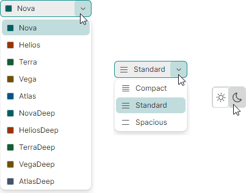
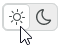

# IAppearanceService

[`IAppearanceService`](../../API/Eremex.AvaloniaUI.Controls.ApplicationServices/IAppearanceService.md) provides a platform-agnostic way to access the appearance choices supported by the [DeltaDesign theme](../themes/index.md) and apply the chosen one. It allows your ViewModel to change the theme variant, color palette, and UI density at runtime without referencing any UI framework type directly.




Main features:

- Theme variants — Provides access to available theme variants (`Light` and `Dark`) and allows you to apply a specific variant.
- Color palettes — Provides access to the [color palettes](../themes/index.md#color-palettes-for-deltadesign-theme) shipped with the `DeltaDesign` theme (`Nova`, `Helios`, `Terra`, `Vega`, `Atlas`, and so on) and allows you to apply one of these color palettes.
- UI densities — Provides access to the [UI densities](../themes/ui-density.md) available in the `DeltaDesign` theme (`Compact`, `Standard`, and `Spacious`) and allows you to apply one of these options.
- Bindable to selectors — The service helps you create selector controls in your UI (such as a ribbon gallery, a combo box, or a menu) to let users switch theme options at runtime.

## Interface Definition

```csharp
public interface IAppearanceService : INotifyPropertyChanged
{
    // A list of available theme variants (light/dark).
    IReadOnlyList<IAppearanceOption> ThemeVariants { get; }

    // A list of available color palettes.
    IReadOnlyList<IAppearanceOption> Palettes { get; }

    // A list of available UI densities.
    IReadOnlyList<IAppearanceOption> Densities { get; }

    // Gets or sets the selected theme variant. 
    IAppearanceOption SelectedThemeVariant { get; set; }

    // Gets or sets the selected theme palette. 
    IAppearanceOption SelectedPalette { get; set; }

    // Gets or sets the selected UI density. 
    IAppearanceOption SelectedDensity { get; set; }
}
```

## IAppearanceOption

Each item in the [`ThemeVariants`](../../API/Eremex.AvaloniaUI.Controls.ApplicationServices/IAppearanceService/ThemeVariants.md), [`Palettes`](../../API/Eremex.AvaloniaUI.Controls.ApplicationServices/IAppearanceService/Palettes.md), and [`Densities`](../../API/Eremex.AvaloniaUI.Controls.ApplicationServices/IAppearanceService/Densities.md) lists implements the [`IAppearanceOption`](../../API/Eremex.AvaloniaUI.Controls.ApplicationServices/IAppearanceOption.md) interface:

```csharp
public interface IAppearanceOption
{
    // The text shown for this choice.
    string Header { get; }
}
```

Like the other service interfaces, the [`IAppearanceOption`](../../API/Eremex.AvaloniaUI.Controls.ApplicationServices/IAppearanceOption.md) interface has no references to Avalonia UI framework types. It only contains a string property that specifies the display text for the option. However, actual implementations of the [`IAppearanceOption`](../../API/Eremex.AvaloniaUI.Controls.ApplicationServices/IAppearanceOption.md) interface return richer objects, listed below:

| [`IAppearanceOption`](../../API/Eremex.AvaloniaUI.Controls.ApplicationServices/IAppearanceOption.md) Implementation | Description |
|---|---|
| [`ThemeOption`](../../API/Eremex.AvaloniaUI.Controls.ApplicationServices/ThemeOption.md) class | A light or dark theme variant. Additional properties include: <br> - [`ThemeOption.Variant`](../../API/Eremex.AvaloniaUI.Controls.ApplicationServices/ThemeOption/Variant.md) — The theme variant (`Avalonia.Styling.ThemeVariant`) applied when this option is chosen. |
| [`PaletteOption`](../../API/Eremex.AvaloniaUI.Controls.ApplicationServices/PaletteOption.md) class | A color palette.  Additional properties include: <br>- [`PaletteOption.Palette`](../../API/Eremex.AvaloniaUI.Controls.ApplicationServices/PaletteOption/Palette.md) — The palette (Nova, Helios, Terra, Vega, Atlas, etc.) applied when this option is chosen;<br> - [`PaletteOption.Accent`](../../API/Eremex.AvaloniaUI.Controls.ApplicationServices/PaletteOption/Accent.md) — A read-only brush that represents the palette's accent color. The [`PaletteOption.Accent`](../../API/Eremex.AvaloniaUI.Controls.ApplicationServices/PaletteOption/Accent.md) property helps you show a color swatch in your palette selector, so the user can preview a palette before picking it. See an example below.  |
| [`DensityOption`](../../API/Eremex.AvaloniaUI.Controls.ApplicationServices/DensityOption.md) class | A UI density. Additional properties include: <br>- [`DensityOption.Density`](../../API/Eremex.AvaloniaUI.Controls.ApplicationServices/DensityOption/Density.md) — The density (Compact, Standard, or Spacious) applied when this option is chosen. |

The [`IAppearanceService`](../../API/Eremex.AvaloniaUI.Controls.ApplicationServices/IAppearanceService.md) implementation returns these richer objects. For instance, the actual return value of [`IAppearanceService.SelectedPalette`](../../API/Eremex.AvaloniaUI.Controls.ApplicationServices/IAppearanceService/SelectedPalette.md) is a [`PaletteOption`](../../API/Eremex.AvaloniaUI.Controls.ApplicationServices/PaletteOption.md) object.

## How to Use IAppearanceService

1. In your ViewModel, expose the [`IAppearanceService`](../../API/Eremex.AvaloniaUI.Controls.ApplicationServices/IAppearanceService.md) service as a property. 
2. In your View, bind your selector controls to the members of this property.

### Access the Service

You need to access the [`IAppearanceService`](../../API/Eremex.AvaloniaUI.Controls.ApplicationServices/IAppearanceService.md) service in your ViewModel to expose it as a property.

There are two ways to access an [`IAppearanceService`](../../API/Eremex.AvaloniaUI.Controls.ApplicationServices/IAppearanceService.md) object in a ViewModel:

- Through the `Service<T>()` helper method. This is a convenient approach to obtain registered application services shipped with the Eremex Controls library.
- Through constructor injection.

#### Service<T>() Helper

Implement a helper `Service<T>()` method in your ViewModel to get a requested service using the static `ApplicationServicesContext.GetRequiredService<T>()` method.

```csharp
using Eremex.AvaloniaUI.Controls.ApplicationServices;
using CommunityToolkit.Mvvm.Input;

public partial class MyViewModel : ObservableObject
{
    // Provides access to any registered service
    protected static T Service<T>() where T : class
        => ApplicationServicesContext.GetRequiredService<T>();

    public IAppearanceService Appearance { get; } = Service<IAppearanceService>();
}
```

In the App.axaml.cs file, ensure that Eremex application services are registered using [`SimpleServiceProvider`](../../API/Eremex.AvaloniaUI.Controls.ApplicationServices/SimpleServiceProvider.md) and [`ApplicationServicesContext`](../../API/Eremex.AvaloniaUI.Controls.ApplicationServices/ApplicationServicesContext.md) as follows:

```csharp
public class App : Application
{
    public override void OnFrameworkInitializationCompleted()
    {
        RegisterApplicationServices();
        //...
    }

    static void RegisterApplicationServices()
    {
        // Register built-in services.
        var serviceProvider = new SimpleServiceProvider();
        ApplicationServicesContext.RegisterApplicationServices(serviceProvider.AddSingleton);
        ApplicationServicesContext.SetCurrent(serviceProvider);
    }
}
```

#### Constructor Injection

Implement a constructor in your ViewModel with [`IAppearanceService`](../../API/Eremex.AvaloniaUI.Controls.ApplicationServices/IAppearanceService.md) as a parameter. When you instantiate the ViewModel, pass the service object to this constructor.

```csharp
public partial class MainViewModel : ObservableObject
{
    public MainViewModel(IAppearanceService appearance)
    {
        Appearance = appearance;
    }

    public IAppearanceService Appearance { get; }
}
```

### Expose the Service from the ViewModel

Expose [`IAppearanceService`](../../API/Eremex.AvaloniaUI.Controls.ApplicationServices/IAppearanceService.md) as a public property. UI controls in the View will bind to it directly.

The following example creates an _Appearance_ property of the [`IAppearanceService`](../../API/Eremex.AvaloniaUI.Controls.ApplicationServices/IAppearanceService.md) type and initializes it using the `Service<T>` helper. 

```csharp
public partial class MainViewModel : ObservableObject
{
    public IAppearanceService Appearance { get; }

    public MainViewModel(ThemeVariant? startupThemeVariant = null)
    {
        Appearance = Service<IAppearanceService>();
        Appearance.SelectedThemeVariant = FindTheme(startupThemeVariant);
        //...
    }

    private IAppearanceOption? FindTheme(ThemeVariant? variant)
        => variant is null
            ? null
            : Appearance.ThemeVariants.FirstOrDefault(
                x => string.Equals(x.Header, variant.ToString(), StringComparison.OrdinalIgnoreCase));

    // Provides access to any registered service
    protected static T Service<T>() where T : class
        => ApplicationServicesContext.GetRequiredService<T>();
}
```

### Example - Create a Palette Selector in a View

This example creates a combo box ([`ComboBoxEditor`](../../API/Eremex.AvaloniaUI.Controls.Editors/ComboBoxEditor.md) control) that lists the available theme palettes. When an item is selected in the control's dropdown menu, the corresponding palette is applied to the application.


In this example: 

- [`ComboBoxEditor.ItemsSource`](../../API/Eremex.AvaloniaUI.Controls.Editors/ComboBoxEditor/ItemsSource.md) is bound to `Appearance.Palettes` to list all available palettes in the dropdown menu.
- [`ComboBoxEditor.EditorValue`](../../API/Eremex.AvaloniaUI.Controls.Editors/BaseEditor/EditorValue.md) is bound to `Appearance.SelectedPalette`. Picking an item in the control's dropdown applies the corresponding theme palette.
- The ComboBoxEditor's item template displays the palette's accent color as a swatch next to the palette's name (header).

```xml
<mxe:ComboBoxEditor x:Name="themePaletteComboBox"
                    ItemsSource="{Binding Appearance.Palettes}"
                    EditorValue="{Binding Appearance.SelectedPalette}"
                    IsTextEditable="False"
                    ApplyItemTemplateToEditBox="True"
                    Width="150" Margin="0,0,10,0">
    <mxe:ComboBoxEditor.ItemTemplate>
        <DataTemplate x:DataType="appsvc:PaletteOption">
            <StackPanel Orientation="Horizontal" Spacing="8">
                <Border Width="12" Height="12" CornerRadius="2" VerticalAlignment="Center"
                        Background="{Binding Accent}"
                        BorderThickness="1"
                        BorderBrush="{DynamicResource Outline/Neutral/Transparent/Medium}"/>
                <TextBlock Text="{Binding Header}" VerticalAlignment="Center"/>
            </StackPanel>
        </DataTemplate>
    </mxe:ComboBoxEditor.ItemTemplate>
</mxe:ComboBoxEditor>
```

See the complete code in the [Controls Demo](../../index.md#demo-application) application.

### Example - Create a Density Selector

This example creates a combo box ([`ComboBoxEditor`](../../API/Eremex.AvaloniaUI.Controls.Editors/ComboBoxEditor.md) control) populated with UI density options. When a user selects an item, the corresponding layout is automatically applied.


To show custom images for density values in the combo box, this example populates the control with items directly from the `Eremex.AvaloniaUI.Themes.DeltaDesign.Density` enumeration. The images are provided using a custom `NameToImageConverter` converter and displayed using the [`ComboBoxEditor.ItemTemplate`](../../API/Eremex.AvaloniaUI.Controls.Editors/ComboBoxEditor/ItemTemplate.md) property.

```xml
<mxe:ComboBoxEditor x:Name="densityComboBox"
                    ItemsSource="{mxc:EnumItemsSource EnumType=ddt:Density, ShowImages=True,
                                  NameToImageConverter={views:DensityToIconConverter}}"
                    EditorValueChanged="DensityComboBoxEditor_EditorValueChanged"
                    IsTextEditable="False"
                    Margin="0,0,10,0">
    <mxe:ComboBoxEditor.ItemTemplate>
        <DataTemplate x:DataType="mxc:EnumMemberInfo">
            <StackPanel Orientation="Horizontal" Spacing="8">
                <Image Source="{Binding Image}" Stretch="None" VerticalAlignment="Center"/>
                <TextBlock Text="{Binding Name}" VerticalAlignment="Center"/>
            </StackPanel>
        </DataTemplate>
    </mxe:ComboBoxEditor.ItemTemplate>
</mxe:ComboBoxEditor>
```

See the complete code in the [Controls Demo](../../index.md#demo-application) application.


### Example - Create a Theme Variant Selector

The following code shows how to build a theme variant selector using [`SegmentedEditor`](../../API/Eremex.AvaloniaUI.Controls.Editors/SegmentedEditor.md).

In this example:

- [`SegmentedEditor.ItemsSource`](../../API/Eremex.AvaloniaUI.Controls.Editors/SegmentedEditor/ItemsSource.md) is bound to the `ThemeOptions` list defined in a View Model. `ThemeOptions` returns a list of available theme options (`Light` and `Dark`), excluding the default variant (`ThemeVariant.Default`).
- [`SegmentedEditor.EditorValue`](../../API/Eremex.AvaloniaUI.Controls.Editors/BaseEditor/EditorValue.md) is bound to `Appearance.SelectedThemeVariant`. This binding statement applies a corresponding theme variant when the [`SegmentedEditor`](../../API/Eremex.AvaloniaUI.Controls.Editors/SegmentedEditor.md)'s item is selected.
- The [`SegmentedEditor.ItemTemplate`](../../API/Eremex.AvaloniaUI.Controls.Editors/SegmentedEditor/ItemTemplate.md) property is set to an item template that displays each option as a `PathIcon`.



``` xml
<mxe:SegmentedEditor ItemsSource="{Binding ThemeOptions}" Width="56"
                     EditorValue="{Binding Appearance.SelectedThemeVariant}">
    <mxe:SegmentedEditor.ItemTemplate>
        <DataTemplate x:DataType="appsvc:ThemeOption">
            <PathIcon Width="16" Height="16" Foreground="{DynamicResource Text/Neutral/Secondary}"
                      ToolTip.Tip="{Binding Header}">
                <PathIcon.Data>
                    <MultiBinding Converter="{views:ThemeVariantToIconDataConverter}">
                        <Binding Path="Variant"/>
                        <DynamicResourceExtension ResourceKey="SunPath"/>
                        <DynamicResourceExtension ResourceKey="MoonPath"/>
                    </MultiBinding>
                </PathIcon.Data>
            </PathIcon>
        </DataTemplate>
    </mxe:SegmentedEditor.ItemTemplate>
</mxe:SegmentedEditor>
```

``` cs
class MainViewModel 
{
    public IAppearanceService Appearance { get; }

    public IReadOnlyList<IAppearanceOption> ThemeOptions =>
        Appearance.ThemeVariants.Where(x => x is ThemeOption { Variant: not null } option
                                    && option.Variant != ThemeVariant.Default).ToList();
}
```

See the complete code in the [Controls Demo](../../index.md#demo-application) application.


### Change Theme Settings in Code

Use the [`SelectedThemeVariant`](../../API/Eremex.AvaloniaUI.Controls.ApplicationServices/IAppearanceService/SelectedThemeVariant.md), [`SelectedPalette`](../../API/Eremex.AvaloniaUI.Controls.ApplicationServices/IAppearanceService/SelectedPalette.md), and [`SelectedDensity`](../../API/Eremex.AvaloniaUI.Controls.ApplicationServices/IAppearanceService/SelectedDensity.md) properties to change theme settings in code. 

```csharp
public IAppearanceService Appearance { get; } = Service<IAppearanceService>();

public void ChangeThemeSettings() 
{
    // Apply the 'Terra' palette.
    Appearance.SelectedPalette = Appearance.Palettes.First(p => p.Header == "Terra");  
    
    Appearance.SelectedDensity = Appearance.Densities[0]; // Switch to the most compact density.

    Appearance.SelectedThemeVariant = Appearance.ThemeVariants[0]; // Switch to the default theme variant.
}
```

