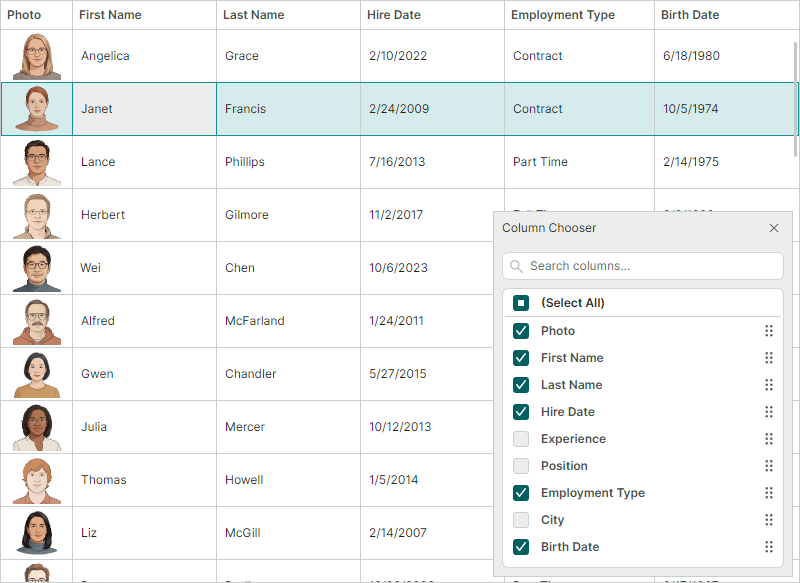
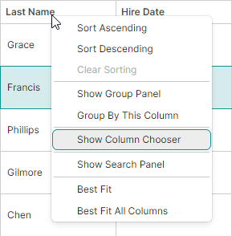
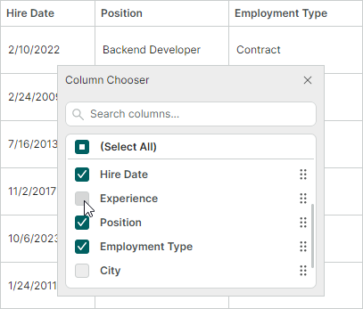
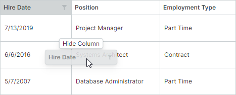
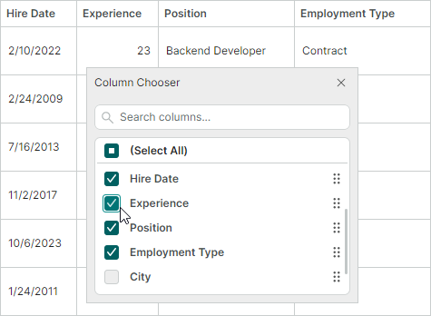
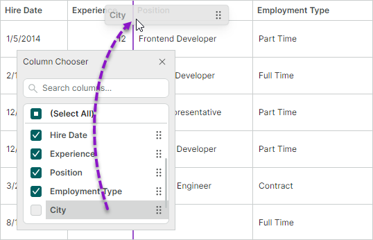
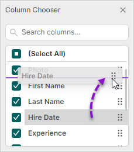
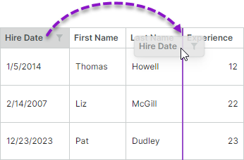

# Column Chooser

The Column Chooser is a window that provides access to all grid columns (both hidden and currently visible). 

The features of the Column Chooser include:

- Hide columns or make them visible using built-in check boxes. 
- Reorder columns by dragging column headers directly within the Column Chooser.
- Built-in search for columns by name.

## Show and Hide the Column Chooser

A user can invoke the Column Chooser by right-clicking within the grid's column header panel and selecting **Show Column Chooser**.

To hide the Column Chooser, click the window's **Close** (x) button, or right-click within the grid's column header panel and select **Hide Column Chooser**.

**Related API:**

- [`DataControlBase.ShowColumnChooser`](../../API/Eremex.AvaloniaUI.Controls.DataControl/DataControlBase/ShowColumnChooser.md) method — Displays the Column Chooser.
- [`DataControlBase.HideColumnChooser`](../../API/Eremex.AvaloniaUI.Controls.DataControl/DataControlBase/HideColumnChooser.md) method — Hides the Column Chooser.
- [`DataControlBase.IsColumnChooserVisible`](../../API/Eremex.AvaloniaUI.Controls.DataControl/DataControlBase/IsColumnChooserVisible.md) property — Gets or sets whether the Column Chooser is visible.

## Hide a Column

Users can hide a column in one of the following ways:

- In the Column Chooser, uncheck the check box for the column.

    

- In the Data Grid, drag a column header outside the header panel and release it when the **Hide Column** tooltip appears.

    

**Related API:**

- [`ColumnBase.VisibleIndex`](../../API/Eremex.AvaloniaUI.Controls.DataControl/ColumnBase/VisibleIndex.md) — Gets or sets the column's visual position. To hide the column, set this property to `-1`.
- [`ColumnBase.IsVisible`](../../API/Eremex.AvaloniaUI.Controls.DataControl/ColumnBase/IsVisible.md) — Gets or sets the column's visibility state. To hide the column, set this property to `false`.

## Show a Column

Users can show a hidden column in one of the following ways:

- Check the check box for the column in the Column Chooser.

    

- Drag a column header from the Column Chooser onto the data grid's column header panel.

    

**Related API:**

- [`ColumnBase.VisibleIndex`](../../API/Eremex.AvaloniaUI.Controls.DataControl/ColumnBase/VisibleIndex.md) — Gets or sets the column's visual position. To show the column, set this property to a non-negative value.
- [`ColumnBase.IsVisible`](../../API/Eremex.AvaloniaUI.Controls.DataControl/ColumnBase/IsVisible.md) — Gets or sets the column's visibility state. To show the column, set this property to `true`.

## Reorder Columns

Users can reorder columns in one of the following ways:

- Click a column header within the Column Chooser and drag it to the required position. The order of column headers in the Column Chooser is in sync with the order of columns in the Data Grid.

    

- Drag a column header within the data grid's column header panel.

    

**Related API:**

- [`ColumnBase.VisibleIndex`](../../API/Eremex.AvaloniaUI.Controls.DataControl/ColumnBase/VisibleIndex.md) — Gets or sets the column's visual position.

## Hide Columns From the Column Chooser

- [`ColumnBase.ShowInColumnChooser`](../../API/Eremex.AvaloniaUI.Controls.DataControl/ColumnBase/ShowInColumnChooser.md) — Allows you to prevent specific columns from being displayed in the Column Chooser.

## Set a Custom Column Header for the Column Chooser

[`ColumnBase.ColumnChooserHeader`](../../API/Eremex.AvaloniaUI.Controls.DataControl/ColumnBase/ColumnChooserHeader.md) —  Get or set a custom content for the column header displayed in the Column Chooser.