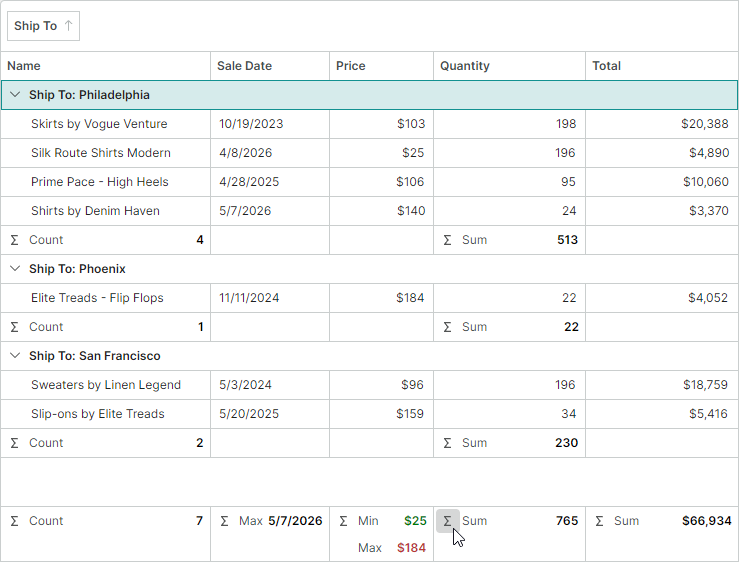
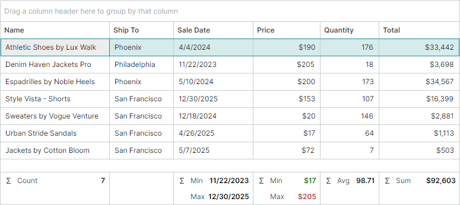
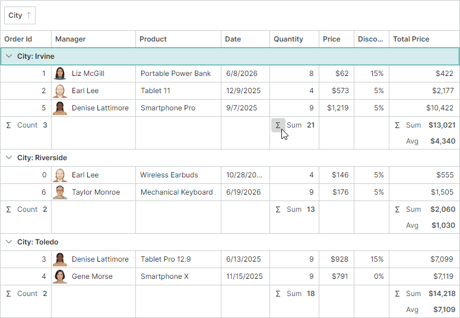
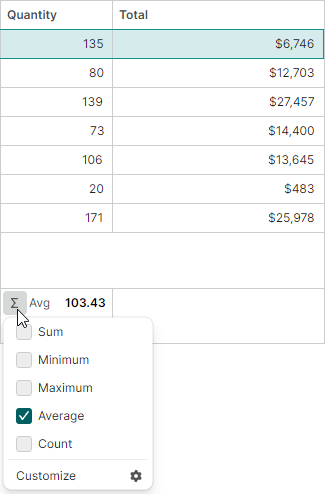
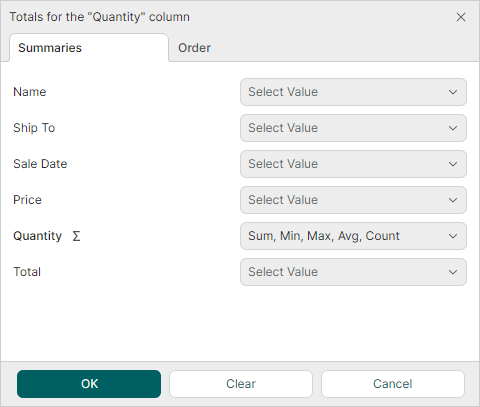
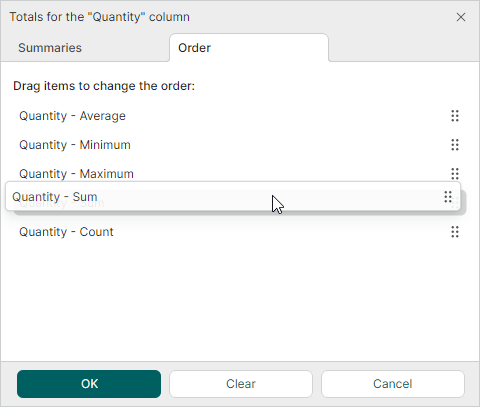
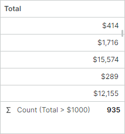
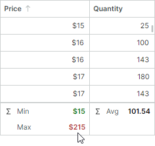

# Summaries

The [`DataGridControl`](../../API/Eremex.AvaloniaUI.Controls.DataGrid/DataGridControl.md) allows you to calculate summaries (aggregate functions) across cell values. It supports two summary types:

- Total summaries, calculated across all rows.
- Group summaries, calculated across specific groups of rows when data grouping is applied.




The main summary calculation features include:

- Built-in summary functions: Sum, Min, Max, Count, and Average.
- Runtime management — Users can click the Σ button in the footer cell to add summaries or invoke the Summary Editor dialog for advanced summary operations.
- Multiple summaries per column — Each column can display multiple summaries calculated across that column's values.
- Cross-column summaries — You can calculate a summary against one column and display it in another.
- Custom summaries — You can handle the [`CustomSummary`](../../API/Eremex.AvaloniaUI.Controls.DataGrid/DataGridControl/CustomSummary.md) event to calculate a custom aggregate function according to your logic.
- Including summaries in XLSX and PDF exports.

## Total Summaries

Total summaries are calculated across all rows and shown in the control's footer.



### Enable Total Summaries

Set the [`ShowTotalSummaries`](../../API/Eremex.AvaloniaUI.Controls.DataGrid/DataGridControl/ShowTotalSummaries.md) property to `true` to display the summary footer and enable total summary calculation. The summary footer is positioned at the bottom of the [`DataGridControl`](../../API/Eremex.AvaloniaUI.Controls.DataGrid/DataGridControl.md), below all rows. Initially, this footer is hidden.

```xml
<mxdg:DataGridControl x:Name="dataGrid" ShowTotalSummaries="True">...</mxdg:DataGridControl>
```

The summary footer contains summary cells for all columns. If [user summary customization](#user-summary-customizations) is enabled (default), the summary cells contain the `Σ` button used to show a summary menu and the summary editor.


**Related API**

- [`ShowTotalSummaries`](../../API/Eremex.AvaloniaUI.Controls.DataGrid/DataGridControl/ShowTotalSummaries.md) — Gets or sets whether the total summary footer is displayed and total summary calculation is enabled.
- [`TotalSummaryPanelMinHeight`](../../API/Eremex.AvaloniaUI.Controls.DataGrid/DataGridControl/TotalSummaryPanelMinHeight.md) — Gets or sets the minimum height of the total summary footer.

### Define Total Summaries

Use the [`TotalSummaries`](../../API/Eremex.AvaloniaUI.Controls.DataGrid/DataGridControl/TotalSummaries.md) collection to define total summaries. Items in this collection are instances of the [`SummaryItem`](../../API/Eremex.AvaloniaUI.Controls.DataControl/SummaryItem.md) class. Each [`SummaryItem`](../../API/Eremex.AvaloniaUI.Controls.DataControl/SummaryItem.md) object specifies the field to summarize, the summary type, the column in which to display the result, and other settings.

```xml
xmlns:mxdc="clr-namespace:Eremex.AvaloniaUI.Controls.DataControl;assembly=Eremex.Avalonia.Controls"

<mxdg:DataGridControl x:Name="dataGrid" ShowTotalSummaries="True">
    <mxdg:DataGridControl.TotalSummaries>
        <mxdc:SummaryItem FieldName="Name" SummaryType="Count" />
        <mxdc:SummaryItem FieldName="SaleDate" SummaryType="Min" ShowInColumn="Total" />
        <mxdc:SummaryItem FieldName="SaleDate" SummaryType="Max" ShowInColumn="Total" />
        <mxdc:SummaryItem FieldName="Price" SummaryType="Min" />
        <mxdc:SummaryItem FieldName="Price" SummaryType="Max" />
        <mxdc:SummaryItem FieldName="Quantity" SummaryType="Average" />
        <mxdc:SummaryItem FieldName="Total" SummaryType="Sum" />
    </mxdg:DataGridControl.TotalSummaries>
</mxdg:DataGridControl>
```

**Related API**

- [`TotalSummaries`](../../API/Eremex.AvaloniaUI.Controls.DataGrid/DataGridControl/TotalSummaries.md) — Provides access to the collection of summary items ([`SummaryItem`](../../API/Eremex.AvaloniaUI.Controls.DataControl/SummaryItem.md) objects) that define total summaries.
- [`SummaryItem.FieldName`](../../API/Eremex.AvaloniaUI.Controls.DataControl/SummaryItem/FieldName.md) — Gets or sets the name of the data field whose values are used to calculate the summary.
- [`SummaryItem.Name`](../../API/Eremex.AvaloniaUI.Controls.DataControl/SummaryItem/Name.md) — Gets or sets the summary item's name, used to identify it. You can retrieve summary items by name from the [`TotalSummaries`](../../API/Eremex.AvaloniaUI.Controls.DataGrid/DataGridControl/TotalSummaries.md) collection.
- [`SummaryItem.Tag`](../../API/Eremex.AvaloniaUI.Controls.DataControl/SummaryItem/Tag.md) — Gets or sets custom data associated with this SummaryItem.
- [`SummaryItem.ShowInColumn`](../../API/Eremex.AvaloniaUI.Controls.DataControl/SummaryItem/ShowInColumn.md) — Gets or sets the field name of the column that displays the summary value. If this property is not set, the summary is displayed in the column bound to `FieldName`.
- [`SummaryItem.SummaryType`](../../API/Eremex.AvaloniaUI.Controls.DataControl/SummaryItem/SummaryType.md) — Gets or sets the type of the aggregate function (`Sum`, `Min`, `Max`, `Count`, or `Average`).
- [`SummaryItem.Label`](../../API/Eremex.AvaloniaUI.Controls.DataControl/SummaryItem/Label.md) — Gets or sets a custom label to display instead of the default summary label. The default summary label displays the name of the summary function. If the summary is displayed in another column (see [`ShowInColumn`](../../API/Eremex.AvaloniaUI.Controls.DataControl/SummaryItem/ShowInColumn.md)), the summary label also displays the caption of the column bound to [`SummaryItem.FieldName`](../../API/Eremex.AvaloniaUI.Controls.DataControl/SummaryItem/FieldName.md).

    

## Group Summaries

Group summaries allow you to calculate aggregate functions across groups of rows when data is grouped by columns. Group summaries are displayed in group footers.



### Enable Group Summaries

Set the [`ShowGroupSummaries`](../../API/Eremex.AvaloniaUI.Controls.DataGrid/DataGridControl/ShowGroupSummaries.md) property to `true` to display group summary footers (initially, they are hidden) and enable group summary calculation. Group summary footers are displayed below all groups of rows. Each grouping level contains its own footer.

```xml
<mxdg:DataGridControl x:Name="dataGrid" ShowGroupSummaries="True">...</mxdg:DataGridControl>
```

**Related API**

- [`ShowGroupSummaries`](../../API/Eremex.AvaloniaUI.Controls.DataGrid/DataGridControl/ShowGroupSummaries.md) — Gets or sets whether group footers that display group summaries are displayed.
- [`GroupSummaryRowMinHeight`](../../API/Eremex.AvaloniaUI.Controls.DataGrid/DataGridControl/GroupSummaryRowMinHeight.md) — Gets or sets the minimum height of group footers.

### Define Group Summaries

Use the [`GroupSummaries`](../../API/Eremex.AvaloniaUI.Controls.DataGrid/DataGridControl/GroupSummaries.md) collection to define group summaries. As with the [`TotalSummaries`](../../API/Eremex.AvaloniaUI.Controls.DataGrid/DataGridControl/TotalSummaries.md) collection, items in the [`GroupSummaries`](../../API/Eremex.AvaloniaUI.Controls.DataGrid/DataGridControl/GroupSummaries.md) collection are instances of the [`SummaryItem`](../../API/Eremex.AvaloniaUI.Controls.DataControl/SummaryItem.md) class. Each [`SummaryItem`](../../API/Eremex.AvaloniaUI.Controls.DataControl/SummaryItem.md) object specifies the field to summarize, the summary type, the column in which to display the result, and other settings.

```xml
<mxdg:DataGridControl x:Name="dataGrid" ShowGroupSummaries="True">
    <mxdg:DataGridControl.GroupSummaries>
        <mxdc:SummaryItem FieldName="OrderId" SummaryType="Count" />
        <mxdc:SummaryItem FieldName="Quantity" SummaryType="Sum" />
        <mxdc:SummaryItem FieldName="TotalPrice" SummaryType="Sum" />
        <mxdc:SummaryItem FieldName="TotalPrice" SummaryType="Average" />
    </mxdg:DataGridControl.GroupSummaries>
</mxdg:DataGridControl>
```

**Related API**

- [`GroupSummaries`](../../API/Eremex.AvaloniaUI.Controls.DataGrid/DataGridControl/GroupSummaries.md) — Provides access to the collection of summary items ([`SummaryItem`](../../API/Eremex.AvaloniaUI.Controls.DataControl/SummaryItem.md) objects) that define group summaries.
- [`SummaryItem.FieldName`](../../API/Eremex.AvaloniaUI.Controls.DataControl/SummaryItem/FieldName.md) — Gets or sets the name of the data field whose values are used to calculate the summary.
- [`SummaryItem.Name`](../../API/Eremex.AvaloniaUI.Controls.DataControl/SummaryItem/Name.md) — Gets or sets the summary item's name, used to identify it. You can retrieve summary items by name from the [`GroupSummaries`](../../API/Eremex.AvaloniaUI.Controls.DataGrid/DataGridControl/TotalSummaries.md) collection.
- [`SummaryItem.Tag`](../../API/Eremex.AvaloniaUI.Controls.DataControl/SummaryItem/Tag.md) — Gets or sets custom data associated with this SummaryItem.
- [`SummaryItem.ShowInColumn`](../../API/Eremex.AvaloniaUI.Controls.DataControl/SummaryItem/ShowInColumn.md) — Gets or sets the field name of the column that displays the summary value. If this property is not set, the summary is displayed in the column bound to `FieldName`.
- [`SummaryItem.SummaryType`](../../API/Eremex.AvaloniaUI.Controls.DataControl/SummaryItem/SummaryType.md) — Gets or sets the type of the aggregate function (`Sum`, `Min`, `Max`, `Count`, or `Average`).
- [`SummaryItem.Label`](../../API/Eremex.AvaloniaUI.Controls.DataControl/SummaryItem/Label.md) — Gets or sets a custom label to display instead of the default summary label. The default summary label displays the name of the summary function. If the summary is displayed in another column (see [`ShowInColumn`](../../API/Eremex.AvaloniaUI.Controls.DataControl/SummaryItem/ShowInColumn.md)), the summary label also displays the caption of the column bound to [`SummaryItem.FieldName`](../../API/Eremex.AvaloniaUI.Controls.DataControl/SummaryItem/FieldName.md).


## User Summary Customizations

The control allows users to edit summaries at runtime by default. In this mode, summary cells display the `Σ` button, used to invoke the summary menu:



Users can use this menu to:

- Add or remove summaries by toggling checkboxes next to summary functions.

    

- Select `Customize` to invoke the `Summary Editor` dialog. 

    

    In this dialog's `Summaries` tab, users can create cross-column summaries (summaries calculated for one column, but shown in another column).
    
    The `Order` tab allows users to change the display order of the existing summaries.

    


**Related API**

- [`AllowEditingTotalSummaries`](../../API/Eremex.AvaloniaUI.Controls.DataGrid/DataGridControl/AllowEditingTotalSummaries.md) — Gets or sets whether users can edit total summaries.
- [`AllowEditingGroupSummaries`](../../API/Eremex.AvaloniaUI.Controls.DataGrid/DataGridControl/AllowEditingGroupSummaries.md) — Gets or sets whether users can edit group summaries.

These properties only affect user capabilities to modify summaries and do not impact summary calculations performed in code.

## Custom Summaries

Custom summaries allow you to calculate aggregate values using your own logic. You can define custom total summaries and custom group summaries.

To add a custom summary, do the following:

- Create a [`SummaryItem`](../../API/Eremex.AvaloniaUI.Controls.DataControl/SummaryItem.md) object and set its [`SummaryItem.SummaryType`](../../API/Eremex.AvaloniaUI.Controls.DataControl/SummaryItem/SummaryType.md) property to `Custom`. 

    - To calculate a custom total summary, add this [`SummaryItem`](../../API/Eremex.AvaloniaUI.Controls.DataControl/SummaryItem.md) to the [`TotalSummaries`](../../API/Eremex.AvaloniaUI.Controls.DataGrid/DataGridControl/TotalSummaries.md) collection. 
    - To calculate a custom group summary, add this [`SummaryItem`](../../API/Eremex.AvaloniaUI.Controls.DataControl/SummaryItem.md) to the [`GroupSummaries`](../../API/Eremex.AvaloniaUI.Controls.DataGrid/DataGridControl/GroupSummaries.md) collection.

- Handle the [`CustomSummary`](../../API/Eremex.AvaloniaUI.Controls.DataGrid/DataGridControl/CustomSummary.md) event to manually calculate a value for this [`SummaryItem`](../../API/Eremex.AvaloniaUI.Controls.DataControl/SummaryItem.md). 

    Set the `e.SummaryValue` event parameter to supply your custom result.

    While handling the [`CustomSummary`](../../API/Eremex.AvaloniaUI.Controls.DataGrid/DataGridControl/CustomSummary.md) event, use the `e.RowIndexes` collection to iterate through target rows. Items in this collection specify [indexes](rows.md#identify-and-get-rows) of rows across which to calculate the custom summary. When calculating a custom total summary, the indexes refer to all DataGrid rows. When calculating a custom group summary, the [`CustomSummary`](../../API/Eremex.AvaloniaUI.Controls.DataGrid/DataGridControl/CustomSummary.md) event is raised for each group of rows, and indexes in the `e.RowIndexes` collection refer to rows within each group.
    
    !!! Tip 
        
        Row indexes allow you to address rows when using the DataGrid's row-wise API (for instance, [`DataGridControl.GetCellValue`](../../API/Eremex.AvaloniaUI.Controls.DataGrid/DataGridControl/GetCellValue.md))

    When the [`CustomSummary`](../../API/Eremex.AvaloniaUI.Controls.DataGrid/DataGridControl/CustomSummary.md) event is raised for a group summary, the event's [`IsGroupSummary`](../../API/Eremex.AvaloniaUI.Controls.DataGrid/DataGridCustomSummaryEventArgs/IsGroupSummary.md) parameter returns `true` and the [`GroupRowIndex`](../../API/Eremex.AvaloniaUI.Controls.DataGrid/DataGridCustomSummaryEventArgs/GroupRowIndex.md) parameter specifies the [index](rows.md#identify-and-get-rows) of the group row being processed.


### Example - Calculate a custom total summary

The following example creates a custom total summary that calculates the number of orders that exceed the $1000 amount.




```xml
<!-- XAML -->
<mxdg:DataGridControl x:Name="dataGrid" CustomSummary="OnCustomSummary">
    <mxdg:DataGridControl.TotalSummaries>
        <mxdc:SummaryItem FieldName="Total" SummaryType="Custom" Label="Count (Total > $1000)" />
    </mxdg:DataGridControl.TotalSummaries>
</mxdg:DataGridControl>
```

```csharp
// Code-behind
void OnCustomSummary(object sender, DataGridCustomSummaryEventArgs e)
{
    int largeOrdersCount = 0;
    foreach (int rowIndex in e.RowIndexes)
    {
        if ((decimal)dataGrid.GetCellValue(rowIndex, e.SummaryItem.FieldName) > 1000m)
            largeOrdersCount++;
    }
    e.SummaryValue = largeOrdersCount.ToString();
}
```

**Related API**

- [`CustomSummary`](../../API/Eremex.AvaloniaUI.Controls.DataGrid/DataGridControl/CustomSummary.md) — Occurs when a summary value is calculated. Use the [`SummaryValue`](../../API/Eremex.AvaloniaUI.Controls.DataGrid/DataGridCustomSummaryEventArgs/SummaryValue.md) event parameter to supply a custom summary value.


## Get Summary Values

You can retrieve calculated summary values in code using the following methods:

- [`DataGridControl.GetTotalSummaryValue`](../../API/Eremex.AvaloniaUI.Controls.DataGrid/DataGridControl/GetTotalSummaryValue.md) — Returns the calculated value of a total summary.
- [`DataGridControl.GetGroupSummaryValue`](../../API/Eremex.AvaloniaUI.Controls.DataGrid/DataGridControl/GetGroupSummaryValue.md) — Returns the calculated value of a group summary for a specific group row. The `rowIndex` parameter identifies the index of a target group row whose child rows are used to calculate a summary.

```csharp
object? totalValue = dataGrid.GetTotalSummaryValue(summaryItem);

// Get a summary value for the first group of rows
int rowIndex = -1; // Address the first group row.
object? groupValue = dataGrid.GetGroupSummaryValue(rowIndex, summaryItem);
```

## Style Summary Items

The DataGrid control allows you to customize the appearance of summary items. To do this, style the dedicated visual control used to paint DataGrid summary items.

### Target Visual Control Class

`Eremex.AvaloniaUI.Controls.DataControl.Visuals.FooterCellItemControl`

Each `FooterCellItemControl` has a `FooterCellItem` object as its DataContext.

### DataContext

`Eremex.AvaloniaUI.Controls.DataControl.Visuals.FooterCellItem`

The `FooterCellItem` class definition is shown below for your reference. When creating custom style setters and converters, you can bind to the summary's properties (`FooterCellItem.FieldName`, `FooterCellItem.SummaryType`, `FooterCellItem.Value`, `FooterCellItem.Label`, and `FooterCellItem.DisplayValue`). See [an example](#example-style-summary-items).

```csharp
/// <summary>Represents a summary value displayed in a footer cell.</summary>
public partial class FooterCellItem : ViewModelBase
{
	/// <summary>Gets or sets the summary item's label.</summary>
	[ObservableProperty] string label = string.Empty;

	/// <summary>Gets or sets the formatted summary value displayed in the footer cell.</summary>
	[ObservableProperty] string displayValue = string.Empty;

	/// <summary>Gets or sets the type of the aggregate function the summary calculates.</summary>
	public SummaryItemType SummaryType { get; set; } = SummaryItemType.None;

	/// <summary>Gets or sets the summary value.</summary>
	public object Value { get; set; }

	/// <summary>Gets or sets the name of the data field whose values the summary calculates.</summary>
	public string FieldName { get; set; }
}
```

### Default Template to Render Summary Items

The following code shows the default template used to render summary items. You can find this template in the [`DeltaDesign` paint theme sources](../themes/modify-control-themes.md#default-theme). Use the information from this template to create a style selector that addresses specific elements of a summary item. For example, the `TextBlock` named _Label_ displays the summary item's label, while the `TextBlock` named _DisplayValue_ shows the summary value:

``` xml
<!-- DeltaDesign paint theme -->
xmlns:mxdcv="clr-namespace:Eremex.AvaloniaUI.Controls.DataControl.Visuals;assembly=Eremex.Avalonia.Controls"

<ControlTheme x:Key="{x:Type mxdcv:FooterCellItemControl}" TargetType="mxdcv:FooterCellItemControl">
    <Setter Property="Background" Value="Transparent" />
    <Setter Property="Padding" Value="{DynamicResource DataControlFooterPadding}" />
    
    <Setter Property="Template">
        <ControlTemplate TargetType="mxdcv:FooterCellItemControl">
            <DockPanel Margin="{TemplateBinding Padding}" Background="{TemplateBinding Background}">
                <TextBlock x:Name="Label"
                           Text="{Binding Label}"
                           DockPanel.Dock="Left"
                           TextTrimming="CharacterEllipsis"
                           HorizontalAlignment="Left"
                           mxc:TextBlockHelper.ShowTooltipWhenTrimming="True" />
                <TextBlock Text=" "/>
                <TextBlock x:Name="DisplayValue"
                           Text="{Binding DisplayValue}"
                           DockPanel.Dock="Right"
                           FontWeight="SemiBold"
                           TextTrimming="CharacterEllipsis"
                           HorizontalAlignment="Right"
                           mxc:TextBlockHelper.ShowTooltipWhenTrimming="True" />
            </DockPanel>
        </ControlTemplate>
    </Setter>
</ControlTheme>
```

### Example - Style Summary Items

The following code modifies the colors of two summary values for the _Price_ column in the DataGrid control. The `Min` summary value is shown in green, and the `Max` summary value in red. 



The created style targets the _DisplayValue_ text block inside the `FooterCellItemControl` template and uses a custom multi-value converter to select the foreground based on the summary's properties (`FooterCellItem.FieldName` and `FooterCellItem.SummaryType`).

```xml
xmlns:mxdg="https://schemas.eremexcontrols.net/avalonia/datagrid"

xmlns:mxdcv="clr-namespace:Eremex.AvaloniaUI.Controls.DataControl.Visuals;assembly=Eremex.Avalonia.Controls"

<mxdg:DataGridControl.Styles>
    <Style Selector="mxdcv|FooterCellItemControl /template/ TextBlock#DisplayValue" x:DataType="mxdcv:FooterCellItem">
        <Setter Property="Foreground">
          <Setter.Value>
            <MultiBinding Converter="{views:DataGridSummaryTypeToForegroundConverter}">
              <Binding Path="FieldName" />
              <Binding Path="SummaryType" />
              <DynamicResourceExtension ResourceKey="Icons/Outline/Green"/>
              <DynamicResourceExtension ResourceKey="Icons/Outline/Red"/>
            </MultiBinding>
          </Setter.Value>
        </Setter>
      </Style>                
</mxdg:DataGridControl.Styles>
```

```csharp
public class DataGridSummaryTypeToForegroundConverter : MarkupExtension, IMultiValueConverter
{
    public object Convert(IList<object> values, Type targetType, object parameter, CultureInfo culture)
    {
        if (values.Count != 4)
            return null;

        if (values[0] is string fieldName && fieldName == "Price" && values[1] is SummaryItemType sumType)
        {
            if (sumType == SummaryItemType.Min)
                return values[2];
            else if (sumType == SummaryItemType.Max)
                return values[3];
        }

        return null;
    }

    public override object ProvideValue(IServiceProvider serviceProvider)
    {
        return this;
    }
}
```

See the [Demo application](../../index.md#demo-application) for complete code.