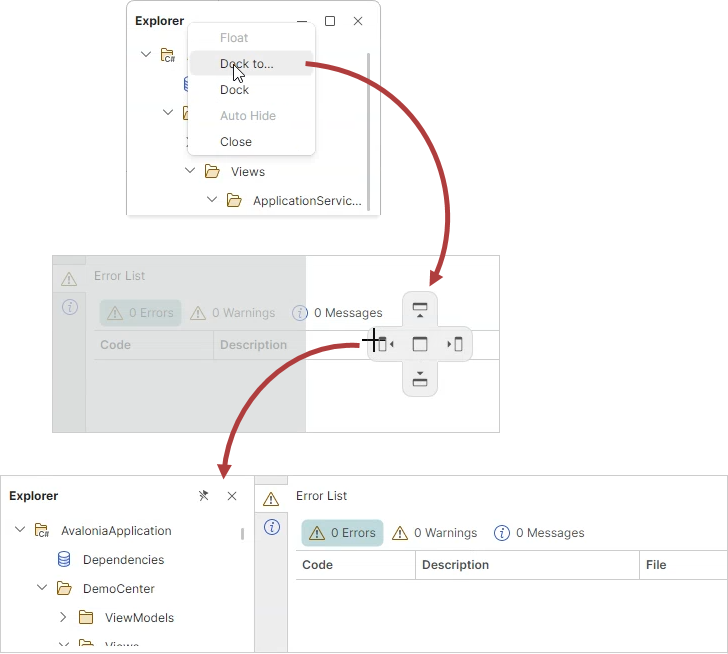

# Wayland Limitations

Native Wayland sessions on Linux prevent individual application windows from knowing or setting their own screen position. As a result, the Docking library has the following limitations:

- You can drag a floating panel to move it. However, dock guides are not displayed while dragging. A floating panel cannot be docked via drag-and-drop.

- To dock a panel, select **Dock To** in its context menu. This command displays the dock guides. Then, click a guide to dock the panel at the corresponding position.

- You cannot make a docked panel floating by dragging it. Instead, right-click the panel's header and select the **Float** command from the context menu.

