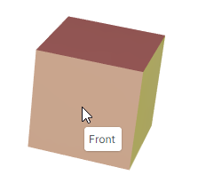
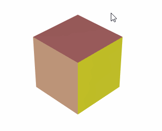
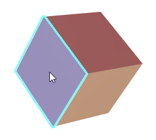
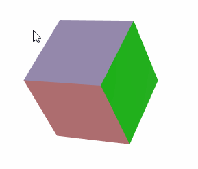
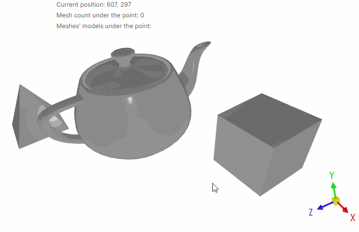

# User Interactions with 3D Models

[`Graphics3DControl`](../../API/Eremex.AvaloniaUI.Controls3D/Graphics3DControl.md) enables users to interact with 3D models. Users can rotate, zoom, and pan (move) the scene with the mouse and keyboard. Additionally, you can allow users to select elements of the model with a mouse click or highlight elements when hovering over them with the mouse. 
The [`Graphics3DControl`](../../API/Eremex.AvaloniaUI.Controls3D/Graphics3DControl.md) also supports tooltips for the models and its elements (meshes).

## Rotate the Scene

The [`Graphics3DControl`](../../API/Eremex.AvaloniaUI.Controls3D/Graphics3DControl.md) allows users to rotate the scene interactively with the mouse. Rotation is camera orbiting: the camera moves along a spherical path around a pivot point, while the models stay fixed in world space.

#### Keyboard Shortcuts

- Rotate Left — Shift+Left Arrow
- Rotate Right — Shift+Right Arrow
- Rotate Up — Shift+Up Arrow
- Rotate Down — Shift+Down Arrow


#### Mouse Operations

- Rotate — Drag the model with Left mouse button.

### Rotate Options

- [`Graphics3DControl.RotateStep`](../../API/Eremex.AvaloniaUI.Controls3D/Graphics3DControl/RotateStep.md) — Allows you to control the rotation speed. The [`RotateStep`](../../API/Eremex.AvaloniaUI.Controls3D/Graphics3DControl/RotateStep.md) property is specified in internal units. The default value is 20. A higher value results in a greater rotation speed. 

- [`Graphics3DControl.RotationMode`](../../API/Eremex.AvaloniaUI.Controls3D/Graphics3DControl/RotationMode.md) — Gets or sets the pivot around which the camera orbits when the user rotates the scene by dragging with the left mouse button. Available rotation modes include:

    - [`RotationMode.AroundCameraTarget`](../../API/Eremex.AvaloniaUI.Controls3D/RotationMode.md) (default) — The camera orbits around its target ([`Camera.Target`](../../API/Eremex.AvaloniaUI.Controls3D/Camera/Target.md)).

        The default camera target is the origin of the coordinate system _(0, 0, 0)_. The target point automatically changes when you pan (shift) the model using the [`Camera.MoveLeft`](../../API/Eremex.AvaloniaUI.Controls3D/Camera/MoveLeft.md)/[`Camera.MoveUp`](../../API/Eremex.AvaloniaUI.Controls3D/Camera/MoveUp.md) methods, and the [keyboard shortcuts and mouse gestures](#shift-the-scene).


    - [`RotationMode.AroundMouseHit`](../../API/Eremex.AvaloniaUI.Controls3D/RotationMode.md) — The camera orbits around the point of the scene that was under the mouse pointer when the rotation started.

        This mode allows a user to click on any object or surface and rotate the view around that specific spot, rather than around the camera's current target.

    

## Zoom the Scene

#### Keyboard Shortcuts

- Zoom In — CTRL+Plus Key
- Zoom Out — CTRL+Minus Key

#### Mouse Operations

- Zoom — Use Mouse Scroll Wheel to zoom in and out.

### Zoom Options

- [`Graphics3DControl.ZoomRate`](../../API/Eremex.AvaloniaUI.Controls3D/Graphics3DControl/ZoomRate.md) — Controls the speed of zoom operations performed using the keyboard and mouse wheel. The default value is 0.1. A higher value increases the zoom speed.

## Shift the Scene

#### Keyboard Shortcuts

- Move Left — CTRL+Left Arrow
- Move Right — CTRL+Right Arrow
- Move Up — CTRL+Up Arrow
- Move Down — CTRL+Down Arrow

#### Mouse Operations

- Move — Drag the model with Right mouse button.

### Move Options

- [`Graphics3DControl.KeyboardMoveStep`](../../API/Eremex.AvaloniaUI.Controls3D/Graphics3DControl/KeyboardMoveStep.md) property — Allows you to specify the distance by which a model is shifted during a single keyboard move operation.

<!-- TODO
which units ?
 -->

## Rotate, Zoom and Move Operations in Code

To view a model from a specific position and angle in code, you need to adjust the camera's position and orientation. See the following topic for more information:

- [Camera](camera.md)


## Override Keyboard Shortcuts

The [`Graphics3DControl.NavigationBindings`](../../API/Eremex.AvaloniaUI.Controls3D/Graphics3DControl/NavigationBindings.md) property of the [`Graphics3DKeyBindings`](../../API/Eremex.AvaloniaUI.Controls3D/Graphics3DKeyBindings.md) class allows you to override the default keyboard shortcuts. The [`Graphics3DKeyBindings`](../../API/Eremex.AvaloniaUI.Controls3D/Graphics3DKeyBindings.md) class contains properties that define the shortcuts for the zoom, rotate and pan operations. Initially, these properties are set to the default shortcuts, which are listed above. You can use these properties to assign custom shortcuts to the operations.

The following code assigns the CTRL+1 and CTRL+2 shortcuts to the Zoom In and Zoom Out operations.

``` cs
g3DControl.NavigationBindings = new Graphics3DKeyBindings();
Graphics3DKeyBinding zoomInShortcut = new Graphics3DKeyBinding(Avalonia.Input.KeyModifiers.Control, Avalonia.Input.Key.D1);
Graphics3DKeyBinding zoomOutShortcut = new Graphics3DKeyBinding(Avalonia.Input.KeyModifiers.Control, Avalonia.Input.Key.D2);
g3DControl.NavigationBindings.ZoomIn = zoomInShortcut;
g3DControl.NavigationBindings.ZoomOut = zoomOutShortcut;
```

## Show Hints

[`Graphics3DControl`](../../API/Eremex.AvaloniaUI.Controls3D/Graphics3DControl.md) can display hints when a user hovers over models or individual meshes. 



Use the following properties to assign hints to models, meshes, or both models and meshes at the same time:

- [`GeometryModel3D.Hint`](../../API/Eremex.AvaloniaUI.Controls3D/SelectableElement/Hint.md) — A hint for a model.
- [`MeshGeometry3D.Hint`](../../API/Eremex.AvaloniaUI.Controls3D/SelectableElement/Hint.md) — A hint for a mesh.

The following example sets hints for a model and its meshes. Hints for meshes indicate their names.

``` xml
<mx3d:GeometryModel3D x:Name="Cube" MeshesSource="{Binding Meshes}" Hint="Cube">
    <mx3d:GeometryModel3D.MeshTemplate>
        <DataTemplate x:DataType="vm:MeshViewModel">
            <mx3d:MeshGeometry3D 
                Name="{Binding Name}" 
                Hint="{Binding Name}"
                ...
            />
        </DataTemplate>
    </mx3d:GeometryModel3D.MeshTemplate>
</mx3d:GeometryModel3D>
```
``` cs
public partial class MeshViewModel : ObservableObject
{
    [ObservableProperty] string name;
    [ObservableProperty] Vertex3D[] vertices;
    //...
}
```

When hints are set for both the model and a mesh, these hints are merged into a single hint, separated by the ',' delimiter.



Set the [`Graphics3DControl.ShowHints`](../../API/Eremex.AvaloniaUI.Controls3D/Graphics3DControl/ShowHints.md) property to `false` to disable hints. This property has a default value of `true`.

## Highlight Elements

[`Graphics3DControl`](../../API/Eremex.AvaloniaUI.Controls3D/Graphics3DControl.md) supports model and mesh highlighting. With this feature, the control draws a highlight border around a model/mesh when a user hovers over it.



Use the [`Graphics3DControl.HighlightMode`](../../API/Eremex.AvaloniaUI.Controls3D/Graphics3DControl/HighlightMode.md) property to enable the highlight feature and specify highlight mode. The following options are available:

- `Mesh` — Enables highlighting of individual meshes.
- `Model` — Enables highlighting of individual models.
- `None` (default) — The highlight feature is disabled.

**Related API**

- [`Graphics3DControl.HighlightedElement`](../../API/Eremex.AvaloniaUI.Controls3D/Graphics3DControl/HighlightedElement.md) — Gets or sets the currently highlighted element.
- [`Graphics3DControl.HighlightColor`](../../API/Eremex.AvaloniaUI.Controls3D/Graphics3DControl/HighlightColor.md) — Gets or sets the color used to draw a highlight border around highlighted elements.


## Select Elements

You can enable the selection feature to allow a user to select elements (models or meshes) with a mouse click. A selection border is painted around an element when a user clicks it.



Use the [`Graphics3DControl.SelectionMode`](../../API/Eremex.AvaloniaUI.Controls3D/Graphics3DControl/SelectionMode.md) property to activate the selection feature and define selection mode. The available options include:

- `Mesh` — Enables selection of individual meshes on a mouse click.
- `Model` — Enables selection of individual models on a mouse click.
- `None` (default) — The selection feature is disabled.

**Related API**

- [`Graphics3DControl.SelectedElement`](../../API/Eremex.AvaloniaUI.Controls3D/Graphics3DControl/SelectedElement.md) — Gets or sets the currently selected element.
- [`Graphics3DControl.SelectionColor`](../../API/Eremex.AvaloniaUI.Controls3D/Graphics3DControl/SelectionColor.md) — Gets or sets the color used to draw a border around selected elements.

### Override and Respond to Selection

When a new element is about to be selected, the control fires the [`Graphics3DControl.SelectionChanging`](../../API/Eremex.AvaloniaUI.Controls3D/Graphics3DControl/SelectionChanging.md) event. This event allows you to override the default selection. 

By default, the control selects the nearest model and mesh under the clicked point. You can handle the [`Graphics3DControl.SelectionChanging`](../../API/Eremex.AvaloniaUI.Controls3D/Graphics3DControl/SelectionChanging.md) event to change this behavior:

- To select a different element, assign it to the `e.NewValue` event parameter.
- To clear the selection, set the `e.NewValue` event parameter to `null`.

To choose a different element, use the `e.HitTestResults` event parameter, which contains all hit results found by a raycast at the clicked point, ordered from nearest to farthest. The [`Graphics3DControl.CalcHitInfo`](../../API/Eremex.AvaloniaUI.Controls3D/Graphics3DControl/CalcHitInfo.md) method returns the same results for that point. For more details, see [Hit Testing](#hit-testing).

Use the `e.OldValue` event parameter to obtain the element that is currently selected. 

## Hit Testing

Hit testing allows you to determine which models and meshes in the scene lie under a given point. The [`Graphics3DControl`](../../API/Eremex.AvaloniaUI.Controls3D/Graphics3DControl.md) exposes two methods for hit testing:

- [`HitTest(Point)`](../../API/Eremex.AvaloniaUI.Controls3D/Graphics3DControl/HitTest.md) — Returns the nearest mesh under a specific point, or `null` if the point is over empty space.
- [`CalcHitInfo(Point)`](../../API/Eremex.AvaloniaUI.Controls3D/Graphics3DControl/CalcHitInfo.md) — Returns a list of meshes (across all models) under a specific point, ordered from the nearest to the farthest. The method returns an empty list if the point is over empty space.

Hit testing is implemented as a raycast. The control projects a ray from the camera through the given 2D point (specified in control-relative coordinates). It then tests this ray against the 3D scene geometry to identify intersected objects.

### Example - Hit Testing

The following code handles the Graphics3DControl's `PointerMoved` event to display:

- The current cursor position
- The number of meshes under the mouse cursor
- The [`GeometryModel3D.Hint`](../../API/Eremex.AvaloniaUI.Controls3D/SelectableElement/Hint.md) properties of the models to which these meshes belong

When multiple models are located under the mouse cursor, the meshes of all these models are included in the output.



``` cs
private void G3DControl_PointerMoved(object sender, Avalonia.Input.PointerEventArgs e)
{
    Point position = e.GetPosition(graphics3DControl1);
    label1.Content = "Current position: " + position;
    IList<RaycastHitTestResult> meshesHitInfo = graphics3DControl1.CalcHitInfo(position);
    label2.Content = "Mesh count under the point: " + meshesHitInfo.Count;
    label3.Content = "Meshes' models under the point: " + string.Join(", ", meshesHitInfo.Select(r => r.Model.Hint ?? "<null>"));
}
```


## See Also

- [Camera](camera.md)