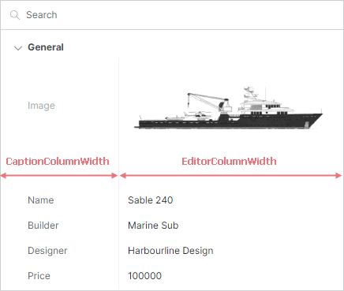
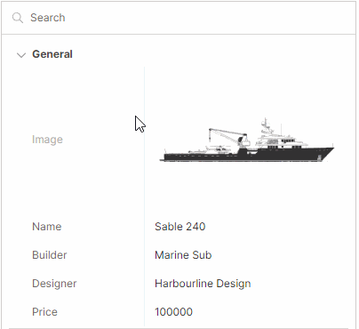

# Row Header and Cell Layout Options

The [`PropertyGridControl`](../../API/Eremex.AvaloniaUI.Controls.PropertyGrid/PropertyGridControl.md) provides several properties to control the width of the caption (header) column and the editor (cell) column, and to specify the alignment of row headers. You can fix the width of these columns, and allow users to resize them at runtime.

## Set Column Widths

Use the following properties to set the widths of PropertyGrid columns:

- [`CaptionColumnWidth`](../../API/Eremex.AvaloniaUI.Controls.PropertyGrid/PropertyGridControl/CaptionColumnWidth.md) — Gets or sets the width of the header (caption) column. Defaults to a `GridLength.Star` value.
- [`EditorColumnWidth`](../../API/Eremex.AvaloniaUI.Controls.PropertyGrid/PropertyGridControl/EditorColumnWidth.md) — Gets or sets the width of the editor (cell) column. Defaults to a `GridLength.Star` value.

    


The [`CaptionColumnWidth`](../../API/Eremex.AvaloniaUI.Controls.PropertyGrid/PropertyGridControl/CaptionColumnWidth.md) and [`EditorColumnWidth`](../../API/Eremex.AvaloniaUI.Controls.PropertyGrid/PropertyGridControl/EditorColumnWidth.md) properties accept a `GridLength` value, so you can specify an absolute pixel width, a star (proportional) width, or an auto width.

The default values of these properties are `GridLength.Star`, which means the available horizontal space is divided proportionally between the caption and editor columns.


If you use absolute (pixel) widths for both columns, ensure that their sum does not exceed the width of the control. Otherwise, the column content will be trimmed.

```csharp
propertyGridControl.Width = 300;
propertyGridControl.CaptionColumnWidth = new GridLength(100);
propertyGridControl.EditorColumnWidth = new GridLength(200);
```


## Allow Users to Resize Columns

PropertyGrid allows users to resize the caption and editor columns at runtime using the built-in resizer.



Use the [`AllowResizing`](../../API/Eremex.AvaloniaUI.Controls.PropertyGrid/PropertyGridControl/AllowResizing.md) property to control whether the resizer is enabled. The property's default value is `true`.


## Align Caption Text

Use the [`CaptionHorizontalAlignment`](../../API/Eremex.AvaloniaUI.Controls.PropertyGrid/PropertyGridControl/CaptionHorizontalAlignment.md) property to specify the horizontal alignment of the text within the caption column. The following text alignment modes are supported: `Left`, `Center` and `Right`.

```csharp
propertyGridControl.CaptionHorizontalAlignment = HorizontalAlignment.Center;
```
