# Themes

In Avalonia UI, paint themes define appearance settings, resources and templates for controls. The Eremex Controls library includes the following paint themes to render the controls shipped with the library:

<table >
  <thead>
    <tr>
      <th style="visibility: visible;">Paint&nbsp;Theme</th>
      <th style="visibility: visible;">Description</th>
      <th style="visibility: visible;">Package</th>
    </tr>
  </thead>
  <tbody>
    <tr>
      <td><code>DeltaDesign</code></td>
      <td>Contains visual settings for the Eremex Controls (except <a href="../../API/Eremex.AvaloniaUI.Controls3D/Graphics3DControl.md"><code>Graphics3DControl</code></a>) and a set of standard Avalonia UI controls.</td>
      <td><code>Eremex.Avalonia.Themes.DeltaDesign</code> package</td>
    </tr>
    <tr>
      <td><code>Controls3D</code></td>
      <td>Contains visual settings for the <a href="../../API/Eremex.AvaloniaUI.Controls3D/Graphics3DControl.md"><code>Graphics3DControl</code></a>.</td>
      <td><code>Eremex.Avalonia.Controls3D</code> package</td>
    </tr>
  </tbody>
</table>


You must [add and register](register-an-eremex-paint-theme.md) an appropriate theme(s) for the Eremex controls to render correctly. Without a corresponding theme, controls will appear blank.

## Light and Dark Theme Variants

Eremex paint themes support Light and Dark theme variants:

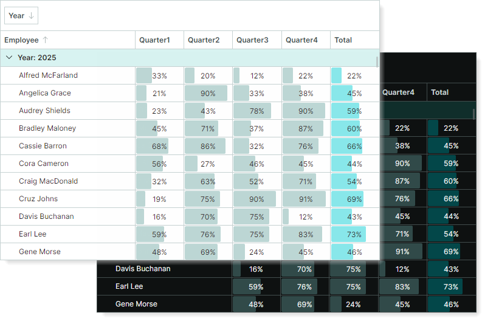

To specify the required theme variant, set the `Application.RequestedThemeVariant` property (for instance, in the _App.axaml_ file).

``` xml
<Application 
    RequestedThemeVariant="Default" ... >
    <!-- "Default" - The application's theme is defined by the system setting. 
         "Light" - Enables the Light theme.
         "Dark" - Enables the Dark theme. 
    -->
</Application>
```

## Color Palettes for DeltaDesign Theme

The `DeltaDesign` theme provides multiple color palettes that allow you to fine-tune the appearance of Eremex Controls in your application. A color palette applies a set of colors on top of the base theme to adjust control styling and accent colors.

Applying a palette dynamically updates the color values of key UI elements, including:

- Window, panel, and container backgrounds
- Editor backgrounds across various states (normal, hovered, and focused)
- Row and cell backgrounds in data-aware controls
- Selection highlights, hot-tracked elements, and focused control accents

Available palettes are exposed by the `Eremex.AvaloniaUI.Themes.DeltaDesign.Palette` enumeration. They include:

<style>

th {
    visibility: collapse;
}
td, th, tr {
   border: none!important;
   vertical-align: top;
}
</style>


| <div style="width:400px"></div> | <div style="width:400px"></div> |
|---|---|
| **Nova** (default)<br>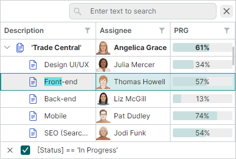 | **NovaDeep**<br>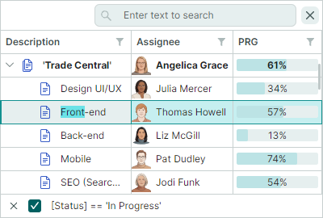 |
| **Helios**<br>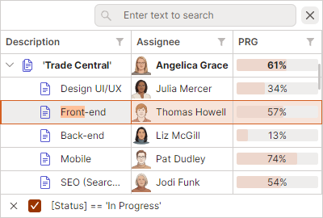 | **HeliosDeep**<br>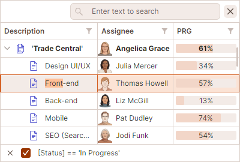 |
| **Terra**<br>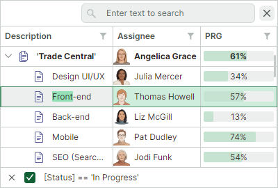 | **TerraDeep**<br>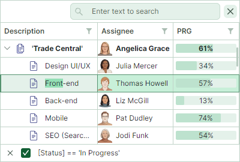 |
| **Vega**<br>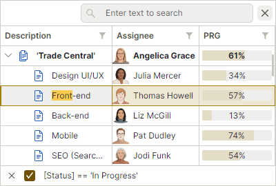 | **VegaDeep**<br>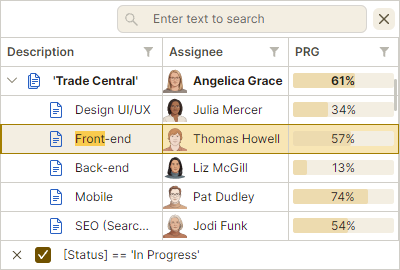 |
| **Atlas**<br>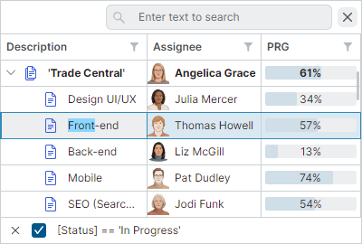 | **AtlasDeep**<br>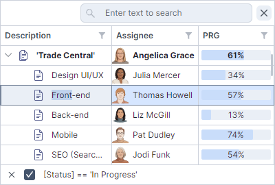 |


Color palettes are supported for both Light and Dark theme variants. 

| <div style="width:400px"></div> | <div style="width:400px"></div> |
|---|---|
| **Helios** (Light)<br>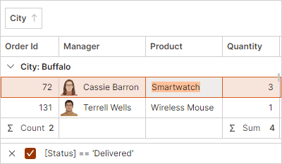 | **Helios** (Dark)<br>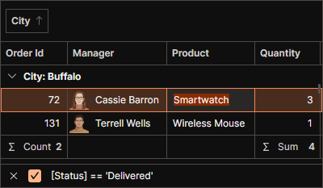 |


### Apply a Palette

To change the color palette, set the `DeltaDesignTheme.Palette` property to an appropriate value from the `Eremex.AvaloniaUI.Themes.DeltaDesign.Palette` enumeration.

The following example sets the palette when [registering](register-an-eremex-paint-theme.md) the `DeltaDesign` theme in your _App.axaml_ file:

``` xml
<Application xmlns="https://github.com/avaloniaui"
             xmlns:x="http://schemas.microsoft.com/winfx/2006/xaml"
             xmlns:local="using:DemoCenter"
             x:Class="DemoCenter.App"
             xmlns:theme="clr-namespace:Eremex.AvaloniaUI.Themes.DeltaDesign;assembly=Eremex.Avalonia.Themes.DeltaDesign"
             RequestedThemeVariant="Light">
    <Application.Styles>
        <theme:DeltaDesignTheme Palette="AtlasDeep"/>
        ...
    </Application.Styles>
</Application>
```

To change the palette at runtime, locate the registered `DeltaDesign` theme in your application styles and update its `DeltaDesignTheme.Palette` property:

```csharp
using Eremex.AvaloniaUI.Themes.DeltaDesign;

var deltaDesignTheme = Application.Current?.Styles.OfType<DeltaDesignTheme>().FirstOrDefault();
deltaDesignTheme.Palette = Palette.HeliosDeep;
```

#### Create a Palette Selector in the Application's UI

You can use the [IAppeanceService](../app-services/appearanceservice.md) object to manage `DeltaDesign` theme options, including color palettes, UI density, and theme variants. [`IAppearanceService`](../../API/Eremex.AvaloniaUI.Controls.ApplicationServices/IAppearanceService.md) allows you to change theme options in code. It also facilitates the creation of selector controls in your UI (such as a ribbon gallery, a combo box, or a menu) to let users switch theme options at runtime.

The following image demonstrates a combo box used as a selector for available color palettes.


See the following topic for more information: [Example - Create a Palette Selector in a View](../app-services/appearanceservice.md#example-create-a-palette-selector-in-a-view)

## Styling Standard Avalonia Controls

The `DeltaDesign` paint theme also includes styles for common standard Avalonia controls. If you use standard Avalonia controls not supported by the `DeltaDesign` theme, you must also register the `Fluent` theme. See the following topic for instructions:

- [Register the 'FluentTheme' Theme for Standard Avalonia Controls](register-an-eremex-paint-theme.md#register-the-fluenttheme-theme-for-standard-avalonia-controls).

## Theme Customization

To modify the appearance of Eremex Controls, you should customize corresponding theme settings.
The following topic explains how to modify styles for individual controls or for all Eremex controls in your project::

- [Modify Control Themes](modify-control-themes.md)


## See Also

- [Choose the Light or Dark Theme Variant](register-an-eremex-paint-theme.md#choose-the-light-or-dark-theme-variant)