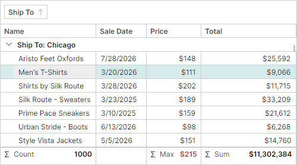
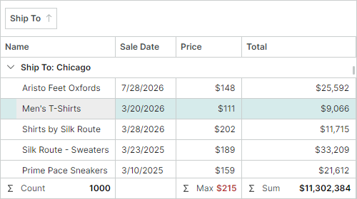
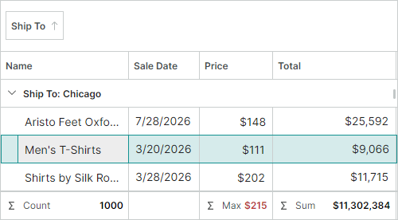

# UI Density

Applications sometimes need to maximize screen real estate or, conversely, provide a more spacious layout. To address these requirements, the `DeltaDesign` theme allows you to change the UI density to alter element padding and font sizes. Three predefined modes are available:

- `Compact`

    

- `Standard` (default)

    

- `Spacious`

    


## Modify the UI Density

To change the UI density, set the `DeltaDesignTheme.Density` property to an appropriate value from the `Eremex.AvaloniaUI.Themes.DeltaDesign.Density` enumeration.

The following example sets the UI density when [registering](register-an-eremex-paint-theme.md) the `DeltaDesign` theme in your _App.axaml_ file:

```xml
<Application xmlns="https://github.com/avaloniaui"
             xmlns:x="http://schemas.microsoft.com/winfx/2006/xaml"
             xmlns:theme="clr-namespace:Eremex.AvaloniaUI.Themes.DeltaDesign;assembly=Eremex.Avalonia.Themes.DeltaDesign"
             x:Class="MyApp.App">
    <Application.Styles>
        <theme:DeltaDesignTheme Palette="AtlasDeep"
                        Density="Compact"/>
    </Application.Styles>
</Application>
```

To change the UI density at runtime, locate the registered `DeltaDesign` theme in your application styles and update its `DeltaDesignTheme.Density` property:

```csharp
var deltaDesignTheme = Application.Current?.Styles.OfType<DeltaDesignTheme>().FirstOrDefault();
deltaDesignTheme.Density = Density.Compact;
```

## Create a Density Selector in the Application's UI

You can use the [IAppeanceService](../app-services/appearanceservice.md) object to manage `DeltaDesign` theme options, including color palettes, UI density, and theme variants. [`IAppearanceService`](../../API/Eremex.AvaloniaUI.Controls.ApplicationServices/IAppearanceService.md) allows you to change theme options in code. It also facilitates the creation of selector controls in your UI (such as a ribbon gallery, a combo box, or a menu) to let users switch theme options at runtime.

The following image demonstrates a combo box used as a selector for UI density options.


See the following topic for more information: [Example - Create a Density Selector](../app-services/appearanceservice.md#example-create-a-density-selector)
