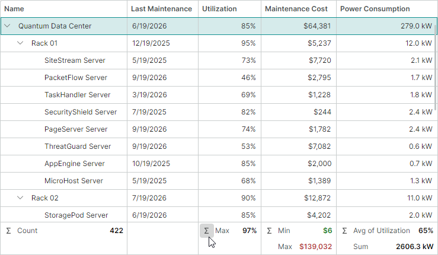
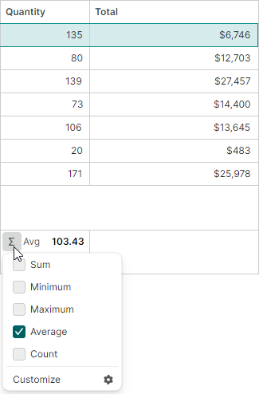
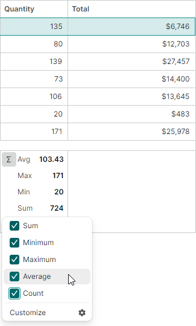
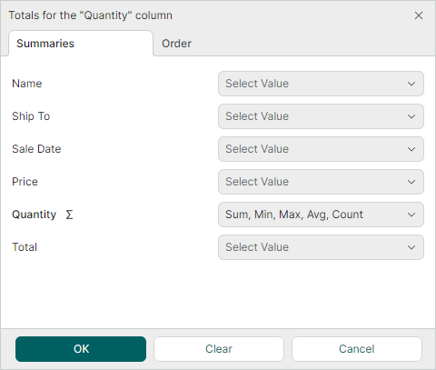
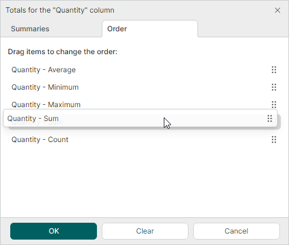
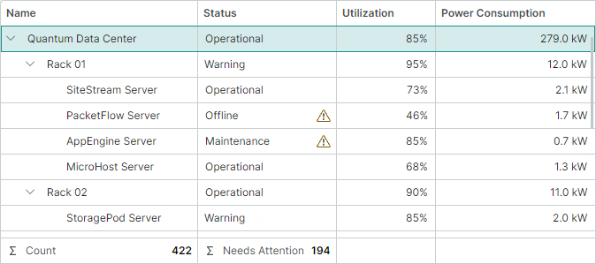
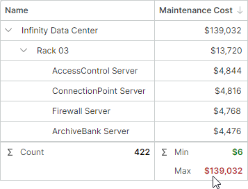

# Summaries

The TreeList control allows you to calculate total summaries for columns. Total summaries are aggregate functions computed across all rows. The control must have simultaneous access to all rows to correctly calculate total summaries.

!!! Note

    Set the [`AllowDynamicDataLoading`](../../API/Eremex.AvaloniaUI.Controls.TreeList/TreeListControlBase/AllowDynamicDataLoading.md) property to `false` to disable [dynamic data loading](data-binding/binding-to-hierarchical-data.md#dynamic-data-load) and provide simultaneous access to all rows for the TreeList control.




The main summary calculation features include:

- Built-in summary functions: Sum, Min, Max, Count, and Average.
- Runtime management — Users can click the Σ button in the footer cell to add summaries or invoke the Summary Editor dialog for advanced summary operations.
- Multiple summaries per column — Each column can display multiple summaries calculated across that column's values.
- Cross-column summaries — You can calculate a summary against one column and display it in another.
- Custom summaries — You can handle the [`CustomSummary`](../../API/Eremex.AvaloniaUI.Controls.TreeList/TreeListControl/CustomSummary.md) event to calculate a custom aggregate function according to your logic.
- Including summaries in XLSX and PDF exports.


## Enable Total Summaries

Total summaries are shown in the control's footer.

Set the [`ShowTotalSummaries`](../../API/Eremex.AvaloniaUI.Controls.TreeList/TreeListControl/ShowTotalSummaries.md) property to `true` to display the summary footer and enable total summary calculation. The summary footer is positioned at the bottom of the [`TreeListControl`](../../API/Eremex.AvaloniaUI.Controls.TreeList/TreeListControl.md), below all rows. Initially, this footer is hidden.

```xml
<mxtl:TreeListControl x:Name="treeList" ShowTotalSummaries="True" AllowDynamicDataLoading="False">...</mxtl:TreeListControl>
```

The summary footer contains summary cells for all columns. If [user summary customization](#user-summary-customizations) is enabled (default), the summary cells contain the `Σ` button used to show a summary menu and the summary editor.


**Related API**

- [`ShowTotalSummaries`](../../API/Eremex.AvaloniaUI.Controls.TreeList/TreeListControl/ShowTotalSummaries.md) — Gets or sets whether the total summary footer is displayed and total summary calculation is enabled.
- [`TotalSummaryPanelMinHeight`](../../API/Eremex.AvaloniaUI.Controls.TreeList/TreeListControl/TotalSummaryPanelMinHeight.md) — Gets or sets the minimum height of the total summary footer.

## Define Total Summaries

Use the [`TotalSummaries`](../../API/Eremex.AvaloniaUI.Controls.TreeList/TreeListControl/TotalSummaries.md) collection to define total summaries. Items in this collection are instances of the [`SummaryItem`](../../API/Eremex.AvaloniaUI.Controls.DataControl/SummaryItem.md) class. Each [`SummaryItem`](../../API/Eremex.AvaloniaUI.Controls.DataControl/SummaryItem.md) object specifies the field to summarize, the summary type, the column in which to display the result, and other settings.

```xml
xmlns:mxdc="clr-namespace:Eremex.AvaloniaUI.Controls.DataControl;assembly=Eremex.Avalonia.Controls"

<mxtl:TreeListControl x:Name="treeList" ShowTotalSummaries="True" AllowDynamicDataLoading="False">
    <mxtl:TreeListControl.TotalSummaries>
        <mxdc:SummaryItem FieldName="Name" SummaryType="Count" />
        <mxdc:SummaryItem FieldName="Utilization" SummaryType="Average" ShowInColumn="PowerConsumption" />
        <mxdc:SummaryItem FieldName="Utilization" SummaryType="Max" />
        <mxdc:SummaryItem FieldName="MaintenanceCost" SummaryType="Min" />
        <mxdc:SummaryItem FieldName="MaintenanceCost" SummaryType="Max" />
        <mxdc:SummaryItem FieldName="PowerConsumption" SummaryType="Sum" />
    </mxtl:TreeListControl.TotalSummaries>
</mxtl:TreeListControl>
```

**Related API**

- [`TotalSummaries`](../../API/Eremex.AvaloniaUI.Controls.TreeList/TreeListControl/TotalSummaries.md) — Provides access to the collection of summary items ([`SummaryItem`](../../API/Eremex.AvaloniaUI.Controls.DataControl/SummaryItem.md) objects) that define total summaries.
- [`SummaryItem.FieldName`](../../API/Eremex.AvaloniaUI.Controls.DataControl/SummaryItem/FieldName.md) — Gets or sets the name of the data field whose values are used to calculate the summary.
- [`SummaryItem.Name`](../../API/Eremex.AvaloniaUI.Controls.DataControl/SummaryItem/Name.md) — Gets or sets the summary item's name, used to identify it. You can retrieve summary items by name from the [`TotalSummaries`](../../API/Eremex.AvaloniaUI.Controls.TreeList/TreeListControl/TotalSummaries.md) collection.
- [`SummaryItem.Tag`](../../API/Eremex.AvaloniaUI.Controls.DataControl/SummaryItem/Tag.md) — Gets or sets custom data associated with this SummaryItem.
- [`SummaryItem.ShowInColumn`](../../API/Eremex.AvaloniaUI.Controls.DataControl/SummaryItem/ShowInColumn.md) — Gets or sets the field name of the column that displays the summary value. If this property is not set, the summary is displayed in the column bound to `FieldName`.
- [`SummaryItem.SummaryType`](../../API/Eremex.AvaloniaUI.Controls.DataControl/SummaryItem/SummaryType.md) — Gets or sets the type of the aggregate function (`Sum`, `Min`, `Max`, `Count`, or `Average`).
- [`SummaryItem.Label`](../../API/Eremex.AvaloniaUI.Controls.DataControl/SummaryItem/Label.md) — Gets or sets a custom label to display instead of the default summary label. The default summary label displays the name of the summary function. If the summary is displayed in another column (see [`ShowInColumn`](../../API/Eremex.AvaloniaUI.Controls.DataControl/SummaryItem/ShowInColumn.md)), the summary label also displays the caption of the column bound to [`SummaryItem.FieldName`](../../API/Eremex.AvaloniaUI.Controls.DataControl/SummaryItem/FieldName.md).

    


## User Summary Customizations

The control allows users to edit summaries at runtime by default. In this mode, summary cells display the `Σ` button, used to invoke the summary menu:



Users can use this menu to:

- Add or remove summaries by toggling checkboxes next to summary functions.

    

- Select `Customize` to invoke the `Summary Editor` dialog. 

    

    In this dialog's `Summaries` tab, users can create cross-column summaries (summaries calculated for one column, but shown in another column).
    
    The `Order` tab allows users to change the display order of the existing summaries.

    


**Related API**

- [`AllowEditingTotalSummaries`](../../API/Eremex.AvaloniaUI.Controls.TreeList/TreeListControl/AllowEditingTotalSummaries.md) — Gets or sets whether users can edit total summaries.

    This property only affects user capabilities to modify summaries and does not impact summary calculations performed in code.

## Custom Summaries

Custom summaries allow you to calculate aggregate values using your own logic.

To add a custom summary, do the following:

- Create a [`SummaryItem`](../../API/Eremex.AvaloniaUI.Controls.DataControl/SummaryItem.md) object and set its [`SummaryItem.SummaryType`](../../API/Eremex.AvaloniaUI.Controls.DataControl/SummaryItem/SummaryType.md) property to `Custom`. 

- Add this [`SummaryItem`](../../API/Eremex.AvaloniaUI.Controls.DataControl/SummaryItem.md) to the [`TotalSummaries`](../../API/Eremex.AvaloniaUI.Controls.TreeList/TreeListControl/TotalSummaries.md) collection. 

- Handle the [`CustomSummary`](../../API/Eremex.AvaloniaUI.Controls.TreeList/TreeListControl/CustomSummary.md) event to manually calculate a value for this [`SummaryItem`](../../API/Eremex.AvaloniaUI.Controls.DataControl/SummaryItem.md). 

    Set the `e.SummaryValue` event parameter to supply your custom result.

    While handling the [`CustomSummary`](../../API/Eremex.AvaloniaUI.Controls.TreeList/TreeListControl/CustomSummary.md) event, use the `e.Nodes` collection to iterate through target nodes (rows).


### Example - Calculate a custom total summary

The following example creates a custom total summary (called "Needs Attention") that calculates the number of assets requiring attention. These assets have a status of _Maintenance_, _Degraded_, _Offline_, or _Decommissioned_.




```xml
<!-- XAML -->
<mxtl:TreeListControl x:Name="treeList" CustomSummary="OnCustomSummary">
    <mxtl:TreeListControl.TotalSummaries>
        <mxdc:SummaryItem FieldName="Status" SummaryType="Custom" Label="Needs Attention"/>
        <mxdc:SummaryItem FieldName="Name" SummaryType="Count" />
    </mxtl:TreeListControl.TotalSummaries>
</mxtl:TreeListControl>
```

```csharp
// Code-behind
void OnCustomSummary(object sender, TreeListCustomSummaryEventArgs e)
{
    int assetsRequiringAttention = 0;
    foreach (var node in e.Nodes)
    {
        var status = (AssetStatus)treeList.GetCellValue(node, e.SummaryItem.FieldName);
        if (status is AssetStatus.Maintenance or AssetStatus.Degraded or AssetStatus.Offline or AssetStatus.Decommissioned)
            assetsRequiringAttention++;
    }
    e.SummaryValue = assetsRequiringAttention;
}
```

**Related API**

- [`CustomSummary`](../../API/Eremex.AvaloniaUI.Controls.TreeList/TreeListControl/CustomSummary.md) — Occurs when a summary value is calculated. Use the [`SummaryValue`](../../API/Eremex.AvaloniaUI.Controls.TreeList/TreeListCustomSummaryEventArgs/SummaryValue.md) event parameter to supply a custom summary value.


## Get Summary Values

You can retrieve calculated summary values in code using the following API:

- [`TreeListControl.GetTotalSummaryValue`](../../API/Eremex.AvaloniaUI.Controls.TreeList/TreeListControl/GetTotalSummaryValue.md) — Returns the calculated value of a total summary.


```csharp
object? totalValue = treeList.GetTotalSummaryValue(summaryItem);
```


## Style Summary Items

The TreeList control allows you to customize the appearance of summary items. To do this, style the dedicated visual control used to paint TreeList summary items.

### Target Visual Control Class

`Eremex.AvaloniaUI.Controls.DataControl.Visuals.FooterCellItemControl`

Each `FooterCellItemControl` has a `FooterCellItem` object as its DataContext.

### DataContext

`Eremex.AvaloniaUI.Controls.DataControl.Visuals.FooterCellItem`

The `FooterCellItem` class definition is shown below for your reference. When creating custom style setters and converters, you can bind to the summary's properties (`FooterCellItem.FieldName`, `FooterCellItem.SummaryType`, `FooterCellItem.Value`, `FooterCellItem.Label`, and `FooterCellItem.DisplayValue`). See [an example](#example-style-summary-items).

```csharp
/// <summary>Represents a summary value displayed in a footer cell.</summary>
public partial class FooterCellItem : ViewModelBase
{
	/// <summary>Gets or sets the summary item's label.</summary>
	[ObservableProperty] string label = string.Empty;

	/// <summary>Gets or sets the formatted summary value displayed in the footer cell.</summary>
	[ObservableProperty] string displayValue = string.Empty;

	/// <summary>Gets or sets the type of the aggregate function the summary calculates.</summary>
	public SummaryItemType SummaryType { get; set; } = SummaryItemType.None;

	/// <summary>Gets or sets the summary value.</summary>
	public object Value { get; set; }

	/// <summary>Gets or sets the name of the data field whose values the summary calculates.</summary>
	public string FieldName { get; set; }
}
```

### Default Template to Render Summary Items

The following code shows the default template used to render summary items. You can find this template in the [`DeltaDesign` paint theme sources](../themes/modify-control-themes.md#default-theme). Use the information from this template to create a style selector that addresses specific elements of a summary item. For example, the `TextBlock` named _Label_ displays the summary item's label, while the `TextBlock` named _DisplayValue_ shows the summary value:

``` xml
<!-- DeltaDesign paint theme -->
xmlns:mxdcv="clr-namespace:Eremex.AvaloniaUI.Controls.DataControl.Visuals;assembly=Eremex.Avalonia.Controls"

<ControlTheme x:Key="{x:Type mxdcv:FooterCellItemControl}" TargetType="mxdcv:FooterCellItemControl">
    <Setter Property="Background" Value="Transparent" />
    <Setter Property="Padding" Value="{DynamicResource DataControlFooterPadding}" />
    
    <Setter Property="Template">
        <ControlTemplate TargetType="mxdcv:FooterCellItemControl">
            <DockPanel Margin="{TemplateBinding Padding}" Background="{TemplateBinding Background}">
                <TextBlock x:Name="Label"
                           Text="{Binding Label}"
                           DockPanel.Dock="Left"
                           TextTrimming="CharacterEllipsis"
                           HorizontalAlignment="Left"
                           mxc:TextBlockHelper.ShowTooltipWhenTrimming="True" />
                <TextBlock Text=" "/>
                <TextBlock x:Name="DisplayValue"
                           Text="{Binding DisplayValue}"
                           DockPanel.Dock="Right"
                           FontWeight="SemiBold"
                           TextTrimming="CharacterEllipsis"
                           HorizontalAlignment="Right"
                           mxc:TextBlockHelper.ShowTooltipWhenTrimming="True" />
            </DockPanel>
        </ControlTemplate>
    </Setter>
</ControlTheme>
```

### Example - Style Summary Items

The following code modifies the colors of two summary values for the _MaintenanceCost_ column in the TreeList control. The `Min` summary value is shown in green, and the `Max` summary value in red. 



The created style targets the _DisplayValue_ text block inside the `FooterCellItemControl` template and uses a custom multi-value converter to select the foreground based on the summary's properties (`FooterCellItem.FieldName` and `FooterCellItem.SummaryType`).

```xml
xmlns:mxtl="https://schemas.eremexcontrols.net/avalonia/treelist"

xmlns:mxdcv="clr-namespace:Eremex.AvaloniaUI.Controls.DataControl.Visuals;assembly=Eremex.Avalonia.Controls"

<mxtl:TreeListControl.Styles>
    <Style Selector="mxdcv|FooterCellItemControl /template/ TextBlock#DisplayValue" x:DataType="mxdcv:FooterCellItem">
        <Setter Property="Foreground">
            <Setter.Value>
            <MultiBinding Converter="{views:TreeListSummaryTypeToForegroundConverter}">
                <Binding Path="FieldName" />
                <Binding Path="SummaryType" />
                <DynamicResourceExtension ResourceKey="Icons/Outline/Green"/>
                <DynamicResourceExtension ResourceKey="Icons/Outline/Red"/>
            </MultiBinding>
            </Setter.Value>
        </Setter>
        </Style>                
</mxtl:TreeListControl.Styles>
```

```csharp
public class TreeListSummaryTypeToForegroundConverter : MarkupExtension, IMultiValueConverter
{
    public object Convert(IList<object> values, Type targetType, object parameter, CultureInfo culture)
    {
        if (values.Count != 4)
            return null;

        if (values[0] is string fieldName && fieldName == "MaintenanceCost" && values[1] is SummaryItemType sumType)
        {
            if (sumType == SummaryItemType.Min)
                return values[2];
            else if (sumType == SummaryItemType.Max)
                return values[3];
        }

        return null;
    }

    public override object ProvideValue(IServiceProvider serviceProvider)
    {
        return this;
    }
}
```

See the [Demo application](../../index.md#demo-application) for complete code.