# TabControl

The [`MxTabControl`](../../API/Eremex.AvaloniaUI.Controls/MxTabControl.md) control allows you to organize panels into a tabbed UI. Users can activate a specific panel with a click on a corresponding tab.

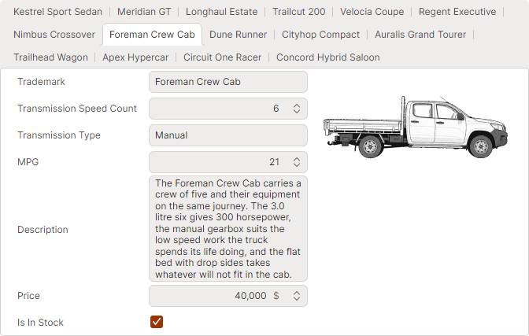

[`MxTabControl`](../../API/Eremex.AvaloniaUI.Controls/MxTabControl.md) is a descendant of the standard `Avalonia.Controls.TabControl` control. It inherits the `TabControl`'s base functionality and extends it with additional features:

- An unlimited number of tabs.
- Population of tabs and tab contents from an items source.
- Tab re-ordering via drag-and-drop.
- Tab layout modes: Stretch, Scroll and Multi-line.
- Flexible tab sizing, including sizing by content, largest content, or a fixed width.
- Stretch-to-fill behavior for tabs.
- Configurable icon visibility and automatic text collapse when space is limited.
- 'Close Tab' buttons.
- 'New Tab' button.
- Custom controls in the tab header area.

## Create Tabs

The [`MxTabControl`](../../API/Eremex.AvaloniaUI.Controls/MxTabControl.md) inherits tab creation functionality from the base `Avalonia.Controls.TabControl` class. The controls support two approaches to adding tabs:

- Add tab items manually
- Populate tabs and tab contents from an items source.

### Add Tab Items Manually

Tab items in the [`MxTabControl`](../../API/Eremex.AvaloniaUI.Controls/MxTabControl.md) control are encapsulated by [`MxTabItem`](../../API/Eremex.AvaloniaUI.Controls/MxTabItem.md) objects. They expose settings to specify the tab header content, tab header icon, selection state, etc. The following list describes the main public members of [`MxTabItem`](../../API/Eremex.AvaloniaUI.Controls/MxTabItem.md), including inherited ones:

- `Header` — Gets or sets the tab header content.
- `HeaderTemplate` — Gets or sets the data template used to render `Header`.
- [`Glyph`](../../API/Eremex.AvaloniaUI.Controls/MxTabItem/Glyph.md) — Gets or sets the icon displayed in the tab header.
- [`GlyphSize`](../../API/Eremex.AvaloniaUI.Controls/MxTabItem/GlyphSize.md) — Gets or sets the display size of the tab header icon. 
- `IsSelected` — Gets or sets the tab's selection state.
- [`CloseCommand`](../../API/Eremex.AvaloniaUI.Controls/MxTabItem/CloseCommand.md) — Gets or sets the command executed when the close button for this tab is clicked.
- [`CloseCommandParameter`](../../API/Eremex.AvaloniaUI.Controls/MxTabItem/CloseCommandParameter.md) — Gets or sets the parameter passed to [`CloseCommand`](../../API/Eremex.AvaloniaUI.Controls/MxTabItem/CloseCommand.md).

#### Example

The following example creates two tabs with predefined contents (editors and labels).

For each tab header, the code specifies the display text (`MxTabItem.Header`) and icon ([`MxTabItem.Glyph`](../../API/Eremex.AvaloniaUI.Controls/MxTabItem/Glyph.md)). The [`MxTabItem.GlyphSize`](../../API/Eremex.AvaloniaUI.Controls/MxTabItem/GlyphSize.md) property is used to set the display size for tab header icons.

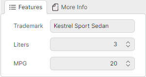

``` xml
xmlns:mx="https://schemas.eremexcontrols.net/avalonia"
xmlns:mxe="https://schemas.eremexcontrols.net/avalonia/editors"

<mx:MxTabControl Name="tabControl1">
    <mx:MxTabItem Header="Features" Glyph="avares://DemoCenter/DemoData/list32x32.png" GlyphSize="16 16">
        <Grid RowDefinitions="Auto Auto Auto" ColumnDefinitions="Auto *" Margin="5">
            <Label Classes="LayoutItem" Grid.Column="0" Grid.Row="0" Content="Trademark"/>
            <mxe:TextEditor EditorValue="{Binding SelectedCar.Trademark}" Margin="5"
                            Height="20" Grid.Row="0" Grid.Column="1"/>
            <Label Classes="LayoutItem" Grid.Column="0" Grid.Row="1" Content="Liters"/>
            <mxe:SpinEditor EditorValue="{Binding SelectedCar.Liter}" Margin="5"
                            Height="20" Grid.Row="1" Grid.Column="1"/>
            <Label Classes="LayoutItem" Grid.Column="0" Grid.Row="2" Content="MPG"/>
            <mxe:SpinEditor EditorValue="{Binding SelectedCar.MPG}" Margin="5"
                            Height="20" Grid.Row="2" Grid.Column="1"/>
        </Grid>
    </mx:MxTabItem>
    <mx:MxTabItem Header="More Info" Glyph="avares://DemoCenter/DemoData/more32x32.png" GlyphSize="16 16">
        <mxe:TextEditor Margin="5" EditorValue="{Binding SelectedCar.Description}"
                        TextWrapping="Wrap" VerticalAlignment="Stretch"/>
    </mx:MxTabItem>
</mx:MxTabControl>
```

### Populate Tabs from an Items Source

One of the [`MxTabControl`](../../API/Eremex.AvaloniaUI.Controls/MxTabControl.md)'s ancestors is the `Avalonia.Controls.ItemsControl` class. This allows you to populate the [`MxTabControl`](../../API/Eremex.AvaloniaUI.Controls/MxTabControl.md) with items from an items source. Use the following main properties for this purpose:

- `ItemsSource` — Specifies the source that contains items to be rendered as tabs.
- `ItemTemplate` — Specifies the DataTemplate used to render tab headers.
- `ContentTemplate` — Specifies the DataTemplate used to render tab contents.

#### Example

The following example binds an [`MxTabControl`](../../API/Eremex.AvaloniaUI.Controls/MxTabControl.md) control to an items source and specifies the DataTemplates that render tab headers (`MxTabControl.ItemTemplate`) and contents (`MxTabControl.ContentTemplate`).

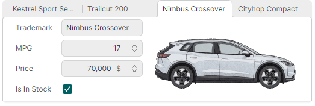

``` xml
xmlns:mx="https://schemas.eremexcontrols.net/avalonia"
xmlns:mxe="https://schemas.eremexcontrols.net/avalonia/editors"

<mx:MxTabControl ItemsSource="{Binding Cars}" SelectedItem="{Binding SelectedCar}">
    <mx:MxTabControl.ItemTemplate>
        <DataTemplate DataType="demoData:CarInfo">
            <TextBlock Text="{Binding Trademark}"></TextBlock>
        </DataTemplate>
    </mx:MxTabControl.ItemTemplate>

    <mx:MxTabControl.ContentTemplate>
        <DataTemplate DataType="demoData:CarInfo">
            <Grid ColumnDefinitions="* Auto">
                <Grid RowDefinitions="Auto Auto Auto Auto Auto Auto Auto"
                        ColumnDefinitions="Auto *">
                    <Label Classes="LayoutItem" Grid.Column="0" Grid.Row="0" Content="Trademark"/>
                    <mxe:TextEditor Classes="LayoutItem" Grid.Column="1" Grid.Row="0"
                                    EditorValue="{Binding Trademark}"/>
                    <Label Classes="LayoutItem" Grid.Column="0" Grid.Row="1" Content="MPG"></Label>
                    <mxe:SpinEditor Classes="LayoutItem" Grid.Column="1" Grid.Row="1"
                                    EditorValue="{Binding  MPG}"
                                    Minimum="0"/>
                    <Label Classes="LayoutItem" Grid.Column="0" Grid.Row="2" Content="Price"/>
                    <mxe:SpinEditor Classes="LayoutItem" Grid.Column="1" Grid.Row="2"
                                    EditorValue="{Binding  Price}" Suffix="{Binding Currency}"
                                    Minimum="0"/>

                    <Label Classes="LayoutItem" Grid.Column="0" Grid.Row="3" Content="Is In Stock"/>
                    <mxe:CheckEditor Classes="LayoutItem" Grid.Column="1" Grid.Row="3"
                                        EditorValue="{Binding  IsInStock}">
                    </mxe:CheckEditor>
                </Grid>
                <Image Grid.Column="1"
                        Width="256"
                        Margin="3"
                        Source="{Binding Image}"
                        VerticalAlignment="Top">
                </Image>
            </Grid>
        </DataTemplate>
    </mx:MxTabControl.ContentTemplate>
</mx:MxTabControl>
```

See the complete code in the [Demo Application](../../index.md#demo-application).

#### Specify Tab Header Icons when Using an Items Source

To display an icon in a tab header, specify the [`MxTabItem.Glyph`](../../API/Eremex.AvaloniaUI.Controls/MxTabItem/Glyph.md) property for tabs. 
When populating tabs from an items source, you cannot initialize the [`MxTabItem.Glyph`](../../API/Eremex.AvaloniaUI.Controls/MxTabItem/Glyph.md) property directly. Instead, set the [`MxTabItem.Glyph`](../../API/Eremex.AvaloniaUI.Controls/MxTabItem/Glyph.md) property by creating a `Style` in the `MxTabControl.Styles` collection. This style must target the [`MxTabItem`](../../API/Eremex.AvaloniaUI.Controls/MxTabItem.md) class. Set the [`MxTabItem.GlyphSize`](../../API/Eremex.AvaloniaUI.Controls/MxTabItem/GlyphSize.md) property (also in a `Style`) to limit the display size of tab header icons when needed.

##### Example - Assign Tab Header Icons

The following example assigns icons to tabs when populating tabs from an items source.

In this example, the tab control is bound to the _Cars_ source, which stores a collection of _CarInfo_ objects. Thus, the data context of each tab is a _CarInfo_ object.

To set a tab header icon, a `Style` that targets [`MxTabItem`](../../API/Eremex.AvaloniaUI.Controls/MxTabItem.md) is created. The style binds the [`MxTabItem.Glyph`](../../API/Eremex.AvaloniaUI.Controls/MxTabItem/Glyph.md) property to the _CarInfo.SmallImage_ property.

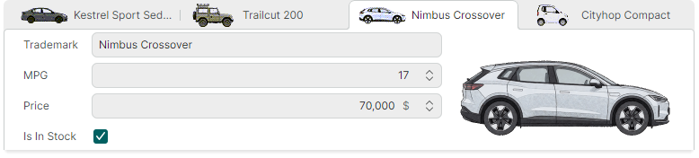

``` xml
<mx:MxTabControl ItemsSource="{Binding Cars}" >
    <mx:MxTabControl.Styles>
        <Style Selector="mx|MxTabItem" x:DataType="demoData:CarInfo">
            <Setter Property="Glyph" Value="{Binding SmallImage}"/>
            <Setter Property="GlyphSize" Value="57 32"/>
        </Style>
    </mx:MxTabControl.Styles>
</mx:MxTabControl>
```


## Select a Tab

Use the following properties to select tabs and get selected tabs:

- `SelectedIndex` — Specifies the zero-based index of the selected tab among all tabs. You can use the `MxTabControl.Items` property to access the tab collection.
- `SelectedItem` — Specifies the selected tab's item. If tabs are manually added to the TabControl using [`MxTabItem`](../../API/Eremex.AvaloniaUI.Controls/MxTabItem.md) objects, the `SelectedItem` property specifies the selected [`MxTabItem`](../../API/Eremex.AvaloniaUI.Controls/MxTabItem.md) object. If the TabControl is populated from an items source, the `SelectedItem` property specifies the selected tab's data object from the bound items source.

The `SelectedValue` property specifies the selected tab's value. This property returns the following values:

- `null`, if tabs are manually added to the TabControl using [`MxTabItem`](../../API/Eremex.AvaloniaUI.Controls/MxTabItem.md) objects.
- A tab's underlying data object, if the TabControl is populated from an items source.

The following properties allow you to return the contents of the selected tab:

- `SelectedContent` — Specifies the selected tab's content.
- `SelectedContentTemplate` — Specifies the selected tab's content template.

## Tab Arrangement and Size

Tab headers are displayed along the TabControl's top edge by default. You can use the `TabStripPlacement` property to specify the position of tab headers.

TabControl supports three tab header layout modes. Use the [`MxTabControl.TabStripLayoutType`](../../API/Eremex.AvaloniaUI.Controls/MxTabControl/TabStripLayoutType.md) property to specify the tab header arrangement type:

- `Scroll` — Tab headers are wide enough to display tab headers' contents. Scroll buttons appear in the tab header region if there is not enough space to display all tab headers in their entirety.
  
    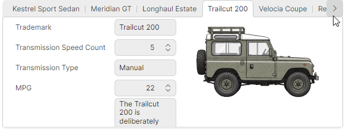

- `MultiLine` — Tab headers are arranged in multiple lines if there is not enough space to display them in a single line.
  
    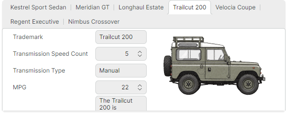

- `Stretch` — All tab headers are arranged in a single line with no scrolling. If the total header width exceeds the control's width, the tabs are shrunk to fit the available width.

    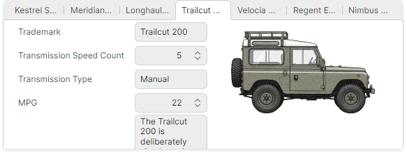


### Tab Stretching

If the total tab width is less than the control's width, the tabs are not expanded to fill the available space. To stretch tabs to fill the control's width, set the [`StretchTabsToFill`](../../API/Eremex.AvaloniaUI.Controls/MxTabControl/StretchTabsToFill.md) property to `true`.

**[`StretchTabsToFill`](../../API/Eremex.AvaloniaUI.Controls/MxTabControl/StretchTabsToFill.md) is false:**

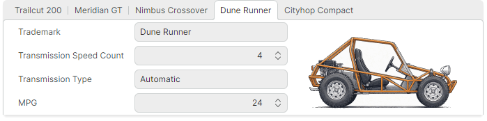

**[`StretchTabsToFill`](../../API/Eremex.AvaloniaUI.Controls/MxTabControl/StretchTabsToFill.md) is true:**

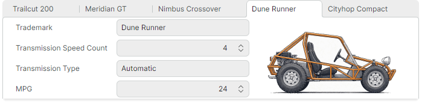


### Tab Size

The [`TabSizeMode`](../../API/Eremex.AvaloniaUI.Controls/TabSizeMode.md) property allows you to specify how tab widths are calculated. The following modes are available:

- `Default` — Tabs have the default width depending on the [`TabStripLayoutType`](../../API/Eremex.AvaloniaUI.Controls/TabStripLayoutType.md) option:
    - When [`TabStripLayoutType`](../../API/Eremex.AvaloniaUI.Controls/TabStripLayoutType.md) is set to `Stretch`, the tab width is specified by the [`TabSize`](../../API/Eremex.AvaloniaUI.Controls/MxTabControl/TabSize.md) property. 
    - In other layout types, the tabs are sized to fit their content, which is equivalent to the [`TabSizeMode.Content`](../../API/Eremex.AvaloniaUI.Controls/TabSizeMode.md) mode.
- `Explicit` — Tabs have the width specified by the [`TabSize`](../../API/Eremex.AvaloniaUI.Controls/MxTabControl/TabSize.md) property.
- `Content` — Sizes each tab header to fit its text and icon.

    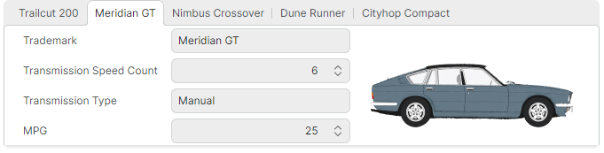

- `LargestContent` — Sizes all tabs to match the widest visible tab header.

    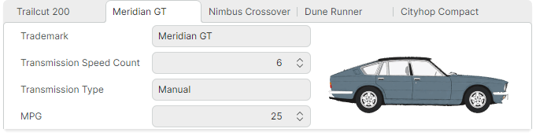

The [`TabSize`](../../API/Eremex.AvaloniaUI.Controls/MxTabControl/TabSize.md) property allows you to apply a fixed width to all tabs. This property is in effect in these cases:

- When the [`TabSizeMode`](../../API/Eremex.AvaloniaUI.Controls/TabSizeMode.md) property is set to `Explicit`
- When the [`TabSizeMode`](../../API/Eremex.AvaloniaUI.Controls/TabSizeMode.md) property is `Default` and [`TabStripLayoutType`](../../API/Eremex.AvaloniaUI.Controls/TabStripLayoutType.md) is `Stretch`.


### Tab Icons and Text Collapse

When the tab control's width (height in the vertical orientation) is limited, tab headers can hide their text and display only their icons. You can control this behavior using the [`TabIconDisplayMode`](../../API/Eremex.AvaloniaUI.Controls/TabIconDisplayMode.md) and [`TabHeaderCollapseThreshold`](../../API/Eremex.AvaloniaUI.Controls/MxTabControl/TabHeaderCollapseThreshold.md) properties.

The [`TabIconDisplayMode`](../../API/Eremex.AvaloniaUI.Controls/TabIconDisplayMode.md) property determines when a tab's icon is visible:

- `Always` (default) — Displays the icon next to the header text, and keeps the icon visible if the text is collapsed.
- `WhenTextCollapsed` — Displays the icon only when the header text is collapsed. If the text is visible, the icon is hidden.
- `Never` — The icon is never displayed. 


The [`TabHeaderCollapseThreshold`](../../API/Eremex.AvaloniaUI.Controls/MxTabControl/TabHeaderCollapseThreshold.md) property specifies the header length (in device-independent pixels) at or below which the header text is collapsed (replaced by its icon). A value of `0` disables text replacement by the icon.


## Tab Re-ordering

A user can re-arrange tabs using drag-and-drop if the [`MxTabControl.TabDragMode`](../../API/Eremex.AvaloniaUI.Controls/MxTabControl/TabDragMode.md) property is set to `Reorder`.

Handle the [`TabItemStartDragging`](../../API/Eremex.AvaloniaUI.Controls/MxTabControl/TabItemStartDragging.md) and [`TabItemCompleteDragging`](../../API/Eremex.AvaloniaUI.Controls/MxTabControl/TabItemCompleteDragging.md) events to cancel drag operations or perform additional actions when tabs are dragged.

## 'Close' Buttons

TabControl supports built-in 'Tab Close' ('x') buttons. They can be displayed in tabs and/or tab header region, as specified by the [`MxTabControl.CloseButtonShowMode`](../../API/Eremex.AvaloniaUI.Controls/MxTabControl/CloseButtonShowMode.md) property.

'Tab Close' buttons do not perform any action by default. You need to implement 'Close' button actions using one of the following approaches:

- Handle the [`MxTabControl.CloseButtonClick`](../../API/Eremex.AvaloniaUI.Controls/MxTabControl/CloseButtonClick.md) event.
- Specify commands with the [`MxTabItem.CloseCommand`](../../API/Eremex.AvaloniaUI.Controls/MxTabItem/CloseCommand.md) member.

## 'New Tab' Button

Set the [`MxTabControl.NewButtonShowMode`](../../API/Eremex.AvaloniaUI.Controls/MxTabControl/NewButtonShowMode.md) property to `InHeaderPanel` to display the 'New Tab' ('+') button. A click on this button has no action by default. You can specify an action with the following members:

- [`MxTabControl.NewButtonClick`](../../API/Eremex.AvaloniaUI.Controls/MxTabControl/NewButtonClick.md) event.
- [`MxTabControl.NewCommand`](../../API/Eremex.AvaloniaUI.Controls/MxTabControl/NewCommand.md) command.

## Custom Controls in the Tab Header Area

You can use the [`ControlBoxContent`](../../API/Eremex.AvaloniaUI.Controls/MxTabControl/ControlBoxContent.md) and [`ControlBoxContentTemplate`](../../API/Eremex.AvaloniaUI.Controls/MxTabControl/ControlBoxContentTemplate.md) properties to add custom controls to the tab header area. 

### Example

The following example adds the '?' button to the tab header area. A click on the button raises the _HelpCommand_ command. The currently selected tab's item is passed as the command's parameter.

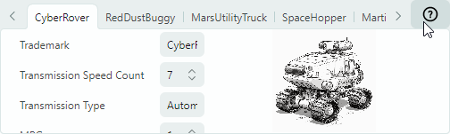

``` xml
xmlns:mx="https://schemas.eremexcontrols.net/avalonia"
x:Class="SampleTabControl.TabControlPageView"
xmlns:vm="using:SampleTabControl"
x:DataType="vm:TabControlPageViewModel"

<mx:MxTabControl ItemsSource="{Binding Cars}"
                SelectedItem="{Binding SelectedCar}"
                x:Name="TabControl"
    >
    <mx:MxTabControl.ControlBoxContent>
        <Button Command="{Binding HelpCommand}" 
         CommandParameter="{Binding $parent.SelectedItem}">
            <Image Width="20" Height="20"  
             Source="{SvgImage 'avares://SampleTabControl/Images/help-icon.svg'}"/>
        </Button>
    </mx:MxTabControl.ControlBoxContent>
    ...
</mx:MxTabControl>
```
``` csharp
public partial class TabControlPageViewModel : PageViewModelBase
{
    //...
    [RelayCommand]
    private void Help(object parameter)
    {
        //...
    }
}
```