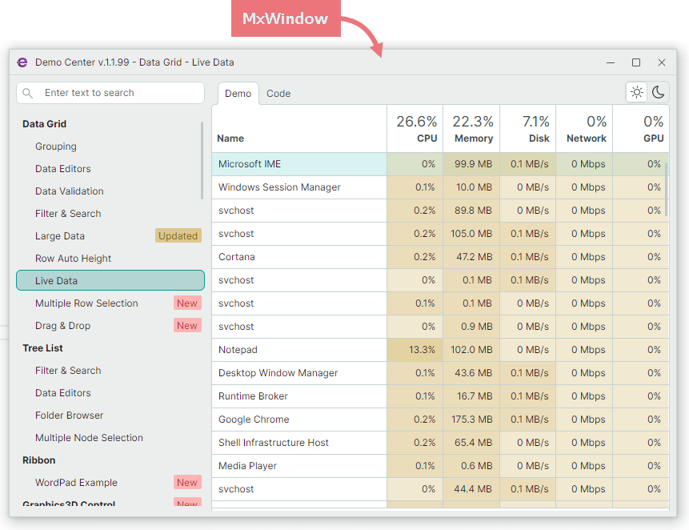
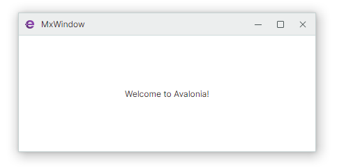
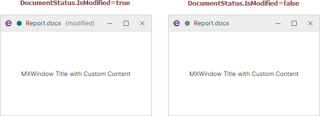
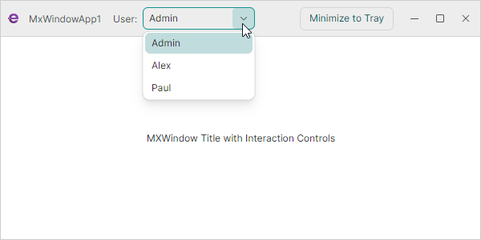

# MxWindow

If you are using Eremex Avalonia Controls, consider utilizing the [`MxWindow`](../../API/Eremex.AvaloniaUI.Controls.Common/MxWindow.md) component for both main and additional windows in your application. This enables you to maintain a consistent UI across your Avalonia project.

[`MxWindow`](../../API/Eremex.AvaloniaUI.Controls.Common/MxWindow.md) is a window that paints its elements (background, border and title bar) according to an [Eremex visual theme](../themes/index.md). 



## Add Theme Package and Register a Paint Theme

To use [`MxWindow`](../../API/Eremex.AvaloniaUI.Controls.Common/MxWindow.md) and other Eremex Avalonia Controls, include a [package](../../whats-included/assemblies.md) that contains an Eremex paint theme. The following topic shows how you can register the paint theme in your application: 

- [Register an Eremex Paint Theme](../themes/register-an-eremex-paint-theme.md).


## Create MxWindow

[`MxWindow`](../../API/Eremex.AvaloniaUI.Controls.Common/MxWindow.md) is a descendant of the standard Avalonia `Window` component.  You can seamlessly replace `Window` components in your existing applications with [`MxWindow`](../../API/Eremex.AvaloniaUI.Controls.Common/MxWindow.md) to leverage the Eremex paint themes. The following XAML code demonstrates a sample [`MxWindow`](../../API/Eremex.AvaloniaUI.Controls.Common/MxWindow.md) object declaration:

``` xml
<mx:MxWindow 
    xmlns:mx="https://schemas.eremexcontrols.net/avalonia"
    Title="MxWindow"
    ...
>

</mx:MxWindow>
```

[Eremex Project Templates](../../whats-included/project-templates.md) allow you to create new Avalonia applications with Eremex Controls. These templates create new projects in which the main window is encapsulated by the [`MxWindow`](../../API/Eremex.AvaloniaUI.Controls.Common/MxWindow.md) component.



## MxWindow Settings

[`MxWindow`](../../API/Eremex.AvaloniaUI.Controls.Common/MxWindow.md) extends settings exposed by the standard `Window` component with the following options that specify the visibility and glyphs of the standard buttons in the title bar:

- [`ShowCloseButton`](../../API/Eremex.AvaloniaUI.Controls.Common/MxWindow/ShowCloseButton.md) — Specifies the visibility of the Close button.
- [`ShowMaximizeButton`](../../API/Eremex.AvaloniaUI.Controls.Common/MxWindow/ShowMaximizeButton.md) — Specifies the visibility of the Maximize button.
- [`ShowMinimizeButton`](../../API/Eremex.AvaloniaUI.Controls.Common/MxWindow/ShowMinimizeButton.md) — Specifies the visibility of the Minimize button.

- [`CloseButtonGlyph`](../../API/Eremex.AvaloniaUI.Controls.Common/MxWindow/CloseButtonGlyph.md) — The Close button's glyph.
- [`MaximizeButtonGlyph`](../../API/Eremex.AvaloniaUI.Controls.Common/MxWindow/MaximizeButtonGlyph.md) — The Maximize button's glyph.
- [`MinimizeButtonGlyph`](../../API/Eremex.AvaloniaUI.Controls.Common/MxWindow/MinimizeButtonGlyph.md) — The Minimize button's glyph.
- [`RestoreButtonGlyph`](../../API/Eremex.AvaloniaUI.Controls.Common/MxWindow/RestoreButtonGlyph.md) — The Restore button's glyph.

## Add Custom Content to the MxWindow Title Bar

[`MxWindow`](../../API/Eremex.AvaloniaUI.Controls.Common/MxWindow.md) allows you to place custom controls (labels, dropdowns, buttons, status indicators) in the window's title bar, to the left of the system window buttons (control box). Two properties control this area:

- [`MxWindow.Header`](../../API/Eremex.AvaloniaUI.Controls.Common/MxWindow/Header.md) — Gets or sets custom content displayed in the title bar. If set, [`Header`](../../API/Eremex.AvaloniaUI.Controls.Common/MxWindow/Header.md) overrides the window's `Title` property.
- [`MxWindow.HeaderTemplate`](../../API/Eremex.AvaloniaUI.Controls.Common/MxWindow/HeaderTemplate.md) — Gets or sets the template that defines how the [`Header`](../../API/Eremex.AvaloniaUI.Controls.Common/MxWindow/Header.md) object is rendered.

The [`ActualHeader`](../../API/Eremex.AvaloniaUI.Controls.Common/MxWindow/ActualHeader.md) property returns the final displayed content. It returns the [`Header`](../../API/Eremex.AvaloniaUI.Controls.Common/MxWindow/Header.md) object when [`Header`](../../API/Eremex.AvaloniaUI.Controls.Common/MxWindow/Header.md) is set, and `Title` otherwise.


### Example - Display a document status in a title bar

This example renders the window's title from a _DocumentStatus_ object assigned to the [`Header`](../../API/Eremex.AvaloniaUI.Controls.Common/MxWindow/Header.md) property using a custom template specified via [`HeaderTemplate`](../../API/Eremex.AvaloniaUI.Controls.Common/MxWindow/HeaderTemplate.md).

The _DocumentStatus_ object contains the file name and a modified flag. The [`HeaderTemplate`](../../API/Eremex.AvaloniaUI.Controls.Common/MxWindow/HeaderTemplate.md) renders this object as a colored indicator followed by the file name.



Window XAML

```xml
<mx:MxWindow ...
        xmlns:mx="https://schemas.eremexcontrols.net/avalonia"
        xmlns:mxcommon="clr-namespace:Eremex.AvaloniaUI.Controls.Common;assembly=Eremex.Avalonia.Controls"
        xmlns:vm="using:MxWindowApp10.ViewModels"
        x:DataType="vm:MainWindowViewModel"
        Title="MxWindowApp1"
        Header="{Binding DocumentStatus}">

    <mxcommon:MxWindow.HeaderTemplate>
        <DataTemplate x:DataType="vm:DocumentStatus">
            <StackPanel Orientation="Horizontal" VerticalAlignment="Center" Spacing="8">
                <!-- Teal dot when modified -->
                <Ellipse Width="10" Height="10" VerticalAlignment="Center"
                         Fill="Teal"
                         IsVisible="{Binding IsModified}" />

                <!-- Gray dot when not modified -->
                <Ellipse Width="10" Height="10" VerticalAlignment="Center"
                         Fill="Gray"
                         IsVisible="{Binding !IsModified}" />

                <TextBlock Text="{Binding FileName}" VerticalAlignment="Center" />

                <TextBlock Text="(modified)"
                           VerticalAlignment="Center"
                           IsVisible="{Binding IsModified}"
                           Foreground="Gray" />

            </StackPanel>
        </DataTemplate>
    </mxcommon:MxWindow.HeaderTemplate>

    <TextBlock Text="MXWindow Title with Custom Content" HorizontalAlignment="Center" VerticalAlignment="Center"/>
</mx:MxWindow>
```

ViewModel

```csharp
using CommunityToolkit.Mvvm.ComponentModel;

namespace MxWindowApp10.ViewModels;

public partial class MainWindowViewModel : ViewModelBase
{
    [ObservableProperty]
    private DocumentStatus documentStatus;

    public MainWindowViewModel()
    {
        DocumentStatus = new DocumentStatus
        {
            FileName = "Report.docx",
            IsModified = true
        };
    }
}

public partial class DocumentStatus : ObservableObject
{
    [ObservableProperty]
    private string fileName;

    [ObservableProperty]
    private bool isModified;
}
```


### Example - Display interaction controls in a title bar

This example uses the [`HeaderTemplate`](../../API/Eremex.AvaloniaUI.Controls.Common/MxWindow/HeaderTemplate.md) property to display the original window title and add interaction controls to the title bar. The [`Header`](../../API/Eremex.AvaloniaUI.Controls.Common/MxWindow/Header.md) property is left unset.

The title bar in this example displays the following items:

- The original window title, read from the `MxWindow.Title` property
- The "User: " label and an account selector ([`ComboBoxEditor`](../../API/Eremex.AvaloniaUI.Controls.Editors/ComboBoxEditor.md)) bound to the `Accounts` and `SelectedAccount` properties in the ViewModel
- A "Minimize to Tray" button on the right



Selecting an account updates the `SelectedAccount` property in the ViewModel automatically. To respond to the selection, use the `OnSelectedAccountChanged` partial method generated for the observable `SelectedAccount` property.


Window XAML

```xml
<mx:MxWindow ...
             xmlns:vm="using:MxWindowApp1.ViewModels"
             xmlns:mx="https://schemas.eremexcontrols.net/avalonia"
             xmlns:mxcommon="clr-namespace:Eremex.AvaloniaUI.Controls.Common;assembly=Eremex.Avalonia.Controls"
             xmlns:mxe="https://schemas.eremexcontrols.net/avalonia/editors"
             x:DataType="vm:MainWindowViewModel"
             Title="MxWindowApp1"
             >

    <Design.DataContext>
        <vm:MainWindowViewModel/>
    </Design.DataContext>

    <mxcommon:MxWindow.HeaderTemplate>
        <DataTemplate>
            <DockPanel LastChildFill="False" VerticalAlignment="Center">
                <Label DockPanel.Dock="Left"
                       VerticalAlignment="Center"
                       Content="{Binding $parent[mxcommon:MxWindow].Title}" />

                <Label DockPanel.Dock="Left"
                       VerticalAlignment="Center"
                       Content="User: " Margin="8,0,0,0"/>

                <mxe:ComboBoxEditor DockPanel.Dock="Left"
                                    x:Name="accountComboBox"
                                    Margin="0,0,8,0"
                                    VerticalAlignment="Center"
                                    ItemsSource="{Binding $parent[mxcommon:MxWindow].DataContext.Accounts}"
                                    DisplayMember="Name"
                                    EditorValue="{Binding $parent[mxcommon:MxWindow].DataContext.SelectedAccount, Mode=TwoWay}"
                                    SelectionMode="Single"
                                    MinWidth="140" />

                <Button DockPanel.Dock="Right"
                        x:Name="btnMinimize"
                        VerticalAlignment="Center"
                        Content="Minimize to Tray"
                        Click="btnMinimizeB_Click" />
            </DockPanel>
        </DataTemplate>
    </mxcommon:MxWindow.HeaderTemplate>

    <TextBlock Text="MXWindow Title with Interaction Controls" HorizontalAlignment="Center" VerticalAlignment="Center"/>
</mx:MxWindow>
```

Window Code-behind

``` cs
using Eremex.AvaloniaUI.Controls.Common;
using MxWindowApp1.ViewModels;

namespace MxWindowApp1.Views;

public partial class MainWindow : MxWindow
{
    public MainWindow()
    {
        this.DataContext = new MainWindowViewModel();
        InitializeComponent();
    }

    private void btnMinimizeB_Click(object sender, Avalonia.Interactivity.RoutedEventArgs e)
    {
        //...
    }
}
```

ViewModel

```cs
using CommunityToolkit.Mvvm.ComponentModel;
using System.Collections.ObjectModel;

namespace MxWindowApp1.ViewModels;

public partial class MainWindowViewModel : ViewModelBase
{

    [ObservableProperty]
    private ObservableCollection<Account> accounts;

    [ObservableProperty]
    private Account selectedAccount;
    
    public MainWindowViewModel()
    {
        Accounts = new ObservableCollection<Account>
        {
            new Account(1, "Admin"),
            new Account(2, "Alex"),
            new Account(3, "Paul"),
        };

        SelectedAccount = Accounts[0];
    }

    partial void OnSelectedAccountChanged(Account value)
    {
        // Runs whenever the user picks a different account
        if (value.Name == "Admin")
        {
            //...
        }
    }
}

public partial class Account : ObservableObject
{
    public Account(int accountId, string name)
    {
        AccountId = accountId;
        Name = name;
    }

    [ObservableProperty]
    private int accountId;

    [ObservableProperty]
    private string name;
}
```