# Activate and Manage Local Licenses

A local license is a type of software license that is tied to a single computer (or workstation). This topic covers how to deploy and manage local licenses on developers' machines.

## License Management Utilities

All license types (local and [network](activate-and-manage-network-licenses.md)) for the EMX Controls library are handled using two utilities from [Guardant](https://guardant.com) - _Guardant Control Center_ and _Guardant License Wizard_. These tools can be downloaded at:

- [Guardant License Management Redistributables (Windows)](../resources/Guardant_Redistributable_Windows.zip)
- [Guardant License Management Redistributables (Linux)](../resources/Guardant_Redistributable_Linux.zip) 


**_Guardant Control Center_**

A license management service.

_Installation files_: 

- Windows: `grdcontrol-x.x.msi`
- Linux: `grdcontrol-x.x_amd64.deb`, `grdcontrol-x.x.x86_64.rpm` 

!!! Note

    _Guardant Control Center_ must be installed and running on the developer's machine to manage licenses and monitor their usage. Do not uninstall, stop, or disable the service; without it, the EMX Controls library cannot verify its license and will display trial messages.

**_Guardant License Wizard_** 

A GUI and command-line tool that allows you to add, update, and transfer licenses. 

_Executable files_: 

- Windows: `license_wizard.exe`
- Linux: `license_wizard`

To get information about all command-line options, run this command:

<code>license_wizard --help</code>


## Online License Activation Using a Software Key (Guardant DL)

### From the Command Line

```
license_wizard --console --activate &lt;LICENSE-KEY&gt; --host https://getlicense.guardant.ru
```

### From the UI

1. Ensure _Guardant Control Center_ is installed and running.

2. Run _Guardant License Wizard_.

    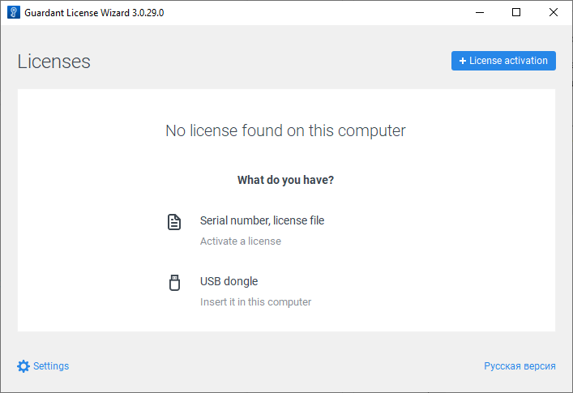
    
3. Click **Settings**, and ensure that the **Server address** property is set to _https://getlicense.guardant.ru_. 
   
     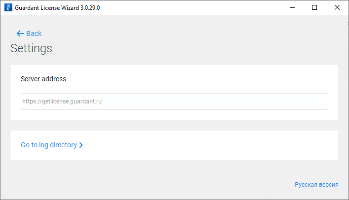

	 Then click **Back** to return to the previous page.

4. Click the **License Activation** button to add a new license key.

5. Specify the computer on which you want to register a license.

    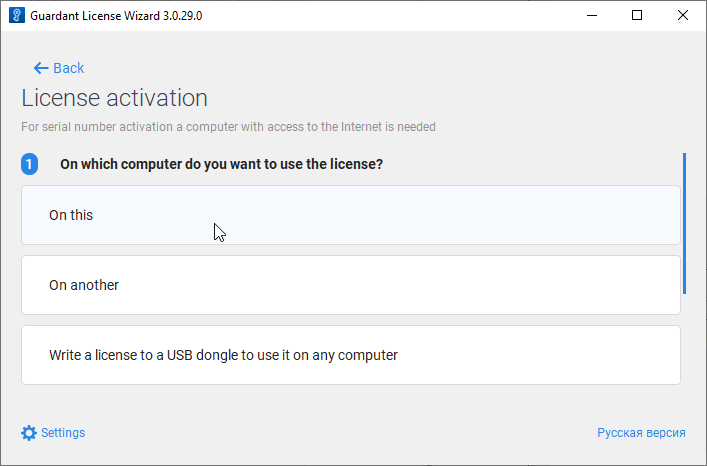

6. Enter your license key in the **Serial Number** field.

    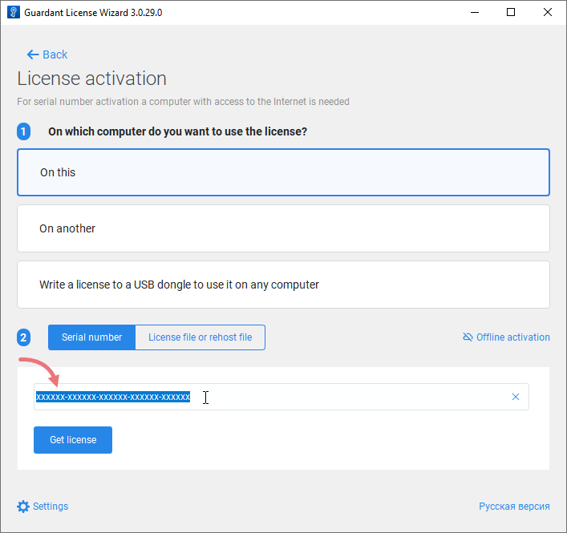

	
7. Click **Get license**.

    If the license activation is successful, the Wizard will display information about the licensed products.

    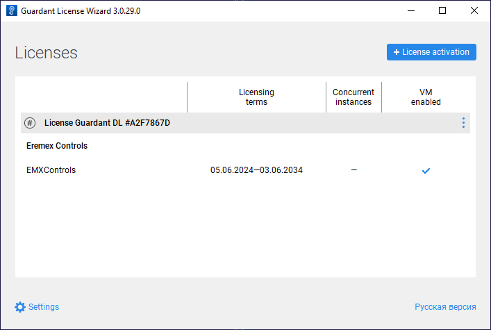


 

## Offline License Activation Using a Software Key (Guardant DL)

If a computer has no internet access, you can still activate the software key using an offline procedure. This activation type includes the following steps:

- Step 1. Generate a request file on the machine that has no Internet access.
- Step 2. Get a license file from the request file on another machine with Internet access
- Step 3. Import the license file back to the offline machine. 

These steps are explained in greater detail below.

1. Ensure _Guardant Control Center_ is installed and running on the offline computer and the computer with Internet access.

2. Run _Guardant License Wizard_ on the offline machine.

    

3. Click **License activation**.

    
4. Select **On this** to specify the computer on which you want to register a license.

    

5. Click the **Offline activation** button.

    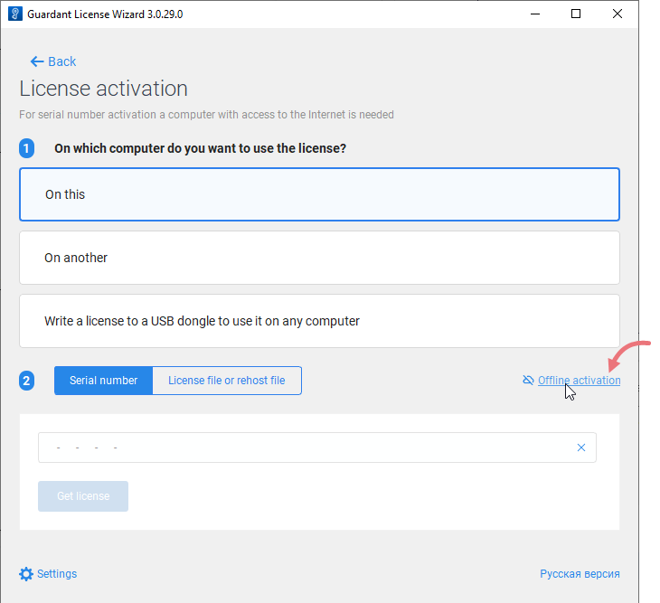

6. Click **Save** to save a request for a new license to a file.

    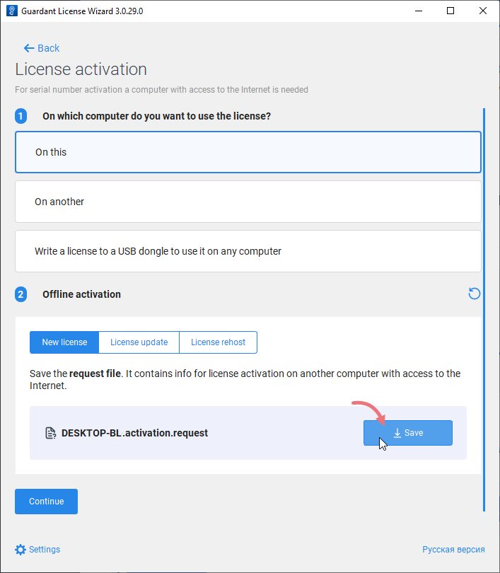

7. On another computer with Internet access, run _Guardant License Wizard_.

8. Click **Settings**, and ensure that the **Server address** property is set to _https://getlicense.guardant.ru_. Then click **Back** to return to the previous page.

9. In the Licenses page, click the **License Activation** button.

    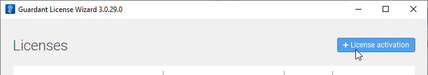

10. Select **On another** to specify the computer for which to activate a license. Then click 'Continue'.

    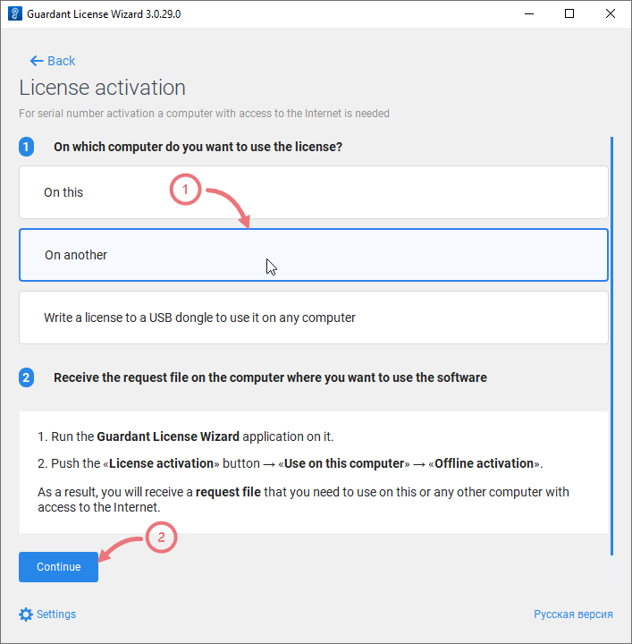

11. Load the request for a license that was generated on a target computer.

    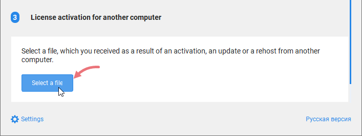

12. Enter your license number and click **Activate a new license**.

    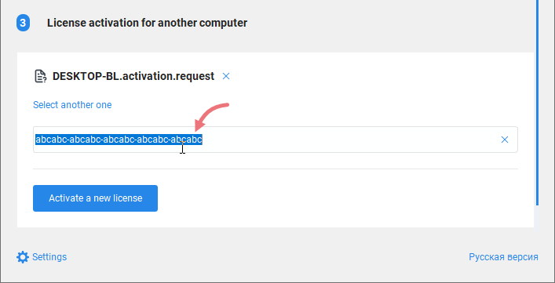

13. Save the license file ('_*.license_').

    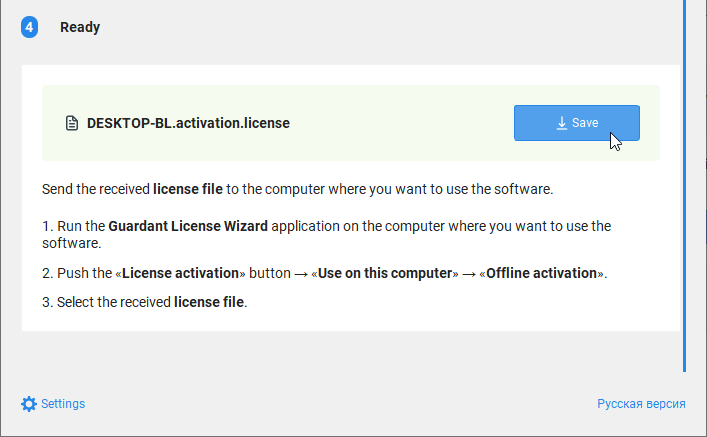

14. Go back to the target computer.

15. Run _Guardant License Wizard_, and switch to the **License activation** page.

16. Select **On this** to the specify the computer for the license activation. Then click **License file or rehost file**, and load the generated license file ('_*.license_').

    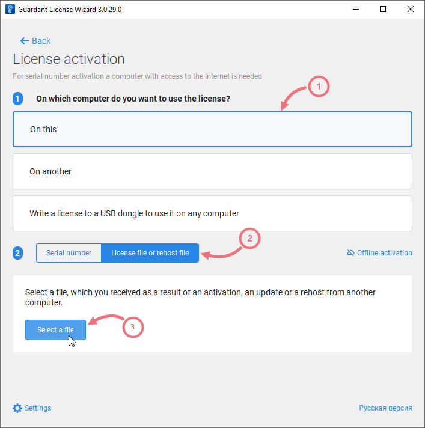

17. Activate the license.


## Online Update of the License

### From the Command Line

```
license_wizard --console --update &lt;LICENSE-KEY&gt; --host https://getlicense.guardant.ru
```

### From the UI

1. Run _Guardant License Wizard_.

    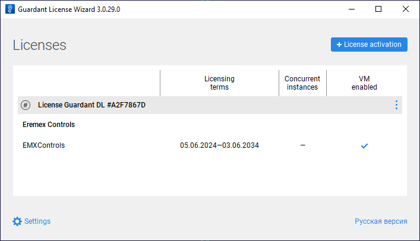

2. Click **Settings**, and ensure that the **Server address** property is set to _https://getlicense.guardant.ru_. Then click **Back** to return to the previous page.

3. In the Licenses page, click the ellipsis ('...') button and click 'Check updates'.

    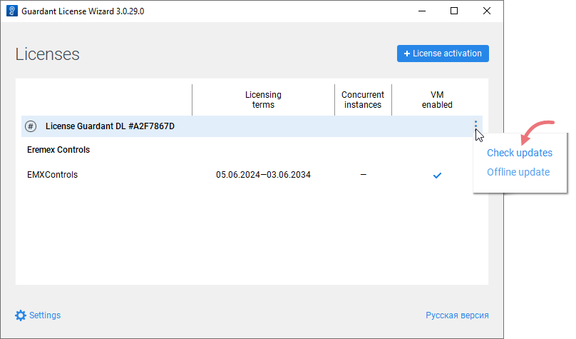

	
4. Click the _Install Updates_ link that appears if a license update is found on the server. 

5. When the operation is successful, the Wizard will update the registered licenses.


## Switch Between Licenses

If you have two or more licenses registered on your computer, you can select the required license for the project as follows.

1. Build your project if the `emxLicense.cs` file is missing. Once generated, this file will reference the first found license.

    The third parameter of the `SetRuntimeLicenseOwner` method in the `emxLicense.cs` file specifies the license id.

    <!-- TODO
    screenshots
    <image> -->

2. Run _Guardant License Wizard_ to view the installed licenses.

    <!--TODO <image> -->

3. Locate the id of the required license (a hexadecimal number displayed after the license title).

4. Replace the license id in the `SetRuntimeLicenseOwner` method with the new one.

    <!-- TODO
    code
    -->

5. Rebuild the project.

