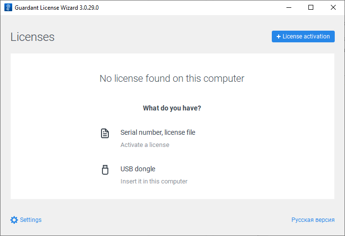
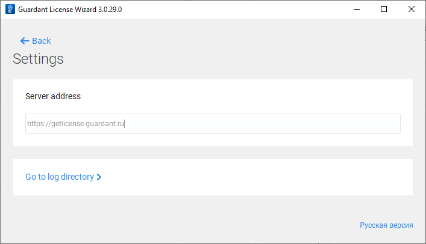
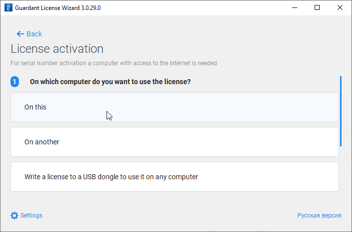
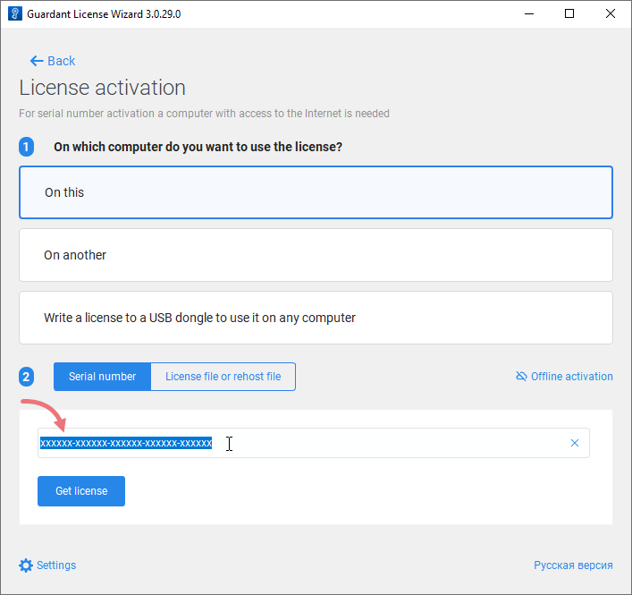
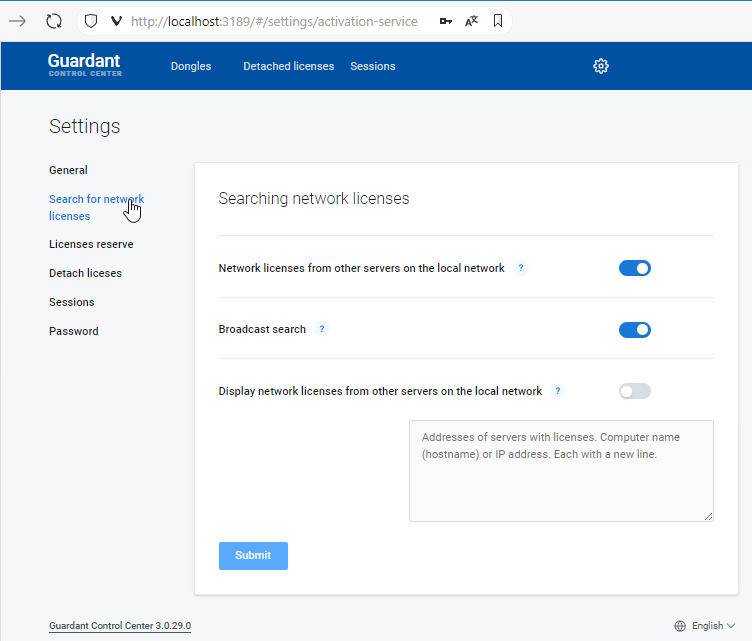
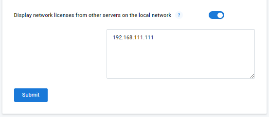

# Activate and Manage Network Licenses

Network licenses allow multiple users on a local network to share a pool of license seats. A network license should be installed on a server, which must stay powered on and connected to the network. This server hosts the license pool from which client machines obtain licenses.

## License Management Utilities

All license types ([local](activate-and-manage-local-licenses.md) and network) for the EMX Controls library are handled using two utilities from [Guardant](https://guardant.com) - _Guardant Control Center_ and _Guardant License Wizard_. These tools can be downloaded at:

- [Guardant License Management Redistributables (Windows)](../resources/Guardant_Redistributable_Windows.zip)
- [Guardant License Management Redistributables (Linux)](../resources/Guardant_Redistributable_Linux.zip) 


**_Guardant Control Center_**

A license management service.

_Installation files_: 

- Windows: `grdcontrol-x.x.msi`
- Linux: `grdcontrol-x.x_amd64.deb`, `grdcontrol-x.x.x86_64.rpm` 

!!! Note

    _Guardant Control Center_ must be installed and running on both the server and client machines to manage licenses and monitor their usage. Do not uninstall, stop, or disable the service; without it, the EMX Controls library cannot verify its license and will display trial messages.

**_Guardant License Wizard_** 

A GUI and command-line tool that allows you to add, update, and transfer licenses. 

_Executable files_: 

- Windows: `license_wizard.exe`
- Linux: `license_wizard`

To get information about all command-line options, run this command:

<code>license_wizard --help</code>


## Set up Network Licenses

To configure a network license, follow these steps:

1. [Install _Guardant Control Center_ (GCC) on the server and client machines](#install-guardant-control-center-gcc).
2. [Activate the network license on the server](#activate-a-network-license-on-the-server).
3. [Provide client access to the network license](#provide-client-access-to-the-network-license).

The sections below provide more details on configuring and using network licenses.

## Install Guardant Control Center (GCC)

To use network licenses, install _Guardant Control Center_ on the server and all client machines. Once installed, GCC runs as a background service. You can access its web interface at the port `3189`. For instance, to access the local GCC service on Windows, go to [http://localhost:3189/](http://localhost:3189/). Use `admin` as the default password in the web interface.


## Activate a Network License on the Server

You must activate a network license on the server machine after GCC is installed.

### Online License Activation Using a Software Key (Guardant DL)

#### From the Command Line

```
license_wizard --console --activate &lt;LICENSE-KEY&gt; --host https://getlicense.guardant.ru
```

#### From the UI

1. Launch _Guardant License Wizard_.

    

2. Click **Settings**, and ensure that the **Server address** field is set to _https://getlicense.guardant.ru_.

    

    Then click **Back** to return to the previous page.

3. Click the **License Activation** button to add a new license key.

4. Select **On this** when you are asked about the computer on which you want to register a license.

    

5. Enter your license key in the **Serial Number** field and click **Get a license**.

    

Upon success, the activated EMX Controls product and its network restrictions will be displayed. 

### Offline License Activation Using a Software Key (Guardant DL)

If the server that should broadcast licenses has no internet access, you can still activate the software key using an offline procedure. This activation type includes the following steps:

- Step 1. Generate a request file on the server that has no Internet access.
- Step 2. Get a license file from the request file on another machine with Internet access
- Step 3. Import the license file back to the offline server. 

You can find a detailed description of the offline activation procedure in this topic:

- [Offline Eremex Controls License Activation](activate-and-manage-local-licenses.md#offline-license-activation-using-a-software-key-guardant-dl)


## Provide Client Access to the Network License

Once the license is present on the server, configure client machines to allow them to find the license server.

Ensure _Guardant Control Center_ is installed and running on a client machine. This is required for the client to communicate with the server.

By default, GCC uses broadcast search to automatically discover license servers on the same subnet. If the client and server are on the same LAN, the network license should be discovered automatically.

If automatic discovery fails (e.g., due to firewall rules, VPN, or different subnets), manually specify the server address, as shown below:

1. Open the GCC web interface on the client machine ([http://localhost:3189/](http://localhost:3189/)).

    The default password is `admin`.

2. Click the Settings button () and then select **Search for network licenses**.

    


3. Enable the **Display network licenses from other servers on the local network** option and add the IP address of the GCC server hosting the license.

    

4. Click **Submit**.

    The client will now query the specified server for a network license directly.


## Verify the Network License

Open the GCC web interface at [http://localhost:3189/#/dongles/list](http://localhost:3189/#/dongles/list). You should see the available network licenses. 