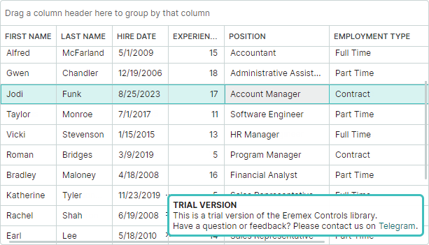
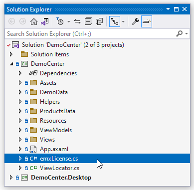

# Licensing and Product Evaluation

This document provides details regarding product evaluation, the licensing model, and answers to frequently asked questions about Eremex Controls Library licensing.

If you are developing an open-source project and wish to use the Eremex Controls library within it, you may apply for a free non-commercial license. See [Free Non-commercial Licenses for Open-Source Projects](#free-non-commercial-licenses-for-open-source-projects).

## Product Evaluation

The free 60-day trial version of the Eremex Controls Library allows you to evaluate the product within your projects and environment. The trial version has no functional limitations compared to an activated license.

While using the trial version, Eremex Controls will display trial messages.




## Licensing Model

The licensing model of the Eremex Controls Library is outlined in the [End User License Agreement (EULA)](eula.md).

Each Eremex Controls license provides one year of product updates and technical support. A license is required for each individual developer using the product.

During the active license period you can create new projects using the Eremex Controls Library, and upgrade your existing projects to new versions of the Library. 


### License Types

#### Annual License

- Includes one year of updates and support starting from the purchase date.
- After the license expires, you may continue to __build and distribute applications that were created during the active license period__.

    The only requirement is that you must not change the assembly name or the major version of the Eremex Controls Library in your existing projects. Otherwise, the controls will revert to displaying trial messages. However, you are free to update the minor release number (XX.Y.**z**) of the Library in your projects, even after the license expires.

- To develop new projects after license expiration, a new license must be purchased.

#### Perpetual License

- Includes one year of updates and support starting from the purchase date.
- After the first year, you retain the perpetual right to __build and distribute applications (both existing and new) based on the licensed version__.
- To continue receiving updates and support after the first year, you must purchase the "Update Subscription Renewal for 1 Year" product.

#### Update Subscription Renewal for 1 Year

This product extends access to updates and technical support for one additional year.  It is available exclusively to owners of a valid Perpetual License.


### Trial Messages At Runtime and During Debugging

A trial message is displayed at runtime and during debugging sessions if valid license information is missing or invalid.

Because debugging is an integral part of the development process, it requires a valid developer license.
If you use two or three computers for your workflow, you can register your active license across those devices. A single developer license can be activated up to three times. Because licenses are hardware-bound, you can apply these activations to multiple machines or save them for future hardware configuration changes (such as replacing a hard drive).


## License File

During a pre-build stage, the Eremex Controls' license manager generates an `emxLicense.cs` file containing a unique license runtime key. This key is used for license checking at runtime. If license information is missing or invalid, the Eremex Controls display a trial message.

The license runtime key encodes information about the following settings:

- Assembly name 
- Major version (**XX.Y**.z) of the Eremex Controls Library used in your project. 

The `emxLicense.cs` file is created inside your project's directory during the build stage and is automatically included in the project as a compile item.



Below is an example of an automatically generated `emxLicense.cs` file defining a runtime key:

``` csharp
// This file is auto-generated. Please do not change it.
using System.Runtime.CompilerServices;
using Eremex.AvaloniaUI.Controls.License;

namespace DemoCenter;
public class LicenseProvider
{
#pragma warning disable CA2255 // The 'ModuleInitializer' attribute should not be used in libraries
	[ModuleInitializer]
#pragma warning restore CA2255 // The 'ModuleInitializer' attribute should not be used in libraries
    public static void RegisterLicense()
	{
        ControlsLicenseManager.SetRuntimeLicenseOwner(new LicenseProvider(),"", 
        "61 5C D0 DA 5E 85 40 27 D0 33 A1 27 5E A7 49 C0 55 B8 3F 84 29 15 30 E0 
        08 57 73 0B 33 D6 BF 34 51 3D AC 02 BD 11 BF C3");
	}
}
```

If the generated `emxLicense.cs` file is not automatically included in your project (for instance, because of an IDE setting), please include this file manually as a compilation item.


## Free Non-commercial Licenses for Open-Source Projects

We support the open-source community by making Eremex Controls available for non-commercial open-source projects. If you maintain an open-source project and wish to use our library within it, you can request a free license using the service below.

- [Apply for the EMX Controls Open Source Licensing Program](https://eremexcontrols.net/open-source-licensing/)

!!! note 

    This licensing method is intended exclusively for non-commercial, open-source projects.

To qualify for a free open-source license, your project must meet the following criteria:

- The project must be publicly hosted on GitHub and contain a valid `README.md` file.
- The README file must contain a link to our website: [https://eremexcontrols.net/](https://eremexcontrols.net/).
- The project references the EMX Controls library.
- The project is licensed under one of the following open-source licenses: MIT, Apache 2.0, BSD 2-Clause, BSD 3-Clause, ISC, or MSPL.

An open-source EMX Controls license is tightly bound to your project name and the library's major version. If you rename your project or upgrade to a newer major version of the library, you will need to obtain a new license through our service.

Please note that technical support may be limited for free licenses.


## FAQ


#### What if I work on multiple computers?

One license can be activated up to three times. Because the license is hardware-bound, you can activate it on your secondary computers or reserve the activations for future hardware upgrades (like replacing a hard drive).

#### Do I need an additional license to build projects in a CI environment?

No. Licenses are only required for active development environments where code is written. Because continuous integration (CI) environments only compile the project rather than author code, they do not require an extra license seat. Ensure that your automated build pipelines do not modify the assembly name or target major version of the Eremex Controls Library.

#### Can I develop applications over a remote RDP connection?

When developing over a remote desktop connection (RDP), the local automated license manager may be unable to generate the license file in your project, resulting in a trial message. If your workflow relies heavily on remote development environments, please contact our support team to discuss alternative license types that accommodate this setup.


#### Will my project continue to build and run without trial messages after my license expires?

Yes. Your license grants you the right to create new projects and upgrade existing ones throughout the active term. 

After the license expires:

- Your existing projects will continue to compile and run without displaying trial messages. 

    If you are using an Annual License, you must not change the assembly name or upgrade the major version (**XX.Y**.z) of the Eremex Controls Library in your projects.

- If you own of a Perpetual License, you can create new projects based on the licensed version of the Eremex Controls Library.
- You can safely update the minor release number (XX.Y.**z**) in your existing projects after expiration, as this number is not used for license validation checking.


#### Why does my project display a trial message?

The Eremex Controls may display trial messages at runtime and during debugging sessions in the following cases:

- The project does not contain the `emxLicense.cs` file with a valid license runtime key.
- The major version of the Eremex Controls Library currently referenced by the application does not match the specific version encoded inside your license runtime key.
- The project's current assembly name has been modified and no longer matches the assembly name encoded in the license runtime key.
- During debugging sessions:
    - If there is no active developer license activated on the local machine. Because debugging is an integral part of the development process, it strictly requires an active, valid developer license on the workstation.
    - If [Guardant Control Center](activate-and-manage-local-licenses.md) (the license management service) is either not installed or not running.

