# Version 1.5

## 1.5.86

### Color Palettes for the DeltaDesign Theme

The `DeltaDesign` theme now includes predefined color palettes to fine-tune the look and feel of your application. A color palette applies a coordinated set of colors on top of the base theme to adjust control styling and accent colors. You can also create UI selectors to let users switch between color palettes at runtime.

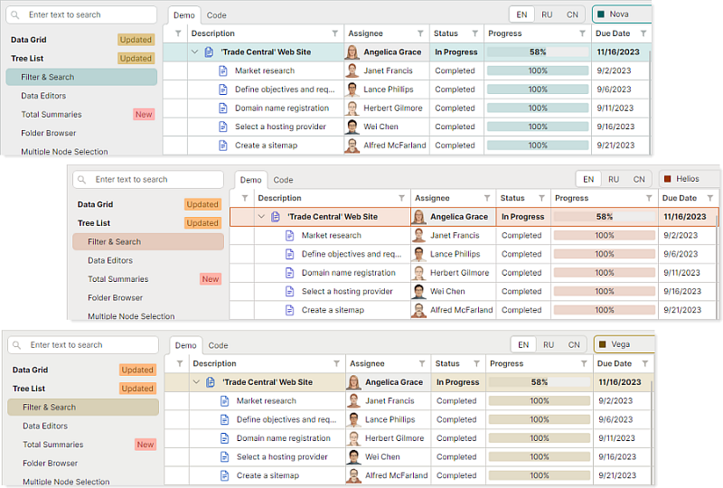

Applying a palette dynamically updates key UI elements and accent colors across your app:

- Window, panel, and container backgrounds.
- Editor backgrounds in various states.
- Row and cell backgrounds in data-aware controls.
- Selection highlights, hot-tracked elements, and focused control accents.

More information: [Themes](../controls/themes/index.md)

### Customizable UI Density in the DeltaDesign Theme

You can now create more compact or more spacious layouts in your application by adjusting the UI density in the `DeltaDesign` theme. Changing the density automatically scales element padding and font sizes to match your interface requirements.

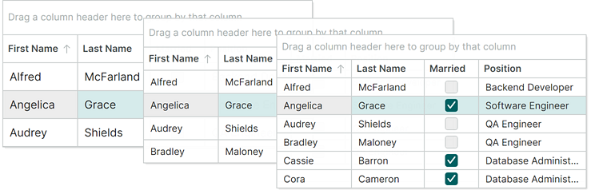

Available Modes:

- `Compact` — Reduces padding and font sizes to fit more information on the screen.

- `Standard` (default) — Uses the balanced default spacing and typography.

- `Spacious` — Increases padding and font sizes for a roomier, easier-to-read layout.

More information: [UI Density](../controls/themes/ui-density.md)

### DataGrid and TreeList

#### Summaries

This release introduces summary calculations to the DataGrid and TreeList controls. Summaries are aggregate functions (such as Sum, Max, and Count) calculated across row values and displayed in summary footers.

The DataGrid control supports two types of summaries:

- Total summaries — Calculated across all rows.
- Group summaries — Calculated for individual row groups when data grouping is applied.

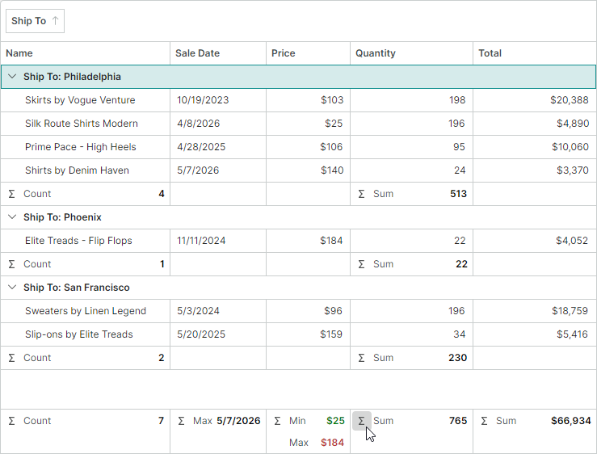

The TreeList control supports total summaries calculated across all nodes.

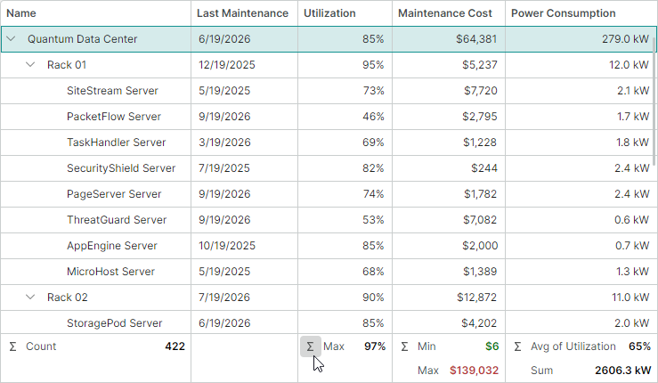


- Summary footers — Both DataGrid and TreeList display a summary footer at the bottom to show total summary values. DataGrid also supports group footers to display summary values for each group of rows.
- Built-in summary types — Sum, Min, Max, Count, and Average.
- Multiple summaries per column — Each column can display multiple summaries calculated against its values.
- Cross-column summaries — You can calculate a summary against one column and display the result in another column's footer cell.
- Runtime summary management — End users can add and remove summaries using a built-in dropdown menu.

    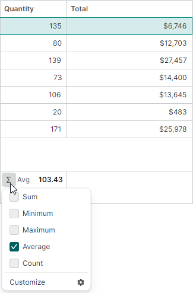

    The `Customize` button opens the `Summary Editor` dialog, where users can manage cross-column summaries and reorder summary items.

    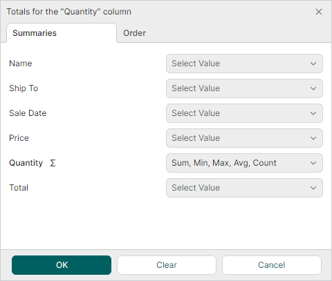

- Custom summaries — Handle the `CustomSummary` event to define custom aggregate calculations beyond the built-in options.
- XLSX and PDF export support — When you export a control to PDF or XLSX format, summary functions are included in the output file.

More information: 

- [DataGrid Summaries](../controls/datagrid/summaries.md)
- [TreeList Summaries](../controls/treelist/summaries.md)

#### Row Drag-and-Drop Enhancements

By default, the DataGrid and TreeList controls prevent rows from being dropped onto the empty area below the existing rows. Starting with v1.5, you can handle the `DragOver` event to allow row drop operations in this empty area. Rows dropped there are appended after the last row.

``` cs 
private void ProductsInStockGrid_DragOver(object sender, DataGridDragEventArgs e)
{
    if (e.DropPosition == DropPosition.EmptyArea)
        e.Effects = Avalonia.Input.DragDropEffects.Move;
}
```

You can also handle the `DragOver` event to override the default drop behavior and force a specific insertion position. For example, the following `DragOver` event handler forces dropped rows to always append to the end of the control:

``` cs
private void ProductsInStockGrid_DragOver(object sender, DataGridDragEventArgs e)
{
    e.DropPosition = DropPosition.EmptyArea;
    e.Effects = Avalonia.Input.DragDropEffects.Move;
}
```

More information: [Row Drag-and-Drop](../controls/datagrid/row-drag-and-drop.md)

#### `Select All` in Column Chooser

The DataGrid and TreeList controls now include a `(Select All)` option in the Column Chooser, allowing users to select or clear all columns in a single action instead of checking each column individually.

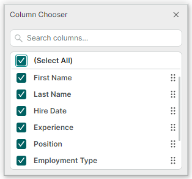

More information: [Column Chooser](../controls/datagrid/column-chooser.md)


#### Application Services

This release introduces Application Services — a set of platform-agnostic services for working with windows, dialogs, and application-wide appearance settings directly from your ViewModels, without referencing any Avalonia window types.

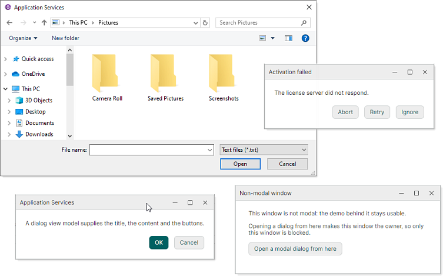

You can invoke these services from your ViewModel code to:

- Open windows
- Show `Save File` and `Open File` dialogs
- Display message boxes and custom modal dialogs
- Identify the active window
- Customize the settings of the current Eremex visual theme

Application Services decouple your ViewModels from the UI framework by exposing functionality through well-defined interfaces. Platform-specific tasks (such as creating windows, resolving owners, and showing dialogs) are handled internally by each service.

Available Application Services include:

##### User Interaction Services

| Service | Description |
|---------|-------------|
| [`IMessageBoxService`](../API/Eremex.AvaloniaUI.Controls.ApplicationServices/IMessageBoxService.md) | Shows standard message boxes with fixed button sets defined by the [`MessageBoxButtons`](../API/Eremex.AvaloniaUI.Controls/MessageBoxButtons.md) enumeration (OK, OK&vert;Cancel, Yes&vert;No&vert;Cancel, Yes&vert;No, Abort&vert;Retry&vert;Ignore, and Retry&vert;Cancel). |
| [`IDialogService`](../API/Eremex.AvaloniaUI.Controls.ApplicationServices/IDialogService.md) | Shows modal dialogs from ViewModel code to prompt the user for input or confirmation. A dialog is driven by a *dialog ViewModel*. You can also implement a View to display as the dialog's content. This View is located through the [`ViewLocatorAttribute`](../API/Eremex.AvaloniaUI.Controls.ApplicationServices/ViewLocatorAttribute.md) applied to the dialog ViewModel. |
| [`IChoiceDialogService`](../API/Eremex.AvaloniaUI.Controls.ApplicationServices/IChoiceDialogService.md) | Shows a dialog with a custom set of buttons and returns the clicked button's result. |
| [`IWindowService`](../API/Eremex.AvaloniaUI.Controls.ApplicationServices/IWindowService.md) | Shows non-modal windows from ViewModel code. |

##### File Services

| Service | Description |
|---------|-------------|
| [`IOpenFileDialogService`](../API/Eremex.AvaloniaUI.Controls.ApplicationServices/IOpenFileDialogService.md) | Shows the platform `Open File` dialog from ViewModel code in synchronous or asynchronous mode. |
| [`ISaveFileDialogService`](../API/Eremex.AvaloniaUI.Controls.ApplicationServices/ISaveFileDialogService.md) | Shows the platform `Save File` dialog from ViewModel code in synchronous or asynchronous mode. |

##### Infrastructure Services

| Service | Description |
|---------|-------------|
| [`IWindowsManager`](../API/Eremex.AvaloniaUI.Controls.ApplicationServices/IWindowsManager.md) | Tracks the application's active window. Dialog services use [`IWindowsManager`](../API/Eremex.AvaloniaUI.Controls.ApplicationServices/IWindowsManager.md) to determine the default owner for newly created dialogs. |
| [`IAppearanceService`](../API/Eremex.AvaloniaUI.Controls.ApplicationServices/IAppearanceService.md) | Lists visual theme settings and applies the selected theme variant. |

More information:

- [Application Services](../controls/app-services/index.md)


### Charts

#### Advanced Line Customization with LineStyle

Chart objects now provide advanced options of the [`LineStyle`](../API/Eremex.AvaloniaUI.Charts/LineStyle.md) type for customizing lines. [`LineStyle`](../API/Eremex.AvaloniaUI.Charts/LineStyle.md) exposes properties that give you full control over how lines are rendered. 

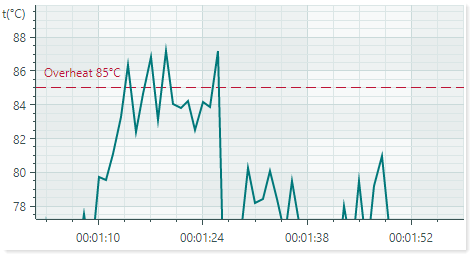

These properties include:

- [`Thickness`](../API/Eremex.AvaloniaUI.Charts/LineStyle/Thickness.md) — The stroke thickness.
- [`Dashes`](../API/Eremex.AvaloniaUI.Charts/LineStyle/Dashes.md) — The dash pattern for dashed lines.
- [`DashOffset`](../API/Eremex.AvaloniaUI.Charts/LineStyle/DashOffset.md) — The offset at which the dash pattern starts.
- [`LineCap`](../API/Eremex.AvaloniaUI.Charts/LineStyle/LineCap.md) — The shape used at both ends of a line.
- [`LineJoin`](../API/Eremex.AvaloniaUI.Charts/LineStyle/LineJoin.md) — The join style where two consecutive line segments meet.
- [`MiterLimit`](../API/Eremex.AvaloniaUI.Charts/LineStyle/MiterLimit.md) — The thickness limit for joins on mitered corners.

New line customization is available for:

- Graph lines in the following series views: all Line and Area Series Views, Lollipop Series View, Range Area Series View, Polar Line and Polar Range Area Series Views, and Smith Line Series View.
- Constant lines in supported Series Views.

    The `ConstantLine.Thickness` property has been deprecated. Use the [`LineStyle.Thickness`](../API/Eremex.AvaloniaUI.Charts/LineStyle/Thickness.md) option instead.

More information: [Cartesian Chart](../controls/charts/cartesian-chart.md#customize-line-style)

### Docking UI

The [`DockManager`](../API/Eremex.AvaloniaUI.Controls.Docking/DockManager.md) component now provides the [`CustomizeDockGuide`](../API/Eremex.AvaloniaUI.Controls.Docking/DockManager/CustomizeDockGuide.md) event that allows you to dynamically hide specific dock guides and individual guide items at runtime.

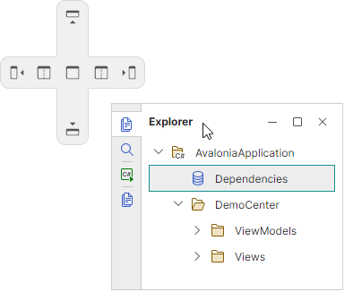

More information: [Customizing Dock Guides](../controls/docking/dock-manager.md#customize-dock-guides)

#### Wayland Support

Native Wayland sessions on Linux prevent individual application windows from knowing or setting their own screen position. To support dock operations on Wayland, panels provide the **Dock To** command in their context menu. Select this command to display dock guides, then click a guide to dock the panel at the corresponding position.

[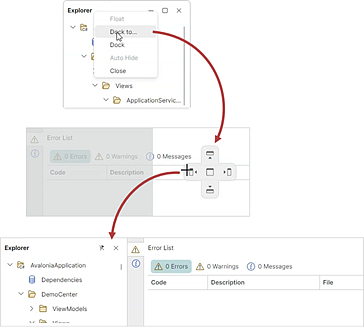](../images/docking-wayland-dockto-command.png)

To make a docked panel floating on Wayland, right-click the panel's header and select **Float** from the context menu.

Fixed issues:

- A document panel within a floating group is not activated when a user starts dragging this group.
- Floating panels cannot be resized on Astra Linux.

### MxTabControl

This release adds several new options to give you finer control over how tab headers are sized and rendered when space is limited.

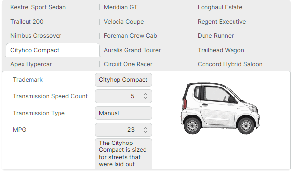

- Tab Stretching — Use the new `StretchTabsToFill` property to stretch tabs so they fill the entire tab strip, even when there are only a few tabs. 

    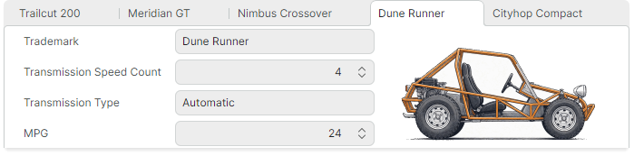

- Tab Sizing — The new [`TabSizeMode`](../API/Eremex.AvaloniaUI.Controls/TabSizeMode.md) and `TabSize` properties define how tab widths are calculated. You can choose to size tabs based on their content, match the largest visible tab, or apply a fixed width across all tabs.

    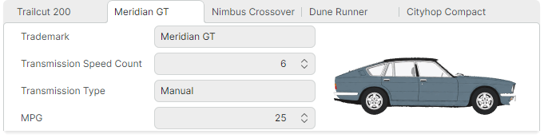

- Icon Display Mode — The new [`TabIconDisplayMode`](../API/Eremex.AvaloniaUI.Controls/TabIconDisplayMode.md) property lets you control when tab icons are visible (always, only when text is collapsed, or never).

More information: [MxTabControl](../controls/utility-controls/tabcontrol.md)

### Graphics3DControl

[`Graphics3DControl`](../API/Eremex.AvaloniaUI.Controls3D/Graphics3DControl.md) introduces new members to control grid plane visibility, mouse-driven rotation, hit-testing, and selection.

- Grid Plane Visibility — The [`Graphics3DControl.GridPlane`](../API/Eremex.AvaloniaUI.Controls3D/Graphics3DControl/GridPlane.md) property allows you to toggle the visibility of individual grid planes (XY, XZ, and YZ) when the [`Graphics3DControl.ShowGrid`](../API/Eremex.AvaloniaUI.Controls3D/Graphics3DControl/ShowGrid.md) property is enabled.

    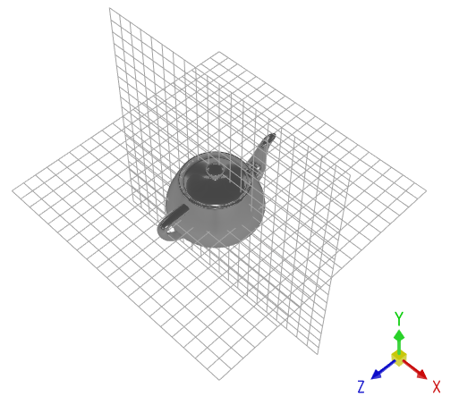

- Camera Rotation Mode — The [`Graphics3DControl.RotationMode`](../API/Eremex.AvaloniaUI.Controls3D/Graphics3DControl/RotationMode.md) property specifies the pivot point around which the camera orbits when the user rotates the scene by dragging with the left mouse button. Available modes include:

    - `AroundCameraTarget` — The camera orbits around its target ([`Camera.Target`](../API/Eremex.AvaloniaUI.Controls3D/Camera/Target.md)).
    - `AroundMouseHit` — The camera orbits around the point in the scene that was under the mouse pointer when the rotation started. This mode is helpful when inspecting a specific element without first re-centering the camera target.

    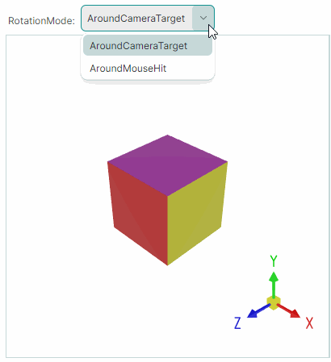


- Overriding Selection — The new [`Graphics3DControl.SelectionChanging`](../API/Eremex.AvaloniaUI.Controls3D/Graphics3DControl/SelectionChanging.md) event allows you to respond to element selection and override the default behavior. By default, the control selects the nearest model and mesh under the clicked point. Handle the [`SelectionChanging`](../API/Eremex.AvaloniaUI.Controls3D/Graphics3DControl/SelectionChanging.md) event to select a different element. You can use the `HitTestResults` event argument to obtain all candidates under the point.

- Hit Testing — The new [`Graphics3DControl.CalcHitInfo`](../API/Eremex.AvaloniaUI.Controls3D/Graphics3DControl/CalcHitInfo.md) method allows you to determine which models and meshes in the scene lie under a given point. [`CalcHitInfo`](../API/Eremex.AvaloniaUI.Controls3D/Graphics3DControl/CalcHitInfo.md) returns all meshes across all models, ordered from nearest to farthest.

    More information: [Hit Testing](../controls/graphics3dcontrol/user-interactions-with-3d-models.md#hit-testing)

### Editors Library

The [`SpinEditor`](../API/Eremex.AvaloniaUI.Controls.Editors/SpinEditor.md) control now includes the [`AllowRoundOutOfRangeValue`](../API/Eremex.AvaloniaUI.Controls.Editors/SpinEditor/AllowRoundOutOfRangeValue.md) property, which controls whether out-of-range values entered by a user are automatically rounded to the nearest valid value. You can define the valid range using the [`Minimum`](../API/Eremex.AvaloniaUI.Controls.Editors/SpinEditor/Minimum.md) and [`Maximum`](../API/Eremex.AvaloniaUI.Controls.Editors/SpinEditor/Maximum.md) properties.

### Toolbars and Menus

Fixed issue:

- The HotKey display text is not refreshed when changing the [`ToolbarItem.HotKey`](../API/Eremex.AvaloniaUI.Controls.Bars/ToolbarItem/HotKey.md) property.

### Breaking Changes

#### DateEditor and SpinEditor — Forced Masked Mode

The [`DateEditor`](../API/Eremex.AvaloniaUI.Controls.Editors/DateEditor.md) and [`SpinEditor`](../API/Eremex.AvaloniaUI.Controls.Editors/SpinEditor.md) controls now always operate in masked mode ([`MaskType.DateTime`](../API/Eremex.AvaloniaUI.Controls.Editors/MaskType.md) and [`MaskType.Numeric`](../API/Eremex.AvaloniaUI.Controls.Editors/MaskType.md), respectively). You can no longer disable masked mode (by setting [`MaskType.None`](../API/Eremex.AvaloniaUI.Controls.Editors/MaskType.md)) or apply an incompatible mask type to these editors.

#### Docking UI — Obsolete Property

The `ShowAutoHideExpandButton` property is now obsolete. This property was not supported in previous versions and has been deprecated.
