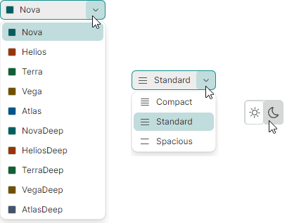
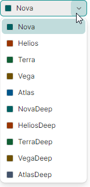
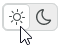

# IAppearanceService

[`IAppearanceService`](../../API/Eremex.AvaloniaUI.Controls.ApplicationServices/IAppearanceService.md) предоставляет платформенно-независимый способ получить параметры внешнего вида, поддерживаемые [темой DeltaDesign](../themes/index.md), и применить выбранный. Он позволяет ViewModel менять вариант темы, цветовую палитру и плотность интерфейса во время работы приложения, не ссылаясь напрямую ни на какие типы UI-фреймворка.




<!-- TODO
selector for Theme Variants (light, dark)
 -->

Основные возможности:

- Варианты темы — Предоставляет доступ к доступным вариантам темы (`Light` и `Dark`).
- Цветовые палитры — Предоставляет доступ к [цветовым палитрам](../themes/index.md#цветовые-палитры-темы-deltadesign), входящим в тему `DeltaDesign`, таким как `Nova`, `Helios`, `Terra`, `Vega` и `Atlas`.
- Плотность интерфейса — Предоставляет доступ к вариантам [плотности интерфейса](../themes/ui-density.md) темы `DeltaDesign` (`Compact`, `Standard` и `Spacious`).
- Немедленное применение — Изменение соответствующего параметра [`IAppearanceService`](../../API/Eremex.AvaloniaUI.Controls.ApplicationServices/IAppearanceService.md) сразу же меняет соответствующую настройку темы.
- Привязка к селекторам — Сервис упрощает создание в интерфейсе селекторов (галереи Ribbon, выпадающего списка или меню), с помощью которых пользователи переключают параметры темы во время работы приложения.

## Определение интерфейса

```csharp
public interface IAppearanceService : INotifyPropertyChanged
{
    // A list of available theme variants (light/dark).
    IReadOnlyList<IAppearanceOption> ThemeVariants { get; }

    // A list of available color palettes.
    IReadOnlyList<IAppearanceOption> Palettes { get; }

    // A list of available UI densities.
    IReadOnlyList<IAppearanceOption> Densities { get; }

    // The chosen theme variant. Assigning it recolors the running application at once.
    IAppearanceOption SelectedThemeVariant { get; set; }

    // The chosen theme palette. Assigning it recolors the running application at once.
    IAppearanceOption SelectedPalette { get; set; }

    // The chosen density. Assigning it resizes the controls of the running application at once.
    IAppearanceOption SelectedDensity { get; set; }
}
```

## IAppearanceOption

Каждый элемент списков [`ThemeVariants`](../../API/Eremex.AvaloniaUI.Controls.ApplicationServices/IAppearanceService/ThemeVariants.md), [`Palettes`](../../API/Eremex.AvaloniaUI.Controls.ApplicationServices/IAppearanceService/Palettes.md) и [`Densities`](../../API/Eremex.AvaloniaUI.Controls.ApplicationServices/IAppearanceService/Densities.md) реализует интерфейс [`IAppearanceOption`](../../API/Eremex.AvaloniaUI.Controls.ApplicationServices/IAppearanceOption.md):

```csharp
public interface IAppearanceOption
{
    // The text shown for this choice.
    string Header { get; }
}
```

Как и другие интерфейсы сервисов, интерфейс [`IAppearanceOption`](../../API/Eremex.AvaloniaUI.Controls.ApplicationServices/IAppearanceOption.md) не содержит типов UI-фреймворка. В нём есть только строковое свойство, задающее подпись параметра темы. Однако фактические реализации интерфейса [`IAppearanceOption`](../../API/Eremex.AvaloniaUI.Controls.ApplicationServices/IAppearanceOption.md) возвращают более богатые объекты, перечисленные ниже:

| Реализация [`IAppearanceOption`](../../API/Eremex.AvaloniaUI.Controls.ApplicationServices/IAppearanceOption.md) | Описание |
|---|---|
| Класс [`ThemeOption`](../../API/Eremex.AvaloniaUI.Controls.ApplicationServices/ThemeOption.md) | Светлый или тёмный вариант темы. Дополнительные свойства: <br> - [`ThemeOption.Variant`](../../API/Eremex.AvaloniaUI.Controls.ApplicationServices/ThemeOption/Variant.md) — Avalonia.Styling.ThemeVariant, применяемый при выборе этого параметра. |
| Класс [`PaletteOption`](../../API/Eremex.AvaloniaUI.Controls.ApplicationServices/PaletteOption.md) | Цветовая палитра. Дополнительные свойства: <br>- [`PaletteOption.Palette`](../../API/Eremex.AvaloniaUI.Controls.ApplicationServices/PaletteOption/Palette.md) — палитра, применяемая при выборе этого параметра (Nova, Helios, Terra, Vega, Atlas и т. д.);<br> - [`PaletteOption.Accent`](../../API/Eremex.AvaloniaUI.Controls.ApplicationServices/PaletteOption/Accent.md) — кисть только для чтения, представляющая акцентный цвет палитры. Свойство [`PaletteOption.Accent`](../../API/Eremex.AvaloniaUI.Controls.ApplicationServices/PaletteOption/Accent.md) позволяет показать в селекторе образец цвета, чтобы пользователь мог оценить палитру до её выбора.|
| Класс [`DensityOption`](../../API/Eremex.AvaloniaUI.Controls.ApplicationServices/DensityOption.md) | Плотность интерфейса. Дополнительные свойства: <br>- [`DensityOption.Density`](../../API/Eremex.AvaloniaUI.Controls.ApplicationServices/DensityOption/Density.md) — плотность, применяемая при выборе этого параметра (Compact, Standard или Spacious). |

Реализация [`IAppearanceService`](../../API/Eremex.AvaloniaUI.Controls.ApplicationServices/IAppearanceService.md) возвращает эти более богатые объекты. Например, фактическое значение [`IAppearanceService.SelectedPalette`](../../API/Eremex.AvaloniaUI.Controls.ApplicationServices/IAppearanceService/SelectedPalette.md) — это объект [`PaletteOption`](../../API/Eremex.AvaloniaUI.Controls.ApplicationServices/PaletteOption.md).

## Как использовать IAppearanceService

1. В ViewModel предоставьте сервис [`IAppearanceService`](../../API/Eremex.AvaloniaUI.Controls.ApplicationServices/IAppearanceService.md) в виде свойства. 
2. В View привяжите контролы-селекторы к членам этого свойства.

### Доступ к сервису

Чтобы предоставить сервис [`IAppearanceService`](../../API/Eremex.AvaloniaUI.Controls.ApplicationServices/IAppearanceService.md) в виде свойства, его нужно получить в ViewModel.

Получить объект [`IAppearanceService`](../../API/Eremex.AvaloniaUI.Controls.ApplicationServices/IAppearanceService.md) в ViewModel можно двумя способами:

- С помощью вспомогательного метода `Service<T>()`. Это удобный способ получить зарегистрированные сервисы приложения, входящие в библиотеку Eremex Controls.
- Через внедрение в конструктор.

#### Вспомогательный метод Service<T>()

Реализуйте в ViewModel вспомогательный метод `Service<T>()`, который получает запрошенный сервис с помощью статического метода `ApplicationServicesContext.GetRequiredService<T>()`.

```csharp
using Eremex.AvaloniaUI.Controls.ApplicationServices;
using CommunityToolkit.Mvvm.Input;

public partial class MyViewModel : ObservableObject
{
    // Provides access to any registered service
    protected static T Service<T>() where T : class
        => ApplicationServicesContext.GetRequiredService<T>();

    public IAppearanceService Appearance { get; } = Service<IAppearanceService>();
}
```

Убедитесь, что в файле App.axaml.cs сервисы приложения Eremex зарегистрированы с помощью [`SimpleServiceProvider`](../../API/Eremex.AvaloniaUI.Controls.ApplicationServices/SimpleServiceProvider.md) и [`ApplicationServicesContext`](../../API/Eremex.AvaloniaUI.Controls.ApplicationServices/ApplicationServicesContext.md) следующим образом:

```csharp
public class App : Application
{
    public override void OnFrameworkInitializationCompleted()
    {
        RegisterApplicationServices();
        //...
    }

    static void RegisterApplicationServices()
    {
        // Register built-in services.
        var serviceProvider = new SimpleServiceProvider();
        ApplicationServicesContext.RegisterApplicationServices(serviceProvider.AddSingleton);
        ApplicationServicesContext.SetCurrent(serviceProvider);
    }
}
```

#### Внедрение в конструктор

Реализуйте в ViewModel конструктор с параметром типа [`IAppearanceService`](../../API/Eremex.AvaloniaUI.Controls.ApplicationServices/IAppearanceService.md). При создании ViewModel передайте объект сервиса в этот конструктор.

```csharp
public partial class MainViewModel : ObservableObject
{
    public MainViewModel(IAppearanceService appearance)
    {
        Appearance = appearance;
    }

    public IAppearanceService Appearance { get; }
}
```

### Предоставление сервиса из ViewModel

Предоставьте [`IAppearanceService`](../../API/Eremex.AvaloniaUI.Controls.ApplicationServices/IAppearanceService.md) в виде открытого свойства. Контролы в View будут привязываться к нему напрямую.

В этом примере создаётся свойство _Appearance_ типа [`IAppearanceService`](../../API/Eremex.AvaloniaUI.Controls.ApplicationServices/IAppearanceService.md), которое инициализируется с помощью вспомогательного метода `Service<T>`. 

```csharp
public partial class MainViewModel : ObservableObject
{
    public IAppearanceService Appearance { get; }

    public MainViewModel(ThemeVariant? startupThemeVariant = null)
    {
        Appearance = Service<IAppearanceService>();
        Appearance.SelectedThemeVariant = FindTheme(startupThemeVariant);
        //...
    }

    private IAppearanceOption? FindTheme(ThemeVariant? variant)
        => variant is null
            ? null
            : Appearance.ThemeVariants.FirstOrDefault(
                x => string.Equals(x.Header, variant.ToString(), StringComparison.OrdinalIgnoreCase));

    // Provides access to any registered service
    protected static T Service<T>() where T : class
        => ApplicationServicesContext.GetRequiredService<T>();
}
```

### Пример - создание селектора палитры в View

В этом примере создаётся выпадающий список (контрол [`ComboBoxEditor`](../../API/Eremex.AvaloniaUI.Controls.Editors/ComboBoxEditor.md)) с доступными палитрами темы. При выборе элемента в выпадающем меню контрола соответствующая палитра применяется к приложению.



В этом примере: 

- [`ComboBoxEditor.ItemsSource`](../../API/Eremex.AvaloniaUI.Controls.Editors/ComboBoxEditor/ItemsSource.md) привязано к `Appearance.Palettes`, чтобы показать все доступные палитры в выпадающем меню.
- [`ComboBoxEditor.EditorValue`](../../API/Eremex.AvaloniaUI.Controls.Editors/BaseEditor/EditorValue.md) привязано к `Appearance.SelectedPalette`. Выбор элемента в выпадающем меню контрола применяет соответствующую палитру темы.
- Шаблон элемента ComboBoxEditor отображает акцентный цвет палитры в виде образца рядом с её названием (заголовком).

```xml
<mxe:ComboBoxEditor x:Name="themePaletteComboBox"
                    ItemsSource="{Binding Appearance.Palettes}"
                    EditorValue="{Binding Appearance.SelectedPalette}"
                    IsTextEditable="False"
                    ApplyItemTemplateToEditBox="True"
                    Width="150" Margin="0,0,10,0">
    <mxe:ComboBoxEditor.ItemTemplate>
        <DataTemplate x:DataType="appsvc:PaletteOption">
            <StackPanel Orientation="Horizontal" Spacing="8">
                <Border Width="12" Height="12" CornerRadius="2" VerticalAlignment="Center"
                        Background="{Binding Accent}"
                        BorderThickness="1"
                        BorderBrush="{DynamicResource Outline/Neutral/Transparent/Medium}"/>
                <TextBlock Text="{Binding Header}" VerticalAlignment="Center"/>
            </StackPanel>
        </DataTemplate>
    </mxe:ComboBoxEditor.ItemTemplate>
</mxe:ComboBoxEditor>
```

Полный код приведён в демонстрационном приложении [Controls Demo](../../index.md#демонстрационное-приложение).

### Пример - создание селектора плотности

В этом примере создаётся выпадающий список (контрол [`ComboBoxEditor`](../../API/Eremex.AvaloniaUI.Controls.Editors/ComboBoxEditor.md)), заполненный вариантами плотности интерфейса. При выборе элемента соответствующая компоновка применяется автоматически.


Чтобы показать в выпадающем списке собственные изображения для значений плотности, пример заполняет контрол элементами непосредственно из перечисления `Eremex.AvaloniaUI.Themes.DeltaDesign.Density`. Изображения предоставляются собственным конвертером `NameToImageConverter` и отображаются с помощью свойства [`ComboBoxEditor.ItemTemplate`](../../API/Eremex.AvaloniaUI.Controls.Editors/ComboBoxEditor/ItemTemplate.md).

```xml
<mxe:ComboBoxEditor x:Name="densityComboBox"
                    ItemsSource="{mxc:EnumItemsSource EnumType=ddt:Density, ShowImages=True,
                                  NameToImageConverter={views:DensityToIconConverter}}"
                    EditorValueChanged="DensityComboBoxEditor_EditorValueChanged"
                    IsTextEditable="False"
                    Margin="0,0,10,0">
    <mxe:ComboBoxEditor.ItemTemplate>
        <DataTemplate x:DataType="mxc:EnumMemberInfo">
            <StackPanel Orientation="Horizontal" Spacing="8">
                <Image Source="{Binding Image}" Stretch="None" VerticalAlignment="Center"/>
                <TextBlock Text="{Binding Name}" VerticalAlignment="Center"/>
            </StackPanel>
        </DataTemplate>
    </mxe:ComboBoxEditor.ItemTemplate>
</mxe:ComboBoxEditor>
```

Полный код приведён в демонстрационном приложении [Controls Demo](../../index.md#демонстрационное-приложение).


### Пример - создание селектора варианта темы

Код ниже показывает, как построить селектор варианта темы с помощью [`SegmentedEditor`](../../API/Eremex.AvaloniaUI.Controls.Editors/SegmentedEditor.md).

В этом примере:

- [`SegmentedEditor.ItemsSource`](../../API/Eremex.AvaloniaUI.Controls.Editors/SegmentedEditor/ItemsSource.md) привязан к списку `ThemeOptions`, определённому в ViewModel. `ThemeOptions` возвращает список доступных вариантов темы (`Light` и `Dark`) без варианта по умолчанию (`ThemeVariant.Default`).
- [`SegmentedEditor.EditorValue`](../../API/Eremex.AvaloniaUI.Controls.Editors/BaseEditor/EditorValue.md) привязан к `Appearance.SelectedThemeVariant`. Эта привязка применяет соответствующий вариант темы при выборе элемента [`SegmentedEditor`](../../API/Eremex.AvaloniaUI.Controls.Editors/SegmentedEditor.md).
- Свойству [`SegmentedEditor.ItemTemplate`](../../API/Eremex.AvaloniaUI.Controls.Editors/SegmentedEditor/ItemTemplate.md) задан шаблон элемента, отображающий каждый вариант как `PathIcon`.



``` xml
<mxe:SegmentedEditor ItemsSource="{Binding ThemeOptions}" Width="56"
                     EditorValue="{Binding Appearance.SelectedThemeVariant}">
    <mxe:SegmentedEditor.ItemTemplate>
        <DataTemplate x:DataType="appsvc:ThemeOption">
            <PathIcon Width="16" Height="16" Foreground="{DynamicResource Text/Neutral/Secondary}"
                      ToolTip.Tip="{Binding Header}">
                <PathIcon.Data>
                    <MultiBinding Converter="{views:ThemeVariantToIconDataConverter}">
                        <Binding Path="Variant"/>
                        <DynamicResourceExtension ResourceKey="SunPath"/>
                        <DynamicResourceExtension ResourceKey="MoonPath"/>
                    </MultiBinding>
                </PathIcon.Data>
            </PathIcon>
        </DataTemplate>
    </mxe:SegmentedEditor.ItemTemplate>
</mxe:SegmentedEditor>
```

``` cs
class MainViewModel 
{
    public IAppearanceService Appearance { get; }

    public IReadOnlyList<IAppearanceOption> ThemeOptions =>
        Appearance.ThemeVariants.Where(x => x is ThemeOption { Variant: not null } option
                                    && option.Variant != ThemeVariant.Default).ToList();
}
```


### Изменение настроек темы в коде

Чтобы изменить настройки темы в коде, используйте свойства [`SelectedThemeVariant`](../../API/Eremex.AvaloniaUI.Controls.ApplicationServices/IAppearanceService/SelectedThemeVariant.md), [`SelectedPalette`](../../API/Eremex.AvaloniaUI.Controls.ApplicationServices/IAppearanceService/SelectedPalette.md) и [`SelectedDensity`](../../API/Eremex.AvaloniaUI.Controls.ApplicationServices/IAppearanceService/SelectedDensity.md). 

```csharp
public IAppearanceService Appearance { get; } = Service<IAppearanceService>();

public void ChangeThemeSettings() 
{
    // Apply the 'Terra' palette.
    Appearance.SelectedPalette = Appearance.Palettes.First(p => p.Header == "Terra");  
    
    Appearance.SelectedDensity = Appearance.Densities[0]; // Switch to the most compact density.
}
```

<br>
<br>

<sup>*</sup> Эта страница переведена с использованием технологий машинного перевода.
