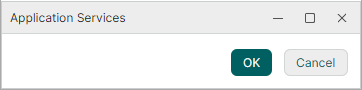
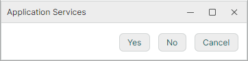

# IDialogService

[`IDialogService`](../../API/Eremex.AvaloniaUI.Controls.ApplicationServices/IDialogService.md) предоставляет платформенно-независимый способ показывать модальные диалоги. Из ViewModel можно открывать и обрабатывать модальные диалоги с помощью специальных _ViewModel диалогов_. Благодаря этому ваши ViewModel полностью отделены от типов окон Avalonia.


<!-- TODO
image
app-services-idialogservice 
-->

Основные возможности:

- Диалоги, управляемые ViewModel — Диалог полностью определяется ViewModel. ViewModel задаёт заголовок, содержимое и кнопки диалога.
- Простые диалоги — Если нужно показать только обычный текст с набором кнопок, View диалога определять не требуется. Достаточно создать ViewModel диалога, унаследовав её от [`OkCancelDialogAwareViewModel`](../../API/Eremex.AvaloniaUI.Controls.ApplicationServices/OkCancelDialogAwareViewModel.md), и присвоить строку свойству [`Content`](../../API/Eremex.AvaloniaUI.Controls.ApplicationServices/WindowAwareViewModel/Content.md) этой ViewModel.
- Собственные View диалогов — Можно создать собственное View, которое отображается как внутреннее содержимое диалога. Это View находится автоматически с помощью атрибута [`ViewLocatorAttribute`](../../API/Eremex.AvaloniaUI.Controls.ApplicationServices/ViewLocatorAttribute.md), применённого к ViewModel диалога. 
- Настраиваемые наборы кнопок — Базовый класс ViewModel диалога предоставляет стандартные кнопки OK/Cancel, но можно переопределить `CreateButtons`, чтобы задать любой набор кнопок с собственными подписями и расположением.
- Поддержка валидации — Переопределите метод [`CanOk`](../../API/Eremex.AvaloniaUI.Controls.ApplicationServices/OkCancelDialogAwareViewModel/CanOk.md) в ViewModel диалога, чтобы кнопка по умолчанию оставалась недоступной, пока введённые данные некорректны.
- Вложенные модальные окна — Диалог может открыть поверх себя другой модальный диалог.
- Результат диалога — После закрытия диалог возвращает результат, заданный перечислением [`DialogResult`](../../API/Eremex.AvaloniaUI.Controls.ApplicationServices/DialogResult.md).

## Определение интерфейса

```csharp
public interface IDialogService
{
    // Show a modal dialog driven by a ViewModel.
    DialogResult ShowDialog<T>(T viewModel, string? caption = null)
        where T : IDialogAwareViewModel;
}
```

| Параметр | Тип | Описание |
|-----------|------|-------------|
| `viewModel` | `T` | ViewModel диалога. Она задаёт содержимое и кнопки диалога. ViewModel присваивается Data Context диалога. ViewModel можно создать, унаследовав её от класса [`OkCancelDialogAwareViewModel`](../../API/Eremex.AvaloniaUI.Controls.ApplicationServices/OkCancelDialogAwareViewModel.md), который уже реализует интерфейс [`IDialogAwareViewModel`](../../API/Eremex.AvaloniaUI.Controls.ApplicationServices/IDialogAwareViewModel.md). [`OkCancelDialogAwareViewModel`](../../API/Eremex.AvaloniaUI.Controls.ApplicationServices/OkCancelDialogAwareViewModel.md) содержит кнопки OK и Cancel, которые можно заменить собственным набором кнопок. |
| `caption` | `string?` | Заголовок диалога. Если задано значение `null`, заголовок берётся из свойства `Title` ViewModel диалога ([`IWindowAwareViewModel.Title`](../../API/Eremex.AvaloniaUI.Controls.ApplicationServices/IWindowAwareViewModel/Title.md)). |

**Возвращаемое значение:** [`DialogResult`](../../API/Eremex.AvaloniaUI.Controls.ApplicationServices/DialogResult.md) — кнопка, которой был закрыт диалог, или [`DialogResult.None`](../../API/Eremex.AvaloniaUI.Controls.ApplicationServices/DialogResult.md), если пользователь закрыл диалог кнопкой в заголовке окна.


## Иерархия ViewModel диалогов

ViewModel диалога должна реализовывать интерфейс [`IDialogAwareViewModel`](../../API/Eremex.AvaloniaUI.Controls.ApplicationServices/IDialogAwareViewModel.md). Как правило, ViewModel диалога наследуют от класса [`OkCancelDialogAwareViewModel`](../../API/Eremex.AvaloniaUI.Controls.ApplicationServices/OkCancelDialogAwareViewModel.md), который уже реализует этот интерфейс. Класс [`OkCancelDialogAwareViewModel`](../../API/Eremex.AvaloniaUI.Controls.ApplicationServices/OkCancelDialogAwareViewModel.md) содержит кнопки OK и Cancel, которые можно заменить собственными кнопками. 

На следующей схеме показана иерархия базовых классов для ViewModel диалогов:

```
IWindowAwareViewModel
    └── IDialogAwareViewModel
            └── WindowAwareViewModel (abstract class)
                    └── DialogAwareViewModel (abstract class)
                            └── OkCancelDialogAwareViewModel (abstract class)
```

| Класс | Назначение |
|-------|---------|
| [`WindowAwareViewModel`](../../API/Eremex.AvaloniaUI.Controls.ApplicationServices/WindowAwareViewModel.md) | Базовый класс для ViewModel, отображаемых в окне. Отслеживает окно, к которому привязана ViewModel, закрывает его по запросу и создаёт View, объявленное атрибутом [`ViewLocatorAttribute`](../../API/Eremex.AvaloniaUI.Controls.ApplicationServices/ViewLocatorAttribute.md). |
| [`DialogAwareViewModel`](../../API/Eremex.AvaloniaUI.Controls.ApplicationServices/DialogAwareViewModel.md) | Базовый класс для ViewModel, отображаемых в виде модальных диалогов. Этот класс добавляет поддержку кнопок диалога. Чтобы задать собственный набор кнопок, можно переопределить метод `CreateButtons`. |
| [`OkCancelDialogAwareViewModel`](../../API/Eremex.AvaloniaUI.Controls.ApplicationServices/OkCancelDialogAwareViewModel.md) | Предоставляет стандартные кнопки OK и Cancel, связанные с виртуальными методами [`OkCancelDialogAwareViewModel.Ok`](../../API/Eremex.AvaloniaUI.Controls.ApplicationServices/OkCancelDialogAwareViewModel/Ok.md) и [`OkCancelDialogAwareViewModel.Cancel`](../../API/Eremex.AvaloniaUI.Controls.ApplicationServices/OkCancelDialogAwareViewModel/Cancel.md). Метод [`CanOk`](../../API/Eremex.AvaloniaUI.Controls.ApplicationServices/OkCancelDialogAwareViewModel/CanOk.md) можно переопределить, чтобы отключать кнопку OK в соответствии с правилами валидации диалога. |


## Как использовать IDialogService

Чтобы отобразить модальный диалог, вызовите в ViewModel метод [`IDialogService.ShowDialog`](../../API/Eremex.AvaloniaUI.Controls.ApplicationServices/IDialogService/ShowDialog.md). Метод возвращает результат диалога (кнопку, которую нажал пользователь).

### Доступ к сервису

Получить объект [`IDialogService`](../../API/Eremex.AvaloniaUI.Controls.ApplicationServices/IDialogService.md) в ViewModel можно двумя способами:

- С помощью вспомогательного метода `Service<T>()`. Это удобный способ получить зарегистрированные сервисы приложения, входящие в библиотеку Eremex Controls.
- Через внедрение в конструктор.

#### Вспомогательный метод Service<T>()

Реализуйте в ViewModel вспомогательный метод `Service<T>()`, который получает запрошенный сервис с помощью статического метода `ApplicationServicesContext.GetRequiredService<T>()`.

```csharp
using Eremex.AvaloniaUI.Controls.ApplicationServices;
using CommunityToolkit.Mvvm.Input;

public partial class MyViewModel : ObservableObject
{
    // Provides access to any registered service
    protected static T Service<T>() where T : class
        => ApplicationServicesContext.GetRequiredService<T>();

    [RelayCommand]
    private void ShowDialog()
    {
        // Create the dialog view model
        var dialogViewModel = new MyDialogViewModel("Dialog Title", "Dialog content");

        // Resolve the service and show the dialog
        var result = Service<IDialogService>()
            .ShowDialog(dialogViewModel, caption: null);
    }
}
```

Убедитесь, что в файле App.axaml.cs сервисы приложения Eremex зарегистрированы с помощью [`SimpleServiceProvider`](../../API/Eremex.AvaloniaUI.Controls.ApplicationServices/SimpleServiceProvider.md) и [`ApplicationServicesContext`](../../API/Eremex.AvaloniaUI.Controls.ApplicationServices/ApplicationServicesContext.md) следующим образом:

```csharp
public class App : Application
{
    public override void OnFrameworkInitializationCompleted()
    {
        RegisterApplicationServices();
        //...
    }

    static void RegisterApplicationServices()
    {
        // Register built-in services.
        var serviceProvider = new SimpleServiceProvider();
        ApplicationServicesContext.RegisterApplicationServices(serviceProvider.AddSingleton);
        ApplicationServicesContext.SetCurrent(serviceProvider);
    }
}
```

#### Внедрение в конструктор

Реализуйте в ViewModel конструктор с параметром типа [`IDialogService`](../../API/Eremex.AvaloniaUI.Controls.ApplicationServices/IDialogService.md). При создании ViewModel передайте объект сервиса в этот конструктор.

```csharp
public partial class MyViewModel
{
    private readonly IDialogService _dialogService;

    public MyViewModel(IDialogService dialogService)
    {
        _dialogService = dialogService;
    }

    [RelayCommand]
    private void ShowDialog()
    {
        var dialogViewModel = new MyDialogViewModel("Dialog Title", "Dialog content");
        var result = _dialogService.ShowDialog(dialogViewModel, caption: null);
        //...
    }
}
```

### Создание ViewModel диалога

ViewModel диалога задаёт его содержимое и кнопки. Проще всего унаследовать её от [`OkCancelDialogAwareViewModel`](../../API/Eremex.AvaloniaUI.Controls.ApplicationServices/OkCancelDialogAwareViewModel.md): этот класс сразу предоставляет кнопки OK и Cancel.

!!! Tip

    [`OkCancelDialogAwareViewModel`](../../API/Eremex.AvaloniaUI.Controls.ApplicationServices/OkCancelDialogAwareViewModel.md) позволяет заменить кнопки OK и Cancel собственным набором кнопок. Каждая кнопка может закрывать диалог с определённым результатом (значением [`DialogResult`](../../API/Eremex.AvaloniaUI.Controls.ApplicationServices/DialogResult.md)).

В этом примере показано, как отобразить диалог с кнопками OK и Cancel. ViewModel создаётся наследованием от класса [`OkCancelDialogAwareViewModel`](../../API/Eremex.AvaloniaUI.Controls.ApplicationServices/OkCancelDialogAwareViewModel.md). Строки, переданные в конструктор ViewModel, задают заголовок и содержимое диалога.

<!-- TODO image
app-services-idialogservice
 -->


```csharp
using Eremex.AvaloniaUI.Controls.ApplicationServices;

public class MyDialogViewModel : OkCancelDialogAwareViewModel
{
    public MyDialogViewModel(string title, string message) : base(title)
    {
        Content = message;
    }
}
```

Чтобы показать этот диалог, используйте следующий код:

```csharp
var result = Service<IDialogService>()
    .ShowDialog(new MyDialogViewModel("Dialog Title", "Dialog content"));
```

### Собственные наборы кнопок

Чтобы заменить стандартный набор кнопок, переопределите метод `CreateButtons` в ViewModel диалога. Для создания стандартных кнопок OK, Cancel и Apply можно использовать встроенные фабричные методы (`CreateOk`, `CreateCancel`, `CreateApply`). Для создания собственных кнопок используйте метод [`CreateCustom`](../../API/Eremex.AvaloniaUI.Controls.ApplicationServices/DialogButtonViewModel/CreateCustom.md).

В этом примере показан диалог с кнопками Yes, No и Cancel. Этот диалог представлен ViewModel `DialogServiceYesNoCancelViewModel`, унаследованной от класса [`OkCancelDialogAwareViewModel`](../../API/Eremex.AvaloniaUI.Controls.ApplicationServices/OkCancelDialogAwareViewModel.md). Метод `CreateButtons` переопределён, чтобы создать собственный набор кнопок. 

Кнопка Yes назначена кнопкой по умолчанию. Команда кнопки по умолчанию вызывается, когда пользователь нажимает ENTER в диалоге. У встроенной кнопки Cancel включён параметр `IsCancel`. Этот параметр вызывает команду кнопки при нажатии клавиши ESC.

<!-- TODO image
app-services-idialogservice
 -->



```csharp
using CommunityToolkit.Mvvm.Input;
using Eremex.AvaloniaUI.Controls.ApplicationServices;

/// <summary>
/// IDialogService with the Yes, No, and Cancel buttons.
/// </summary>
public partial class DialogServiceYesNoCancelViewModel : OkCancelDialogAwareViewModel
{
    public DialogServiceYesNoCancelViewModel(string title, string message) : base(title)
    {
        Content = message;
    }

    [RelayCommand]
    public void Yes(object parameter) => CloseWindow(DialogResult.Yes);

    [RelayCommand]
    public void No(object parameter) => CloseWindow(DialogResult.No);

    protected override IDialogButtonViewModel[] CreateButtons()
    {
        var buttons = new IDialogButtonViewModel[]
        {
            DialogButtonViewModel.CreateCustom(YesCommand, "Yes", classes: "accent"),
            DialogButtonViewModel.CreateCustom(NoCommand, "No"),
            DialogButtonViewModel.CreateCancel(CancelCommand),
        };
        (buttons[0] as DialogButtonViewModel).IsDefault = true;
        return buttons;
    }
}
```

Чтобы показать этот диалог, используйте следующий код:

```csharp
var result = Service<IDialogService>().ShowDialog(new DialogServiceYesNoCancelViewModel("Warning", "Save the changes?"));
```


### Собственные подписи и расположение кнопок

Собственные кнопки можно создать, переопределив метод `DialogAwareViewModel.CreateButtons` и вызвав в нём статический метод [`DialogButtonViewModel.CreateCustom`](../../API/Eremex.AvaloniaUI.Controls.ApplicationServices/DialogButtonViewModel/CreateCustom.md). Метод [`CreateCustom`](../../API/Eremex.AvaloniaUI.Controls.ApplicationServices/DialogButtonViewModel/CreateCustom.md) позволяет задать подпись и расположение кнопки. 

В этом примере показан диалог с кнопками Yes, No и Cancel. Кнопки Yes и No размещены слева от кнопки Cancel с помощью параметра _dockType_.

<!-- TODO image
app-services-idialogservice
 -->

```csharp
using CommunityToolkit.Mvvm.Input;
using Eremex.AvaloniaUI.Controls.ApplicationServices;

public partial class DialogServiceNoYesCancelViewModel : OkCancelDialogAwareViewModel
{
    public DialogServiceNoYesCancelViewModel(string title, string message) : base(title)
    {
        Content = message;
    }

    [RelayCommand]
    public void Yes(object parameter) => CloseWindow(DialogResult.Yes);

    [RelayCommand]
    public void No(object parameter) => CloseWindow(DialogResult.No);

    protected override IDialogButtonViewModel[] CreateButtons() => new[]
    {
        DialogButtonViewModel.CreateCancel(CancelCommand),
        DialogButtonViewModel.CreateCustom(NoCommand, "No", dockType: DockType.Left),
        DialogButtonViewModel.CreateCustom(YesCommand, "Yes", dockType: DockType.Left),
    };
}
```

Чтобы показать этот диалог, используйте следующий код:

```csharp
var result = Service<IDialogService>().ShowDialog(new DialogServiceNoYesCancelViewModel("Info", "Custom button placement"));
```


### Собственное содержимое диалога и валидация

По умолчанию диалог отображает строку, присвоенную свойству [`Content`](../../API/Eremex.AvaloniaUI.Controls.ApplicationServices/WindowAwareViewModel/Content.md) ViewModel диалога ([`WindowAwareViewModel.Content`](../../API/Eremex.AvaloniaUI.Controls.ApplicationServices/WindowAwareViewModel/Content.md)). Вместо простой строки можно также отобразить собственное содержимое.

Чтобы задать собственное содержимое диалога:

1. Создайте View с контролами, которые нужно отобразить в диалоге.

    Добавьте `UserControl` с нужными контролами. При необходимости привяжите его свойства к свойствам ViewModel диалога, чтобы они оставались синхронизированными.

2. Примените к ViewModel диалога атрибут [`ViewLocatorAttribute`](../../API/Eremex.AvaloniaUI.Controls.ApplicationServices/ViewLocatorAttribute.md).

    Пометьте ViewModel диалога атрибутом [`ViewLocatorAttribute`](../../API/Eremex.AvaloniaUI.Controls.ApplicationServices/ViewLocatorAttribute.md), передав ему тип созданного View. Атрибут связывает View с ViewModel. Сервис диалогов использует его, чтобы создать и отобразить View в клиентской области диалога (над кнопками в нижней части диалога).

Если атрибут [`ViewLocatorAttribute`](../../API/Eremex.AvaloniaUI.Controls.ApplicationServices/ViewLocatorAttribute.md) задан, базовый класс [`WindowAwareViewModel`](../../API/Eremex.AvaloniaUI.Controls.ApplicationServices/WindowAwareViewModel.md) автоматически создаёт View при открытии диалога. Это View присваивается свойству [`Content`](../../API/Eremex.AvaloniaUI.Controls.ApplicationServices/WindowAwareViewModel/Content.md). ViewModel никогда не нужно ссылаться на тип View напрямую.

!!! Tip 

    Свойство [`Content`](../../API/Eremex.AvaloniaUI.Controls.ApplicationServices/WindowAwareViewModel/Content.md) ViewModel диалога можно также задать вручную, без использования [`ViewLocatorAttribute`](../../API/Eremex.AvaloniaUI.Controls.ApplicationServices/ViewLocatorAttribute.md).

3. (Необязательно) Управляйте доступностью кнопки OK диалога

    Чтобы включать и отключать кнопку OK в соответствии с вашими требованиями, переопределите метод CanOk в ViewModel диалога.

#### Пример

В этом примере показан диалог с текстовым полем и кнопками OK/Cancel. Текстовое поле находится в собственном View (_DialogServiceValidationView_). Метод [`CanOk`](../../API/Eremex.AvaloniaUI.Controls.ApplicationServices/OkCancelDialogAwareViewModel/CanOk.md) переопределён, чтобы кнопка OK оставалась недоступной, пока текстовое поле пусто.

<!-- TODO image
app-services-idialogservice
 -->

**ViewModel**

```csharp
using Eremex.AvaloniaUI.Controls.ApplicationServices;

namespace DemoCenter.ViewModels.ApplicationServices;

// The Ok button stays disabled until the UserName field is filled in.
[ViewLocator(typeof(DialogServiceValidationView))]
public class DialogServiceValidationViewModel : OkCancelDialogAwareViewModel
{
    private string userName = string.Empty;

    public DialogServiceValidationViewModel(string title) : base(title)
    {
    }

    public string UserName
    {
        get => userName;
        set
        {
            if (userName == value)
                return;

            userName = value;
            OnPropertyChanged(nameof(UserName));
            OkCommand.NotifyCanExecuteChanged();
        }
    }

    public override bool CanOk(object parameter) => !string.IsNullOrWhiteSpace(UserName);
}
```

**View**

```xml
<UserControl x:Class="DemoCenter.Views.ApplicationServices.DialogServiceValidationView"
             xmlns="https://github.com/avaloniaui"
             xmlns:x="http://schemas.microsoft.com/winfx/2006/xaml"
             xmlns:mxe="https://schemas.eremexcontrols.net/avalonia/editors"
             xmlns:vm="using:DemoCenter.ViewModels.ApplicationServices"
             x:CompileBindings="True"
             x:DataType="vm:DialogServiceValidationViewModel"
             MinWidth="380">

    <StackPanel Margin="20" Spacing="10">
        <TextBlock Text="The Ok button stays disabled until the field is filled in."
                   TextWrapping="Wrap" />
        <mxe:TextEditor EditorValue="{Binding UserName, Mode=TwoWay}" />
    </StackPanel>
</UserControl>
```

**Отображение диалога**

Чтобы показать этот диалог, используйте следующий код:

```csharp
var result = Service<IDialogService>().ShowDialog(new DialogServiceValidationViewModel("Custom dialog content and validation"));
```


### Вложенные модальные диалоги

Диалог может открыть поверх себя другой модальный диалог. 

В этом примере показан диалог с кнопкой "Nested dialog". Нажатие этой кнопки отображает ещё один диалог.

<!-- TODO image
app-services-idialogservice
 -->

```csharp
using CommunityToolkit.Mvvm.Input;
using Eremex.AvaloniaUI.Controls.ApplicationServices;

// The primary dialog ViewModel, which contains a button that invokes a nested dialog.
public partial class DialogServiceNestedViewModel : OkCancelDialogAwareViewModel
{
    private readonly IDialogService dialogService;

    public DialogServiceNestedViewModel(string title, IDialogService dialogService) : base(title)
    {
        this.dialogService = dialogService;
        Content = "Press \"Nested dialog\" to open a modal dialog on top of this one. "
            + "The nested dialog blocks this window only.";
    }

    [RelayCommand]
    public void ShowNested(object parameter)
    {
        var nested = new DialogServiceOkCancelViewModel(
            "Nested dialog",
            "This modal dialog is owned by the dialog underneath.");

        dialogService.ShowDialog(nested, caption: null);
    }

    protected override IDialogButtonViewModel[] CreateButtons() => new[]
    {
        DialogButtonViewModel.CreateCustom(ShowNestedCommand, "Nested dialog", dockType: DockType.Left),
        DialogButtonViewModel.CreateOk(OkCommand),
        DialogButtonViewModel.CreateCancel(CancelCommand),
    };
}

// The simplest nested dialog ViewModel
public class DialogServiceOkCancelViewModel : OkCancelDialogAwareViewModel
{
    public DialogServiceOkCancelViewModel(string title, string message) : base(title)
    {
        Content = message;
    }
}
```

Чтобы показать этот диалог, используйте следующий код:

```csharp
var result = Service<IDialogService>().ShowDialog(new DialogServiceNestedViewModel("Dialog that shows a nested dialog", Service<IDialogService>()));
```


## Выделение кнопки акцентом

Любую кнопку диалога можно выделить акцентом, чтобы она визуально выделялась. Например, можно выделить кнопку по умолчанию.


!!! Tip

    Кнопка по умолчанию — это кнопка, которая срабатывает, когда пользователь нажимает ENTER.

Чтобы выделить кнопку акцентом, укажите "accent" в параметре `classes` метода [`CreateCustom`](../../API/Eremex.AvaloniaUI.Controls.ApplicationServices/DialogButtonViewModel/CreateCustom.md).

В этом примере акцентом выделена кнопка Yes. У этой кнопки включено свойство [`IsDefault`](../../API/Eremex.AvaloniaUI.Controls.ApplicationServices/DialogButtonViewModel/IsDefault.md), чтобы назначить её кнопкой диалога по умолчанию.


<!-- TODO image
app-services-idialogservice
 -->

```csharp
    protected override IDialogButtonViewModel[] CreateButtons()
    {
        var buttons = new IDialogButtonViewModel[]
        {
            DialogButtonViewModel.CreateCustom(YesCommand, "Yes", classes: "accent"),
            DialogButtonViewModel.CreateCustom(NoCommand, "No"),
            DialogButtonViewModel.CreateCancel(CancelCommand),
        };
        (buttons[0] as DialogButtonViewModel).IsDefault = true;
        return buttons;
    }
```

<br>
<br>

<sup>*</sup> Эта страница переведена с использованием технологий машинного перевода.
