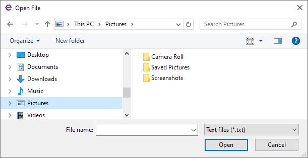
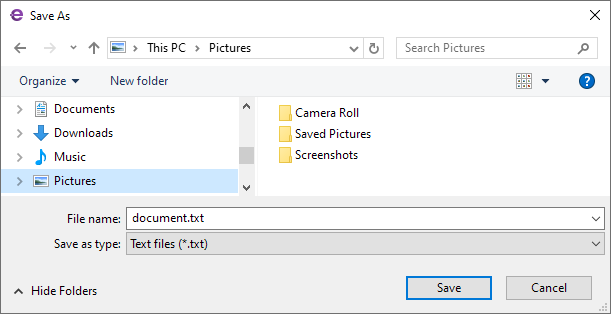

# IOpenFileDialogService и ISaveFileDialogService

[`IOpenFileDialogService`](../../API/Eremex.AvaloniaUI.Controls.ApplicationServices/IOpenFileDialogService.md) и [`ISaveFileDialogService`](../../API/Eremex.AvaloniaUI.Controls.ApplicationServices/ISaveFileDialogService.md) предоставляют платформенно-независимый способ показывать системные диалоги открытия и сохранения файлов из ViewModel. ViewModel при этом остаются полностью отделёнными от типов окон Avalonia.






Основные возможности:

- Системные диалоги открытия и сохранения файлов — Сервисы показывают средства выбора файлов, предоставляемые операционной системой.
- Синхронный и асинхронный варианты — Каждый сервис предоставляет синхронный метод `Show` и асинхронный метод `ShowAsync`. 
- Настраиваемые параметры файловых диалогов — В файловых диалогах можно настроить заголовок, фильтры типов файлов, начальную папку, предлагаемое имя файла, расширение по умолчанию, запрос на перезапись и режим множественного выбора.
- Автоматический владелец — Владельцем диалога становится активное окно приложения, определяемое через сервис [`IWindowsManager`](../../API/Eremex.AvaloniaUI.Controls.ApplicationServices/IWindowsManager.md).

## Определения интерфейсов

### IOpenFileDialogService

```csharp
public interface IOpenFileDialogService
{
    // Show an Open File dialog and block the calling thread until the user closes the dialog.
    string[] Show(IWindow? owner = null, OpenFileDialogOptions? options = null);

    // Show an Open File dialog without blocking the calling thread.
    Task<string[]> ShowAsync(IWindow? owner = null, OpenFileDialogOptions? options = null);
}
```

| Параметр | Тип | Описание |
|-----------|------|-------------|
| `owner` | `IWindow?` | Владелец диалога. Если этот параметр равен `null`, владельцем диалога становится активное окно приложения. |
| `options` | `OpenFileDialogOptions?` | Параметры конфигурации диалога: заголовок, фильтры, начальная папка, множественный выбор и другие. Если этот параметр равен `null`, применяются параметры платформы по умолчанию. |

**Возвращаемое значение:**

- `Show` — Возвращает пути выбранных файлов или пустой массив, если пользователь отменил диалог или окно-владельца не удалось определить.
- `ShowAsync` — Возвращает задачу, которая завершается при закрытии диалога и содержит пути выбранных файлов. Возвращает пустой массив, если пользователь отменил диалог.


### ISaveFileDialogService

```csharp
public interface ISaveFileDialogService
{
    // Show a Save File dialog and block the calling thread until the user closes the dialog.
    string? Show(IWindow? owner = null, SaveFileDialogOptions? options = null);

    // Show a Save File dialog without blocking the calling thread.
    Task<string?> ShowAsync(IWindow? owner = null, SaveFileDialogOptions? options = null);
}
```

| Параметр | Тип | Описание |
|-----------|------|-------------|
| `owner` | `IWindow?` | Владелец диалога. Если этот параметр равен `null`, владельцем диалога становится активное окно приложения. |
| `options` | `SaveFileDialogOptions?` | Параметры конфигурации диалога: заголовок, фильтры, начальная папка, предлагаемое имя файла. Если этот параметр равен `null`, применяются параметры платформы по умолчанию. |

**Возвращаемое значение:**

- `Show` — Возвращает выбранный путь или `null`, если пользователь отменил диалог или окно-владельца не удалось определить.
- `ShowAsync` — Возвращает задачу, которая завершается при закрытии диалога и содержит выбранный путь или `null`, если пользователь отменил диалог.


### Владелец диалога

Параметр `owner` методов `Show` и `ShowAsync` имеет тип [`IWindow`](../../API/Eremex.AvaloniaUI.Controls.ApplicationServices/IWindow.md). Интерфейс [`IWindow`](../../API/Eremex.AvaloniaUI.Controls.ApplicationServices/IWindow.md) — это абстракция окна, которая не привязывает ваш код к типам окон Avalonia. Реализация сервиса внутренне преобразует его в фактическое окно Avalonia `Window`. Чтобы получить в коде объект [`IWindow`](../../API/Eremex.AvaloniaUI.Controls.ApplicationServices/IWindow.md), представляющий текущее активное окно, можно использовать сервис [`IWindowsManager`](../../API/Eremex.AvaloniaUI.Controls.ApplicationServices/IWindowsManager.md).


## Параметры

### OpenFileDialogOptions

При вызове методов `Show` и `ShowAsync` сервиса [`IOpenFileDialogService`](../../API/Eremex.AvaloniaUI.Controls.ApplicationServices/IOpenFileDialogService.md) параметры файлового диалога можно настроить с помощью параметра `options`. Этот параметр имеет тип [`OpenFileDialogOptions`](../../API/Eremex.AvaloniaUI.Controls.ApplicationServices/OpenFileDialogOptions.md).

```csharp
public class OpenFileDialogOptions
{
    public string? Title { get; set; }
    public bool? AllowMultiple { get; set; }
    public string? DefaultFolder { get; set; }
    public string? Filter { get; set; }
}
```

| Свойство | Описание |
|----------|-------------|
| [`Title`](../../API/Eremex.AvaloniaUI.Controls.ApplicationServices/OpenFileDialogOptions/Title.md) | Заголовок диалога. |
| [`AllowMultiple`](../../API/Eremex.AvaloniaUI.Controls.ApplicationServices/OpenFileDialogOptions/AllowMultiple.md) | `true`, чтобы пользователь мог выбрать несколько файлов одновременно. По умолчанию `false`. |
| [`DefaultFolder`](../../API/Eremex.AvaloniaUI.Controls.ApplicationServices/OpenFileDialogOptions/DefaultFolder.md) | Полный путь к папке, которую диалог показывает при открытии. |
| [`Filter`](../../API/Eremex.AvaloniaUI.Controls.ApplicationServices/OpenFileDialogOptions/Filter.md) | Фильтры типов файлов. Если свойство не задано, отображаются все файлы. Пример: `"Images\|*.png;*.jpg\|All files\|*.*"`. |

### SaveFileDialogOptions

```csharp
public class SaveFileDialogOptions
{
    public string? Title { get; set; }
    public string? Filter { get; set; }
    public IReadOnlyList<FileDialogFileType>? FilterFileTypes { get; set; }
    public string? DefaultFolder { get; set; }
    public FileDialogFolder? DefaultWellKnownFolder { get; set; }
    public string? DefaultExtension { get; set; }
    public string? InitialFileName { get; set; }
    public bool ShowOverwritePrompt { get; set; }
}
```

| Свойство | Описание |
|----------|-------------|
| [`Title`](../../API/Eremex.AvaloniaUI.Controls.ApplicationServices/OpenFileDialogOptions/Title.md) | Заголовок диалога. |
| [`Filter`](../../API/Eremex.AvaloniaUI.Controls.ApplicationServices/OpenFileDialogOptions/Filter.md) | Фильтры типов файлов в виде строки. Пример: `"Images\|*.png;*.jpg\|All files\|*.*"`. Это свойство игнорируется, если используется `FilterFileTypes`. |
| `FilterFileTypes` | Фильтры типов файлов в виде коллекции объектов [`FileDialogFileType`](../../API/Eremex.AvaloniaUI.Controls.ApplicationServices/FileDialogFileType.md). Если задано, имеет приоритет над [`Filter`](../../API/Eremex.AvaloniaUI.Controls.ApplicationServices/OpenFileDialogOptions/Filter.md). |
| [`DefaultFolder`](../../API/Eremex.AvaloniaUI.Controls.ApplicationServices/OpenFileDialogOptions/DefaultFolder.md) | Папка по умолчанию в виде полного пути. Имеет приоритет над `DefaultWellKnownFolder`. |
| `DefaultWellKnownFolder` | Папка по умолчанию в виде известной системной папки: Desktop, Documents, Downloads, Music, Pictures или Videos. Это свойство игнорируется, если задано [`DefaultFolder`](../../API/Eremex.AvaloniaUI.Controls.ApplicationServices/OpenFileDialogOptions/DefaultFolder.md). |
| `DefaultExtension` | Расширение файла по умолчанию без точек и подстановочных знаков. Пример: `"xml"`. |
| `InitialFileName` | Начальное имя файла, предлагаемое в диалоге. |
| `ShowOverwritePrompt` | Если это свойство равно `true`, диалог предупреждает пользователя о том, что целевой файл уже существует. |


## Как использовать сервисы файловых диалогов

В ViewModel вызовите метод `Show` или `ShowAsync` сервиса файлового диалога. Возвращаемые значения этих методов позволяют получить путь или пути, выбранные пользователем.

### Доступ к сервису

Получить объект [`IOpenFileDialogService`](../../API/Eremex.AvaloniaUI.Controls.ApplicationServices/IOpenFileDialogService.md) или [`ISaveFileDialogService`](../../API/Eremex.AvaloniaUI.Controls.ApplicationServices/ISaveFileDialogService.md) в ViewModel можно двумя способами:

- С помощью вспомогательного метода `Service<T>()`. Это удобный способ получить зарегистрированные сервисы приложения, входящие в библиотеку Eremex Controls.
- Через внедрение в конструктор.

#### Вспомогательный метод Service<T>()

Реализуйте в ViewModel вспомогательный метод `Service<T>()`, который получает запрошенный сервис с помощью статического метода `ApplicationServicesContext.GetRequiredService<T>()`.

```csharp
using Eremex.AvaloniaUI.Controls.ApplicationServices;
using CommunityToolkit.Mvvm.Input;

public partial class MyViewModel : ObservableObject
{
    // Provides access to any registered service
    protected static T Service<T>() where T : class
        => ApplicationServicesContext.GetRequiredService<T>();

    [RelayCommand]
    private async Task OpenFile()
    {
        var files = await Service<IOpenFileDialogService>().ShowAsync(
            options: new OpenFileDialogOptions
            {
                Title = "Open file",
                Filter = "Text files|*.txt|All files|*.*",
            });
    }
}
```

Убедитесь, что в файле App.axaml.cs сервисы приложения Eremex зарегистрированы с помощью [`SimpleServiceProvider`](../../API/Eremex.AvaloniaUI.Controls.ApplicationServices/SimpleServiceProvider.md) и [`ApplicationServicesContext`](../../API/Eremex.AvaloniaUI.Controls.ApplicationServices/ApplicationServicesContext.md) следующим образом:

```csharp
public class App : Application
{
    public override void OnFrameworkInitializationCompleted()
    {
        RegisterApplicationServices();
        //...
    }

    static void RegisterApplicationServices()
    {
        // Register built-in services.
        var serviceProvider = new SimpleServiceProvider();
        ApplicationServicesContext.RegisterApplicationServices(serviceProvider.AddSingleton);
        ApplicationServicesContext.SetCurrent(serviceProvider);
    }
}
```

#### Внедрение в конструктор

Реализуйте в ViewModel конструктор с параметром типа сервиса. При создании ViewModel передайте объект сервиса в этот конструктор.

```csharp
public partial class MyViewModel
{
    private readonly IOpenFileDialogService _openFileDialogService;

    public MyViewModel(IOpenFileDialogService openFileDialogService)
    {
        _openFileDialogService = openFileDialogService;
    }

    [RelayCommand]
    private async Task OpenFile()
    {
        var files = await _openFileDialogService.ShowAsync(
            options: new OpenFileDialogOptions
            {
                Title = "Open file",
                Filter = "Text files|*.txt|All files|*.*",
            });
    }
}
```

### Пример - синхронное открытие файла

```csharp
[RelayCommand]
private void OpenFileSync()
{
    var files = Service<IOpenFileDialogService>().Show(options: new OpenFileDialogOptions
    {
        Title = "Open File",
        Filter = "Images|*.png;*.jpg|All files|*.*"
    });
    
}
```

### Пример - асинхронное открытие файла

```csharp
[RelayCommand]
private async Task OpenFileAsync()
{
    var files = await Service<IOpenFileDialogService>().ShowAsync(options: new OpenFileDialogOptions
    {
        Title = "Open File",
        Filter = "Text files|*.txt|All files|*.*"
    });
}
```

### Пример - открытие нескольких файлов

Чтобы пользователь мог выбрать несколько файлов, задайте свойству [`OpenFileDialogOptions.AllowMultiple`](../../API/Eremex.AvaloniaUI.Controls.ApplicationServices/OpenFileDialogOptions/AllowMultiple.md) значение `true`.

```csharp
[RelayCommand]
private void OpenMultipleFilesSync()
{
    var files = Service<IOpenFileDialogService>().Show(options: new OpenFileDialogOptions
    {
        Title = "Open File",
        AllowMultiple = true,
        Filter = "Text files|*.txt|All files|*.*"
    });
}
```

### Пример - синхронное сохранение файла

```csharp
[RelayCommand]
private void SaveFileSync()
{
    var path = Service<ISaveFileDialogService>().Show(options: new SaveFileDialogOptions
    {
        Title = "Save File",
        Filter = "Images|*.png;*.jpg|All files|*.*"
    });
    
}
```

### Пример - асинхронное сохранение файла

```csharp
[RelayCommand]
private async Task SaveFileAsync()
{
    var path = await Service<ISaveFileDialogService>().ShowAsync(options: new SaveFileDialogOptions
    {
        Title = "Save File",
        Filter = "Text files|*.txt|All files|*.*",
        DefaultExtension = "txt",
        InitialFileName = "document.txt",
        ShowOverwritePrompt = true,
    });

}
```

<br>
<br>

<sup>*</sup> Эта страница переведена с использованием технологий машинного перевода.
