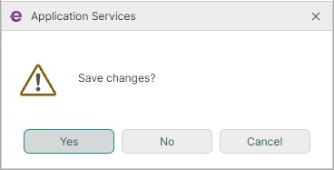

# IMessageBoxService

[`IMessageBoxService`](../../API/Eremex.AvaloniaUI.Controls.ApplicationServices/IMessageBoxService.md) предоставляет платформенно-независимый способ показывать стандартные окна сообщений из ViewModel. ViewModel при этом остаются полностью отделёнными от типов окон Avalonia.



Основные возможности:

- Фиксированные наборы кнопок — Окна сообщений могут отображать фиксированные наборы кнопок, определённые перечислением [`MessageBoxButtons`](../../API/Eremex.AvaloniaUI.Controls/MessageBoxButtons.md) (например, Ok, Ok&vert;Cancel, Yes&vert;No&vert;Cancel, Yes&vert;No, Abort&vert;Retry&vert;Ignore и Retry&vert;Cancel)
- Автоматическое определение владельца — Сервис может автоматически определять окно-владельца через сервис [`IWindowsManager`](../../API/Eremex.AvaloniaUI.Controls.ApplicationServices/IWindowsManager.md). При необходимости владельца окна сообщения можно также задать явно.
- Получение результата окна сообщения — После закрытия окно сообщения возвращает результат, заданный перечислением [`DialogResult`](../../API/Eremex.AvaloniaUI.Controls.ApplicationServices/DialogResult.md).


## Определение интерфейса

```csharp
public interface IMessageBoxService
{
    // Show a message box with an explicit owner.
    DialogResult Show(IWindow? owner, string text, string caption, MessageBoxButtons buttons, MessageBoxIcon icon);
    
    // Show a message box with the default owner (the active window detected through the `IWindowsManager` service).
    DialogResult Show(string text, string caption, MessageBoxButtons buttons, MessageBoxIcon icon);
}
```


## Использование IMessageBoxService

Чтобы отобразить окно сообщения, вызовите в ViewModel метод [`IMessageBoxService.Show`](../../API/Eremex.AvaloniaUI.Controls.ApplicationServices/IMessageBoxService/Show.md) объекта сервиса. Метод возвращает результат окна сообщения (кнопку, которую нажал пользователь).

Метод [`IMessageBoxService.Show`](../../API/Eremex.AvaloniaUI.Controls.ApplicationServices/IMessageBoxService/Show.md) без параметра _owner_ назначает владельцем окна сообщения активное окно. Активное окно определяется через сервис [`IWindowsManager`](../../API/Eremex.AvaloniaUI.Controls.ApplicationServices/IWindowsManager.md).

### Доступ к сервису

Получить объект [`IMessageBoxService`](../../API/Eremex.AvaloniaUI.Controls.ApplicationServices/IMessageBoxService.md) в ViewModel можно двумя способами:

- С помощью вспомогательного метода `Service<T>()`. Это удобный способ получить зарегистрированные сервисы приложения, входящие в библиотеку Eremex Controls.
- Через внедрение в конструктор.


#### Вспомогательный метод Service<T>()

Реализуйте в ViewModel вспомогательный метод `Service<T>()`, который возвращает запрошенный сервис с помощью статического метода `ApplicationServicesContext.GetRequiredService<T>()`.

```csharp
using Eremex.AvaloniaUI.Controls.ApplicationServices;
using CommunityToolkit.Mvvm.Input;

public partial class MyViewModel : ObservableObject
{

    // Provides access to any registered service
    protected static T Service<T>() where T : class
        => ApplicationServicesContext.GetRequiredService<T>();

    [RelayCommand]
    private void ShowInformation()
    {
        // Resolve the service directly from the Service<T>() method
        var result = Service<IMessageBoxService>()
            .Show("Save changes?", "Question",
                  MessageBoxButtons.Ok, MessageBoxIcon.Question);
    }
}
```

Убедитесь, что в файле App.axaml.cs сервисы приложения Eremex зарегистрированы с помощью [`SimpleServiceProvider`](../../API/Eremex.AvaloniaUI.Controls.ApplicationServices/SimpleServiceProvider.md) и [`ApplicationServicesContext`](../../API/Eremex.AvaloniaUI.Controls.ApplicationServices/ApplicationServicesContext.md) следующим образом:

```csharp
public class App : Application
{
    public override void OnFrameworkInitializationCompleted()
    {
        RegisterApplicationServices();
        //...
    }

    static void RegisterApplicationServices()
    {
        // Register built-in services.
        var serviceProvider = new SimpleServiceProvider();
        ApplicationServicesContext.RegisterApplicationServices(serviceProvider.AddSingleton);
        ApplicationServicesContext.SetCurrent(serviceProvider);
    }

}
```

#### Внедрение в конструктор

Реализуйте в ViewModel конструктор с параметром типа [`IMessageBoxService`](../../API/Eremex.AvaloniaUI.Controls.ApplicationServices/IMessageBoxService.md). При создании ViewModel передайте объект сервиса в этот конструктор.

```csharp
public partial class MyViewModel
{
    private readonly IMessageBoxService _messageBoxService;
    public MyViewModel(IMessageBoxService messageBoxService)
    {
        _messageBoxService = messageBoxService;
    }
    [RelayCommand]
    private void ShowMessage()
    {
        var result = _messageBoxService.Show(
            "Save changes?", "Question", MessageBoxButtons.Ok, MessageBoxIcon.Question
        );
        //...
    }
}
```


Для окон сообщений с собственными подписями кнопок используйте [`IChoiceDialogService`](../../API/Eremex.AvaloniaUI.Controls.ApplicationServices/IChoiceDialogService.md). Для полностью настраиваемых диалогов используйте [`IDialogService`](../../API/Eremex.AvaloniaUI.Controls.ApplicationServices/IDialogService.md).

<br>
<br>

<sup>*</sup> Эта страница переведена с использованием технологий машинного перевода.
