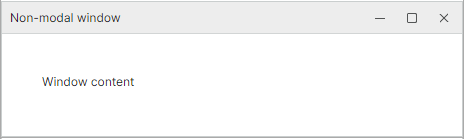

# IWindowService

[`IWindowService`](../../API/Eremex.AvaloniaUI.Controls.ApplicationServices/IWindowService.md) предоставляет платформенно-независимый способ показывать немодальные окна из ViewModel. ViewModel при этом остаются полностью отделёнными от типов окон Avalonia.

<!-- TODO
image
app-services-iwindowservice
-->

Основные возможности:

- Отображение немодальных окон.
- Окна, управляемые ViewModel — Отображаемое окно определяется собственной ViewModel. Содержимое окна можно задать с помощью свойства [`Content`](../../API/Eremex.AvaloniaUI.Controls.ApplicationServices/WindowAwareViewModel/Content.md) ViewModel или с помощью атрибута [`ViewLocatorAttribute`](../../API/Eremex.AvaloniaUI.Controls.ApplicationServices/ViewLocatorAttribute.md), применённого к ViewModel окна.
- Автоматический владелец — Владельцем окна становится активное окно приложения. Активное окно автоматически определяется через сервис [`IWindowsManager`](../../API/Eremex.AvaloniaUI.Controls.ApplicationServices/IWindowsManager.md).


## Определение интерфейса

```csharp
public interface IWindowService
{
    // Show a non-modal window driven by a ViewModel.
    void Show<T>(T viewModel, string? caption = null)
        where T : IWindowAwareViewModel;
}
```

| Параметр | Тип | Описание |
|-----------|------|-------------|
| `viewModel` | `T` | ViewModel отображаемого окна. Объект `viewModel` должен реализовывать интерфейс [`IWindowAwareViewModel`](../../API/Eremex.AvaloniaUI.Controls.ApplicationServices/IWindowAwareViewModel.md). ViewModel окна можно унаследовать от класса [`WindowAwareViewModel`](../../API/Eremex.AvaloniaUI.Controls.ApplicationServices/WindowAwareViewModel.md), который уже реализует этот интерфейс и добавляет инфраструктуру поиска View. |
| `caption` | `string?` | Заголовок окна. Если задано значение `null`, заголовок берётся из свойства `Title` ViewModel ([`IWindowAwareViewModel.Title`](../../API/Eremex.AvaloniaUI.Controls.ApplicationServices/IWindowAwareViewModel/Title.md)). |

Метод [`Show`](../../API/Eremex.AvaloniaUI.Controls.ApplicationServices/WindowService/Show.md) возвращает управление сразу после отображения окна и не ожидает его закрытия.

**Исключения:**

- `ArgumentNullException` — Если параметр `viewModel` равен `null`.


## Как использовать IWindowService

1. Создайте ViewModel для отображаемого немодального окна. Например, её можно унаследовать от класса [`WindowAwareViewModel`](../../API/Eremex.AvaloniaUI.Controls.ApplicationServices/WindowAwareViewModel.md).
2. Задайте содержимое окна одним из следующих способов:
    
    - Определите View (`UserControl`), представляющее содержимое окна. Примените к ViewModel атрибут [`ViewLocatorAttribute`](../../API/Eremex.AvaloniaUI.Controls.ApplicationServices/ViewLocatorAttribute.md), чтобы связать эту ViewModel с созданным View.
    - Явно задайте свойство [`Content`](../../API/Eremex.AvaloniaUI.Controls.ApplicationServices/WindowAwareViewModel/Content.md) ViewModel окна ([`WindowAwareViewModel.Content`](../../API/Eremex.AvaloniaUI.Controls.ApplicationServices/WindowAwareViewModel/Content.md)).

3. В ViewModel, из которой нужно показать окно, вызовите метод [`IWindowService.Show`](../../API/Eremex.AvaloniaUI.Controls.ApplicationServices/IWindowService/Show.md). Передайте методу [`Show`](../../API/Eremex.AvaloniaUI.Controls.ApplicationServices/WindowService/Show.md) ViewModel отображаемого окна. Метод [`Show`](../../API/Eremex.AvaloniaUI.Controls.ApplicationServices/WindowService/Show.md) сразу возвращает управление, а показанное окно остаётся открытым, пока пользователь его не закроет.

### Доступ к сервису

Получить объект [`IWindowService`](../../API/Eremex.AvaloniaUI.Controls.ApplicationServices/IWindowService.md) в ViewModel можно двумя способами:

- С помощью вспомогательного метода `Service<T>()`. Это удобный способ получить зарегистрированные сервисы приложения, входящие в библиотеку Eremex Controls.
- Через внедрение в конструктор.

#### Вспомогательный метод Service<T>()

Реализуйте в ViewModel вспомогательный метод `Service<T>()`, который получает запрошенный сервис с помощью статического метода `ApplicationServicesContext.GetRequiredService<T>()`.

```csharp
using Eremex.AvaloniaUI.Controls.ApplicationServices;
using CommunityToolkit.Mvvm.Input;

public partial class MyViewModel : ObservableObject
{
    // Provides access to any registered service
    protected static T Service<T>() where T : class
        => ApplicationServicesContext.GetRequiredService<T>();

    [RelayCommand]
    private void ShowWindow()
    {
        // Resolve the service and show the window
        Service<IWindowService>().Show(
            new MyWindowViewModel("Non-modal window"));
    }
}
```

Убедитесь, что в файле App.axaml.cs сервисы приложения Eremex зарегистрированы с помощью [`SimpleServiceProvider`](../../API/Eremex.AvaloniaUI.Controls.ApplicationServices/SimpleServiceProvider.md) и [`ApplicationServicesContext`](../../API/Eremex.AvaloniaUI.Controls.ApplicationServices/ApplicationServicesContext.md) следующим образом:

```csharp
public class App : Application
{
    public override void OnFrameworkInitializationCompleted()
    {
        RegisterApplicationServices();
        //...
    }

    static void RegisterApplicationServices()
    {
        // Register built-in services.
        var serviceProvider = new SimpleServiceProvider();
        ApplicationServicesContext.RegisterApplicationServices(serviceProvider.AddSingleton);
        ApplicationServicesContext.SetCurrent(serviceProvider);
    }
}
```

#### Внедрение в конструктор

Реализуйте в ViewModel конструктор с параметром типа [`IWindowService`](../../API/Eremex.AvaloniaUI.Controls.ApplicationServices/IWindowService.md). При создании ViewModel передайте объект сервиса в этот конструктор.

```csharp
public partial class MyViewModel
{
    private readonly IWindowService _windowService;

    public MyViewModel(IWindowService windowService)
    {
        _windowService = windowService;
    }

    [RelayCommand]
    private void ShowWindow()
    {
        _windowService.Show(new MyWindowViewModel("Non-modal window"));
    }
}
```

### Создание ViewModel окна

Для отображаемого немодального окна нужно создать ViewModel. ViewModel должна реализовывать интерфейс [`IWindowAwareViewModel`](../../API/Eremex.AvaloniaUI.Controls.ApplicationServices/IWindowAwareViewModel.md). Проще всего унаследовать ViewModel от класса [`WindowAwareViewModel`](../../API/Eremex.AvaloniaUI.Controls.ApplicationServices/WindowAwareViewModel.md), который уже реализует интерфейс [`IWindowAwareViewModel`](../../API/Eremex.AvaloniaUI.Controls.ApplicationServices/IWindowAwareViewModel.md) и выполняет поиск View.


#### Определение содержимого окна с помощью ViewLocatorAttribute

1. Создайте View (`UserControl`) с контролами, которые нужно отобразить в окне.
2. Пометьте ViewModel окна атрибутом [`ViewLocatorAttribute`](../../API/Eremex.AvaloniaUI.Controls.ApplicationServices/ViewLocatorAttribute.md), передав ему тип View.

При вызове метода [`IWindowService.Show`](../../API/Eremex.AvaloniaUI.Controls.ApplicationServices/IWindowService/Show.md) ViewModel создаёт окно Avalonia, создаёт экземпляр указанного View (`UserControl`) и помещает его в окно в качестве содержимого. ViewModel никогда не нужно ссылаться на тип View напрямую.


#### Пример

В этом примере сервис [`IWindowService`](../../API/Eremex.AvaloniaUI.Controls.ApplicationServices/IWindowService.md) используется для отображения немодального окна, содержимое которого задано собственным View.
Полный код приведён в демонстрационном приложении [Controls Demo](../../index.md#демонстрационное-приложение).




**ViewModel немодального окна**

```csharp
using Eremex.AvaloniaUI.Controls.ApplicationServices;

[ViewLocator(typeof(WindowServiceWindowView))]
public class WindowServiceWindowViewModel : WindowAwareViewModel
{
    private string statusText;

    public string StatusText
    {
        get => statusText;
        private set
        {
            if (statusText == value)
                return;

            statusText = value;
            OnPropertyChanged(nameof(StatusText));
        }
    }
}
```

**Содержимое немодального окна (View)**

```xml
<UserControl x:Class="DemoCenter.Views.ApplicationServices.WindowServiceWindowView"
             xmlns="https://github.com/avaloniaui"
             xmlns:x="http://schemas.microsoft.com/winfx/2006/xaml"
             xmlns:vm="using:DemoCenter.ViewModels.ApplicationServices"
             x:CompileBindings="True"
             x:DataType="vm:WindowServiceWindowViewModel"
             MinWidth="420">

    <StackPanel Margin="20" Spacing="12">
        <TextBlock Text="Window content"
                   TextWrapping="Wrap" />
        
    </StackPanel>
</UserControl>
```

**Отображение окна**

```csharp
[RelayCommand]
private void ShowWindow()
{
    string windowTitle = "Non-modal window";
    Service<IWindowService>().Show(new WindowServiceWindowViewModel(windowTitle));
}
```

#### Непосредственное определение содержимого окна

Чтобы явно задать содержимое окна, используйте свойство [`Content`](../../API/Eremex.AvaloniaUI.Controls.ApplicationServices/WindowAwareViewModel/Content.md) ViewModel ([`WindowAwareViewModel.Content`](../../API/Eremex.AvaloniaUI.Controls.ApplicationServices/WindowAwareViewModel/Content.md)).


```csharp
using Eremex.AvaloniaUI.Controls.ApplicationServices;

public class MyWindowViewModel : WindowAwareViewModel
{
    public MyWindowViewModel(string title) : base(title)
    {
        Content = "Window content";
    }
}
```

Чтобы показать это окно, используйте следующий код:

```csharp
Service<IWindowService>().Show(new MyWindowViewModel("Non-modal window"));
```

### Заголовок окна

Заголовок окна можно задать одним из следующих способов:

1. Задайте параметр `caption` метода [`IWindowService.Show`](../../API/Eremex.AvaloniaUI.Controls.ApplicationServices/IWindowService/Show.md).
2. Задайте свойство `Title` ViewModel окна. Это свойство действует, если параметр `caption` метода [`IWindowService.Show`](../../API/Eremex.AvaloniaUI.Controls.ApplicationServices/IWindowService/Show.md) равен `null`.


### Окно-владелец

Владелец определяется автоматически через сервис [`IWindowsManager`](../../API/Eremex.AvaloniaUI.Controls.ApplicationServices/IWindowsManager.md). Владельцем окна становится активное окно приложения, возвращаемое этим сервисом.

<br>
<br>

<sup>*</sup> Эта страница переведена с использованием технологий машинного перевода.
