# Cartesian Chart


Контрол [`CartesianChart`](../../API/Eremex.AvaloniaUI.Charts/CartesianChart.md) позволяет создавать диаграммы, используя декартову систему координат. 

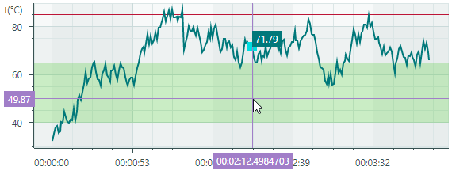

Основные возможности контрола включают:
 
- Неограниченное количество серий данных
- Поддерживаемые типы диаграмм (представления): Line, Scatter Line, Point (с поддержкой SVG-маркеров), Area, Step Line, Bar, Candlestick и другие.
- Поддержка нескольких осей
- Взаимная замена осей X и Y
- Инвертирование осей
- Несколько типов осей: числовая (Numeric), дата-время (Date-Time), временной интервал (Time Span), качественная (Qualitative) и логарифмическая (Logarithmic)
- Прокрутка и масштабирование всех осей одновременно
- Прокрутка и масштабирование отдельных осей
- [Crosshair](crosshair.md)
- Высокая производительность при отображении больших объёмов данных
- Визуализация данных в реальном времени
- Полосы (Strips) и постоянные линии (constant lines)
- Пустые точки (разрывы)
- Использование паттерна проектирования MVVM для предоставления данных и настройки параметров диаграммы
- Отображение быстро изменяющихся данных в реальном времени. Используйте специальный адаптер данных для реализации подвижного видового окна (moving viewport)


## Начало работы

- [Начало работы с диаграммами](get-started-with-charts.md)
- [Начало работы с диаграммами — паттерн MVVM](get-started-with-charts-mvvm.md)

## Элементы контрола диаграммы

Основные элементы контрола диаграммы — это серии и оси. 

**Серия (Series)** — предоставляет данные и определяет способ их визуализации. Вы можете отобразить столько серий, сколько нужно, в рамках одного контрола диаграммы. Подробнее см. в разделе [Серии](#серии).

**Оси (Axes)** — типичная декартова диаграмма отображает две оси: ось X и ось Y. Вы также можете добавить дополнительные оси к диаграмме, когда она отображает две или более серии. Каждая серия может быть связана с собственной осью. Подробнее см. в разделе [Оси](#оси).


## Серии 

Серия предоставляет данные для отрисовки контролом диаграммы и задаёт представление серии (визуальное отображение этих данных).

Класс [`CartesianSeries`](../../API/Eremex.AvaloniaUI.Charts/CartesianSeries.md) инкапсулирует серию для контрола [`CartesianChart`](../../API/Eremex.AvaloniaUI.Charts/CartesianChart.md). Чтобы добавить серии в диаграмму, используйте коллекцию [`CartesianChart.Series`](../../API/Eremex.AvaloniaUI.Charts/CartesianChart/Series.md). Вы также можете заполнить диаграмму сериями, используя паттерн проектирования MVVM. Для этого используйте свойства [`CartesianChart.SeriesSource`](../../API/Eremex.AvaloniaUI.Charts/CartesianChart/SeriesSource.md) и [`CartesianChart.SeriesTemplate`](../../API/Eremex.AvaloniaUI.Charts/CartesianChart/SeriesTemplate.md). Подробнее см. по следующей ссылке: [Начало работы с диаграммами — паттерн MVVM](get-started-with-charts-mvvm.md).


Следующий код определяет одну серию в коллекции [`CartesianChart.Series`](../../API/Eremex.AvaloniaUI.Charts/CartesianChart/Series.md).

``` xml
<mxc:CartesianChart>
    <mxc:CartesianChart.Series>
        <mxc:CartesianSeries DataAdapter="{Binding Series.DataAdapter}">
            <mxc:CartesianLineSeriesView Color="{Binding Series.Color}">
                <mxc:CartesianLineSeriesView.LineStyle>
                    <mxc:LineStyle Thickness="2" />
                </mxc:CartesianLineSeriesView.LineStyle>
            </mxc:CartesianLineSeriesView>
        </mxc:CartesianSeries>
    </mxc:CartesianChart.Series>
    <!-- ... -->
</mxc:CartesianChart>
```

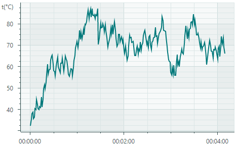


### Данные серии

Вы можете предоставить данные для серий контрола диаграммы с помощью _адаптеров данных (Data Adapters)_. 

``` xml
<mxc:CartesianSeries DataAdapter="{Binding Series.DataAdapter}">
    <!-- ... -->
</mxc:CartesianSeries>
```

Адаптер данных — это объект, реализующий интерфейс [`ISeriesDataAdapter`](../../API/Eremex.AvaloniaUI.Charts/ISeriesDataAdapter.md). Обычно вам не нужно реализовывать этот интерфейс вручную. Eremex Charts поставляются с несколькими адаптерами данных для различных типов данных (числовых, дата-время и качественных). Выберите адаптер данных исходя из ваших требований. 

Ниже приведены адаптеры данных, сгруппированные по типу значений _X_:

Числовые значения _X_:

- [`SortedNumericDataAdapter`](../../API/Eremex.AvaloniaUI.Charts/SortedNumericDataAdapter.md)
- [`FormulaDataAdapter`](../../API/Eremex.AvaloniaUI.Charts/FormulaDataAdapter.md)
- [`ScatterDataAdapter`](../../API/Eremex.AvaloniaUI.Charts/ScatterDataAdapter.md)
- [`NumericRangeDataAdapter`](../../API/Eremex.AvaloniaUI.Charts/NumericRangeDataAdapter.md)

Значения _X_ типа дата и время:

- [`SortedDateTimeDataAdapter`](../../API/Eremex.AvaloniaUI.Charts/SortedDateTimeDataAdapter.md)
- [`DateTimeRangeDataAdapter`](../../API/Eremex.AvaloniaUI.Charts/DateTimeRangeDataAdapter.md)
- [`SortedTimeSpanDataAdapter`](../../API/Eremex.AvaloniaUI.Charts/SortedTimeSpanDataAdapter.md)
- [`TimeSpanRangeDataAdapter`](../../API/Eremex.AvaloniaUI.Charts/TimeSpanRangeDataAdapter.md)
- [`CandlestickDataAdapter`](../../API/Eremex.AvaloniaUI.Charts/CandlestickDataAdapter.md) (для [Candlestick Series View](cartesian-series-views/candlestick-series-view.md))
- [`SummaryCandlestickDataAdapter`](../../API/Eremex.AvaloniaUI.Charts/SummaryCandlestickDataAdapter.md) (для [Candlestick Series View](cartesian-series-views/candlestick-series-view.md))

Качественные значения _X_:

- [`QualitativeDataAdapter`](../../API/Eremex.AvaloniaUI.Charts/QualitativeDataAdapter.md)
- [`QualitativeRangeDataAdapter`](../../API/Eremex.AvaloniaUI.Charts/QualitativeRangeDataAdapter.md) 


#### Пустые точки (разрывы)

CartesianChart поддерживает пустые точки. Это точки данных с неопределёнными значениями. Контрол диаграммы оставляет видимые разрывы в серии, когда встречает пустые точки.

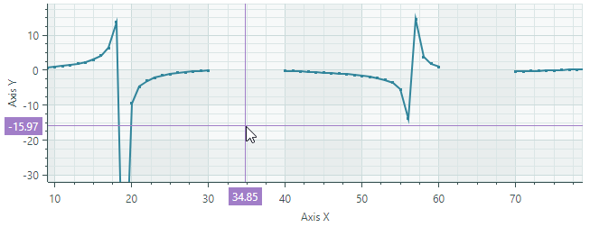

Чтобы задать пустую точку данных, установите значение точки данных равным _double.NaN_, _double.PositiveInfinity_ или _double.NegativeInfinity_.

<!-- TODO

Example - simple data adapter with empty points
-->


<!-- TODO

Describe these Data Adapters in more detail
 -->

<!-- TODO
The following example implements a Data Adapter 


The following example implements a Data Adapter 
(numeric data adapter)


``` cs
public partial class CartesianStripsAndConstantLinesViewModel : ChartsPageViewModel
{
    [ObservableProperty] SeriesViewModel series = new() { Color = Color.FromArgb(255, 0, 120, 122), DataAdapter = CreateAdapter() };
    [ObservableProperty] ObservableCollection<ConstantLineViewModel> constantLines = new();
    
    static ISeriesDataAdapter CreateAdapter()
    {
        const int pointsCount = 250;
        
        var random = new Random(0);
        var arguments = new List<TimeSpan>(pointsCount);
        var values = new List<double>(pointsCount);
        double startTemperature = 30;
        for (int i = 0; i < pointsCount; i++) {
            arguments.Add(TimeSpan.FromSeconds(i));
            double temperature = startTemperature + (random.NextDouble() - 0.5) * 10;
            if (temperature > 90)
                temperature -= 20;
            if (temperature < 20)
                temperature += 10;
            values.Add(temperature);
            startTemperature = temperature;
        }
        
        return new SortedTimeSpanDataAdapter(arguments, values);
    }
}
```

 -->

### Видимость серии

Используйте свойство [`Series.Visible`](../../API/Eremex.AvaloniaUI.Charts/Series/Visible.md), чтобы скрыть серию.

``` cs
chart1.Series[0].Visible = !chart1.Series[0].Visible;
```

### Представления серий 
[`CartesianChart`](../../API/Eremex.AvaloniaUI.Charts/CartesianChart.md) поддерживает несколько представлений серий (типов диаграмм):

<style>

th {
    visibility: collapse;
}
td, th, tr {
   border: none!important;
   vertical-align: top;
}
</style>

| <div style="width:400px"></div> | <div style="width:400px"></div> | 
| --- | --- |
| [Line Series View](cartesian-series-views/line-series-vew.md) (объект [`CartesianLineSeriesView`](../../API/Eremex.AvaloniaUI.Charts/CartesianLineSeriesView.md))<br>Отображает точки, соединённые линиями.<br>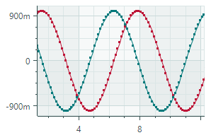 | [Scatter Line Series View](cartesian-series-views/scatter-line-series-view.md) (объект [`CartesianScatterLineSeriesView`](../../API/Eremex.AvaloniaUI.Charts/CartesianScatterLineSeriesView.md))<br>Соединяет точки в том порядке, в котором они расположены в серии данных.<br>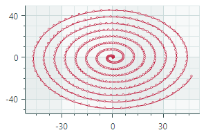 |
| [Point Series View](cartesian-series-views/point-series-view.md) (объект [`CartesianPointSeriesView`](../../API/Eremex.AvaloniaUI.Charts/CartesianPointSeriesView.md))<br>Отображает отдельные точки.<br>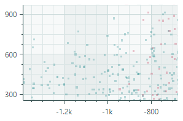 | [Area Series View](cartesian-series-views/area-series-view.md) (объект [`CartesianAreaSeriesView`](../../API/Eremex.AvaloniaUI.Charts/CartesianAreaSeriesView.md))<br>Соединяет точки линиями и закрашивает области.<br>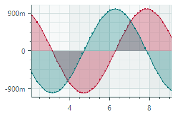 | 
| [Step Line Series View](cartesian-series-views/step-line-series-view.md) (объект [`CartesianStepLineSeriesView`](../../API/Eremex.AvaloniaUI.Charts/CartesianStepLineSeriesView.md))<br>Соединяет точки горизонтальными и вертикальными отрезками линий.<br>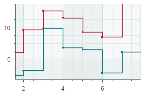 | [Step Area Series View](cartesian-series-views/step-area-series-view.md) (объект [`CartesianStepAreaSeriesView`](../../API/Eremex.AvaloniaUI.Charts/CartesianStepAreaSeriesView.md))<br>Соединяет точки горизонтальными и вертикальными отрезками линий и закрашивает области.<br>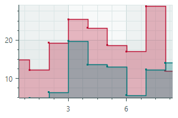 |
| [Range Area Series View](cartesian-series-views/range-area-series-view.md) (объект [`CartesianRangeAreaSeriesView`](../../API/Eremex.AvaloniaUI.Charts/CartesianRangeAreaSeriesView.md))<br>Закрашивает область между двумя значениями Y серии данных.<br>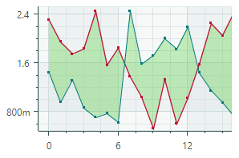 | [Stacked Area Series View](cartesian-series-views/stacked-area-series-view.md) (объект [`CartesianStackedAreaSeriesView`](../../API/Eremex.AvaloniaUI.Charts/CartesianStackedAreaSeriesView.md))<br>Эти представления отрисовывают закрашенные области, наложенные друг на друга, чтобы показать абсолютные соотношения между сериями данных. <br>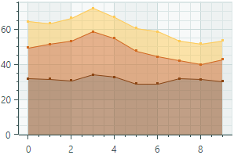 |
| [Full-Stacked Area Series View](cartesian-series-views/full-stacked-area-series-view.md) (объект [`CartesianFullStackedAreaSeriesView`](../../API/Eremex.AvaloniaUI.Charts/CartesianFullStackedAreaSeriesView.md))<br>Эти представления отрисовывают закрашенные области, наложенные друг на друга, чтобы показать пропорциональные соотношения между сериями данных.<br>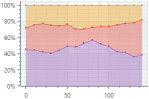 | [Bar Series View](cartesian-series-views/side-by-side-bar-series-view.md) (объект [`CartesianSideBySideBarSeriesView`](../../API/Eremex.AvaloniaUI.Charts/CartesianSideBySideBarSeriesView.md))<br>Визуализирует данные в виде набора прямоугольных столбцов.<br>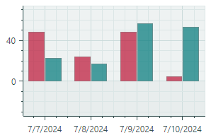 |
| [Range Bar Series View](cartesian-series-views/side-by-side-range-bar-series-view.md) (объект [`CartesianSideBySideRangeBarSeriesView`](../../API/Eremex.AvaloniaUI.Charts/CartesianSideBySideRangeBarSeriesView.md))<br>Отрисовывает прямоугольные столбцы между двумя значениями Y серии данных.<br>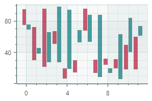 | [Candlestick Series View](cartesian-series-views/candlestick-series-view.md)<br>(объект [`CartesianCandlestickSeriesView`](../../API/Eremex.AvaloniaUI.Charts/CartesianCandlestickSeriesView.md))<br>Финансовая диаграмма, описывающая изменение цены актива. Для каждой точки данных диаграмма отображает набор из четырёх значений: цены открытия (Open), закрытия (Close), максимума (High) и минимума (Low). <br>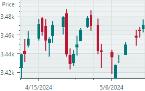 |
| [Lollipop Series View](cartesian-series-views/lollipop-series-view.md) (объект [`CartesianLollipopSeriesView`](../../API/Eremex.AvaloniaUI.Charts/CartesianLollipopSeriesView.md))<br>Представляет данные в виде точек (маркеров), соединённых с горизонтальной или вертикальной осью тонкими линиями.<br>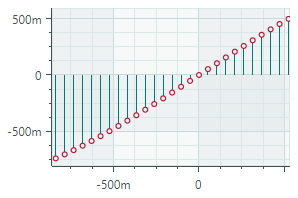 |  |

Чтобы задать представление для серии, определите соответствующий объект **...SeriesView** в качестве содержимого объекта [`CartesianSeries`](../../API/Eremex.AvaloniaUI.Charts/CartesianSeries.md). В коде используйте свойство [`CartesianSeries.View`](../../API/Eremex.AvaloniaUI.Charts/CartesianSeries/View.md), чтобы задать представление серии. 

Этот пример назначает серии представление Line Series View.
``` xml
<mxc:CartesianSeries DataAdapter="{Binding Series.DataAdapter}">
    <mxc:CartesianLineSeriesView Color="{Binding Series.Color}">
        <mxc:CartesianLineSeriesView.LineStyle>
            <mxc:LineStyle Thickness="2" />
        </mxc:CartesianLineSeriesView.LineStyle>
    </mxc:CartesianLineSeriesView>
</mxc:CartesianSeries>
```


## Оси

Контрол [`CartesianChart`](../../API/Eremex.AvaloniaUI.Charts/CartesianChart.md) автоматически создаёт декартовы оси (ось X и ось Y), если вы не определяете их вручную. Если вам нужно настроить оси в XAML, определите объекты [`AxisX`](../../API/Eremex.AvaloniaUI.Charts/AxisX.md) и/или [`AxisY`](../../API/Eremex.AvaloniaUI.Charts/AxisY.md) в коллекциях [`CartesianChart.AxesX`](../../API/Eremex.AvaloniaUI.Charts/CartesianChart/AxesX.md)/[`CartesianChart.AxesY`](../../API/Eremex.AvaloniaUI.Charts/CartesianChart/AxesY.md), а затем измените параметры этих осей.

``` xml
<mxc:CartesianChart>
    <!-- ... -->

    <mxc:CartesianChart.AxesX>
        <mxc:AxisX ShowTitle="False">
        </mxc:AxisX>
    </mxc:CartesianChart.AxesX>

    <mxc:CartesianChart.AxesY>
        <mxc:AxisY Title="t(°C)" TitlePosition="WithLabels">
            <mxc:AxisYRange AlwaysShowZeroLevel="False" />
        </mxc:AxisY>
    </mxc:CartesianChart.AxesY>
</mxc:CartesianChart>
```

### Взаимная замена осей X и Y

Ориентация осей в контроле Cartesian Chart по умолчанию — горизонтальная для осей _X_ и вертикальная для осей _Y_. Используйте свойство [`CartesianChart.SwapAxes`](../../API/Eremex.AvaloniaUI.Charts/CartesianChart/SwapAxes.md), чтобы поменять оси местами. Это свойство поддерживается для всех типов представлений серий.

Следующие изображения показывают, как свойство [`SwapAxes`](../../API/Eremex.AvaloniaUI.Charts/CartesianChart/SwapAxes.md) изменяет расположение осей для линейных диаграмм и столбчатых диаграмм.

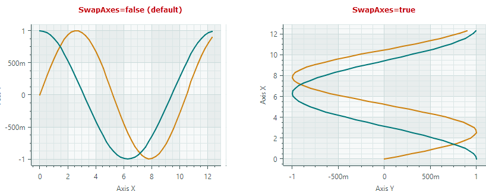

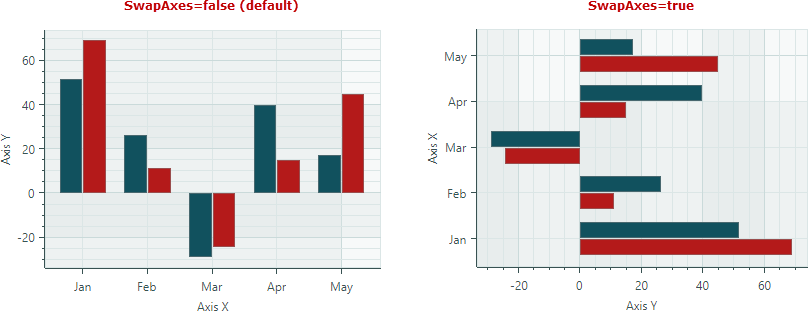

### Инвертирование направления оси

Используйте свойство `Axis.Reverse`, чтобы инвертировать направление осей _X_ и _Y_.

- `false` (по умолчанию) — значения увеличиваются слева направо для оси _X_ и снизу вверх для оси _Y_.
- `true` — значения увеличиваются справа налево для оси _X_ и сверху вниз для оси _Y_.

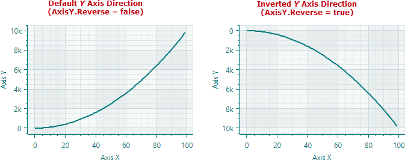

``` xml
<mxc:CartesianChart.AxesY>
    <mxc:AxisY Title="Axis Y" Reverse="True"/>
</mxc:CartesianChart.AxesY>
```

### Диапазон значений оси

Разместите объекты [`AxisXRange`](../../API/Eremex.AvaloniaUI.Charts/AxisXRange.md)/[`AxisYRange`](../../API/Eremex.AvaloniaUI.Charts/AxisYRange.md) в качестве содержимого объектов [`AxisX`](../../API/Eremex.AvaloniaUI.Charts/AxisX.md)/[`AxisY`](../../API/Eremex.AvaloniaUI.Charts/AxisY.md), чтобы задать параметры диапазона осей. Объекты [`AxisXRange`](../../API/Eremex.AvaloniaUI.Charts/AxisXRange.md)/[`AxisYRange`](../../API/Eremex.AvaloniaUI.Charts/AxisYRange.md) позволяют настроить общий диапазон значений, видимый диапазон значений, видимость нулевого уровня и т.д.

``` xml
<mxc:CartesianChart.AxesX>
    <mxc:AxisX ShowTitle="False" >
        <mxc:AxisXRange MinSideMargin="0.15" MaxSideMargin="0.15"/>
    </mxc:AxisX>
</mxc:CartesianChart.AxesX>
<mxc:CartesianChart.AxesY>
    <mxc:AxisY Title="Amplitude (dB SPL)">
        <mxc:AxisYRange AlwaysShowZeroLevel="False" />
    </mxc:AxisY>
</mxc:CartesianChart.AxesY>
```

- [`AutoCorrectWholeRange`](../../API/Eremex.AvaloniaUI.Charts/AxisRange/AutoCorrectWholeRange.md) (по умолчанию `true`) — определяет, вычисляется ли общий диапазон оси автоматически на основе данных серии.

  Чтобы задать пользовательский общий диапазон оси, отключите опцию [`AutoCorrectWholeRange`](../../API/Eremex.AvaloniaUI.Charts/AxisRange/AutoCorrectWholeRange.md), а затем используйте свойства [`WholeMin`](../../API/Eremex.AvaloniaUI.Charts/AxisRange/WholeMin.md) и [`WholeMax`](../../API/Eremex.AvaloniaUI.Charts/AxisRange/WholeMax.md).

- [`SynchronizeVisualRange`](../../API/Eremex.AvaloniaUI.Charts/AxisRange/SynchronizeVisualRange.md) — определяет, устанавливается ли видимый диапазон оси равным общему диапазону оси при изменении последнего.
- [`AlwaysShowZeroLevel`](../../API/Eremex.AvaloniaUI.Charts/AxisYRange/AlwaysShowZeroLevel.md) (только для объектов [`AxisYRange`](../../API/Eremex.AvaloniaUI.Charts/AxisYRange.md)) (по умолчанию `true`) — определяет, корректируется ли общий диапазон оси автоматически, чтобы включить нулевой уровень. См. [`WholeMax`](../../API/Eremex.AvaloniaUI.Charts/AxisRange/WholeMax.md).

- [`WholeMax`](../../API/Eremex.AvaloniaUI.Charts/AxisRange/WholeMax.md) — задаёт максимальное значение общего диапазона оси. Свойство [`WholeMin`](../../API/Eremex.AvaloniaUI.Charts/AxisRange/WholeMin.md) задаёт минимальное значение.
    
    Отключите свойство [`AutoCorrectWholeRange`](../../API/Eremex.AvaloniaUI.Charts/AxisRange/AutoCorrectWholeRange.md), чтобы использовать свойства [`WholeMin`](../../API/Eremex.AvaloniaUI.Charts/AxisRange/WholeMin.md) и [`WholeMax`](../../API/Eremex.AvaloniaUI.Charts/AxisRange/WholeMax.md). 
    
    Если опция [`AlwaysShowZeroLevel`](../../API/Eremex.AvaloniaUI.Charts/AxisYRange/AlwaysShowZeroLevel.md) включена (поведение по умолчанию), нулевой уровень принудительно включается в общий диапазон оси.

    #### Пример — Показать и скрыть нулевой уровень

    Рассмотрим этот пример, в котором свойства [`WholeMin`](../../API/Eremex.AvaloniaUI.Charts/AxisRange/WholeMin.md) и [`WholeMax`](../../API/Eremex.AvaloniaUI.Charts/AxisRange/WholeMax.md) задают пользовательские границы общего диапазона оси. Диапазон автоматически включает нулевой уровень, поскольку свойство [`AlwaysShowZeroLevel`](../../API/Eremex.AvaloniaUI.Charts/AxisYRange/AlwaysShowZeroLevel.md) включено.

    ``` xml
    <mxc:CartesianChart.AxesY>
        <mxc:AxisY ShowTitle="False">
            <mxc:AxisYRange WholeMin="100" WholeMax="350" AutoCorrectWholeRange="False" AlwaysShowZeroLevel="True" />
        </mxc:AxisY>
    </mxc:CartesianChart.AxesY>
    ```
    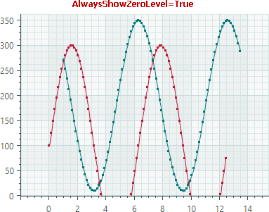


    Отключите свойство [`AlwaysShowZeroLevel`](../../API/Eremex.AvaloniaUI.Charts/AxisYRange/AlwaysShowZeroLevel.md), чтобы ограничить общий диапазон оси значениями [`WholeMin`](../../API/Eremex.AvaloniaUI.Charts/AxisRange/WholeMin.md) и [`WholeMax`](../../API/Eremex.AvaloniaUI.Charts/AxisRange/WholeMax.md), игнорируя нулевой уровень.

    ``` xml
    <mxc:AxisYRange WholeMin="100" WholeMax="350" AutoCorrectWholeRange="False" AlwaysShowZeroLevel="False" />
    ```

    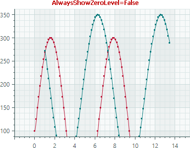
    

- [`WholeMin`](../../API/Eremex.AvaloniaUI.Charts/AxisRange/WholeMin.md) — задаёт минимальное значение общего диапазона оси. Подробнее см. в описании [`WholeMax`](../../API/Eremex.AvaloniaUI.Charts/AxisRange/WholeMax.md).
- [`VisualMax`](../../API/Eremex.AvaloniaUI.Charts/AxisRange/VisualMax.md) — задаёт максимальное значение текущего видимого диапазона оси. Свойство [`VisualMin`](../../API/Eremex.AvaloniaUI.Charts/AxisRange/VisualMin.md) задаёт минимальное значение.
- [`VisualMin`](../../API/Eremex.AvaloniaUI.Charts/AxisRange/VisualMin.md) — задаёт минимальное значение текущего видимого диапазона оси.

- [`MaxSideMargin`](../../API/Eremex.AvaloniaUI.Charts/AxisRange/MaxSideMargin.md) — задаёт величину пустого пространства между крайней правой (или верхней) точкой данных и краем области диаграммы, выраженную как доля от общего диапазона данных. Например, значение 0.1 добавляет отступ, равный 10% диапазона.
    
    Для оси _Y_ свойство [`MaxSideMargin`](../../API/Eremex.AvaloniaUI.Charts/AxisRange/MaxSideMargin.md) не действует, когда свойство [`AlwaysShowZeroLevel`](../../API/Eremex.AvaloniaUI.Charts/AxisYRange/AlwaysShowZeroLevel.md) равно `true`, а нулевой уровень отображается у верхнего края. Установите свойство [`AlwaysShowZeroLevel`](../../API/Eremex.AvaloniaUI.Charts/AxisYRange/AlwaysShowZeroLevel.md) в значение `false`, чтобы устранить эту проблему.

- [`MinSideMargin`](../../API/Eremex.AvaloniaUI.Charts/AxisRange/MinSideMargin.md) — задаёт величину пустого пространства между крайней левой (или нижней) точкой данных и краем области диаграммы, выраженную как доля от общего диапазона данных. Например, значение 0.1 добавляет отступ, равный 10% диапазона.

    Для оси _Y_ свойство [`MinSideMargin`](../../API/Eremex.AvaloniaUI.Charts/AxisRange/MinSideMargin.md) не действует, когда свойство [`AlwaysShowZeroLevel`](../../API/Eremex.AvaloniaUI.Charts/AxisYRange/AlwaysShowZeroLevel.md) равно `true`, а нулевой уровень отображается у нижнего края. Установите свойство [`AlwaysShowZeroLevel`](../../API/Eremex.AvaloniaUI.Charts/AxisYRange/AlwaysShowZeroLevel.md) в значение `false`, чтобы устранить эту проблему.

  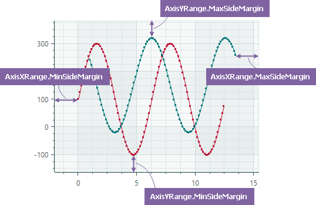

<!-- TODO
AlwaysShowZeroLevel - when to always show
SideMargin - wrong names
SideMargin - percentage, where 0 means no margin, 0.1 means 10% of the total range?

 -->

### Масштаб оси

Масштаб оси определяет тип единиц масштаба и различные параметры отображения оси. На изображении ниже показаны несколько типов масштаба:

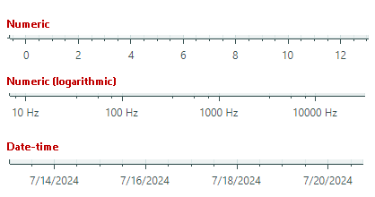

Чтобы задать параметры масштаба для осей, используйте свойства [`AxisX.ScaleOptions`](../../API/Eremex.AvaloniaUI.Charts/AxisX/ScaleOptions.md) и [`AxisY.ScaleOptions`](../../API/Eremex.AvaloniaUI.Charts/AxisY/ScaleOptions.md).

#### Настройка параметров масштаба для оси _X_

Используйте свойство [`AxisX.ScaleOptions`](../../API/Eremex.AvaloniaUI.Charts/AxisX/ScaleOptions.md), чтобы изменить параметры масштаба оси _X_. 
Это свойство имеет базовый тип [`ScaleOptions`](../../API/Eremex.AvaloniaUI.Charts/ScaleOptions.md). 

Чтобы изменить параметры масштаба, установите свойство [`AxisX.ScaleOptions`](../../API/Eremex.AvaloniaUI.Charts/AxisX/ScaleOptions.md) в один из следующих объектов в зависимости от типа значений _X_ серии: 

- [`NumericScaleOptions`](../../API/Eremex.AvaloniaUI.Charts/NumericScaleOptions.md) — числовой масштаб данных. Используйте этот тип масштаба, если значения _X_, предоставляемые серией, являются числовыми.
    ``` xml
    <mxc:AxisX Title="Frequency">
        <mxc:AxisX.ScaleOptions>
            <mxc:NumericScaleOptions 
                LogarithmicBase="{Binding AxisX.LogarithmicBase}"
                LabelFormatter="{Binding FrequencyFormatter}" />
        </mxc:AxisX.ScaleOptions>
    </mxc:AxisX>
    ```

<!-- TODO
Describe members of the NumericScaleOptions and other classes, such as 
GridSpacing, LabelFormatter
etc
  -->

- [`DateTimeScaleOptions`](../../API/Eremex.AvaloniaUI.Charts/DateTimeScaleOptions.md) — масштаб данных DateTime. Используйте этот тип масштаба, если значения _X_, предоставляемые серией, являются значениями `DateTime`. Свойство [`DateTimeScaleOptions.MeasureUnit`](../../API/Eremex.AvaloniaUI.Charts/DateTimeScaleOptions/MeasureUnit.md) позволяет задать единицу времени (единицу оси) для масштаба оси: `Millisecond`, `Second`, `Minute`, `Hour`, `Day`, `Week`, `Month`, `Quarter` или `Year`

    ``` xml
    <mxc:AxisX ShowTitle="False">
        <mxc:AxisX.ScaleOptions>
            <mxc:DateTimeScaleOptions MeasureUnit="Day" />
        </mxc:AxisX.ScaleOptions>
    </mxc:AxisX>
    ```

- [`TimeSpanScaleOptions`](../../API/Eremex.AvaloniaUI.Charts/TimeSpanScaleOptions.md) — масштаб данных TimeSpan. Используйте этот тип масштаба, если значения _X_, предоставляемые серией, являются значениями `TimeSpan`. Свойство [`TimeSpanScaleOptions.MeasureUnit`](../../API/Eremex.AvaloniaUI.Charts/TimeSpanScaleOptions/MeasureUnit.md) позволяет задать единицу времени для масштаба оси: `Millisecond`, `Second`, `Minute`, `Hour` или `Day`.

    ``` xml
    <mxc:AxisX>
        <mxc:AxisX.ScaleOptions>
            <mxc:TimeSpanScaleOptions MeasureUnit="Minute" />
        </mxc:AxisX.ScaleOptions>
    </mxc:AxisX>
    ```

- [`QualitativeScaleOptions`](../../API/Eremex.AvaloniaUI.Charts/QualitativeScaleOptions.md) — качественный масштаб данных. Используйте этот тип масштаба, если значения _X_, предоставляемые серией, являются качественными значениями (текстовыми строками).

    ``` xml
    <mxc:AxisX >
        <mxc:AxisX.ScaleOptions>
            <mxc:QualitativeScaleOptions GridSpacing="1" />
        </mxc:AxisX.ScaleOptions>
    </mxc:AxisX>
    ```

#### Настройка параметров масштаба для оси _Y_

Используйте свойство [`AxisY.ScaleOptions`](../../API/Eremex.AvaloniaUI.Charts/AxisY/ScaleOptions.md), чтобы изменить параметры масштаба оси _Y_. Это свойство имеет тип [`NumericScaleOptions`](../../API/Eremex.AvaloniaUI.Charts/NumericScaleOptions.md).

``` xml
<mxc:AxisY Title="Amplitude (dB SPL)">
    <mxc:AxisY.ScaleOptions>
        <mxc:NumericScaleOptions LabelFormatter="{Binding MyCustomLabelFormatter}"/>
    </mxc:AxisY.ScaleOptions>
</mxc:AxisY>
```

#### Форматирование меток осей

Свойство [`ScaleOptions.LabelFormatter`](../../API/Eremex.AvaloniaUI.Charts/ScaleOptions/LabelFormatter.md) позволяет указать объект, форматирующий отображаемые значения оси пользовательским образом. Вы можете реализовать пользовательский форматтер меток на основе функции/выражения с помощью объекта [`Eremex.AvaloniaUI.Charts.FuncLabelFormatter`](../../API/Eremex.AvaloniaUI.Charts/FuncLabelFormatter.md).

В этом примере реализован пользовательский форматтер меток для значений `DateTime`.

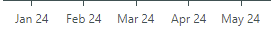

``` xml
<mxc:AxisX Name="salesAxis" Title="Sales">
    <mxc:AxisX.ScaleOptions>
        <mxc:DateTimeScaleOptions MeasureUnit="Month" LabelFormatter="{Binding MonthFormatter}" />
    </mxc:AxisX.ScaleOptions>
</mxc:AxisX>
```

``` cs
public partial class MainWindowViewModel : ViewModelBase
{
    // ...
    [ObservableProperty] FuncLabelFormatter monthFormatter = new(o => String.Format("{0:MMM} {0:yy}", o));
}
```

См. также: [Форматирование значений в метках серий Crosshair](crosshair.md#форматирование-значений-в-метках-серий-crosshair)

### Несколько осей

Типичная декартова диаграмма имеет одну ось _X_ и одну ось _Y_. При необходимости вы можете добавить любое количество дополнительных осей _X_ и _Y_. Это полезно, когда вы отображаете несколько серий и хотите показать собственную ось _X_ и/или _Y_ для каждой серии.

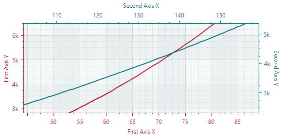

Чтобы связать серию с осью, выполните следующее:

- Установите свойство `Axis.Key` оси в уникальный идентификатор (строку).
- Установите свойство `AxisXKey`/`AxisYKey` серии в значение свойства `Axis.Key`.

 Этот пример добавляет ось _X_ и связывает её с серией _lineSeries_.


``` xml
<mxc:CartesianSeries Name="lineSeries" DataAdapter="{Binding LineSeries.DataAdapter}"  
  AxisXKey="lineSeriesAxis">
    <mxc:CartesianLineSeriesView Color="{Binding LineSeries.Color}" />
</mxc:CartesianSeries>

<mxc:CartesianChart.AxesX>
    <!-- ... -->
    <mxc:AxisX Position="Far" Title="Expenses"
       Key="lineSeriesAxis">
        <mxc:AxisX.ScaleOptions>
            <mxc:NumericScaleOptions />
        </mxc:AxisX.ScaleOptions>
    </mxc:AxisX>
</mxc:CartesianChart.AxesX>
```

### Прокрутка и масштабирование

Пользователи могут масштабировать и прокручивать всё представление и отдельные оси с помощью мыши. Они также могут выполнять масштабирование в конкретную область или диапазон значений.

#### Прокрутка и масштабирование всех осей одновременно 

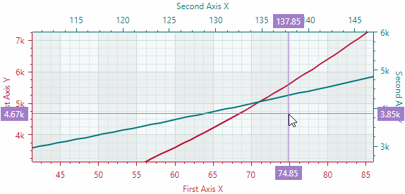

#### Прокрутка и масштабирование отдельных осей

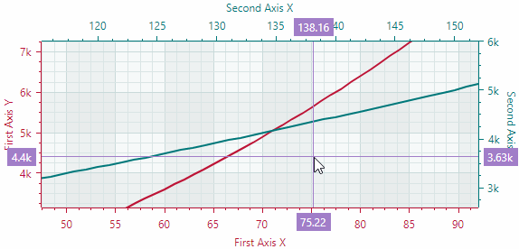

#### Масштабирование в конкретную область и диапазон значений оси

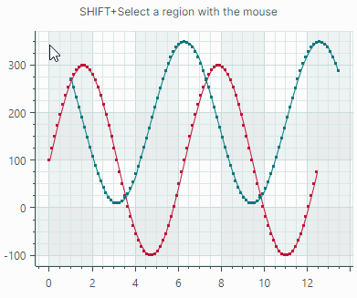

Подробнее см. в разделе [Прокрутка и масштабирование в контроле диаграммы](scroll-and-zoom-in-a-chart-control.md)


### Параметры осей

В следующем списке приведены параметры отображения и поведения декартовых осей:

- [`ConstantLines`](../../API/Eremex.AvaloniaUI.Charts/Axis/ConstantLines.md) и [`ConstantLinesSource`](../../API/Eremex.AvaloniaUI.Charts/Axis/ConstantLinesSource.md) — позволяют отрисовать постоянные линии для конкретных значений. См. [Постоянные линии и полосы](#постоянные-линии-и-полосы).
- [`EnableScrolling`](../../API/Eremex.AvaloniaUI.Charts/Axis/EnableScrolling.md) — позволяет пользователю прокручивать ось операцией перетаскивания мышью.
- [`EnableZooming`](../../API/Eremex.AvaloniaUI.Charts/Axis/EnableZooming.md) — позволяет пользователю масштабировать ось.
- [`InterlacingColor`](../../API/Eremex.AvaloniaUI.Charts/Axis/InterlacingColor.md) — цвет, используемый для отрисовки чередующихся полос (когда включена опция [`ShowInterlacing`](../../API/Eremex.AvaloniaUI.Charts/Axis/ShowInterlacing.md)).
- [`MinorCount`](../../API/Eremex.AvaloniaUI.Charts/Axis/MinorCount.md) — задаёт количество второстепенных отметок (tickmarks) и линий сетки.
- [`Position`](../../API/Eremex.AvaloniaUI.Charts/CartesianAxis/Position.md) — задаёт положение оси. Доступные варианты: `Near` (ось X отображается снизу, ось Y — у левого края диаграммы) и `Far` (ось X отображается сверху, ось Y — у правого края диаграммы).
- [`ShowAxisLine`](../../API/Eremex.AvaloniaUI.Charts/Axis/ShowAxisLine.md) — задаёт видимость линии оси.
- [`ShowInterlacing`](../../API/Eremex.AvaloniaUI.Charts/Axis/ShowInterlacing.md) — определяет, закрашивать ли чередующиеся полосы между основными линиями сетки.
- [`ShowLabels`](../../API/Eremex.AvaloniaUI.Charts/Axis/ShowLabels.md) — задаёт видимость меток, соответствующих основным отметкам.
- [`ShowMajorGridlines`](../../API/Eremex.AvaloniaUI.Charts/Axis/ShowMajorGridlines.md) — задаёт видимость линий сетки, соответствующих основным отметкам.
- [`ShowMajorTickmarks`](../../API/Eremex.AvaloniaUI.Charts/Axis/ShowMajorTickmarks.md) — задаёт видимость основных отметок.
- [`ShowMinorGridlines`](../../API/Eremex.AvaloniaUI.Charts/Axis/ShowMinorGridlines.md) — задаёт видимость линий сетки, соответствующих второстепенным отметкам.
- [`ShowMinorTickmarks`](../../API/Eremex.AvaloniaUI.Charts/Axis/ShowMinorTickmarks.md) — задаёт видимость второстепенных отметок.
- [`ShowTitle`](../../API/Eremex.AvaloniaUI.Charts/CartesianAxis/ShowTitle.md) — задаёт видимость заголовка оси (свойство [`Title`](../../API/Eremex.AvaloniaUI.Charts/CartesianAxis/Title.md)).
- [`Strips`](../../API/Eremex.AvaloniaUI.Charts/Axis/Strips.md) и [`StripsSource`](../../API/Eremex.AvaloniaUI.Charts/Axis/StripsSource.md) — позволяют закрасить диапазоны между конкретными значениями. См. [Постоянные линии и полосы](#постоянные-линии-и-полосы).
- [`Thickness`](../../API/Eremex.AvaloniaUI.Charts/Axis/Thickness.md) — толщина линии оси.
- [`Title`](../../API/Eremex.AvaloniaUI.Charts/CartesianAxis/Title.md) — задаёт заголовок оси.
- [`TitlePosition`](../../API/Eremex.AvaloniaUI.Charts/CartesianAxis/TitlePosition.md) — задаёт положение заголовка оси.


### Постоянные линии и полосы

Контрол [`CartesianChart`](../../API/Eremex.AvaloniaUI.Charts/CartesianChart.md) включает поддержку постоянных линий и полос. Они позволяют выделять конкретные значения и диапазоны значений вдоль осей.

#### Постоянные линии

Постоянные линии — это вертикальные или горизонтальные линии, отрисовываемые перпендикулярно осям. Они служат визуальными маркерами для выделения конкретных значений вдоль осей. Используйте свойство [`Axis.ConstantLines`](../../API/Eremex.AvaloniaUI.Charts/Axis/ConstantLines.md) или [`Axis.ConstantLinesSource`](../../API/Eremex.AvaloniaUI.Charts/Axis/ConstantLinesSource.md), чтобы задать постоянные линии. Каждая постоянная линия инкапсулируется объектом [`ConstantLine`](../../API/Eremex.AvaloniaUI.Charts/ConstantLine.md).

Следующий код создаёт горизонтальную постоянную линию, обозначающую значение 85 вдоль оси Y.

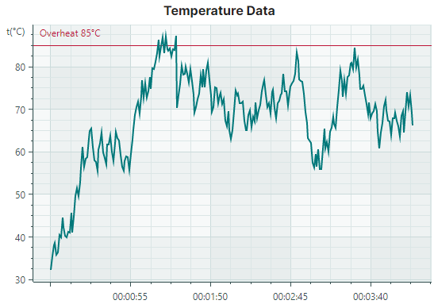

``` xml
<mxc:CartesianChart.AxesY>
    <mxc:AxisY Title="t(°C)" TitlePosition="WithLabels">
        <mxc:AxisY.ConstantLines>
            <mxc:ConstantLine Title="Overheat 85°C" AxisValue="85" Color="#BD1436"/>
        </mxc:AxisY.ConstantLines>
    </mxc:AxisY>
</mxc:CartesianChart.AxesY>
```

Свойство [`Axis.ConstantLinesSource`](../../API/Eremex.AvaloniaUI.Charts/Axis/ConstantLinesSource.md) позволяет инициализировать постоянные линии из коллекции объектов, определённых в View Model. Чтобы создать объекты [`ConstantLine`](../../API/Eremex.AvaloniaUI.Charts/ConstantLine.md) из исходных объектов данных, используйте свойство [`Axis.ConstantLineTemplate`](../../API/Eremex.AvaloniaUI.Charts/Axis/ConstantLineTemplate.md) для задания шаблона. Пример см. в демонстрации `Strips and Constant Lines`.


##### Настройки постоянной линии

- [`ConstantLine.AxisValue`](../../API/Eremex.AvaloniaUI.Charts/ConstantLine/AxisValue.md) — значение оси, связанное с постоянной линией.
- [`ConstantLine.Color`](../../API/Eremex.AvaloniaUI.Charts/ConstantLine/Color.md) — цвет для отрисовки постоянной линии.
- [`ConstantLine.ShowBehind`](../../API/Eremex.AvaloniaUI.Charts/ConstantLine/ShowBehind.md) — определяет, отрисовывать ли постоянную линию под сериями (по умолчанию) или над ними.
- [`ConstantLine.ShowTitle`](../../API/Eremex.AvaloniaUI.Charts/ConstantLine/ShowTitle.md) — определяет, показывать (по умолчанию) или скрывать заголовок (см. параметр [`Title`](../../API/Eremex.AvaloniaUI.Charts/CartesianAxis/Title.md)).
- `ConstantLine.Thickness` — толщина постоянной линии.
- [`ConstantLine.Title`](../../API/Eremex.AvaloniaUI.Charts/ConstantLine/Title.md) — заголовок, отображаемый рядом с постоянной линией. Параметр [`TitlePosition`](../../API/Eremex.AvaloniaUI.Charts/CartesianAxis/TitlePosition.md) задаёт положение заголовка.
- [`ConstantLine.TitleIndent`](../../API/Eremex.AvaloniaUI.Charts/ConstantLine/TitleIndent.md) — горизонтальное и вертикальное расстояние заголовка от линии.
- [`ConstantLine.TitlePosition`](../../API/Eremex.AvaloniaUI.Charts/ConstantLine/TitlePosition.md) — расположение заголовка относительно линии. Доступные варианты: `NearAboveLine`, `NearBelowLine`, `FarAboveLine` и `FarBelowLine`.


#### Постоянные полосы

Постоянные полосы позволяют выделять конкретные диапазоны значений вдоль осей. Как и постоянные линии, полосы отрисовываются перпендикулярно осям. Вы можете задать полосы с помощью свойств [`Axis.Strips`](../../API/Eremex.AvaloniaUI.Charts/Axis/Strips.md) и [`Axis.StripsSource`](../../API/Eremex.AvaloniaUI.Charts/Axis/StripsSource.md). Каждая полоса инкапсулируется объектом [`Strip`](../../API/Eremex.AvaloniaUI.Charts/Strip.md).

Следующий код создаёт полосу, выделяющую диапазон значений _Y_ от 40 до 65. Полоса закрашена полупрозрачным светло-зелёным цветом. Обратите внимание, что если использовать непрозрачный цвет для полосы, она будет перекрывать линии сетки контрола диаграммы.

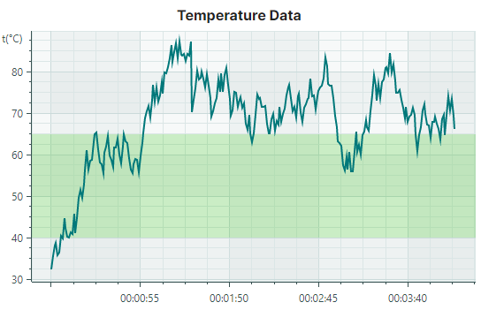

``` xml
<mxc:CartesianChart.AxesY>
    <mxc:AxisY Title="t(°C)" TitlePosition="WithLabels">
        <mxc:AxisY.Strips>
            <mxc:Strip AxisValue1="40" AxisValue2="65" Color="#4043C927" />
        </mxc:AxisY.Strips>
    </mxc:AxisY>
</mxc:CartesianChart.AxesY>
```

Свойство [`Axis.StripsSource`](../../API/Eremex.AvaloniaUI.Charts/Axis/StripsSource.md) позволяет инициализировать полосы из коллекции объектов, определённых в View Model. Чтобы создать объекты [`Strip`](../../API/Eremex.AvaloniaUI.Charts/Strip.md) из исходных объектов данных, используйте свойство [`Axis.StripTemplate`](../../API/Eremex.AvaloniaUI.Charts/Axis/StripTemplate.md) для задания шаблона.

##### Настройки полосы

- `ConstantLine.AxisValue1` — задаёт первое (начальное или конечное) значение диапазона вдоль оси
- `ConstantLine.AxisValue2` — задаёт второе (конечное или начальное) значение диапазона вдоль оси.
- [`ConstantLine.Color`](../../API/Eremex.AvaloniaUI.Charts/ConstantLine/Color.md) — цвет, используемый для закрашивания полосы.

    !!! tip
    
        Используйте полупрозрачный цвет, чтобы линии сетки были видны под полосой.


## Настройка стиля линий

Контрол диаграммы позволяет настраивать стиль линий графиков и постоянных линий. Например, можно задать толщину штриха и шаблоны пунктира для линий.

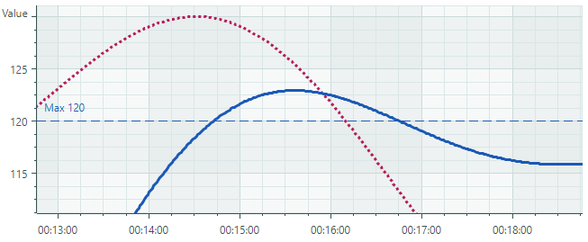

Параметры настройки линий поддерживаются для:

- Линий графиков в следующих представлениях серий:

	- Линейные представления серий ([`CartesianLineSeriesView`](../../API/Eremex.AvaloniaUI.Charts/CartesianLineSeriesView.md), [`CartesianSortedLineSeriesView`](../../API/Eremex.AvaloniaUI.Charts/CartesianSortedLineSeriesView.md), [`CartesianScatterLineSeriesView`](../../API/Eremex.AvaloniaUI.Charts/CartesianScatterLineSeriesView.md) и [`CartesianStepLineSeriesView`](../../API/Eremex.AvaloniaUI.Charts/CartesianStepLineSeriesView.md))
	- Представления серий с диапазонами ([`CartesianAreaSeriesView`](../../API/Eremex.AvaloniaUI.Charts/CartesianAreaSeriesView.md), [`CartesianRangeAreaSeriesView`](../../API/Eremex.AvaloniaUI.Charts/CartesianRangeAreaSeriesView.md), [`CartesianStepAreaSeriesView`](../../API/Eremex.AvaloniaUI.Charts/CartesianStepAreaSeriesView.md), [`CartesianStackedAreaSeriesView`](../../API/Eremex.AvaloniaUI.Charts/CartesianStackedAreaSeriesView.md) и [`CartesianFullStackedAreaSeriesView`](../../API/Eremex.AvaloniaUI.Charts/CartesianFullStackedAreaSeriesView.md))
	- Представление серии «леденцы» ([`CartesianLollipopSeriesView`](../../API/Eremex.AvaloniaUI.Charts/CartesianLollipopSeriesView.md))

- [Постоянных линий](#постоянные-линии)

Эти объекты предоставляют свойства класса [`LineStyle`](../../API/Eremex.AvaloniaUI.Charts/LineStyle.md) для настройки линий. Класс [`LineStyle`](../../API/Eremex.AvaloniaUI.Charts/LineStyle.md) содержит следующие члены, описывающие штрих:


- [`Thickness`](../../API/Eremex.AvaloniaUI.Charts/LineStyle/Thickness.md) (`double`, по умолчанию: `1`) — ширина штриха в независимых от устройства единицах.
- [`Dashes`](../../API/Eremex.AvaloniaUI.Charts/LineStyle/Dashes.md) (`IReadOnlyList<double>?`, по умолчанию: `null`) — длины штрихов и промежутков между ними. Оставьте это свойство незаданным, чтобы рисовать сплошную линию.

    Фактическая ширина штрихов и промежутков пропорциональна толщине линии ([`Thickness`](../../API/Eremex.AvaloniaUI.Charts/LineStyle/Thickness.md)). Например, если [`Thickness`](../../API/Eremex.AvaloniaUI.Charts/LineStyle/Thickness.md) равно 2, а [`Dashes`](../../API/Eremex.AvaloniaUI.Charts/LineStyle/Dashes.md) — { 4, 2 }, фактический шаблон пунктира будет {8, 4}.

- [`DashOffset`](../../API/Eremex.AvaloniaUI.Charts/LineStyle/DashOffset.md) (`double`, по умолчанию: `0`) — расстояние от начала линии до первого штриха.

    Как и в случае со свойством [`Dashes`](../../API/Eremex.AvaloniaUI.Charts/LineStyle/Dashes.md), фактическое смещение пунктира пропорционально толщине линии ([`Thickness`](../../API/Eremex.AvaloniaUI.Charts/LineStyle/Thickness.md)).

- [`LineCap`](../../API/Eremex.AvaloniaUI.Charts/LineStyle/LineCap.md) (`PenLineCap`, по умолчанию: `Flat`) — форма концов штриха.
- [`LineJoin`](../../API/Eremex.AvaloniaUI.Charts/LineStyle/LineJoin.md) (`PenLineJoin`, по умолчанию: `Miter`) — форма углов штриха.
- [`MiterLimit`](../../API/Eremex.AvaloniaUI.Charts/LineStyle/MiterLimit.md) (`double`, по умолчанию: `10`) — предел, при превышении которого скошенное соединение с острым углом заменяется фаской.


### Пример — изменение толщины линии

В этом примере показано, как задать пользовательскую толщину линии в [`CartesianLineSeriesView`](../../API/Eremex.AvaloniaUI.Charts/CartesianLineSeriesView.md).

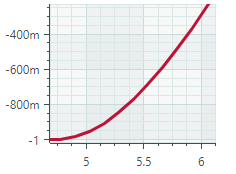


```xml
<mxc:CartesianLineSeriesView Color="{Binding Color}" ShowMarkers="False">
    <mxc:CartesianLineSeriesView.LineStyle>
        <mxc:LineStyle Thickness="3" />
    </mxc:CartesianLineSeriesView.LineStyle>
</mxc:CartesianLineSeriesView>
```


### Пример — изменение шаблона линии

Этот код применяет к постоянной линии основной оси Y шаблон «длинный штрих — короткий штрих».

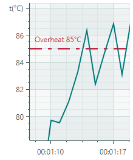

```xml
<mxc:AxisY.ConstantLines>
    <mxc:ConstantLine Title="Overheat 85°C" AxisValue="85" Color="#BD1436" >
        <mxc:ConstantLine.LineStyle>
            <mxc:LineStyle Thickness="2" Dashes="10,5,3,5" />
        </mxc:ConstantLine.LineStyle>
    </mxc:ConstantLine>
</mxc:AxisY.ConstantLines>
```

Свойство [`LineStyle.Dashes`](../../API/Eremex.AvaloniaUI.Charts/LineStyle/Dashes.md), равное `{ 10, 5, 3, 5 }`, создаёт повторяющийся шаблон: длинный штрих в 10 единиц, промежуток в 5 единиц, короткий штрих в 3 единицы и промежуток в 5 единиц. Поскольку толщина линии равна `2`, фактический шаблон пунктира будет {20, 10, 6, 10}.


## Преобразование между координатами диаграммы и координатами экрана

Иногда может потребоваться преобразовать координаты диаграммы в экранные координаты, и наоборот. Следующие методы позволяют выполнить эту задачу:

- [`CartesianChart.DiagramPointToScreenPoint`](../../API/Eremex.AvaloniaUI.Charts/CartesianChart/DiagramPointToScreenPoint.md) — преобразует координаты точки диаграммы в экранные координаты. Точка диаграммы адресуется осями _X_ и _Y_, а также значениями вдоль этих осей.
- [`CartesianChart.ScreenPointToDiagramPoint`](../../API/Eremex.AvaloniaUI.Charts/CartesianChart/ScreenPointToDiagramPoint.md) — преобразует экранные координаты в координаты точки в рамках контрола диаграммы. Объект, возвращаемый методом, позволяет получить координаты диаграммы или определить, находятся ли экранные координаты в пределах видового окна контрола.

<br>
<br>

<sup>*</sup> Эта страница переведена с использованием технологий машинного перевода.
