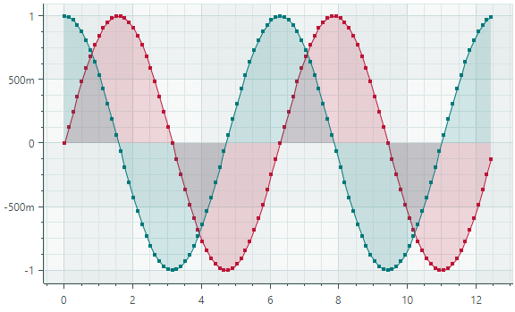
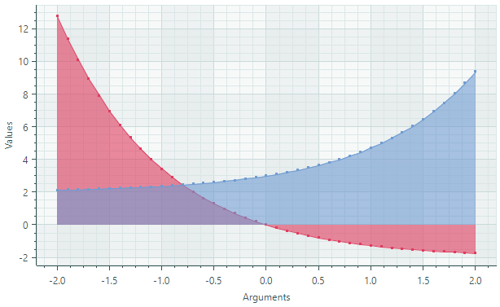

# Area Series View

Представление Area Series View ([`CartesianAreaSeriesView`](../../../API/Eremex.AvaloniaUI.Charts/CartesianAreaSeriesView.md)) соединяет точки линиями и закрашивает области между диаграммами и осью _X_ указанными цветами. Вы можете закрашивать эти области полупрозрачными цветами, чтобы смешивать цвета нескольких серий и сохранять видимыми линии сетки диаграммы под ними.





## Создание Area Series View

Чтобы создать Area Series View, добавьте объект [`CartesianSeries`](../../../API/Eremex.AvaloniaUI.Charts/CartesianSeries.md) в коллекцию [`CartesianChart.Series`](../../../API/Eremex.AvaloniaUI.Charts/CartesianChart/Series.md) и инициализируйте свойство [`CartesianSeries.View`](../../../API/Eremex.AvaloniaUI.Charts/CartesianSeries/View.md) объектом [`CartesianAreaSeriesView`](../../../API/Eremex.AvaloniaUI.Charts/CartesianAreaSeriesView.md).

Используйте свойство [`CartesianSeries.DataAdapter`](../../../API/Eremex.AvaloniaUI.Charts/Series/DataAdapter.md), чтобы предоставить данные для серии.

В следующем коде показано, как создать Area Series View в XAML и code-behind.

``` xml
xmlns:mxc="https://schemas.eremexcontrols.net/avalonia/charts"

<mxc:CartesianChart x:Name="chartControl">
    <mxc:CartesianChart.Series>
        <mxc:CartesianSeries Name="areaSeries1" DataAdapter="{Binding DataAdapter}" >
            <mxc:CartesianAreaSeriesView Color="Green" Transparency="0.3" MarkerSize="5" ShowMarkers="True"/>
        </mxc:CartesianSeries>
    </mxc:CartesianChart.Series>
</mxc:CartesianChart>
```

``` cs
using Eremex.AvaloniaUI.Charts;

CartesianSeries series = new CartesianSeries();
chartControl.Series.Add(series);
double[] args = new double[] { 1,2,3,4,5,6,7 };
double[] values = new double[] { 5,4,3,2,3,4,5 };
series.DataAdapter = new SortedNumericDataAdapter(args, values);
series.View = new CartesianAreaSeriesView()
{
    Color = Avalonia.Media.Colors.Green,
    Transparency = 0.3,
    ShowMarkers = true,
    MarkerSize = 5
};
``` 

!!! tip

    Если вы используете аргументы типа "дата-время", вам также может потребоваться инициализировать ось _X_ и настроить параметры шкалы оси. Подробнее см. в разделе: [Шкала оси](../cartesian-chart.md#масштаб-оси).

### Пример - Создание двух Area Series View

Этот пример создаёт контрол [`CartesianChart`](../../../API/Eremex.AvaloniaUI.Charts/CartesianChart.md) с двумя Area Series View. Данные для представлений серий предоставляются объектами [`FormulaDataAdapter`](../../../API/Eremex.AvaloniaUI.Charts/FormulaDataAdapter.md), которые вычисляют значения согласно указанным формулам. Предполагается, что объект _MainWindowViewModel_ установлен в качестве контекста данных окна.

Созданные представления серий используют полупрозрачные красный и синий цвета. Когда закрашенные области перекрываются, обе серии и линии сетки остаются видимыми.



Пример демонстрирует, как настроить цвет, прозрачность заливки и маркеры точек для представлений серий.

Оси _X_ и _Y_ создаются в XAML для настройки их параметров. Обратите внимание на использование свойства [`NumericScaleOptions.LabelFormatter`](../../../API/Eremex.AvaloniaUI.Charts/ScaleOptions/LabelFormatter.md) для форматирования подписей оси пользовательским способом.


``` xml
<mx:MxWindow xmlns="https://github.com/avaloniaui"
        xmlns:x="http://schemas.microsoft.com/winfx/2006/xaml"
        xmlns:vm="using:ChartAreaSeriesView.ViewModels"
        xmlns:d="http://schemas.microsoft.com/expression/blend/2008"
        xmlns:mc="http://schemas.openxmlformats.org/markup-compatibility/2006"
        xmlns:mx="https://schemas.eremexcontrols.net/avalonia"
        xmlns:mxc="https://schemas.eremexcontrols.net/avalonia/charts"
        mc:Ignorable="d" d:DesignWidth="800" d:DesignHeight="450"
        x:Class="ChartAreaSeriesView.Views.MainWindow"
        x:DataType="vm:MainWindowViewModel"
        Icon="/Assets/EMXControls.ico"
        Title="ChartAreaSeriesView">

    <Design.DataContext>
        <vm:MainWindowViewModel/>
    </Design.DataContext>

    <mxc:CartesianChart x:Name="chartControl">
        <mxc:CartesianChart.Series>
            <mxc:CartesianSeries Name="areaSeries1" DataAdapter="{Binding AreaSeries1.DataAdapter}" >
                <mxc:CartesianAreaSeriesView Color="{Binding AreaSeries1.Color}" Transparency="0.6" MarkerSize="3" ShowMarkers="True"/>
            </mxc:CartesianSeries>
            <mxc:CartesianSeries Name="areaSeries2" DataAdapter="{Binding AreaSeries2.DataAdapter}" >
                <mxc:CartesianAreaSeriesView Color="{Binding AreaSeries2.Color}" Transparency="0.6" MarkerSize="3" ShowMarkers="True"/>
            </mxc:CartesianSeries>
        </mxc:CartesianChart.Series>

        <mxc:CartesianChart.AxesX>
            <mxc:AxisX Name="xAxis" Title="Arguments" >
                <mxc:AxisX.ScaleOptions>
                    <mxc:NumericScaleOptions LabelFormatter="{Binding ArgsLabelFormatter}"/>
                </mxc:AxisX.ScaleOptions>
            </mxc:AxisX>
        </mxc:CartesianChart.AxesX>
        <mxc:CartesianChart.AxesY>
            <mxc:AxisY Title="Values"/>
        </mxc:CartesianChart.AxesY>
    </mxc:CartesianChart>
</mx:MxWindow>
```

``` cs
using Avalonia.Media;
using CommunityToolkit.Mvvm.ComponentModel;
using Eremex.AvaloniaUI.Charts;
using System;

namespace ChartAreaSeriesView.ViewModels;

public partial class MainWindowViewModel : ViewModelBase
{
    static double Exp(double argument) => 2 * Math.Exp(-argument) - 2;
    static double Exp2(double argument) => Math.Exp(argument) + 2;

    [ObservableProperty] SeriesViewModel areaSeries1;
    [ObservableProperty] SeriesViewModel areaSeries2;
    [ObservableProperty] FuncLabelFormatter argsLabelFormatter = new(o => String.Format("{0:n1}", o));

    const int ItemCount = 41;
    const double Step = 0.1;

    public MainWindowViewModel()
    {
        AreaSeries1 = new() { Color = Color.FromUInt32(0xffDF3C5F), DataAdapter = new FormulaDataAdapter(-2, Step, ItemCount, Exp) };
        AreaSeries2 = new() { Color = Color.FromUInt32(0xff6F9BD1), DataAdapter = new FormulaDataAdapter(-2, Step, ItemCount, Exp2) };
    }
}

public partial class SeriesViewModel : ObservableObject
{
    [ObservableProperty] Color color;
    [ObservableProperty] ISeriesDataAdapter dataAdapter;
}
```


## Данные для Area Series View

Вы можете использовать следующие адаптеры данных для предоставления данных для Area Series View:

Числовые значения _X_:

- [`SortedNumericDataAdapter`](../../../API/Eremex.AvaloniaUI.Charts/SortedNumericDataAdapter.md)
- [`FormulaDataAdapter`](../../../API/Eremex.AvaloniaUI.Charts/FormulaDataAdapter.md)


Значения даты и времени _X_:

- [`SortedDateTimeDataAdapter`](../../../API/Eremex.AvaloniaUI.Charts/SortedDateTimeDataAdapter.md)
- [`SortedTimeSpanDataAdapter`](../../../API/Eremex.AvaloniaUI.Charts/SortedTimeSpanDataAdapter.md)

Качественные значения _X_:

- [`QualitativeDataAdapter`](../../../API/Eremex.AvaloniaUI.Charts/QualitativeDataAdapter.md)


## Параметры Area Series View


- [`Color`](../../../API/Eremex.AvaloniaUI.Charts/CartesianPointSeriesView/Color.md) — Задаёт цвет, используемый для закраски серии.
- [`CrosshairMode`](../../../API/Eremex.AvaloniaUI.Charts/CartesianSortedLineSeriesView/CrosshairMode.md) — Задаёт, привязывается ли подпись перекрестия к ближайшей точке данных, или отображает интерполированное значение. См. [Отображение точного или интерполированного значения в подписях перекрестия](../crosshair.md#отображение-точного-или-интерполированного-значения-в-метках-серий-crosshair).
- [`MarkerImage`](../../../API/Eremex.AvaloniaUI.Charts/CartesianPointSeriesView/MarkerImage.md) — Получает или задаёт изображение, используемое в качестве пользовательских маркеров точек. Если изображение не указано, отображаются стандартные маркеры в форме квадрата. Вы можете использовать экземпляр класса `SvgImage`, чтобы задать SVG-изображение.

    Свойство [`MarkerImage`](../../../API/Eremex.AvaloniaUI.Charts/CartesianPointSeriesView/MarkerImage.md) объявлено с атрибутом `[Content]`, что позволяет определить изображение непосредственно между тегами &lt;CartesianAreaSeriesView&gt;.

    ``` xml
    <mxc:CartesianAreaSeriesView>
        <SvgImage Source="avares://Demo/Assets/circle.svg" />
    </mxc:CartesianAreaSeriesView>
    ```

    SVG-файлы содержат предопределённые цвета для SVG-элементов. Чтобы эти цвета соответствовали цвету вашей серии данных, вы можете:
    
    - Вручную отредактировать исходный SVG-файл заранее
    - Использовать свойство [`MarkerImageCss`](../../../API/Eremex.AvaloniaUI.Charts/CartesianPointSeriesView/MarkerImageCss.md), чтобы динамически настраивать [стили](https://developer.mozilla.org/en-US/docs/Web/SVG/Reference/Element/style) для SVG-элементов. Стили применяются при отрисовке маркеров точек.


- [`MarkerImageCss`](../../../API/Eremex.AvaloniaUI.Charts/CartesianPointSeriesView/MarkerImageCss.md) — Задаёт [CSS-стили](https://developer.mozilla.org/en-US/docs/Web/SVG/Reference/Element/style) для настройки SVG-изображения, заданного свойством [`MarkerImage`](../../../API/Eremex.AvaloniaUI.Charts/CartesianPointSeriesView/MarkerImage.md), во время выполнения. Основной сценарий использования — замена цветов SVG-элементов на цвет серии ([`Color`](../../../API/Eremex.AvaloniaUI.Charts/CartesianPointSeriesView/Color.md)). Включите заполнитель `{0}`, чтобы вставить значение свойства [`Color`](../../../API/Eremex.AvaloniaUI.Charts/CartesianPointSeriesView/Color.md) в CSS-код. 

    Например, когда свойство [`MarkerImage`](../../../API/Eremex.AvaloniaUI.Charts/CartesianPointSeriesView/MarkerImage.md) содержит SVG-изображение с элементом circle, следующий CSS-код стилизует `circle` заливкой Orange (используя цвет серии) и границей Dark Red:

    ``` xml
    <mxc:CartesianAreaSeriesView Color="orange" MarkerImageCss="circle {{fill:{0};stroke:darkred;}}">
        <SvgImage Source="avares://Demo/Assets/circle.svg" />
    </mxc:CartesianAreaSeriesView>
    ```
    
    Смотрите также: [Пример - Создание Lollipop Series View и использование пользовательских SVG-маркеров](lollipop-series-view.md#пример---создание-lollipop-series-view-и-использование-пользовательских-svg-маркеров-точек-данных).


- [`MarkerSize`](../../../API/Eremex.AvaloniaUI.Charts/CartesianPointSeriesView/MarkerSize.md) — Задаёт размер маркеров точек.
- [`ShowInCrosshair`](../../../API/Eremex.AvaloniaUI.Charts/CrosshairSeriesViewBase/ShowInCrosshair.md) — Задаёт видимость подписи перекрестия для текущей серии. См. [Настройка подписей перекрестия](../crosshair.md#скрытие-серии-в-crosshair).
- [`ShowMarkers`](../../../API/Eremex.AvaloniaUI.Charts/CartesianLineSeriesViewBase/ShowMarkers.md) — Включает или отключает маркеры точек.
- `Thickness` — Задаёт толщину линии.
- [`Transparency`](../../../API/Eremex.AvaloniaUI.Charts/CartesianAreaSeriesView/Transparency.md) — Значение от `0` до `1`, задающее уровень прозрачности закрашенных областей:
    - `0` означает полную непрозрачность
    - `1` означает полную прозрачность

<br>
<br>

<sup>*</sup> Эта страница переведена с использованием технологий машинного перевода.
