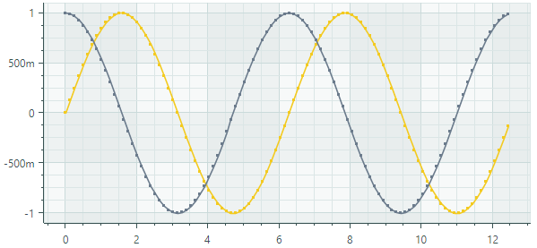
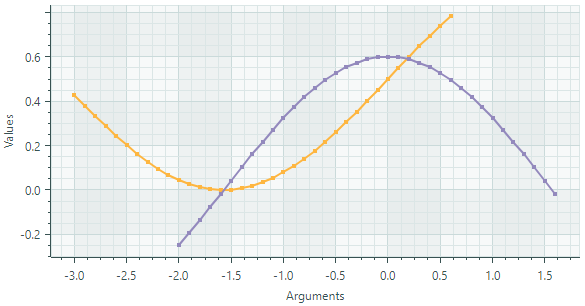

# Line Series View

Line Series View ([`CartesianLineSeriesView`](../../../API/Eremex.AvaloniaUI.Charts/CartesianLineSeriesView.md)) соединяет точки линиями. Серия позволяет отображать или скрывать маркеры точек, а также настраивать толщину линий и маркеров точек. На следующем изображении показан контрол диаграммы с двумя линейными сериями, каждая из которых закрашена своим цветом.




## Создание Line Series View

Чтобы создать Line Series View, добавьте объект [`CartesianSeries`](../../../API/Eremex.AvaloniaUI.Charts/CartesianSeries.md) в коллекцию [`CartesianChart.Series`](../../../API/Eremex.AvaloniaUI.Charts/CartesianChart/Series.md) и инициализируйте свойство [`CartesianSeries.View`](../../../API/Eremex.AvaloniaUI.Charts/CartesianSeries/View.md) экземпляром [`CartesianLineSeriesView`](../../../API/Eremex.AvaloniaUI.Charts/CartesianLineSeriesView.md).

Используйте свойство [`CartesianSeries.DataAdapter`](../../../API/Eremex.AvaloniaUI.Charts/Series/DataAdapter.md), чтобы предоставить данные для серии.

В следующем коде показано, как создать Line Series View в XAML и code-behind.

``` xml
xmlns:mxc="https://schemas.eremexcontrols.net/avalonia/charts"

<mxc:CartesianChart x:Name="chartControl">
    <mxc:CartesianChart.Series>
        <mxc:CartesianSeries Name="lineSeries1" DataAdapter="{Binding DataAdapter}" >
            <mxc:CartesianLineSeriesView Color="Red" MarkerSize="4" ShowMarkers="True">
                <mxc:CartesianLineSeriesView.LineStyle>
                    <mxc:LineStyle Thickness="2" />
                </mxc:CartesianLineSeriesView.LineStyle>
            </mxc:CartesianLineSeriesView>
        </mxc:CartesianSeries>
    </mxc:CartesianChart.Series>
</mxc:CartesianChart>
```

``` cs
using Eremex.AvaloniaUI.Charts;

CartesianSeries series = new CartesianSeries();
chartControl.Series.Add(series);
double[] args = new double[] { 1, 2, 3, 4, 5, 6, 7 };
double[] values = new double[] { 0, 0.4, 1.5, 1.3, 0.4, 0, 0.1 };
series.DataAdapter = new SortedNumericDataAdapter(args, values);
series.View = new CartesianLineSeriesView()
{
    Color = Avalonia.Media.Colors.Green,
    ShowMarkers = true,
    MarkerSize = 4,
    Thickness = 2
};
```

### Пример - Создание двух Line Series View


Этот пример создаёт контрол [`CartesianChart`](../../../API/Eremex.AvaloniaUI.Charts/CartesianChart.md) с двумя Line Series View. Данные для представлений серий предоставляются объектами [`FormulaDataAdapter`](../../../API/Eremex.AvaloniaUI.Charts/FormulaDataAdapter.md), которые вычисляют значения согласно указанным формулам. Предполагается, что объект _MainWindowViewModel_ установлен в качестве контекста данных окна.



Пример демонстрирует, как настроить толщину линии и маркеры точек для представлений серий.

Оси _X_ и _Y_ создаются в XAML для настройки их параметров. Обратите внимание на использование свойства [`NumericScaleOptions.LabelFormatter`](../../../API/Eremex.AvaloniaUI.Charts/ScaleOptions/LabelFormatter.md) для форматирования подписей оси пользовательским способом.

``` xml
<mx:MxWindow xmlns="https://github.com/avaloniaui"
        xmlns:x="http://schemas.microsoft.com/winfx/2006/xaml"
        xmlns:vm="using:ChartLinearSeriesView.ViewModels"
        xmlns:d="http://schemas.microsoft.com/expression/blend/2008"
        xmlns:mc="http://schemas.openxmlformats.org/markup-compatibility/2006"
        xmlns:mx="https://schemas.eremexcontrols.net/avalonia"
        xmlns:mxc="https://schemas.eremexcontrols.net/avalonia/charts"
        mc:Ignorable="d" d:DesignWidth="800" d:DesignHeight="450"
        x:Class="ChartLinearSeriesView.Views.MainWindow"
        x:DataType="vm:MainWindowViewModel"
        Icon="/Assets/EMXControls.ico"
        Title="ChartLinearSeriesView"
        Width="600" Height="350"
        >
    <Design.DataContext>
        <vm:MainWindowViewModel/>
    </Design.DataContext>

    <mxc:CartesianChart x:Name="chartControl">
        <mxc:CartesianChart.Series>
            <mxc:CartesianSeries Name="lineSeries1" DataAdapter="{Binding LineSeries1.DataAdapter}" >
                <mxc:CartesianLineSeriesView Color="{Binding LineSeries1.Color}" MarkerSize="4" ShowMarkers="True">
                    <mxc:CartesianLineSeriesView.LineStyle>
                        <mxc:LineStyle Thickness="2" />
                    </mxc:CartesianLineSeriesView.LineStyle>
                </mxc:CartesianLineSeriesView>
            </mxc:CartesianSeries>
            <mxc:CartesianSeries Name="lineSeries2" DataAdapter="{Binding LineSeries2.DataAdapter}" >
                <mxc:CartesianLineSeriesView Color="{Binding LineSeries2.Color}" MarkerSize="4" ShowMarkers="True">
                    <mxc:CartesianLineSeriesView.LineStyle>
                        <mxc:LineStyle Thickness="2" />
                    </mxc:CartesianLineSeriesView.LineStyle>
                </mxc:CartesianLineSeriesView>
            </mxc:CartesianSeries>
        </mxc:CartesianChart.Series>

        <mxc:CartesianChart.AxesX>
            <mxc:AxisX Name="xAxis" Title="Arguments" >
                <mxc:AxisX.ScaleOptions>
                    <mxc:NumericScaleOptions LabelFormatter="{Binding ArgsLabelFormatter}"/>
                </mxc:AxisX.ScaleOptions>
            </mxc:AxisX>
        </mxc:CartesianChart.AxesX>
        <mxc:CartesianChart.AxesY>
            <mxc:AxisY Title="Values">
                <mxc:AxisY.ScaleOptions>
                    <mxc:NumericScaleOptions LabelFormatter="{Binding ArgsLabelFormatter}"/>
                </mxc:AxisY.ScaleOptions>
            </mxc:AxisY>
        </mxc:CartesianChart.AxesY>
    </mxc:CartesianChart>
</mx:MxWindow>
```

``` cs
using Avalonia.Media;
using CommunityToolkit.Mvvm.ComponentModel;
using Eremex.AvaloniaUI.Charts;
using System;

namespace ChartLinearSeriesView.ViewModels;

public partial class MainWindowViewModel : ViewModelBase
{
    static double Sin(double argument) => 0.5* Math.Sin(argument)+0.5;
    static double Cos(double argument) => 0.6*Math.Cos(argument);

    [ObservableProperty] SeriesViewModel lineSeries1;
    [ObservableProperty] SeriesViewModel lineSeries2;
    [ObservableProperty] FuncLabelFormatter argsLabelFormatter = new(o => String.Format("{0:n1}", o));

    const int ItemCount = 37;
    const double Step = 0.1;

    public MainWindowViewModel()
    {
        LineSeries1 = new() 
        { 
            Color = Color.FromUInt32(0xfffeb640), 
            DataAdapter = new FormulaDataAdapter(-3, Step, ItemCount, Sin) 
        };
        LineSeries2 = new() 
        { 
            Color = Color.FromUInt32(0xff9389bd), 
            DataAdapter = new FormulaDataAdapter(-2, Step, ItemCount, Cos) 
        };
    }
}

public partial class SeriesViewModel : ObservableObject
{
    [ObservableProperty] Color color;
    [ObservableProperty] ISeriesDataAdapter dataAdapter;
}
```

## Данные для Line Series View

Вы можете использовать следующие адаптеры данных для предоставления данных для Line Series View:

Числовые значения _X_:

- [`SortedNumericDataAdapter`](../../../API/Eremex.AvaloniaUI.Charts/SortedNumericDataAdapter.md)
- [`FormulaDataAdapter`](../../../API/Eremex.AvaloniaUI.Charts/FormulaDataAdapter.md)

Значения даты и времени _X_:

- [`SortedDateTimeDataAdapter`](../../../API/Eremex.AvaloniaUI.Charts/SortedDateTimeDataAdapter.md)
- [`SortedTimeSpanDataAdapter`](../../../API/Eremex.AvaloniaUI.Charts/SortedTimeSpanDataAdapter.md)


Качественные значения _X_:

- [`QualitativeDataAdapter`](../../../API/Eremex.AvaloniaUI.Charts/QualitativeDataAdapter.md)


## Параметры Line Series View


- [`Color`](../../../API/Eremex.AvaloniaUI.Charts/CartesianPointSeriesView/Color.md) — Задаёт цвет, используемый для закраски серии.
- [`CrosshairMode`](../../../API/Eremex.AvaloniaUI.Charts/CartesianSortedLineSeriesView/CrosshairMode.md) — Задаёт, привязывается ли подпись перекрестия к ближайшей точке данных, или отображает интерполированное значение. См. [Отображение точного или интерполированного значения в подписях перекрестия](../crosshair.md#отображение-точного-или-интерполированного-значения-в-метках-серий-crosshair).
- [`MarkerImage`](../../../API/Eremex.AvaloniaUI.Charts/CartesianPointSeriesView/MarkerImage.md) — Получает или задаёт изображение, используемое в качестве пользовательских маркеров точек. Если изображение не указано, отображаются стандартные маркеры в форме квадрата. Вы можете использовать экземпляр класса `SvgImage`, чтобы задать SVG-изображение.

    Свойство [`MarkerImage`](../../../API/Eremex.AvaloniaUI.Charts/CartesianPointSeriesView/MarkerImage.md) объявлено с атрибутом `[Content]`, что позволяет определить изображение непосредственно между тегами &lt;CartesianLineSeriesView&gt;.

    ``` xml
    <mxc:CartesianLineSeriesView>
        <SvgImage Source="avares://Demo/Assets/circle.svg" />
    </mxc:CartesianLineSeriesView>
    ```

    SVG-файлы содержат предопределённые цвета для SVG-элементов. Чтобы эти цвета соответствовали цвету вашей серии данных, вы можете:
    
    - Вручную отредактировать исходный SVG-файл заранее
    - Использовать свойство [`MarkerImageCss`](../../../API/Eremex.AvaloniaUI.Charts/CartesianPointSeriesView/MarkerImageCss.md), чтобы динамически настраивать [стили](https://developer.mozilla.org/en-US/docs/Web/SVG/Reference/Element/style) для SVG-элементов. Стили применяются при отрисовке маркеров точек.

- [`MarkerImageCss`](../../../API/Eremex.AvaloniaUI.Charts/CartesianPointSeriesView/MarkerImageCss.md) — Задаёт [CSS-стили](https://developer.mozilla.org/en-US/docs/Web/SVG/Reference/Element/style) для настройки SVG-изображения, заданного свойством [`MarkerImage`](../../../API/Eremex.AvaloniaUI.Charts/CartesianPointSeriesView/MarkerImage.md), во время выполнения. Основной сценарий использования — замена цветов SVG-элементов на цвет серии ([`Color`](../../../API/Eremex.AvaloniaUI.Charts/CartesianPointSeriesView/Color.md)). Включите заполнитель `{0}`, чтобы вставить значение свойства [`Color`](../../../API/Eremex.AvaloniaUI.Charts/CartesianPointSeriesView/Color.md) в CSS-код. 

    Например, когда свойство [`MarkerImage`](../../../API/Eremex.AvaloniaUI.Charts/CartesianPointSeriesView/MarkerImage.md) содержит SVG-изображение с элементом circle, следующий CSS-код стилизует `circle` заливкой Orange (используя цвет серии) и границей Dark Red:

    ``` xml
    <mxc:CartesianLineSeriesView Color="orange" MarkerImageCss="circle {{fill:{0};stroke:darkred;}}">
        <SvgImage Source="avares://Demo/Assets/circle.svg" />
    </mxc:CartesianLineSeriesView>
    ```
    
    Смотрите также: [Пример - Создание Lollipop Series View и использование пользовательских SVG-маркеров](lollipop-series-view.md#пример---создание-lollipop-series-view-и-использование-пользовательских-svg-маркеров-точек-данных).

- [`MarkerSize`](../../../API/Eremex.AvaloniaUI.Charts/CartesianPointSeriesView/MarkerSize.md) — Задаёт размер маркеров точек.
- [`ShowInCrosshair`](../../../API/Eremex.AvaloniaUI.Charts/CrosshairSeriesViewBase/ShowInCrosshair.md) — Задаёт видимость подписи перекрестия для текущей серии. См. [Настройка подписей перекрестия](../crosshair.md#скрытие-серии-в-crosshair).
- [`ShowMarkers`](../../../API/Eremex.AvaloniaUI.Charts/CartesianLineSeriesViewBase/ShowMarkers.md) — Включает или отключает маркеры точек.
- `Thickness` — Задаёт толщину линии.

<br>
<br>

<sup>*</sup> Эта страница переведена с использованием технологий машинного перевода.
