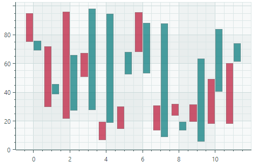

# Side-by-side Range Bar Series View

Side-by-side Range Bar Series View ([`CartesianSideBySideRangeBarSeriesView`](../../../API/Eremex.AvaloniaUI.Charts/CartesianSideBySideRangeBarSeriesView.md)) отрисовывает прямоугольные столбцы между двумя значениями Y серии данных.

## Данные для Side-by-side Range Bar Series View

Вы можете использовать следующие адаптеры данных для предоставления данных для Side-by-side Range Bar Series View:

Числовые значения _X_:

- [`NumericRangeDataAdapter`](../../../API/Eremex.AvaloniaUI.Charts/NumericRangeDataAdapter.md)

Значения даты и времени _X_:

- [`DateTimeRangeDataAdapter`](../../../API/Eremex.AvaloniaUI.Charts/DateTimeRangeDataAdapter.md)
- [`TimeSpanRangeDataAdapter`](../../../API/Eremex.AvaloniaUI.Charts/TimeSpanRangeDataAdapter.md)

Качественные значения _X_:

- [`QualitativeRangeDataAdapter`](../../../API/Eremex.AvaloniaUI.Charts/QualitativeRangeDataAdapter.md) 

 
 

* Эта страница переведена с использованием технологий машинного перевода.
