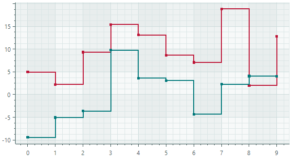
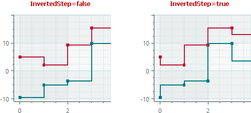

# Step Line Series View

Step Line Series View ([`CartesianStepLineSeriesView`](../../../API/Eremex.AvaloniaUI.Charts/CartesianStepLineSeriesView.md)) соединяет точки горизонтальными и вертикальными отрезками линий.



## Данные для Step Line Series View

Вы можете использовать следующие адаптеры данных для предоставления данных для Step Line Series View:

Числовые значения _X_:

- [`SortedNumericDataAdapter`](../../../API/Eremex.AvaloniaUI.Charts/SortedNumericDataAdapter.md)
- [`FormulaDataAdapter`](../../../API/Eremex.AvaloniaUI.Charts/FormulaDataAdapter.md)

Значения даты и времени _X_:

- [`SortedDateTimeDataAdapter`](../../../API/Eremex.AvaloniaUI.Charts/SortedDateTimeDataAdapter.md)
- [`SortedTimeSpanDataAdapter`](../../../API/Eremex.AvaloniaUI.Charts/SortedTimeSpanDataAdapter.md)

Качественные значения _X_:

- [`QualitativeDataAdapter`](../../../API/Eremex.AvaloniaUI.Charts/QualitativeDataAdapter.md)


## Параметры Step Line Series View

- [`Color`](../../../API/Eremex.AvaloniaUI.Charts/CartesianPointSeriesView/Color.md) — Задаёт цвет, используемый для закраски серии.
- [`CrosshairMode`](../../../API/Eremex.AvaloniaUI.Charts/CartesianSortedLineSeriesView/CrosshairMode.md) — Задаёт, привязывается ли подпись перекрестия к ближайшей точке данных, или отображает интерполированное значение. См. [Отображение точного или интерполированного значения в подписях перекрестия](../crosshair.md#отображение-точного-или-интерполированного-значения-в-метках-серий-crosshair).
- [`InvertedStep`](../../../API/Eremex.AvaloniaUI.Charts/CartesianStepLineSeriesView/InvertedStep.md) — Задаёт порядок отрисовки ступенчатых сегментов между соседними точками данных. Если [`InvertedStep`](../../../API/Eremex.AvaloniaUI.Charts/CartesianStepLineSeriesView/InvertedStep.md) равно `false` (по умолчанию), ступени состоят из горизонтального, а затем вертикального сегмента. Если [`InvertedStep`](../../../API/Eremex.AvaloniaUI.Charts/CartesianStepLineSeriesView/InvertedStep.md) равно `true`, ступени состоят из вертикального, а затем горизонтального сегмента.

    

- [`MarkerImage`](../../../API/Eremex.AvaloniaUI.Charts/CartesianPointSeriesView/MarkerImage.md) — Получает или задаёт изображение, используемое в качестве пользовательских маркеров точек. Если изображение не указано, отображаются стандартные маркеры в форме квадрата. Вы можете использовать экземпляр класса `SvgImage`, чтобы задать SVG-изображение.

    Свойство [`MarkerImage`](../../../API/Eremex.AvaloniaUI.Charts/CartesianPointSeriesView/MarkerImage.md) объявлено с атрибутом `[Content]`, что позволяет определить изображение непосредственно между тегами &lt;CartesianStepLineSeriesView&gt;.

    ``` xml
    <mxc:CartesianStepLineSeriesView>
        <SvgImage Source="avares://Demo/Assets/circle.svg" />
    </mxc:CartesianStepLineSeriesView>
    ```

    SVG-файлы содержат предопределённые цвета для SVG-элементов. Чтобы эти цвета соответствовали цвету вашей серии данных, вы можете:
    
    - Вручную отредактировать исходный SVG-файл заранее
    - Использовать свойство [`MarkerImageCss`](../../../API/Eremex.AvaloniaUI.Charts/CartesianPointSeriesView/MarkerImageCss.md), чтобы динамически настраивать [стили](https://developer.mozilla.org/en-US/docs/Web/SVG/Reference/Element/style) для SVG-элементов. Стили применяются при отрисовке маркеров точек.

- [`MarkerImageCss`](../../../API/Eremex.AvaloniaUI.Charts/CartesianPointSeriesView/MarkerImageCss.md) — Задаёт [CSS-стили](https://developer.mozilla.org/en-US/docs/Web/SVG/Reference/Element/style) для настройки SVG-изображения, заданного свойством [`MarkerImage`](../../../API/Eremex.AvaloniaUI.Charts/CartesianPointSeriesView/MarkerImage.md), во время выполнения. Основной сценарий использования — замена цветов SVG-элементов на цвет серии ([`Color`](../../../API/Eremex.AvaloniaUI.Charts/CartesianPointSeriesView/Color.md)). Включите заполнитель `{0}`, чтобы вставить значение свойства [`Color`](../../../API/Eremex.AvaloniaUI.Charts/CartesianPointSeriesView/Color.md) в CSS-код. 

    Например, когда свойство [`MarkerImage`](../../../API/Eremex.AvaloniaUI.Charts/CartesianPointSeriesView/MarkerImage.md) содержит SVG-изображение с элементом circle, следующий CSS-код стилизует `circle` заливкой Orange (используя цвет серии) и границей Dark Red:

    ``` xml
    <mxc:CartesianStepLineSeriesView Color="orange" MarkerImageCss="circle {{fill:{0};stroke:darkred;}}">
        <SvgImage Source="avares://Demo/Assets/circle.svg" />
    </mxc:CartesianStepLineSeriesView>
    ```
    
    Смотрите также: [Пример - Создание Lollipop Series View и использование пользовательских SVG-маркеров](lollipop-series-view.md#пример---создание-lollipop-series-view-и-использование-пользовательских-svg-маркеров-точек-данных).

- [`MarkerSize`](../../../API/Eremex.AvaloniaUI.Charts/CartesianPointSeriesView/MarkerSize.md) — Задаёт размер маркеров точек.
- [`ShowInCrosshair`](../../../API/Eremex.AvaloniaUI.Charts/CrosshairSeriesViewBase/ShowInCrosshair.md) — Задаёт видимость подписи перекрестия для текущей серии. См. [Настройка подписей перекрестия](../crosshair.md#скрытие-серии-в-crosshair).
- [`ShowMarkers`](../../../API/Eremex.AvaloniaUI.Charts/CartesianLineSeriesViewBase/ShowMarkers.md) — Включает или отключает маркеры точек.
- `Thickness` — Задаёт толщину линии.

<br>
<br>

<sup>*</sup> Эта страница переведена с использованием технологий машинного перевода.
