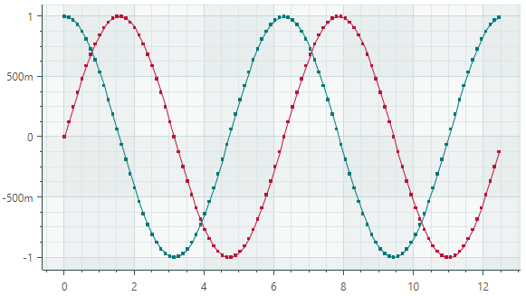
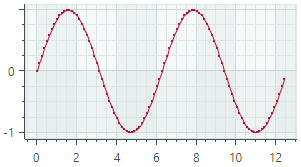
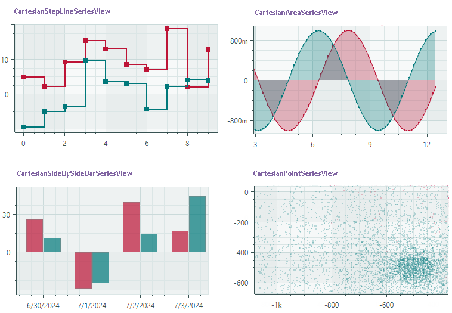

# Начало работы с диаграммами — паттерн MVVM

Вы можете заполнять контролы диаграмм данными, используя паттерн проектирования MVVM. Это полезно, когда требуется отобразить несколько серий данных.

Этот учебник показывает, как отрисовать два линейных графика в контроле [`CartesianChart`](../../API/Eremex.AvaloniaUI.Charts/CartesianChart.md), используя паттерн MVVM. Данные для линейных графиков в этом примере вычисляются с помощью математических функций (синус и косинус). 
Полный код этого учебника можно найти в модуле _Cartesian Chart&rarr;Line_ демонстрационного приложения.



## Определение View Model

Начните с определения View Model, предоставляющих данные и настройки серий для контрола диаграммы.

- _CartesianLineSeriesViewViewModel_ — главная View Model, которая будет назначена в качестве Data Context контрола диаграммы. Главная View Model предоставляет свойство _CartesianLineSeriesViewViewModel.Series_, которое задаёт коллекцию View Model серий данных.

- _SeriesViewModel_ — View Model для серии данных.


``` cs
// The main View Model
public partial class CartesianLineSeriesViewViewModel : ChartsPageViewModel
{
    static double Sin(double argument) => Math.Sin(argument);
    static double Cos(double argument) => Math.Cos(argument);

    const int ItemCount = 100;
    const double Step = 4 * Math.PI / ItemCount;

    // A collection of View Models used to create data series.
    [ObservableProperty] ObservableCollection<SeriesViewModel> series = new()
    {
        new SeriesViewModel { Color = Color.FromArgb(255, 189, 20, 54), DataAdapter = new FormulaDataAdapter(0, Step, ItemCount, Sin)},
        new SeriesViewModel { Color = Color.FromArgb(255, 0, 120, 122), DataAdapter = new FormulaDataAdapter(0, Step, ItemCount, Cos)},
    };
}

// A View Model for a data series.
public partial class SeriesViewModel : ObservableObject
{
    [ObservableProperty] string axisXKey;
    [ObservableProperty] string axisYKey;
    [ObservableProperty] Color color;
    [ObservableProperty] ISeriesDataAdapter dataAdapter;
}
```

Коллекция _CartesianLineSeriesViewViewModel.Series_ инициализируется двумя View Model серий. Cartesian Chart отрисует их как две серии данных.

View Model серии данных (_SeriesViewModel_) предоставляет свойства, задающие данные и цвет для отрисовки серии в контроле диаграммы:

- _Color_ — цвет для отрисовки серии данных.
- _DataAdapter_ — объект [`ISeriesDataAdapter`](../../API/Eremex.AvaloniaUI.Charts/ISeriesDataAdapter.md), предоставляющий данные для серии. 
  
  Eremex Charts поставляются с несколькими адаптерами данных для различных типов данных (числовых, дата-время и качественных). Все адаптеры данных реализуют интерфейс [`ISeriesDataAdapter`](../../API/Eremex.AvaloniaUI.Charts/ISeriesDataAdapter.md).
  
  В этом учебнике используется объект [`Eremex.AvaloniaUI.Charts.FormulaDataAdapter`](../../API/Eremex.AvaloniaUI.Charts/FormulaDataAdapter.md). Он задаёт функцию, возвращающую числовые значения _Y_ с шагом _Step_. 
  
  Несколько примеров других адаптеров данных:
  - [`SortedNumericDataAdapter`](../../API/Eremex.AvaloniaUI.Charts/SortedNumericDataAdapter.md) — предоставляет пары (числовое значение X, числовое значение Y), отсортированные по значениям X.
  - [`QualitativeDataAdapter`](../../API/Eremex.AvaloniaUI.Charts/QualitativeDataAdapter.md) — предоставляет пары (строковое значение X, числовое значение Y).

  Подробнее см. в разделе [Cartesian Chart](cartesian-chart.md).

## Создание контрола диаграммы

В XAML создайте контрол [`CartesianChart`](../../API/Eremex.AvaloniaUI.Charts/CartesianChart.md) и инициализируйте его свойства [`CartesianChart.SeriesSource`](../../API/Eremex.AvaloniaUI.Charts/CartesianChart/SeriesSource.md) и [`CartesianChart.SeriesTemplate`](../../API/Eremex.AvaloniaUI.Charts/CartesianChart/SeriesTemplate.md):

- [`CartesianChart.SeriesSource`](../../API/Eremex.AvaloniaUI.Charts/CartesianChart/SeriesSource.md) — коллекция View Model, представляющих серии данных (коллекция _CartesianLineSeriesViewViewModel.Series_, хранящая объекты _SeriesViewModel_).
  
  Предполагается, что Data Context контрола диаграммы установлен в объект _CartesianLineSeriesViewViewModel_.

- [`CartesianChart.SeriesTemplate`](../../API/Eremex.AvaloniaUI.Charts/CartesianChart/SeriesTemplate.md) — шаблон, создающий объект [`CartesianSeries`](../../API/Eremex.AvaloniaUI.Charts/CartesianSeries.md) из View Model серии. Класс [`CartesianSeries`](../../API/Eremex.AvaloniaUI.Charts/CartesianSeries.md) инкапсулирует одну серию данных в контроле [`CartesianChart`](../../API/Eremex.AvaloniaUI.Charts/CartesianChart.md).

``` xml
<mxc:CartesianChart Grid.Column="0" Classes="DemoChart" 
 SeriesSource="{Binding Series}" x:Name="chart1">
    <mxc:CartesianChart.SeriesTemplate>
        <DataTemplate x:DataType="vm:SeriesViewModel">
            <mxc:CartesianSeries DataAdapter="{Binding DataAdapter}">
                <mxc:CartesianLineSeriesView Color="{Binding Color}"
                                             ShowMarkers="True"
                                             MarkerSize="4">
                    <mxc:CartesianLineSeriesView.LineStyle>
                        <mxc:LineStyle Thickness="2" />
                    </mxc:CartesianLineSeriesView.LineStyle>
                </mxc:CartesianLineSeriesView>
            </mxc:CartesianSeries>
        </DataTemplate>
    </mxc:CartesianChart.SeriesTemplate>
</mxc:CartesianChart>
```

При создании объекта [`CartesianSeries`](../../API/Eremex.AvaloniaUI.Charts/CartesianSeries.md) инициализируйте следующие свойства, чтобы задать данные и представление серии:

- [`CartesianSeries.DataAdapter`](../../API/Eremex.AvaloniaUI.Charts/Series/DataAdapter.md) — адаптер данных, предоставляющий данные. Установите это свойство равным свойству _DataAdapter_, определённому в View Model.
- [`CartesianSeries.View`](../../API/Eremex.AvaloniaUI.Charts/CartesianSeries/View.md) — представление серии, определяющее визуальное отображение серии данных. 

## Настройка представления серии

Свойство [`CartesianSeries.View`](../../API/Eremex.AvaloniaUI.Charts/CartesianSeries/View.md) задаёт визуальное отображение серии данных. В XAML вы можете указать представление в качестве содержимого объекта [`CartesianSeries`](../../API/Eremex.AvaloniaUI.Charts/CartesianSeries.md).

``` xml
<mxc:CartesianSeries DataAdapter="{Binding DataAdapter}">
    <mxc:CartesianLineSeriesView Color="{Binding Color}"
                                    ShowMarkers="True"
                                    MarkerSize="4">
        <mxc:CartesianLineSeriesView.LineStyle>
            <mxc:LineStyle Thickness="2" />
        </mxc:CartesianLineSeriesView.LineStyle>
    </mxc:CartesianLineSeriesView>
</mxc:CartesianSeries>
```

В этом учебнике свойство [`CartesianSeries.View`](../../API/Eremex.AvaloniaUI.Charts/CartesianSeries/View.md) инициализируется объектом [`CartesianLineSeriesView`](../../API/Eremex.AvaloniaUI.Charts/CartesianLineSeriesView.md), чтобы отобразить данные в виде линии, соединяющей исходные точки данных.



Чтобы представить данные другим образом в ваших проектах, используйте другие представления серий (классы-наследники [`SeriesViewBase`](../../API/Eremex.AvaloniaUI.Charts/SeriesViewBase.md)). Несколько примеров доступных представлений серий показаны ниже:




Представление серии содержит настройки, позволяющие изменить стиль отображения серии. 

``` xml
<mxc:CartesianLineSeriesView Color="{Binding Color}"
                             ShowMarkers="True"
                             MarkerSize="4">
    <mxc:CartesianLineSeriesView.LineStyle>
        <mxc:LineStyle Thickness="2" />
    </mxc:CartesianLineSeriesView.LineStyle>
</mxc:CartesianLineSeriesView>                             
```

Например, класс [`CartesianLineSeriesView`](../../API/Eremex.AvaloniaUI.Charts/CartesianLineSeriesView.md) предоставляет следующие свойства:

- [`Color`](../../API/Eremex.AvaloniaUI.Charts/CartesianPointSeriesView/Color.md) — цвет для отрисовки серии.
- [`CrosshairMode`](../../API/Eremex.AvaloniaUI.Charts/CartesianSortedLineSeriesView/CrosshairMode.md) — определяет, отображать ли интерполированное значение _Y_ или значение _Y_ ближайшей точки, когда активна функция Crosshair и включена опция [`ShowInCrosshair`](../../API/Eremex.AvaloniaUI.Charts/CrosshairSeriesViewBase/ShowInCrosshair.md).
- [`MarkerSize`](../../API/Eremex.AvaloniaUI.Charts/CartesianPointSeriesView/MarkerSize.md) — задаёт размер маркера точки.
- [`MarkerImage`](../../API/Eremex.AvaloniaUI.Charts/CartesianPointSeriesView/MarkerImage.md) — позволяет указать пользовательское изображение для использования в качестве маркеров точек данных. Для назначения SVG-изображений используйте объекты класса `SvgImage`.
- [`MarkerImageCss`](../../API/Eremex.AvaloniaUI.Charts/CartesianPointSeriesView/MarkerImageCss.md) — код CSS, позволяющий настроить цвета элементов указанного SVG-изображения ([`MarkerImage`](../../API/Eremex.AvaloniaUI.Charts/CartesianPointSeriesView/MarkerImage.md)).
- [`ShowInCrosshair`](../../API/Eremex.AvaloniaUI.Charts/CrosshairSeriesViewBase/ShowInCrosshair.md) — определяет, отображать ли значение _Y_ диаграммы в точке пересечения вертикальной линии Crosshair с графиком.
- [`ShowMarkers`](../../API/Eremex.AvaloniaUI.Charts/CartesianLineSeriesViewBase/ShowMarkers.md) — включает или отключает маркеры точек.
- [`LineStyle`](../../API/Eremex.AvaloniaUI.Charts/LineStyle.md) — задаёт стиль линии (толщину линии, шаблон пунктира и т. д.).

<!-- TODO
Desribe MarkerImage and MarkerImageCss in greater detail.
 -->


## Создание осей диаграммы

Контрол [`CartesianChart`](../../API/Eremex.AvaloniaUI.Charts/CartesianChart.md) автоматически создаёт декартовы оси (ось X и ось Y), если вы не определяете их вручную. Если вы хотите настроить оси в XAML, добавьте объекты [`AxisX`](../../API/Eremex.AvaloniaUI.Charts/AxisX.md) и/или [`AxisY`](../../API/Eremex.AvaloniaUI.Charts/AxisY.md) в коллекции [`CartesianChart.AxesX`](../../API/Eremex.AvaloniaUI.Charts/CartesianChart/AxesX.md)/[`CartesianChart.AxesY`](../../API/Eremex.AvaloniaUI.Charts/CartesianChart/AxesY.md), а затем измените параметры осей.

<!-- TODO
how to define an axis for the second series

check the text: automatically creates cartesian axes (the X-axis and Y-axis) if you do not define them manually. If you want to customize axes in XAML, add them to the [`CartesianChart.AxesX`](../../API/Eremex.AvaloniaUI.Charts/CartesianChart/AxesX.md) and [`CartesianChart.AxesY`](../../API/Eremex.AvaloniaUI.Charts/CartesianChart/AxesY.md) collections, and then modify settings of these axes.
 -->


``` xml
 <mxc:CartesianChart Grid.Column="0" Classes="DemoChart" SeriesSource="{Binding Series}" x:Name="chart1">
    <!-- ... -->
    <mxc:CartesianChart.AxesX>
        <mxc:AxisX ShowTitle="True"  />
    </mxc:CartesianChart.AxesX>
    <mxc:CartesianChart.AxesY>
        <mxc:AxisY ShowTitle="False" />
    </mxc:CartesianChart.AxesY>
</mxc:CartesianChart>
``` 

В следующем списке приведены основные настройки декартовых осей:

- [`ConstantLines`](../../API/Eremex.AvaloniaUI.Charts/Axis/ConstantLines.md) и [`ConstantLinesSource`](../../API/Eremex.AvaloniaUI.Charts/Axis/ConstantLinesSource.md) — позволяют отрисовать постоянные линии для конкретных значений. См. также [`Strips`](../../API/Eremex.AvaloniaUI.Charts/Axis/Strips.md) и [`StripsSource`](../../API/Eremex.AvaloniaUI.Charts/Axis/StripsSource.md).
- [`EnableScrolling`](../../API/Eremex.AvaloniaUI.Charts/Axis/EnableScrolling.md) — позволяет пользователю прокручивать ось операцией перетаскивания мышью.
- [`EnableZooming`](../../API/Eremex.AvaloniaUI.Charts/Axis/EnableZooming.md) — позволяет пользователю масштабировать ось.
- [`MinorCount`](../../API/Eremex.AvaloniaUI.Charts/Axis/MinorCount.md) — задаёт количество второстепенных отметок (tickmarks) и линий сетки.
- [`Position`](../../API/Eremex.AvaloniaUI.Charts/CartesianAxis/Position.md) — задаёт положение оси. Доступные варианты: `Near` (ось X отображается снизу, ось Y — у левого края диаграммы) и `Far` (ось X отображается сверху, ось Y — у правого края диаграммы).
- `Range` — настройки диапазона значений.
- [`ScaleOptions`](../../API/Eremex.AvaloniaUI.Charts/ScaleOptions.md) — задаёт параметры масштаба.
- [`ShowAxisLine`](../../API/Eremex.AvaloniaUI.Charts/Axis/ShowAxisLine.md) — задаёт видимость линии оси.
- [`ShowInterlacing`](../../API/Eremex.AvaloniaUI.Charts/Axis/ShowInterlacing.md) — определяет, закрашивать ли чередующиеся полосы между основными линиями сетки.
- [`ShowLabels`](../../API/Eremex.AvaloniaUI.Charts/Axis/ShowLabels.md) — задаёт видимость меток, соответствующих основным отметкам.
- [`ShowMajorGridlines`](../../API/Eremex.AvaloniaUI.Charts/Axis/ShowMajorGridlines.md) — задаёт видимость линий сетки, соответствующих основным отметкам.
- [`ShowMajorTickmarks`](../../API/Eremex.AvaloniaUI.Charts/Axis/ShowMajorTickmarks.md) — задаёт видимость основных отметок.
- [`ShowMinorGridlines`](../../API/Eremex.AvaloniaUI.Charts/Axis/ShowMinorGridlines.md) — задаёт видимость линий сетки, соответствующих второстепенным отметкам.
- [`ShowMinorTickmarks`](../../API/Eremex.AvaloniaUI.Charts/Axis/ShowMinorTickmarks.md) — задаёт видимость второстепенных отметок.
- [`ShowTitle`](../../API/Eremex.AvaloniaUI.Charts/CartesianAxis/ShowTitle.md) — задаёт видимость заголовка оси (свойство [`Title`](../../API/Eremex.AvaloniaUI.Charts/CartesianAxis/Title.md)).
- [`Strips`](../../API/Eremex.AvaloniaUI.Charts/Axis/Strips.md) и [`StripsSource`](../../API/Eremex.AvaloniaUI.Charts/Axis/StripsSource.md) — позволяют закрасить диапазоны между конкретными значениями. См. также [`ConstantLines`](../../API/Eremex.AvaloniaUI.Charts/Axis/ConstantLines.md) и [`ConstantLinesSource`](../../API/Eremex.AvaloniaUI.Charts/Axis/ConstantLinesSource.md).
- [`Thickness`](../../API/Eremex.AvaloniaUI.Charts/Axis/Thickness.md) — толщина линии оси.
- [`Title`](../../API/Eremex.AvaloniaUI.Charts/CartesianAxis/Title.md) — задаёт заголовок оси.
- [`TitlePosition`](../../API/Eremex.AvaloniaUI.Charts/CartesianAxis/TitlePosition.md) — задаёт положение заголовка оси.


## Результат

Запустите приложение, чтобы увидеть результат этого учебника. Контрол [`CartesianChart`](../../API/Eremex.AvaloniaUI.Charts/CartesianChart.md) отображает две серии данных с использованием представления Line series view. 


## Полный код

Полный код этого учебника можно найти в модуле _Cartesian Chart&rarr;Line_ демонстрационного приложения.


<br>
<br>

<sup>*</sup> Эта страница переведена с использованием технологий машинного перевода.
