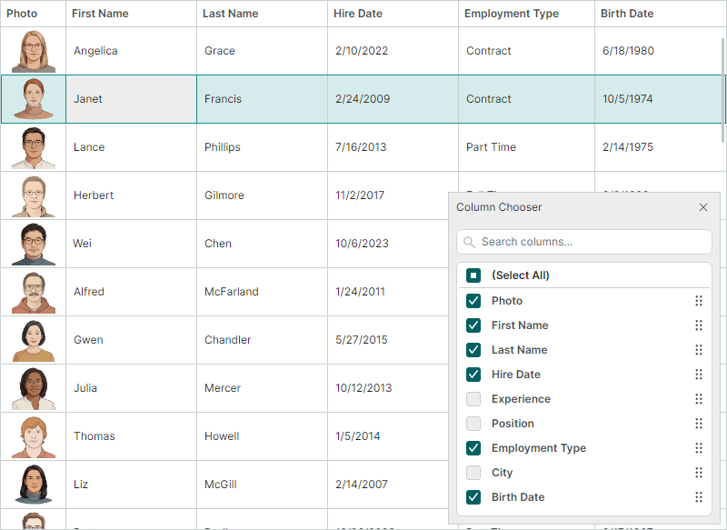
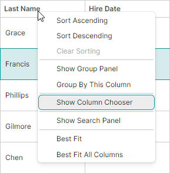
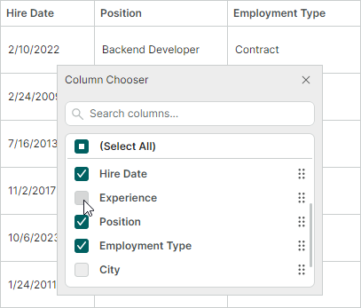
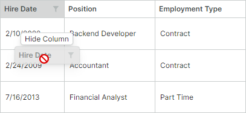
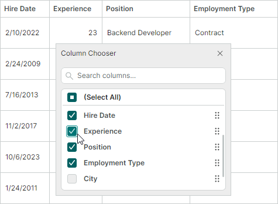
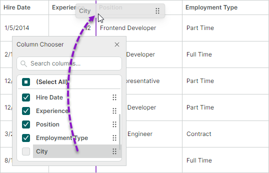
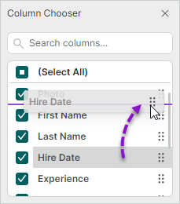
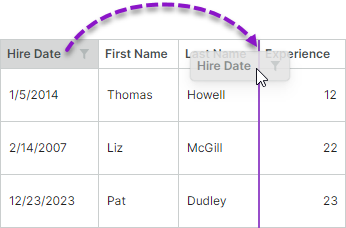

# Окно выбора колонок

Окно выбора колонок (Column Chooser) даёт доступ ко всем колонкам грида — как скрытым, так и видимым в данный момент.

Возможности окна выбора колонок:

- Скрытие и отображение колонок с помощью встроенных флажков.
- Изменение порядка колонок перетаскиванием их заголовков прямо в окне выбора колонок.
- Встроенный поиск колонок по имени.

## Отображение и скрытие окна выбора колонок

Пользователь может открыть окно выбора колонок: щёлкнуть правой кнопкой мыши на панели заголовков колонок грида и выбрать **Show Column Chooser**.

Чтобы скрыть окно выбора колонок, нажмите кнопку **Close** (x) окна или щёлкните правой кнопкой мыши на панели заголовков колонок грида и выберите **Hide Column Chooser**.

**Связанные API:**

- Метод [`DataControlBase.ShowColumnChooser`](../../API/Eremex.AvaloniaUI.Controls.DataControl/DataControlBase/ShowColumnChooser.md) — отображает окно выбора колонок.
- Метод [`DataControlBase.HideColumnChooser`](../../API/Eremex.AvaloniaUI.Controls.DataControl/DataControlBase/HideColumnChooser.md) — скрывает окно выбора колонок.
- Свойство [`DataControlBase.IsColumnChooserVisible`](../../API/Eremex.AvaloniaUI.Controls.DataControl/DataControlBase/IsColumnChooserVisible.md) — возвращает или задаёт, отображается ли окно выбора колонок.

## Скрытие колонки

Пользователь может скрыть колонку одним из способов:

- В окне выбора колонок снимите флажок колонки.

    

- В гриде перетащите заголовок колонки за пределы панели заголовков и отпустите его, когда появится всплывающая подсказка **Hide Column**.

    

**Связанные API:**

- [`ColumnBase.VisibleIndex`](../../API/Eremex.AvaloniaUI.Controls.DataControl/ColumnBase/VisibleIndex.md) — возвращает или задаёт визуальную позицию колонки. Чтобы скрыть колонку, установите это свойство в `-1`.
- [`ColumnBase.IsVisible`](../../API/Eremex.AvaloniaUI.Controls.DataControl/ColumnBase/IsVisible.md) — возвращает или задаёт видимость колонки. Чтобы скрыть колонку, установите это свойство в `false`.

## Отображение колонки

Пользователь может показать скрытую колонку одним из способов:

- Установите флажок колонки в окне выбора колонок.

    

- Перетащите заголовок колонки из окна выбора колонок на панель заголовков колонок грида.

    

**Связанные API:**

- [`ColumnBase.VisibleIndex`](../../API/Eremex.AvaloniaUI.Controls.DataControl/ColumnBase/VisibleIndex.md) — возвращает или задаёт визуальную позицию колонки. Чтобы показать колонку, установите это свойство в неотрицательное значение.
- [`ColumnBase.IsVisible`](../../API/Eremex.AvaloniaUI.Controls.DataControl/ColumnBase/IsVisible.md) — возвращает или задаёт видимость колонки. Чтобы показать колонку, установите это свойство в `true`.

## Изменение порядка колонок

Пользователь может изменить порядок колонок одним из способов:

- Щёлкните заголовок колонки в окне выбора колонок и перетащите его в нужную позицию. Порядок заголовков в окне выбора колонок синхронизирован с порядком колонок в гриде.

    

- Перетащите заголовок колонки в пределах панели заголовков колонок грида.

    

**Связанные API:**

- [`ColumnBase.VisibleIndex`](../../API/Eremex.AvaloniaUI.Controls.DataControl/ColumnBase/VisibleIndex.md) — возвращает или задаёт визуальную позицию колонки.

## Исключение колонок из окна выбора колонок

- [`ColumnBase.ShowInColumnChooser`](../../API/Eremex.AvaloniaUI.Controls.DataControl/ColumnBase/ShowInColumnChooser.md) — позволяет не отображать определённые колонки в окне выбора колонок.

## Собственный заголовок колонки в окне выбора колонок

[`ColumnBase.ColumnChooserHeader`](../../API/Eremex.AvaloniaUI.Controls.DataControl/ColumnBase/ColumnChooserHeader.md) — возвращает или задаёт собственное содержимое заголовка колонки, отображаемого в окне выбора колонок.
