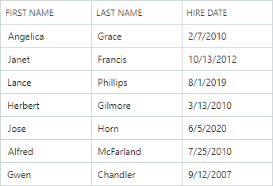
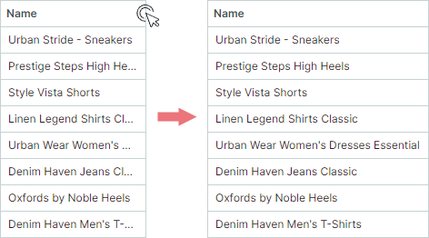
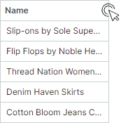
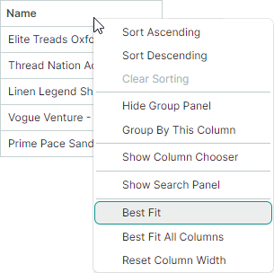
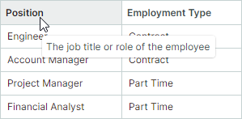
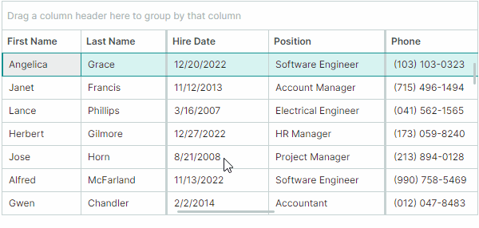
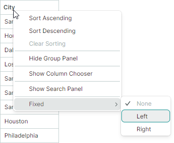
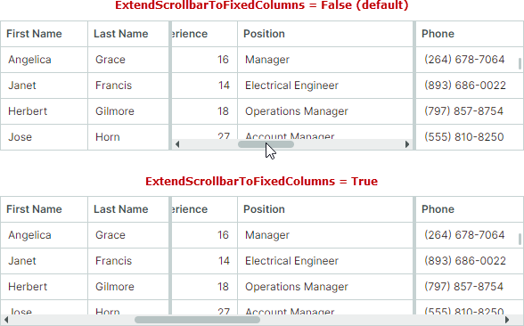

# Columns

DataGrid поддерживает связанные (bound) и несвязанные (unbound) колонки. Связанные колонки отображают значения из полей связанного источника данных. [Несвязанные колонки](data-binding/unbound-columns.md) позволяют отображать пользовательские данные.



Колонки DataGrid предоставляют свойства для настройки заголовка колонки, редактора ячеек, настроек сортировки/группировки и других параметров.

## Create Columns

Класс [`GridColumn`](../../API/Eremex.AvaloniaUI.Controls.DataGrid/GridColumn.md) представляет колонку в [`DataGridControl`](../../API/Eremex.AvaloniaUI.Controls.DataGrid/DataGridControl.md). Классы [`GridColumn`](../../API/Eremex.AvaloniaUI.Controls.DataGrid/GridColumn.md) и [`TreeListColumn`](../../API/Eremex.AvaloniaUI.Controls.TreeList/TreeListColumn.md) (колонка в [`TreeListControl`](../../API/Eremex.AvaloniaUI.Controls.TreeList/TreeListControl.md)) являются наследниками класса [`ColumnBase`](../../API/Eremex.AvaloniaUI.Controls.DataControl/ColumnBase.md). Таким образом, колонки в DataGrid и TreeList имеют много общих членов API.

Чтобы получить доступ к коллекции колонок таблицы, используйте свойство [`DataGridControl.Columns`](../../API/Eremex.AvaloniaUI.Controls.DataGrid/DataGridControl/Columns.md).

DataGrid не создаёт колонки автоматически при привязке контрола к источнику данных. Существуют четыре подхода к созданию колонок:

- **Ручное создание колонок**

    Вы можете вручную определить все колонки DataGrid в коллекции [`DataGridControl.Columns`](../../API/Eremex.AvaloniaUI.Controls.DataGrid/DataGridControl/Columns.md) (в XAML или code-behind). При таком подходе у вас есть доступ к созданным объектам колонок по имени в коде. 

    Этот пример создаёт две колонки DataGrid и настраивает формат отображения значений второй колонки:

    ``` xml
    xmlns:mxdg="https://schemas.eremexcontrols.net/avalonia/datagrid"

    <mxdg:DataGridControl Name="dataGrid1" >                
        <mxdg:DataGridControl.Columns>
            <mxdg:GridColumn Name="colName" FieldName="Name" />
            <mxdg:GridColumn Name="colBirthdate" FieldName="Birthdate" >
                <mxdg:GridColumn.EditorProperties>
                    <mxe:TextEditorProperties DisplayFormatString="yyyy-MM-dd"/>
                </mxdg:GridColumn.EditorProperties>
            </mxdg:GridColumn>
        </mxdg:DataGridControl.Columns>
    </mxdg:DataGridControl>
    ```


- **Автоматическая генерация колонок**

    Включите опцию [`DataGridControl.AutoGenerateColumns`](../../API/Eremex.AvaloniaUI.Controls.DataGrid/DataGridControl/AutoGenerateColumns.md), чтобы автоматически создавать отсутствующие колонки при привязке контрола к источнику данных. Вы можете применять специальные атрибуты (из пространств имён `System.ComponentModel` и `System.ComponentModel.DataAnnotations`) к свойствам бизнес-объекта, чтобы управлять автоматической генерацией колонок и настраивать параметры автоматически созданных колонок (например, отображаемое имя и порядок колонки).

- **Сочетание ручного создания колонок и автоматической генерации**

    Вы можете сочетать два описанных выше подхода: вручную создать необходимые колонки в коллекции [`DataGridControl.Columns`](../../API/Eremex.AvaloniaUI.Controls.DataGrid/DataGridControl/Columns.md), а затем включить опцию [`DataGridControl.AutoGenerateColumns`](../../API/Eremex.AvaloniaUI.Controls.DataGrid/DataGridControl/AutoGenerateColumns.md), чтобы делегировать генерацию остальных колонок DataGrid.

- **Генерация колонок из View Model**

    DataGrid может создавать колонки из источника колонок, определённого в View Model. В этом сценарии используйте свойства `ColumnsSource` и [`ColumnTemplate`](../../API/Eremex.AvaloniaUI.Controls.DataGrid/DataGridControl/ColumnTemplate.md). Смотрите [Генерация колонок из View Model](#generate-columns-from-a-view-model).


Информацию об автоматически создаваемых колонках смотрите в разделе [Автоматическая генерация колонок](#automatic-column-generation).

## Bind Columns to Data

Свойство [`GridColumn.FieldName`](../../API/Eremex.AvaloniaUI.Controls.DataControl/ColumnBase/FieldName.md) позволяет привязать колонку к полю в исходной таблице данных или к публичному свойству бизнес-объекта. После привязки колонка получает значения из источника данных.

DataGrid также позволяет создавать несвязанные колонки, значения которых необходимо предоставлять вручную с помощью события [`DataGridControl.CustomUnboundColumnData`](../../API/Eremex.AvaloniaUI.Controls.DataGrid/DataGridControl/CustomUnboundColumnData.md). Дополнительную информацию смотрите в разделе [Несвязанные колонки](data-binding/unbound-columns.md).

Не рекомендуется привязывать несколько колонок DataGrid к одному и тому же полю/свойству данных.

Этот пример создаёт колонки DataGrid и привязывает их к данным.

``` xml
xmlns:mxdg="https://schemas.eremexcontrols.net/avalonia/datagrid"

<mxdg:DataGridControl Grid.Column="3" Width="200" Name="dataGrid1" HorizontalAlignment="Stretch">
    <mxdg:DataGridControl.Columns>
        <mxdg:GridColumn Name="colFirstName" FieldName="FirstName" Header="First Name" 
         Width="*" AllowSorting="False"  />
        <mxdg:GridColumn Name="colLastName" FieldName="LastName" Header="Last Name" Width="*"/>
        <mxdg:GridColumn Name="colCity" FieldName="City" Header="City" Width="*" ReadOnly="True" />
        <mxdg:GridColumn Name="colPhone" FieldName="Phone" Header="Phone" Width="*"/>
    </mxdg:DataGridControl.Columns>
</mxdg:DataGridControl>
```

``` csharp
using Eremex.AvaloniaUI.Controls.DataGrid;

GridColumn colFirstName = new GridColumn() 
 { FieldName = "FirstName", Header = "First Name", AllowSorting = false, 
   Width= new GridLength(1, GridUnitType.Star) };
dataGrid1.Columns.Add(colFirstName);
```

## Automatic Column Generation

Установите свойство [`AutoGenerateColumns`](../../API/Eremex.AvaloniaUI.Controls.DataGrid/DataGridControl/AutoGenerateColumns.md) в значение `true` (значение по умолчанию — `false`), чтобы включить автоматическую генерацию колонок для свойств источника данных. Когда [`AutoGenerateColumns`](../../API/Eremex.AvaloniaUI.Controls.DataGrid/DataGridControl/AutoGenerateColumns.md) установлено в `true`, DataGrid получает публичные свойства из источника данных, создаёт колонки и привязывает их к этим свойствам. Если коллекция [`Columns`](../../API/Eremex.AvaloniaUI.Controls.DataGrid/DataGridControl/Columns.md) контрола уже содержит колонку, привязанную к конкретному свойству/полю, дополнительная колонка, привязанная к тому же свойству/полю, автоматически не создаётся.

События [`AutoGeneratingColumn`](../../API/Eremex.AvaloniaUI.Controls.DataGrid/DataGridControl/AutoGeneratingColumn.md) и [`AutoGeneratedColumns`](../../API/Eremex.AvaloniaUI.Controls.DataGrid/DataGridControl/AutoGeneratedColumns.md) позволяют настраивать автоматически создаваемые колонки. Событие [`AutoGeneratingColumn`](../../API/Eremex.AvaloniaUI.Controls.DataGrid/DataGridControl/AutoGeneratingColumn.md) возникает, когда автоматически создаваемая колонка должна быть добавлена в коллекцию [`Columns`](../../API/Eremex.AvaloniaUI.Controls.DataGrid/DataGridControl/Columns.md). Установите параметр события `e.Cancel` в значение `true`, чтобы предотвратить добавление колонки в коллекцию. 

Событие [`AutoGeneratedColumns`](../../API/Eremex.AvaloniaUI.Controls.DataGrid/DataGridControl/AutoGeneratedColumns.md) возникает после того, как все колонки были автоматически созданы.

Когда вы назначаете контролу другой источник данных, DataGrid сначала удаляет колонки, которые были ранее созданы автоматически, а затем автоматически создаёт колонки для нового источника данных.

### Use Attributes to Customize Settings of Auto-Generated Columns

Вы можете применять специальные атрибуты (из пространств имён `System.ComponentModel` и `System.ComponentModel.DataAnnotations`) к свойствам бизнес-объекта (записи источника данных), чтобы настраивать видимость, параметры отображения и поведения соответствующих автоматически создаваемых колонок DataGrid. Поддерживаемые атрибуты описаны ниже:

#### Атрибут `Browsable` 

Атрибут `System.ComponentModel.BrowsableAttribute` управляет автоматической генерацией колонок. Примените атрибут **Browsable(false)** к конкретным свойствам, чтобы предотвратить автоматическое создание соответствующих колонок.

``` csharp
using CommunityToolkit.Mvvm.ComponentModel;
using System.ComponentModel;

public partial class MyBusinessObject : ObservableObject
{
    [ObservableProperty]
    [property: Browsable(false)]
    public int serviceId = "";
}
```

Атрибут `System.ComponentModel.BrowsableAttribute` эквивалентен использованию атрибута `System.ComponentModel.DataAnnotations.DisplayAttribute` с параметром `AutoGenerateField`.

#### Атрибут `Display` 
Атрибут `System.ComponentModel.DataAnnotations.DisplayAttribute` — это универсальный атрибут, который управляет автоматической генерацией колонок и параметрами отображения автоматически создаваемых колонок. Атрибут имеет следующие параметры, поддерживаемые DataGrid:

- `AutoGenerateField` — определяет, следует ли автоматически создавать соответствующую колонку.

- `Order` — определяет видимую позицию автоматически создаваемой колонки ([`ColumnBase.VisibleIndex`](../../API/Eremex.AvaloniaUI.Controls.DataControl/ColumnBase/VisibleIndex.md)). 

- `Name` — определяет заголовок автоматически создаваемой колонки ([`ColumnBase.Header`](../../API/Eremex.AvaloniaUI.Controls.DataControl/DataControlColumnBase/Header.md)).

- `ShortName` — эквивалентен параметру `Name`.

- `GroupName` — определяет имя группы, с которой связывается автоматически создаваемая колонка. 
Значение этого атрибута используется для инициализации свойства [`GridColumn.BandName`](../../API/Eremex.AvaloniaUI.Controls.DataControl/ColumnBase/BandName.md), если опция [`DataGridControl.AutoGenerateBands`](../../API/Eremex.AvaloniaUI.Controls.DataGrid/DataGridControl/AutoGenerateBands.md) имеет значение `true` (по умолчанию).

    Когда DataGrid встречает `DisplayAttribute.GroupName`, он проверяет наличие существующей группы с совпадающим именем ([`GridBand.BandName`](../../API/Eremex.AvaloniaUI.Controls.DataControl/DataControlBandBase/BandName.md)). Если такой группы не существует, контрол автоматически создаёт её и инициализирует свойство [`GridBand.BandName`](../../API/Eremex.AvaloniaUI.Controls.DataControl/DataControlBandBase/BandName.md) значением `DisplayAttribute.GroupName`.

    Параметр `DisplayAttribute.GroupName` также поддерживает вложенные группы. Используйте символ '/' для разделения родительской и дочерней группы (например, «ParentBandName/ChildBandName»). 
    Чтобы использовать '/' как обычный символ, применяйте "//".

 
``` csharp
using CommunityToolkit.Mvvm.ComponentModel;
using System.ComponentModel.DataAnnotations;

public partial class MyBusinessObject : ObservableObject
{
    [ObservableProperty]
    [property: Display(Name = "Birth date", Order=2, GroupName="General")]
    public DateTime? birthdate = null;

    [ObservableProperty]
    [property: Display(GroupName = "Details/Address")]
    public string country { get; set; }

    [ObservableProperty]
    [property: Display(GroupName = "Details/Contact")]
    public string phone { get; set; }
}
```

#### Атрибут `DisplayName`

Атрибут `System.ComponentModel.DisplayNameAttribute` позволяет инициализировать заголовок автоматически создаваемой колонки ([`ColumnBase.Header`](../../API/Eremex.AvaloniaUI.Controls.DataControl/DataControlColumnBase/Header.md)).

``` csharp
using CommunityToolkit.Mvvm.ComponentModel;
using System.ComponentModel;

public partial class MyBusinessObject : ObservableObject
{
    [ObservableProperty]
    [property: DisplayName("Birth date")]
    public DateTime? birthdate = null;
}
```

Атрибут `System.ComponentModel.DisplayNameAttribute` эквивалентен использованию атрибута `System.ComponentModel.DataAnnotations.DisplayAttribute` с параметром `Name` или `ShortName`.

#### Атрибут `Editable`

Атрибут `System.ComponentModel.EditableAttribute`, применённый к свойству, создаёт нередактируемую колонку. Пользователи не могут открывать встроенные редакторы и, соответственно, выделять и копировать текст.

``` csharp
using CommunityToolkit.Mvvm.ComponentModel;
using System.ComponentModel;

public partial class MyBusinessObject : ObservableObject
{
    [ObservableProperty]
    [property: Editable(false)]
    public int parentId = -1;
}
```

#### Атрибут `Readonly` 

Атрибут `System.ComponentModel.ReadonlyAttribute`, применённый к свойству, создаёт колонку только для чтения. Пользователи могут выделять и копировать текст в колонках только для чтения, но не могут редактировать значения.

``` csharp
using CommunityToolkit.Mvvm.ComponentModel;
using System.ComponentModel;

public partial class MyBusinessObject : ObservableObject
{
    [ObservableProperty]
    [property: ReadOnly(true)]
    public int id = -1;
}
```

## Generate Columns from a View Model


Вы можете заполнять DataGrid колонками из источника колонок, определённого в View Model. Источник колонок — это коллекция бизнес-объектов, на основе которой создаются объекты [`GridColumn`](../../API/Eremex.AvaloniaUI.Controls.DataGrid/GridColumn.md) согласно указанному шаблону. Генерацию колонок из View Model обеспечивают следующие члены API:

- [`DataGridControl.ColumnsSource`](../../API/Eremex.AvaloniaUI.Controls.DataGrid/DataGridControl/ColumnsSource.md) — коллекция бизнес-объектов, используемая для создания колонок таблицы согласно шаблону [`ColumnTemplate`](../../API/Eremex.AvaloniaUI.Controls.DataGrid/DataGridControl/ColumnTemplate.md). 

- [`DataGridControl.ColumnTemplate`](../../API/Eremex.AvaloniaUI.Controls.DataGrid/DataGridControl/ColumnTemplate.md) — шаблон, инициализирующий объект [`GridColumn`](../../API/Eremex.AvaloniaUI.Controls.DataGrid/GridColumn.md) на основе бизнес-объектов, хранящихся в источнике колонок.

### Пример - Генерация колонок из источника колонок

Следующий фрагмент кода из демонстрации «Large Data» показывает, как можно создавать и инициализировать колонки DataGrid из источника колонок ([`DataGridControl.ColumnsSource`](../../API/Eremex.AvaloniaUI.Controls.DataGrid/DataGridControl/ColumnsSource.md)).

``` xml
<mxdg:DataGridControl ItemsSource="{Binding Items}" ColumnsSource="{Binding Columns}" AutoGenerateColumns="True" BorderThickness="0,0,1,0"
                      CustomUnboundColumnData="DataGridControl_CustomUnboundColumnData" PropertyChanged="DataGridControl_PropertyChanged">
    <mxdg:DataGridControl.ColumnTemplate>
        <views:DataGridLargeDataViewColumnTemplate/>
    </mxdg:DataGridControl.ColumnTemplate>
</mxdg:DataGridControl>
```

``` cs
public class DataGridLargeDataViewColumnTemplate : ITemplate<object, GridColumn>
{
    public GridColumn Build(object param)
    {
        var largeDataColumn = (LargeDataColumn)param;
        var gridColumn = new GridColumn() 
        { 
            FieldName = largeDataColumn.FieldName,
            Header = largeDataColumn.Header
        };
        if (!largeDataColumn.FieldName.Contains("Id"))
        {
            gridColumn.UnboundDataType = largeDataColumn.DataType;

            if (largeDataColumn.FieldName.Contains("ComboBox"))
                gridColumn.EditorProperties = new ComboBoxEditorProperties() { ItemsSource = EmployeesData.EmployeeNames };
            else if (largeDataColumn.FieldName.Contains("Numeric"))
                gridColumn.EditorProperties = new SpinEditorProperties() { MaskType = MaskType.Numeric, Mask = "c" };
        }
        return gridColumn;
    }
}
```

Полный пример смотрите в демонстрации «Large Data» для контрола DataGrid.

## Move Columns

Используйте свойство [`GridColumn.VisibleIndex`](../../API/Eremex.AvaloniaUI.Controls.DataControl/ColumnBase/VisibleIndex.md), чтобы указать позицию отображения колонки. Чтобы скрыть колонку, установите её свойство [`GridColumn.VisibleIndex`](../../API/Eremex.AvaloniaUI.Controls.DataControl/ColumnBase/VisibleIndex.md) в значение **-1** или установите свойство [`IsVisible`](../../API/Eremex.AvaloniaUI.Controls.DataControl/ColumnBase/IsVisible.md) в значение `false`.

Поведение контрола по умолчанию позволяет пользователю переупорядочивать колонки. Используйте следующие свойства, чтобы запретить перемещение колонок:

- [`DataGridControl.AllowColumnMoving`](../../API/Eremex.AvaloniaUI.Controls.DataGrid/DataGridControl/AllowColumnMoving.md) — определяет, может ли пользователь перемещать любую колонку.
- [`GridColumn.AllowMoving`](../../API/Eremex.AvaloniaUI.Controls.DataControl/ColumnBase/AllowMoving.md) — определяет, может ли пользователь перемещать конкретную колонку.

## Resize Columns

Вы можете использовать следующие свойства для управления шириной колонок в DataGrid:

- [`GridColumn.Width`](../../API/Eremex.AvaloniaUI.Controls.DataControl/ColumnBase/Width.md) — ширина колонки, задаваемая значением типа `GridLength`. 
- [`GridColumn.MinWidth`](../../API/Eremex.AvaloniaUI.Controls.DataControl/ColumnBase/MinWidth.md) — минимальная ширина колонки.
- [`GridColumn.MaxWidth`](../../API/Eremex.AvaloniaUI.Controls.DataControl/ColumnBase/MaxWidth.md) — максимальная ширина колонки.


Свойство [`Width`](../../API/Eremex.AvaloniaUI.Controls.DataControl/ColumnBase/Width.md) имеет тип `GridLength`. Оно позволяет задать ширину колонки следующими способами:

- Фиксированная ширина (число пикселей).
- Взвешенная пропорция доступного пространства (нотация _star_).
- Значение 'Auto' — включает автоматический расчёт ширины колонки, чтобы вместить заголовок колонки и видимые значения. Когда пользователь прокручивает контрол по вертикали, контрол может увеличивать ширину колонки, чтобы вместить новые значения ячеек, появившиеся во время прокрутки.

``` xml
xmlns:mxdg="https://schemas.eremexcontrols.net/avalonia/datagrid"

<mxdg:DataGridControl Name="dataGrid1">
    <mxdg:DataGridControl.Columns>
        <mxdg:GridColumn Name="colFirstName" FieldName="FirstName" Header="First Name" Width="*"/>
        <mxdg:GridColumn Name="colLastName" FieldName="LastName" Header="Last Name" Width="2*"/>
        <mxdg:GridColumn Name="colPhone" FieldName="Phone" Header="Phone" Width="*"/>
    </mxdg:DataGridControl.Columns>
</mxdg:DataGridControl>
```

Следующие свойства управляют операциями изменения размера колонок, выполняемыми пользователями.

- [`DataGridControl.AllowColumnResizing`](../../API/Eremex.AvaloniaUI.Controls.DataGrid/DataGridControl/AllowColumnResizing.md) — определяет, может ли пользователь изменять размер любой колонки.
- [`GridColumn.AllowResizing`](../../API/Eremex.AvaloniaUI.Controls.DataControl/ColumnBase/AllowResizing.md) — определяет, может ли пользователь изменять размер конкретной колонки.

## Best Fit

Функция Best Fit изменяет размер колонок до их оптимальной ширины — минимальной ширины, необходимой для полного отображения содержимого колонки (значений и заголовков) без усечения. 



Best Fit вычисляет оптимальную ширину колонок **в пикселях** и присваивает эти значения свойствам [`TreeListColumn.Width`](../../API/Eremex.AvaloniaUI.Controls.DataControl/ColumnBase/Width.md), заменяя любую ранее заданную ширину. 

!!! Note

    Best Fit заменяет исходную ширину колонок вычисленными абсолютными значениями в пикселях. Если колонка ранее имела ширину, установленную в `Auto` или в звёздное значение (`*`), она также заменяется абсолютной шириной в пикселях. Исходная ширина может быть восстановлена с помощью [команды сброса ширины колонки](#reset-column-width-user-modifications).

Пользователи могут вызвать функцию Best Fit следующими способами:

- Двойным щелчком по правому краю заголовка колонки.

    

- Щёлкнув правой кнопкой мыши по заголовку колонки и выбрав команду _Best Fit_ или _Best Fit All Columns_ в контекстном меню.

    

    - Команда _Best Fit_ — изменяет размер выбранной колонки до оптимальной ширины.
    - Команда _Best Fit All Columns_ — изменяет размер всех колонок до их оптимальной ширины.


### Enable and Disable Best Fit Operations

Функция Best Fit включена по умолчанию. Вы можете использовать следующие свойства для управления операциями Best Fit для всех колонок и отдельных колонок.

- [`DataGridControl.AllowBestFit`](../../API/Eremex.AvaloniaUI.Controls.DataGrid/DataGridControl/AllowBestFit.md) (значение по умолчанию — `true`) — определяет, включены ли операции Best Fit для всех колонок таблицы. Вы можете переопределить эту глобальную настройку для отдельных колонок с помощью свойства [`GridColumn.AllowBestFit`](../../API/Eremex.AvaloniaUI.Controls.DataControl/ColumnBase/AllowBestFit.md).
- [`GridColumn.AllowBestFit`](../../API/Eremex.AvaloniaUI.Controls.DataControl/ColumnBase/AllowBestFit.md) (значение по умолчанию — `null`) — определяет, включены ли операции Best Fit для конкретной колонки. Если свойство [`GridColumn.AllowBestFit`](../../API/Eremex.AvaloniaUI.Controls.DataControl/ColumnBase/AllowBestFit.md) установлено в значение `null`, фактическая настройка определяется глобальным свойством [`DataGridControl.AllowBestFit`](../../API/Eremex.AvaloniaUI.Controls.DataGrid/DataGridControl/AllowBestFit.md).

### Best Fit Mode

Вы можете использовать свойства [`DataGridControl.BestFitMode`](../../API/Eremex.AvaloniaUI.Controls.DataGrid/DataGridControl/BestFitMode.md) и [`GridColumn.BestFitMode`](../../API/Eremex.AvaloniaUI.Controls.DataControl/ColumnBase/BestFitMode.md), чтобы управлять областью обрабатываемых значений строк для операций Best Fit.

``` xaml
<mxdg:DataGridControl BestFitMode="Full" >
```

#### Доступные режимы вычисления Best Fit

- Режим [`BestFitMode.Fast`](../../API/Eremex.AvaloniaUI.Controls.DataControl/BestFitMode.md) — измеряет ширину уникальных значений строк, что значительно повышает производительность Best Fit в большинстве сценариев. 

    !!! Note

        - Режим `Fast` неприменим, если отображаемый текст целевых ячеек зависит от других ячеек. В этом случае необходимо переключиться на режим `Full`.

        - Режим `Fast` может некорректно вычислять ширину колонок, если для назначения пользовательских редакторов используются шаблоны ячеек ([`GridColumn.CellTemplate`](../../API/Eremex.AvaloniaUI.Controls.DataControl/ColumnBase/CellTemplate.md)) или если ячейки отображают ошибки валидации, инициируемые источником данных (смотрите [`ShowItemsSourceErrors`](../../API/Eremex.AvaloniaUI.Controls.DataControl/DataControlBase/ShowItemsSourceErrors.md)).

- Режим [`BestFitMode.Full`](../../API/Eremex.AvaloniaUI.Controls.DataControl/BestFitMode.md) — измеряет ширину всех значений строк, включая дубликаты. Хотя этот режим медленнее, чем `Fast`, он корректно вычисляет ширину колонок при использовании шаблонов ячеек или ошибок валидации.

#### Automatic (Default) Best Fit Calculation Mode

- `Fast` является режимом по умолчанию в большинстве случаев.
- `Full` автоматически активируется как режим по умолчанию в следующих сценариях:
    - Для назначения редакторов колонкам используются шаблоны ячеек ([`GridColumn.CellTemplate`](../../API/Eremex.AvaloniaUI.Controls.DataControl/ColumnBase/CellTemplate.md)).
    - Свойство контрола [`DataControlBase.ShowItemsSourceErrors`](../../API/Eremex.AvaloniaUI.Controls.DataControl/DataControlBase/ShowItemsSourceErrors.md) установлено в значение `true`, и к колонкам применяются ошибки валидации на уровне источника данных (с помощью атрибутов валидации, интерфейса `IDataErrorInfo` или интерфейса `INotifyDataErrorInfo`).

#### Choose Best Fit Calculation Mode

Используйте следующие свойства, чтобы задать режим вычисления Best Fit для всех или отдельных колонок:

- [`DataGridControl.BestFitMode`](../../API/Eremex.AvaloniaUI.Controls.DataGrid/DataGridControl/BestFitMode.md) — определяет глобальный режим вычисления Best Fit для всех колонок таблицы.
Когда [`DataGridControl.BestFitMode`](../../API/Eremex.AvaloniaUI.Controls.DataGrid/DataGridControl/BestFitMode.md) установлено в значение `null` (исходное значение), режим вычисления Best Fit определяется [автоматически](#automatic-default-best-fit-calculation-mode). Используйте свойство [`GridColumn.BestFitMode`](../../API/Eremex.AvaloniaUI.Controls.DataControl/ColumnBase/BestFitMode.md), чтобы переопределить эту глобальную настройку для конкретных колонок.

- [`GridColumn.BestFitMode`](../../API/Eremex.AvaloniaUI.Controls.DataControl/ColumnBase/BestFitMode.md) — позволяет задать режим вычисления Best Fit для отдельных колонок, переопределяя свойство [`DataGridControl.BestFitMode`](../../API/Eremex.AvaloniaUI.Controls.DataGrid/DataGridControl/BestFitMode.md). Если свойство [`GridColumn.BestFitMode`](../../API/Eremex.AvaloniaUI.Controls.DataControl/ColumnBase/BestFitMode.md) имеет значение `null` (исходное значение), фактическая настройка определяется свойством контрола [`DataGridControl.BestFitMode`](../../API/Eremex.AvaloniaUI.Controls.DataGrid/DataGridControl/BestFitMode.md).

### Call Best Fit Operations in Code

Используйте следующие методы, чтобы изменить размер колонок таблицы до их оптимальной ширины:

- [`DataGridControl.BestFit(GridColumn column)`](../../API/Eremex.AvaloniaUI.Controls.DataGrid/DataGridControl/BestFit.md) — изменяет размер указанной колонки до ширины, необходимой для полного отображения её содержимого.
- [`DataGridControl.BestFitAllColumns()`](../../API/Eremex.AvaloniaUI.Controls.DataGrid/DataGridControl/BestFitAllColumns.md) — изменяет размер всех колонок до ширины, необходимой для полного отображения их содержимого.

Чтобы выполнить операции Best Fit при инициализации DataGrid, вызовите метод [`BestFit`](../../API/Eremex.AvaloniaUI.Controls.DataGrid/DataGridControl/BestFit.md) или [`BestFitAllColumns`](../../API/Eremex.AvaloniaUI.Controls.DataGrid/DataGridControl/BestFitAllColumns.md) в обработчике события `DataGridControl.AttachedToVisualTree`.

## Reset Column Width User Modifications

После того как пользователь изменяет ширину колонок (перетаскиванием или с помощью Best Fit), в контекстных меню колонок появляется команда _Reset Column Width_. Эта команда отменяет изменения ширины колонок, сделанные пользователями, восстанавливая исходную ширину, применённую к колонкам в XAML или code-behind до пользовательских изменений.


### Связанный API

- [`DataGridControl.AllowResetColumnWidth`](../../API/Eremex.AvaloniaUI.Controls.DataGrid/DataGridControl/AllowResetColumnWidth.md) (значение по умолчанию — `true`) — определяет, доступна ли команда _Reset Column Width_ в контекстных меню колонок. Если это свойство отключено, пользователи не могут отменить операции изменения ширины колонок через пользовательский интерфейс. Свойство [`DataGridControl.AllowResetColumnWidth`](../../API/Eremex.AvaloniaUI.Controls.DataGrid/DataGridControl/AllowResetColumnWidth.md) не влияет на сброс ширины колонки с помощью метода [`DataGridControl.ResetColumnWidth`](../../API/Eremex.AvaloniaUI.Controls.DataGrid/DataGridControl/ResetColumnWidth.md).
- Метод [`DataGridControl.ResetColumnWidth`](../../API/Eremex.AvaloniaUI.Controls.DataGrid/DataGridControl/ResetColumnWidth.md) — изменяет размер колонок до их исходной ширины, заданной в XAML или code-behind до каких-либо пользовательских изменений.

## Column Headers

Заголовки колонок DataGrid отображаются на панели заголовков. Вы можете скрыть эту панель с помощью свойства [`DataGridControl.ShowColumnHeaders`](../../API/Eremex.AvaloniaUI.Controls.DataGrid/DataGridControl/ShowColumnHeaders.md). 

Высота панели автоматически подстраивается под содержимое заголовков колонок. Используйте свойство [`HeaderPanelMinHeight`](../../API/Eremex.AvaloniaUI.Controls.DataGrid/DataGridControl/HeaderPanelMinHeight.md), чтобы ограничить минимальную высоту панели.

Заголовок колонки изначально отображает подпись (текстовую метку), которая является текстовым представлением свойства [`ColumnBase.Header`](../../API/Eremex.AvaloniaUI.Controls.DataControl/DataControlColumnBase/Header.md). Если свойство [`ColumnBase.Header`](../../API/Eremex.AvaloniaUI.Controls.DataControl/DataControlColumnBase/Header.md) не задано, подпись колонки формируется из имени поля колонки ([`ColumnBase.FieldName`](../../API/Eremex.AvaloniaUI.Controls.DataControl/ColumnBase/FieldName.md)).

Используйте свойство [`ColumnBase.HeaderTemplate`](../../API/Eremex.AvaloniaUI.Controls.DataControl/DataControlColumnBase/HeaderTemplate.md), чтобы задать шаблон, используемый для отрисовки заголовка колонки. Шаблон позволяет отображать изображения и пользовательские контролы, а также произвольно оформлять текст.

Следующий код отображает изображение перед подписью колонки. Выражение `<TextBlock Text="{Binding}">` отображает содержимое свойства [`Header`](../../API/Eremex.AvaloniaUI.Controls.DataControl/DataControlColumnBase/Header.md) колонки:

``` xml
xmlns:mxdg="https://schemas.eremexcontrols.net/avalonia/datagrid"

<mxdg:DataGridControl Name="DataGrid" HeaderPanelMinHeight="50">
    <mxdg:GridColumn FieldName="Number" Header="Position" HeaderVerticalAlignment="Bottom">
        <mxdg:GridColumn.HeaderTemplate>
            <DataTemplate>
                <StackPanel Orientation="Horizontal">
                    <Image Source="/info24x24.png" Width="24" Height="24" Margin="0,0,5,0"></Image>
                    <TextBlock Text="{Binding}" VerticalAlignment="Center"/>
                </StackPanel>
            </DataTemplate>
        </mxdg:GridColumn.HeaderTemplate>
    </mxdg:GridColumn>
</mxdg:DataGridControl>
```

Используйте свойства [`ColumnBase.HeaderHorizontalAlignment`](../../API/Eremex.AvaloniaUI.Controls.DataControl/DataControlColumnBase/HeaderHorizontalAlignment.md) и [`ColumnBase.HeaderVerticalAlignment`](../../API/Eremex.AvaloniaUI.Controls.DataControl/DataControlColumnBase/HeaderVerticalAlignment.md), чтобы выровнять содержимое заголовка колонки по горизонтали и вертикали. 

## Column Sorting 

Пользователь может щёлкнуть по заголовку колонки или использовать контекстное меню заголовка колонки, чтобы отсортировать DataGrid по этой колонке. Дополнительную информацию смотрите в разделе [Сортировка данных](sorting.md).

## Column Grouping

Пользователи могут группировать данные по любому количеству колонок. Чтобы сгруппировать данные по колонке, пользователь может перетащить колонку на панель группировки или использовать соответствующую команду в контекстном меню заголовка колонки. Дополнительную информацию смотрите в разделе: [Группировка данных](grouping.md).

## Column Values

Чтобы узнать, как получать значения ячеек для конкретных строк, смотрите раздел [Rows](rows.md).

## Column Header Tooltips

Используйте свойство [`HeaderToolTip`](../../API/Eremex.AvaloniaUI.Controls.DataControl/DataControlColumnBase/HeaderToolTip.md), чтобы задать пользовательские подсказки для заголовков колонок. Пользовательские подсказки отображаются при наведении на заголовок колонки независимо от того, обрезан текст заголовка или нет.

``` xml
<mxdg:GridColumn FieldName="Position" HeaderToolTip="The job title or role of the employee"/>
```



Если пользовательская подсказка не назначена колонке, для заголовка колонки отображается стандартная подсказка, если текст заголовка обрезан. Стандартная подсказка отображает полный, неусечённый текст заголовка.


## Fixed Columns

Если суммарная ширина колонок превышает область просмотра контрола, появляется полоса прокрутки для выполнения горизонтальной прокрутки. DataGrid позволяет закреплять (пиннить) отдельные колонки у левого или правого края. Такие колонки остаются неподвижными при горизонтальной прокрутке, в то время как незакреплённые колонки прокручиваются обычным образом.




!!! tip

    Суммарная ширина колонок вычисляется как сумма ширины отдельных колонок (смотрите [`GridColumn.Width`](../../API/Eremex.AvaloniaUI.Controls.DataControl/ColumnBase/Width.md)). Чтобы активировать горизонтальную полосу прокрутки, задайте ширину отдельных колонок так, чтобы их сумма превышала ширину области просмотра. Не используйте звёздную нотацию ("*") для ширины колонок при использовании закреплённых колонок.

Чтобы закрепить колонку или вернуть её в обычное состояние, установите свойство [`GridColumn.FixedMode`](../../API/Eremex.AvaloniaUI.Controls.DataControl/ColumnBase/FixedMode.md) в одно из следующих значений:

- `Left` — закрепляет колонку у левого края. 
- `Right` — закрепляет колонку у правого края. 
- `None` — открепляет закреплённую колонку. 

``` xml
<mxdg:GridColumn FieldName="FirstName" FixedMode="Left"/>
<mxdg:GridColumn FieldName="Phone" FixedMode="Right"/>
```

### Подменю _Fixed_

Пользователи могут закреплять колонку во время работы с помощью встроенного подменю _Fixed_, доступного из контекстного меню колонки. Установите свойство контрола [`ShowColumnMenuFixedItem`](../../API/Eremex.AvaloniaUI.Controls.DataGrid/DataGridControl/ShowColumnMenuFixedItem.md) в значение `true`, чтобы включить это подменю _Fixed_:



### Fixed Column Position

Когда колонка закрепляется (пиннится) или возвращается в обычное состояние, её видимая позиция (синхронизированная со свойством [`GridColumn.VisibleIndex`](../../API/Eremex.AvaloniaUI.Controls.DataControl/ColumnBase/VisibleIndex.md)) обновляется автоматически.

- Закрепление слева: колонка размещается после существующих колонок, закреплённых слева.
- Закрепление справа: колонка размещается перед существующими колонками, закреплёнными справа.
- Открепление слева: колонка становится первой прокручиваемой колонкой. 
- Открепление справа: колонка становится последней прокручиваемой колонкой. 

### Fixed Column Width

Чтобы изменить ширину закреплённой колонки, установите свойство [`GridColumn.Width`](../../API/Eremex.AvaloniaUI.Controls.DataControl/ColumnBase/Width.md) в абсолютное значение в пикселях или в `Auto` для автоматического вычисления на основе содержимого ячеек. Закреплённые колонки не поддерживают звёздную нотацию (пропорциональное задание размера) для ширины колонки. 

Когда колонка со звёздной шириной закрепляется, её ширина автоматически сбрасывается на 120 пикселей.

### Horizontal Scrollbar Display Mode

По умолчанию горизонтальная полоса прокрутки отображается только для прокручиваемых колонок. Включите свойство [`ExtendScrollbarToFixedColumns`](../../API/Eremex.AvaloniaUI.Controls.DataGrid/DataGridControl/ExtendScrollbarToFixedColumns.md), чтобы отображать горизонтальную полосу прокрутки для всех колонок, включая закреплённые.




### Связанный API

- [`DataGridControl.FixedColumnSeparatorWidth`](../../API/Eremex.AvaloniaUI.Controls.DataGrid/DataGridControl/FixedColumnSeparatorWidth.md) — определяет ширину разделителей, отделяющих закреплённые колонки от прокручиваемых.

## Смотрите также

- [Unbound Columns](data-binding/unbound-columns.md)

<br>
<br>

<sup>*</sup> Эта страница переведена с использованием технологий машинного перевода.
