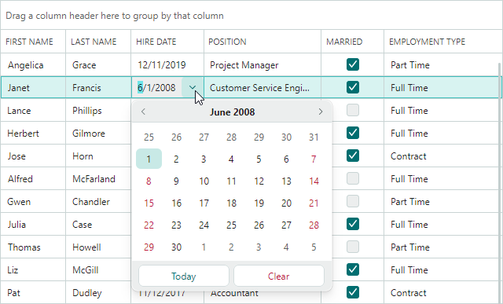
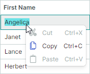
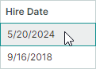

# Редактирование данных

## Встроенные редакторы Eremex, используемые по умолчанию

По умолчанию контрол DataGrid использует встроенные редакторы Eremex для отображения и редактирования значений ячеек стандартных типов данных.



Следующий список показывает редакторы Eremex, связанные с отдельными типами данных:

- Логические значения — [`CheckEditor`](../../../API/Eremex.AvaloniaUI.Controls.Editors/CheckEditor.md)
- Значения типа Double — [`SpinEditor`](../../../API/Eremex.AvaloniaUI.Controls.Editors/SpinEditor.md)
- Значения перечислений — [`ComboBoxEditor`](../../../API/Eremex.AvaloniaUI.Controls.Editors/ComboBoxEditor.md)
- Свойства с атрибутом `TypeConverter`, метод `TypeConverter.GetStandardValuesSupported` которого возвращает `true` — [`ComboBoxEditor`](../../../API/Eremex.AvaloniaUI.Controls.Editors/ComboBoxEditor.md)
- Прочие значения — [`TextEditor`](../../../API/Eremex.AvaloniaUI.Controls.Editors/TextEditor.md)

Вы можете явно указать редакторы ячеек для колонок DataGrid, чтобы переопределить назначение редактора по умолчанию и настроить свойства встроенных редакторов. Текущий раздел содержит более подробную информацию о назначении редакторов.

Когда в ячейке начинается операция редактирования, вы можете получить доступ к активному встроенному редактору и изменить его. Подробнее смотрите в разделе [Доступ к активному встроенному редактору Eremex](#доступ-к-активному-встроенному-редактору-eremex).

## Назначение встроенных редакторов Eremex

Чтобы явно назначить встроенный редактор Eremex ячейкам (колонкам), используйте свойство [`GridColumn.EditorProperties`](../../../API/Eremex.AvaloniaUI.Controls.DataControl/ColumnBase/EditorProperties.md).

Вы можете установить свойство [`EditorProperties`](../../../API/Eremex.AvaloniaUI.Controls.DataControl/ColumnBase/EditorProperties.md) в один из следующих объектов, определяющих тип встроенного редактора (все эти объекты являются потомками [`BaseEditorProperties`](../../../API/Eremex.AvaloniaUI.Controls.Editors/BaseEditorProperties.md)):

- [`ButtonEditorProperties`](../../../API/Eremex.AvaloniaUI.Controls.Editors/ButtonEditorProperties.md) — Содержит настройки, специфичные для контрола [`ButtonEditor`](../../../API/Eremex.AvaloniaUI.Controls.Editors/ButtonEditor.md).
- [`CheckEditorProperties`](../../../API/Eremex.AvaloniaUI.Controls.Editors/CheckEditorProperties.md) — Содержит настройки, специфичные для контрола [`CheckEditor`](../../../API/Eremex.AvaloniaUI.Controls.Editors/CheckEditor.md).
- [`ComboBoxEditorProperties`](../../../API/Eremex.AvaloniaUI.Controls.Editors/ComboBoxEditorProperties.md) — Содержит настройки, специфичные для контрола [`ComboBoxEditor`](../../../API/Eremex.AvaloniaUI.Controls.Editors/ComboBoxEditor.md).
- [`DateEditorProperties`](../../../API/Eremex.AvaloniaUI.Controls.Editors/DateEditorProperties.md) — Содержит настройки, специфичные для контрола [`DateEditor`](../../../API/Eremex.AvaloniaUI.Controls.Editors/DateEditor.md).
- [`HyperlinkEditorProperties`](../../../API/Eremex.AvaloniaUI.Controls.Editors/HyperlinkEditorProperties.md) — Содержит настройки, специфичные для контрола [`HyperlinkEditor`](../../../API/Eremex.AvaloniaUI.Controls.Editors/HyperlinkEditor.md).
- [`MemoEditorProperties`](../../../API/Eremex.AvaloniaUI.Controls.Editors/MemoEditorProperties.md) — Содержит настройки, специфичные для контрола [`MemoEditor`](../../../API/Eremex.AvaloniaUI.Controls.Editors/MemoEditor.md).
- [`PopupColorEditorProperties`](../../../API/Eremex.AvaloniaUI.Controls.Editors/PopupColorEditorProperties.md) — Содержит настройки, специфичные для контрола [`PopupColorEditor`](../../../API/Eremex.AvaloniaUI.Controls.Editors/PopupColorEditor.md).
- [`SegmentedEditorProperties`](../../../API/Eremex.AvaloniaUI.Controls.Editors/SegmentedEditorProperties.md) — Содержит настройки, специфичные для контрола [`SegmentedEditor`](../../../API/Eremex.AvaloniaUI.Controls.Editors/SegmentedEditor.md).
- [`SpinEditorProperties`](../../../API/Eremex.AvaloniaUI.Controls.Editors/SpinEditorProperties.md) — Содержит настройки, специфичные для контрола [`SpinEditor`](../../../API/Eremex.AvaloniaUI.Controls.Editors/SpinEditor.md).
- [`TextEditorProperties`](../../../API/Eremex.AvaloniaUI.Controls.Editors/TextEditorProperties.md) — Содержит настройки, специфичные для контрола [`TextEditor`](../../../API/Eremex.AvaloniaUI.Controls.Editors/TextEditor.md).

Предположим, вы установили свойство [`EditorProperties`](../../../API/Eremex.AvaloniaUI.Controls.DataControl/ColumnBase/EditorProperties.md) в объект [`SpinEditorProperties`](../../../API/Eremex.AvaloniaUI.Controls.Editors/SpinEditorProperties.md). В режиме отображения (когда редактирование ячейки не активно) контрол DataGrid эмулирует [`SpinEditor`](../../../API/Eremex.AvaloniaUI.Controls.Editors/SpinEditor.md) в ячейках целевой колонки, используя настройки объекта [`SpinEditorProperties`](../../../API/Eremex.AvaloniaUI.Controls.Editors/SpinEditorProperties.md). Реальный [`SpinEditor`](../../../API/Eremex.AvaloniaUI.Controls.Editors/SpinEditor.md) не создаётся, пока в ячейке не начнётся операция редактирования. Когда пользователь начинает редактирование ячейки, контрол DataGrid создаёт реальный встроенный редактор [`SpinEditor`](../../../API/Eremex.AvaloniaUI.Controls.Editors/SpinEditor.md) в сфокусированной ячейке. После завершения операции редактирования контрол уничтожает реальный [`SpinEditor`](../../../API/Eremex.AvaloniaUI.Controls.Editors/SpinEditor.md) и снова начинает эмулировать [`SpinEditor`](../../../API/Eremex.AvaloniaUI.Controls.Editors/SpinEditor.md) в этой ячейке. Смотрите раздел [Доступ к активному встроенному редактору Eremex](#доступ-к-активному-встроенному-редактору-eremex), чтобы узнать, как получить доступ к реальному редактору ячейки.

### Пример - Как использовать ButtonEditor в качестве встроенного редактора в колонке DataGrid

Следующий код назначает встроенный редактор [`ButtonEditor`](../../../API/Eremex.AvaloniaUI.Controls.Editors/ButtonEditor.md) колонке DataGrid.

``` xml
xmlns:mxdg="https://schemas.eremexcontrols.net/avalonia/datagrid" 
xmlns:mxe="https://schemas.eremexcontrols.net/avalonia/editors"

<mxdg:DataGridControl.Columns>
    <mxdg:GridColumn Header="Name" FieldName="Name">
        <mxdg:GridColumn.EditorProperties>
            <mxe:ButtonEditorProperties>
                <mxe:ButtonEditorProperties.Buttons>
                    <mxe:ButtonSettings Content="Clear" 
                     Command="{Binding 
                      $parent[mxdg:CellControl].DataControl.DataContext.ClearValueCommand}"/>
                </mxe:ButtonEditorProperties.Buttons>
            </mxe:ButtonEditorProperties>
        </mxdg:GridColumn.EditorProperties>
    </mxdg:GridColumn>
</mxdg:DataGridControl.Columns>
```

## Назначение встроенных редакторов Eremex с помощью шаблонов

Вы можете использовать шаблоны, чтобы назначать редакторы Eremex колонкам DataGrid. Шаблоны ячеек позволяют предоставлять разные редакторы для разных строк одного и того же колонки.

!!! Note 

    Использование шаблонов имеет следующие ограничения:

    - Отображаемый текст, предоставляемый через шаблоны ячеек, не используется для сортировки, группировки и фильтрации данных.
    - Шаблоны ячеек не [экспортируются](../export.md).


Чтобы предоставить встроенный редактор для колонки в шаблоне ячейки, используйте свойство [`GridColumn.CellTemplate`](../../../API/Eremex.AvaloniaUI.Controls.DataControl/ColumnBase/CellTemplate.md).

Установите свойство `x:Name` в значение **"PART_Editor"** для редактора Eremex, определённого в шаблоне. Это обеспечивает автоматическую привязку значения редактора ([`BaseEditor.EditorValue`](../../../API/Eremex.AvaloniaUI.Controls.Editors/BaseEditor/EditorValue.md)) к полю колонки. Кроме того,
настройки внешнего вида редактора (видимость границы и цвета текста в активном и неактивном состояниях) будут управляться контролом DataGrid.

``` xml
xmlns:mxdg="https://schemas.eremexcontrols.net/avalonia/datagrid"
xmlns:mxe="https://schemas.eremexcontrols.net/avalonia/editors"
...
<mxdg:GridColumn Header="Phone" FieldName="Phone">
    <mxdg:GridColumn.CellTemplate>
        <DataTemplate>
            <mxe:ButtonEditor x:Name="PART_Editor">
                <mxe:ButtonEditor.Buttons>
                    <mxe:ButtonSettings Content="..."/>
                </mxe:ButtonEditor.Buttons>
            </mxe:ButtonEditor>
        </DataTemplate>
    </mxdg:GridColumn.CellTemplate>
</mxdg:GridColumn>
```


## Пользовательские редакторы

Вы можете использовать шаблоны ячеек для встраивания пользовательских редакторов в колонки DataGrid. Доступны следующие подходы:

- Назначить редактор напрямую конкретной колонке.
- Динамически назначать редакторы колонкам на основе типа данных базового объекта колонки.

Подробнее смотрите в разделе [Пользовательские редакторы](custom-editors.md).


## Получение и установка значений ячеек

Используйте следующий API для получения и установки значений ячеек:

- [`DataGridControl.GetCellValue`](../../../API/Eremex.AvaloniaUI.Controls.DataGrid/DataGridControl/GetCellValue.md)
- [`DataGridControl.SetCellValue`](../../../API/Eremex.AvaloniaUI.Controls.DataGrid/DataGridControl/SetCellValue.md)

<!-- TODO
- [`DataGridControl.GetCellDisplayText`](../../../API/Eremex.AvaloniaUI.Controls.DataGrid/DataGridControl/GetCellDisplayText.md) -->


## Доступ к активному встроенному редактору Eremex

- Свойство [`ActiveEditor`](../../../API/Eremex.AvaloniaUI.Controls.DataControl/DataControlBase/ActiveEditor.md) — Возвращает активный встроенный редактор.
  
  Когда встроенный редактор Eremex назначен колонке DataGrid (неявно, или явно с помощью свойства [`EditorProperties`](../../../API/Eremex.AvaloniaUI.Controls.DataControl/ColumnBase/EditorProperties.md) и шаблонов), контрол эмулирует указанный встроенный редактор в ячейках этой колонки в режиме отображения (когда редактирование ячейки не активно). В этот момент реальный встроенный редактор не существует. Эмуляция редакторов ячеек в режиме отображения повышает производительность приложения.

  Когда пользователь начинает редактировать ячейку, контрол создаёт реальный встроенный редактор. В этот момент вы можете использовать свойство контрола [`ActiveEditor`](../../../API/Eremex.AvaloniaUI.Controls.DataControl/DataControlBase/ActiveEditor.md), чтобы получить доступ к реальному экземпляру редактора Eremex. Когда ячейка теряет фокус, реальный редактор уничтожается, и свойство [`ActiveEditor`](../../../API/Eremex.AvaloniaUI.Controls.DataControl/DataControlBase/ActiveEditor.md) возвращает `null`.

- Событие [`ShownEditor`](../../../API/Eremex.AvaloniaUI.Controls.DataGrid/DataGridControl/ShownEditor.md) — Вызывается после создания встроенного редактора для ячейки и начала операции редактирования. Вы можете получить доступ к активному редактору с помощью параметра события [`Editor`](../../../API/Eremex.AvaloniaUI.Controls.DataGrid/DataGridEditorEventArgs/Editor.md) или свойства контрола [`ActiveEditor`](../../../API/Eremex.AvaloniaUI.Controls.DataControl/DataControlBase/ActiveEditor.md).

## Отображение редакторов ячеек

- Метод [`ShowEditor`](../../../API/Eremex.AvaloniaUI.Controls.DataControl/DataControlBase/ShowEditor.md) — Активирует редактор ячейки в сфокусированной ячейке.
- Событие [`ShowingEditor`](../../../API/Eremex.AvaloniaUI.Controls.DataGrid/DataGridControl/ShowingEditor.md) — Позволяет предотвратить активацию редактора ячейки пользователями в определённых случаях. При обработке события [`ShowingEditor`](../../../API/Eremex.AvaloniaUI.Controls.DataGrid/DataGridControl/ShowingEditor.md) установите параметр события [`Cancel`](../../../API/Eremex.AvaloniaUI.Controls.DataGrid/DataGridShowingEditorEventArgs/Cancel.md) в значение `true`, чтобы отключить активацию редактора. Смотрите [Как сделать ячейки нередактируемыми (предотвращение копирования)](#как-сделать-ячейки-нередактируемыми-предотвращение-копирования).


### Отображение редакторов ячеек пользователями

Когда редактирование ячеек включено, клик по ячейке строки активирует редактор ячейки. Используйте свойство [`DataControlBase.EditorShowMode`](../../../API/Eremex.AvaloniaUI.Controls.DataControl/DataControlBase/EditorShowMode.md), чтобы указать, какое действие мыши активирует редактор. Вы можете установить это свойство в одно из следующих значений:

- [`EditorShowMode.PointerPressed`](../../../API/Eremex.AvaloniaUI.Controls.DataControl/EditorShowMode.md) (по умолчанию) — Редактор ячейки активируется при нажатии кнопки мыши.

    Когда включено [перетаскивание строк](../row-drag-and-drop.md) и [`RowDragMode`](../../../API/Eremex.AvaloniaUI.Controls.DataControl/RowDragMode.md) установлен в [`RowDragMode.Row`](../../../API/Eremex.AvaloniaUI.Controls.DataControl/RowDragMode.md), режим [`EditorShowMode.PointerPressed`](../../../API/Eremex.AvaloniaUI.Controls.DataControl/EditorShowMode.md) не поддерживается. В этой конфигурации режимом по умолчанию является [`EditorShowMode.PointerPressedInFocusedCell`](../../../API/Eremex.AvaloniaUI.Controls.DataControl/EditorShowMode.md).

- [`EditorShowMode.PointerPressedInFocusedCell`](../../../API/Eremex.AvaloniaUI.Controls.DataControl/EditorShowMode.md) — Редактор ячейки активируется при нажатии кнопки мыши в сфокусированной ячейке.

    Этот режим используется по умолчанию, если перетаскивание строк активно и свойство контрола [`RowDragMode`](../../../API/Eremex.AvaloniaUI.Controls.DataControl/RowDragMode.md) установлено в [`RowDragMode.Row`](../../../API/Eremex.AvaloniaUI.Controls.DataControl/RowDragMode.md).

- [`EditorShowMode.PointerReleased`](../../../API/Eremex.AvaloniaUI.Controls.DataControl/EditorShowMode.md) — Редактор ячейки активируется при отпускании кнопки мыши.
- [`EditorShowMode.PointerReleasedInFocusedCell`](../../../API/Eremex.AvaloniaUI.Controls.DataControl/EditorShowMode.md) — Редактор ячейки активируется при отпускании кнопки мыши в сфокусированной ячейке.


## Закрытие активного встроенного редактора

- Метод [`CloseEditor`](../../../API/Eremex.AvaloniaUI.Controls.DataControl/DataControlBase/CloseEditor.md) — Сохраняет изменения, внесённые в редакторе ячейки, и закрывает редактор.
- Метод [`HideEditor`](../../../API/Eremex.AvaloniaUI.Controls.DataControl/DataControlBase/HideEditor.md) — Закрывает редактор ячейки без сохранения каких-либо изменений.

- Событие [`HiddenEditor`](../../../API/Eremex.AvaloniaUI.Controls.DataGrid/DataGridControl/HiddenEditor.md) — Вызывается после закрытия активного редактора ячейки.


## Сохранение изменений, внесённых во встроенном редакторе

- Метод [`CloseEditor`](../../../API/Eremex.AvaloniaUI.Controls.DataControl/DataControlBase/CloseEditor.md) — Сохраняет изменения, внесённые в редакторе ячейки, и закрывает редактор.
- Метод [`PostEditor`](../../../API/Eremex.AvaloniaUI.Controls.DataControl/DataControlBase/PostEditor.md) — Сохраняет изменения, внесённые в активном редакторе ячейки, без закрытия редактора.

## Как сделать ячейки доступными только для чтения (с возможностью копирования)

Вы можете сделать ячейки колонки доступными только для чтения, разрешив при этом пользователям копировать значения ячеек. Для этого:

- Установите свойство колонки [`ReadOnly`](../../../API/Eremex.AvaloniaUI.Controls.DataControl/ColumnBase/ReadOnly.md) в значение `true`.
- Оставьте свойство колонки [`AllowEditing`](../../../API/Eremex.AvaloniaUI.Controls.DataControl/ColumnBase/AllowEditing.md) установленным в значение `true` (по умолчанию).

``` xml
<mxdg:GridColumn FieldName="FirstName" ReadOnly="True"/>
```




## Как сделать ячейки нередактируемыми (предотвращение копирования)


### Весь грид

Чтобы сделать весь грид нередактируемым, установите свойство контрола [`AllowEditing`](../../../API/Eremex.AvaloniaUI.Controls.DataControl/DataControlBase/AllowEditing.md) в значение `false`.

``` xml
<mxdg:DataGridControl x:Name="dataGrid" AllowEditing="False">
```

### Конкретные колонки

Чтобы сделать все ячейки в конкретной колонке нередактируемыми, используйте один из следующих подходов:

- Установите свойство колонки `AllowEditing` в значение `false`.

    ``` xml
    <mxdg:GridColumn FieldName="HireDate" AllowEditing="False"/>
    ```

    

- Установите свойство колонки [`AllowFocus`](../../../API/Eremex.AvaloniaUI.Controls.DataControl/ColumnBase/AllowFocus.md) в значение `false`. Эта настройка предотвращает получение фокуса колонкой.

### Конкретные ячейки

Чтобы сделать отдельные ячейки нередактируемыми, обработайте событие [`ShowingEditor`](../../../API/Eremex.AvaloniaUI.Controls.DataGrid/DataGridControl/ShowingEditor.md). Это событие вызывается, когда редактор ячейки должен быть активирован. Установите параметр события [`Cancel`](../../../API/Eremex.AvaloniaUI.Controls.DataGrid/DataGridShowingEditorEventArgs/Cancel.md) в значение `true`, чтобы предотвратить активацию редактора ячейки.

``` cs
private void DataGrid_ShowingEditor(object sender, DataGridShowingEditorEventArgs e)
{
    DataGridControl grid = sender as DataGridControl;
    // Your condition to prevent cell editor activation
    if(grid.FocusedRowIndex == 0) 
        e.Cancel = true;
}
```

<br>
<br>

<sup>*</sup> Эта страница переведена с использованием технологий машинного перевода.
