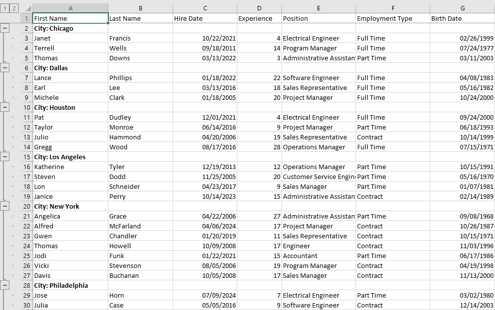
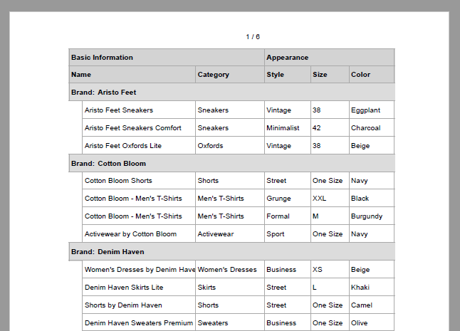
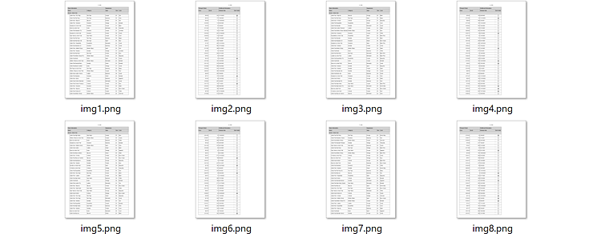

# Экспорт

Контрол DataGrid поддерживает экспорт данных в следующие форматы:

- XLSX (Microsoft Excel)
- PDF
- CSV
- Форматы изображений (PNG, JPEG, SVG и WebP)

!!! note 

    Экспорт данных в форматы XLSX, PDF и изображения реализован в библиотеке **Eremex.DocumentProcessing**. Убедитесь, что эта библиотека подключена к вашему проекту для использования функции экспорта.


## Экспорт в формат XLSX

Механизм экспорта в Excel учитывает структуру данных и сохраняет в выходном XLSX-документе настройки формирования данных грида, включая:

- Группировку строк
- Форматирование значений
- Сортировку данных
- Общие и групповые итоги

<!-- TODO
 - Data filtering settings 
-->


После экспорта данные можно обрабатывать и анализировать в Microsoft Excel или другом приложении для работы с электронными таблицами.



!!! note

    Форматирование ячеек, реализованное с помощью шаблонов ячеек ([`GridColumn.CellTemplate`](../../API/Eremex.AvaloniaUI.Controls.DataControl/ColumnBase/CellTemplate.md)), не экспортируется.

Используйте следующие методы для экспорта данных контрола в формат XLSX:

- <code>DataGridControl.ExportToXlsx(string fileName, XlsxExportOptions? options = null)</code> — экспортирует данные в файл.

- <code>DataGridControl.ExportToXlsx(Stream stream, XlsxExportOptions? options = null)</code> — экспортирует данные в поток.

Необязательный параметр `options` (типа [`XlsxExportOptions`](../../API/Eremex.AvaloniaUI.Controls.DataControl/XlsxExportOptions.md)) позволяет настроить параметры экспорта. Класс [`XlsxExportOptions`](../../API/Eremex.AvaloniaUI.Controls.DataControl/XlsxExportOptions.md) предоставляет следующие члены:

**Ход экспорта**

- Событие [`ExportProgress`](../../API/Eremex.AvaloniaUI.Controls.DataControl/ExportOptions/ExportProgress.md) — возникает многократно в процессе экспорта данных. Параметр [`ExportProgressEventArgs.ProgressPercentage`](../../API/Eremex.AvaloniaUI.Controls.DataControl/ExportProgressEventArgs/ProgressPercentage.md) этого события указывает прогресс в процентах (от 0 до 100). Вы можете использовать это событие для отображения пользователям хода экспорта в удобном виде.


**Заголовки колонок и групп колонок**

- Свойство [`AllowFixedColumnHeaderPanel`](../../API/Eremex.AvaloniaUI.Controls.DataControl/XlsxExportOptions/AllowFixedColumnHeaderPanel.md) (по умолчанию `true`) — определяет, остаётся ли панель заголовков колонок закреплённой сверху в экспортированном документе. 

- Свойство [`ShowBands`](../../API/Eremex.AvaloniaUI.Controls.DataControl/XlsxExportOptions/ShowBands.md) (по умолчанию `null`) — определяет, включаются ли [группы колонок](bands.md) контрола в экспорт. 

    Если [`ShowBands`](../../API/Eremex.AvaloniaUI.Controls.DataControl/XlsxExportOptions/ShowBands.md) имеет значение `null`, используется значение свойства [`DataGridControl.ShowBands`](../../API/Eremex.AvaloniaUI.Controls.DataGrid/DataGridControl/ShowBands.md) контрола. 

- Свойство [`ShowColumnHeaders`](../../API/Eremex.AvaloniaUI.Controls.DataControl/ExportOptions/ShowColumnHeaders.md) (по умолчанию `null`) — определяет, включается ли панель заголовков колонок в экспорт. 

    Если [`ShowColumnHeaders`](../../API/Eremex.AvaloniaUI.Controls.DataControl/ExportOptions/ShowColumnHeaders.md) имеет значение `null`, используется значение свойства [`DataGridControl.ShowColumnHeaders`](../../API/Eremex.AvaloniaUI.Controls.DataGrid/DataGridControl/ShowColumnHeaders.md) контрола. 


**Группировка данных**

- Свойство [`AllowGrouping`](../../API/Eremex.AvaloniaUI.Controls.DataControl/XlsxExportOptions/AllowGrouping.md) (по умолчанию `true`) — определяет, экспортируются ли строки групп и иерархия группировки. Если [`AllowGrouping`](../../API/Eremex.AvaloniaUI.Controls.DataControl/XlsxExportOptions/AllowGrouping.md) имеет значение `false`, экспортируются только строки данных.


**Итоги**

- [`ShowGroupSummaries`](../../API/Eremex.AvaloniaUI.Controls.DataControl/ExportOptions/ShowGroupSummaries.md) — возвращает или задаёт, экспортируются ли [групповые итоги](summaries.md#групповые-итоги).

- [`ShowTotalSummaries`](../../API/Eremex.AvaloniaUI.Controls.DataControl/ExportOptions/ShowTotalSummaries.md) — возвращает или задаёт, экспортируются ли [общие итоги](summaries.md#общие-итоги).

- [`SummaryCountBlankCells`](../../API/Eremex.AvaloniaUI.Controls.DataControl/XlsxExportOptions/SummaryCountBlankCells.md) — возвращает или задаёт, учитывают ли формулы итога Count пустые ячейки.

- [`ShowSummaryLabels`](../../API/Eremex.AvaloniaUI.Controls.DataControl/XlsxExportOptions/ShowSummaryLabels.md) — возвращает или задаёт, включаются ли метки итогов в экспортированные ячейки итогов.

**Линии ячеек**

- [`ShowHorizontalLines`](../../API/Eremex.AvaloniaUI.Controls.DataControl/XlsxExportOptions/ShowHorizontalLines.md) — определяет, отображаются ли горизонтальные линии между ячейками в выходном документе.

- [`ShowVerticalLines`](../../API/Eremex.AvaloniaUI.Controls.DataControl/XlsxExportOptions/ShowVerticalLines.md) — определяет, отображаются ли вертикальные линии между ячейками в выходном документе.


**Региональные параметры и форматирование ячеек**

- [`ApplyFormattingToEntireColumn`](../../API/Eremex.AvaloniaUI.Controls.DataControl/XlsxExportOptions/ApplyFormattingToEntireColumn.md) — определяет, применяется ли форматирование ячеек ко всей колонке целиком или к отдельным ячейкам в выходном документе.

- [`DocumentCulture`](../../API/Eremex.AvaloniaUI.Controls.DataControl/XlsxExportOptions/DocumentCulture.md) — пользовательский объект `CultureInfo`, определяющий правила форматирования числовых значений и значений даты-времени в выходном документе.

    Если свойство [`DocumentCulture`](../../API/Eremex.AvaloniaUI.Controls.DataControl/XlsxExportOptions/DocumentCulture.md) не задано, механизм экспорта использует текущую культуру приложения.

- Свойство [`TextExportMode`](../../API/Eremex.AvaloniaUI.Controls.DataControl/TextExportMode.md) — режим экспорта значений ячеек **по умолчанию**. 

    Доступные варианты: 

    - [`TextExportMode.Value`](../../API/Eremex.AvaloniaUI.Controls.DataControl/TextExportMode.md) — экспортирует значения ячеек. Если значения ячеек отформатированы в контроле DataGrid, механизм экспорта пытается применить соответствующее форматирование к экспортированным значениям в выходном документе.
    - [`TextExportMode.Text`](../../API/Eremex.AvaloniaUI.Controls.DataControl/TextExportMode.md) — экспортирует отображаемый текст ячеек. Если значения ячеек отформатированы в контроле DataGrid, экспортируется отформатированное строковое представление.

    Вы можете использовать свойство [`GridColumn.TextExportMode`](../../API/Eremex.AvaloniaUI.Controls.DataControl/ColumnBase/TextExportMode.md), чтобы переопределить настройку [`XlsxExportOptions.TextExportMode`](../../API/Eremex.AvaloniaUI.Controls.DataControl/XlsxExportOptions/TextExportMode.md) для отдельных колонок.

    !!! note

        Механизм экспорта учитывает только форматирование ячеек, применённое с помощью свойства [`GridColumn.EditorProperties`](../../API/Eremex.AvaloniaUI.Controls.DataControl/ColumnBase/EditorProperties.md). Например:

        ```
        <mxdg:GridColumn Width="*" FieldName="Salary">
            <mxdg:GridColumn.EditorProperties>
                <mxe:TextEditorProperties DisplayFormatString="c"/>
            </mxdg:GridColumn.EditorProperties>
        </mxdg:GridColumn>
        ```

        Форматирование ячеек, применённое другими способами (например, с помощью [`GridColumn.CellTemplate`](../../API/Eremex.AvaloniaUI.Controls.DataControl/ColumnBase/CellTemplate.md)), игнорируется при экспорте данных.

        


<!-- TODO
image with data grouping export
 -->


## Экспорт в формат PDF

Механизм рендеринга PDF следует концепции WYSIWYG, сохраняя расположение элементов грида в выходном документе. 





Используйте следующие методы для экспорта данных контрола в формат PDF:

- <code>DataGridControl.ExportToPdf(string fileName, PageExportOptions? options = null)</code> — экспортирует данные в файл.

- <code>DataGridControl.ExportToPdf(Stream stream, PageExportOptions? options = null)</code> — экспортирует данные в поток.

Необязательный параметр `options` (типа [`PageExportOptions`](../../API/Eremex.AvaloniaUI.Controls.DataControl/PageExportOptions.md)) позволяет настроить параметры экспорта. Класс [`PageExportOptions`](../../API/Eremex.AvaloniaUI.Controls.DataControl/PageExportOptions.md) предоставляет следующие члены:

**Ход экспорта**

- Событие [`PageExportOptions.ExportProgress`](../../API/Eremex.AvaloniaUI.Controls.DataControl/ExportOptions/ExportProgress.md) — возникает многократно в процессе экспорта данных. Параметр [`ExportProgressEventArgs.ProgressPercentage`](../../API/Eremex.AvaloniaUI.Controls.DataControl/ExportProgressEventArgs/ProgressPercentage.md) этого события указывает прогресс в процентах (от 0 до 100). Вы можете использовать это событие для отображения пользователям хода экспорта в удобном виде.

**Страница**

- [`PageExportOptions.FitToPageWidth`](../../API/Eremex.AvaloniaUI.Controls.DataControl/PageExportOptions/FitToPageWidth.md) (по умолчанию `false`) — определяет, растягиваются ли колонки грида по ширине страницы.

- [`PageExportOptions.Landscape`](../../API/Eremex.AvaloniaUI.Controls.DataControl/PageExportOptions/Landscape.md) (по умолчанию `false`) — определяет ориентацию страницы: горизонтальную ([`Landscape`](../../API/Eremex.AvaloniaUI.Controls.DataControl/PageExportOptions/Landscape.md)) или вертикальную (`Portrait`).

- [`PageExportOptions.Margins`](../../API/Eremex.AvaloniaUI.Controls.DataControl/PageExportOptions/Margins.md) (по умолчанию `72,72,72,72`) — поля страницы в пунктах. 1 пункт = 1/72 дюйма.

- [`PageExportOptions.PageRange`](../../API/Eremex.AvaloniaUI.Controls.DataControl/PageExportOptions/PageRange.md) — строка, определяющая диапазон экспортируемых страниц. Вы можете использовать следующие обозначения для указания диапазона страниц:

    - "1" — экспортирует страницу 1.
    - "1, 4, 8-10" — экспортирует страницы 1, 4 и с 8 по 10.
    <!-- - "7-" — Exports from page 7 to the end. -->

    Значение по умолчанию свойства [`PageRange`](../../API/Eremex.AvaloniaUI.Controls.DataControl/PageExportOptions/PageRange.md) — пустая строка, при которой экспортируются все страницы.

- [`PageExportOptions.PaperKind`](../../API/Eremex.AvaloniaUI.Controls.DataControl/PageExportOptions/PaperKind.md) (по умолчанию `A4`) — размер бумаги.

**Заголовки колонок и групп колонок**

- Свойство [`PageExportOptions.ShowBands`](../../API/Eremex.AvaloniaUI.Controls.DataControl/PageExportOptions/ShowBands.md) (по умолчанию `null`) — определяет, включаются ли [группы колонок](bands.md) контрола в экспорт. 

    Если [`ShowBands`](../../API/Eremex.AvaloniaUI.Controls.DataControl/PageExportOptions/ShowBands.md) имеет значение `null`, используется значение свойства [`DataGridControl.ShowBands`](../../API/Eremex.AvaloniaUI.Controls.DataGrid/DataGridControl/ShowBands.md) контрола. 

- Свойство [`PageExportOptions.ShowColumnHeaders`](../../API/Eremex.AvaloniaUI.Controls.DataControl/ExportOptions/ShowColumnHeaders.md) (по умолчанию `null`) — определяет, включается ли панель заголовков колонок в экспорт. 

    Если [`ShowColumnHeaders`](../../API/Eremex.AvaloniaUI.Controls.DataControl/ExportOptions/ShowColumnHeaders.md) имеет значение `null`, используется значение свойства [`DataGridControl.ShowColumnHeaders`](../../API/Eremex.AvaloniaUI.Controls.DataGrid/DataGridControl/ShowColumnHeaders.md) контрола.  


**Итоги**

- [`ShowGroupSummaries`](../../API/Eremex.AvaloniaUI.Controls.DataControl/ExportOptions/ShowGroupSummaries.md) — возвращает или задаёт, экспортируются ли [групповые итоги](summaries.md#групповые-итоги).

- [`ShowTotalSummaries`](../../API/Eremex.AvaloniaUI.Controls.DataControl/ExportOptions/ShowTotalSummaries.md) — возвращает или задаёт, экспортируются ли [общие итоги](summaries.md#общие-итоги).

**Собственный текст ячеек**

- Событие [`ColumnDisplayText`](../../API/Eremex.AvaloniaUI.Controls.DataControl/PageExportOptions/ColumnDisplayText.md) — возникает каждый раз, когда при экспорте формируется отображаемый текст ячейки. Обработайте это событие, чтобы задать собственный отображаемый текст ячеек.
    

## Экспорт в формат CSV

Контрол DataGrid предоставляет метод [`ExportToCsv`](../../API/Eremex.AvaloniaUI.Controls.DataControl/DataControlBase/ExportToCsv.md) для экспорта данных в формат CSV. CSV (comma-separated values, значения, разделённые запятыми) — это текстовый формат данных для хранения табличных данных. Каждая запись экспортируется в виде текстовой строки, в которой значения разделены разделителем (как правило, запятой).

Доступны следующие перегрузки метода [`ExportToCsv`](../../API/Eremex.AvaloniaUI.Controls.DataControl/DataControlBase/ExportToCsv.md):

- <code>DataGridControl.ExportToCsv(string filePath, TextExportMode textExportNode = TextExportMode.Text, string separator = ",", bool quoteStringsWithSeparators = true)</code> — экспортирует данные в файл.

- <code>DataGridControl.ExportToCsv(Stream stream, TextExportMode textExportMode = TextExportMode.Text, string separator = ",", bool quoteStringsWithSeparators = true)</code> — экспортирует данные в поток.

Следующие параметры метода позволяют настроить параметры экспорта:

- `textExportMode` — режим экспорта значений ячеек **по умолчанию**. 

    Доступные варианты: 

    - [`TextExportMode.Value`](../../API/Eremex.AvaloniaUI.Controls.DataControl/TextExportMode.md) — экспортирует значения ячеек. Форматы данных, применённые к значениям ячеек, не экспортируются.
    - [`TextExportMode.Text`](../../API/Eremex.AvaloniaUI.Controls.DataControl/TextExportMode.md) — экспортирует отображаемый текст ячеек. Если значения ячеек отформатированы в контроле DataGrid, экспортируется отформатированное строковое представление.

        !!! note

            Механизм экспорта учитывает только форматирование ячеек, применённое с помощью свойства [`GridColumn.EditorProperties`](../../API/Eremex.AvaloniaUI.Controls.DataControl/ColumnBase/EditorProperties.md).

    Вы можете использовать свойство [`GridColumn.TextExportMode`](../../API/Eremex.AvaloniaUI.Controls.DataControl/ColumnBase/TextExportMode.md), чтобы переопределить параметр метода `textExportMode` для отдельных колонок. 


- `separator` — строка, определяющая разделитель, используемый для разделения значений ячеек в выходном документе. Разделитель по умолчанию — запятая (",").

- `quoteStringsWithSeparators` — определяет, следует ли заключать значения в кавычки ("), если они содержат указанный `separator`.


## Экспорт в форматы изображений

Метод [`ExportToImages`](../../API/Eremex.AvaloniaUI.Controls.DataGrid/DataGridControl/ExportToImages.md) контрола DataGrid выполняет постраничный экспорт в формат изображения (PNG, JPEG, SVG или WebP). Если содержимое контрола слишком велико, чтобы поместиться на одной странице, метод разбивает данные на страницы и экспортирует каждую страницу в виде отдельного изображения. 



Формат и размер целевой страницы определяются параметром, передаваемым методу. Метод [`ExportToImages`](../../API/Eremex.AvaloniaUI.Controls.DataGrid/DataGridControl/ExportToImages.md) использует тот же механизм постраничной разбивки, что и метод [`ExportToPdf`](../../API/Eremex.AvaloniaUI.Controls.DataGrid/DataGridControl/ExportToPdf.md).

- <code>DataGridControl.ExportToImages(string directory, string fileNameFormat, ImageExportOptions? options = null)</code>

``` cs
using Eremex.AvaloniaUI.Controls.DataControl;
using Eremex.DocumentProcessing.Printing;

ImageExportOptions options = new ImageExportOptions();
options.Format = MxImageFormat.Svg;
options.FitToPageWidth = false;
options.PaperKind = PaperKind.A4;
options.Margins = new Margins(36, 36, 36, 36);
options.PageRange = "1-2";
dataGrid.ExportToImages(@"c:\images\", "img{0}.svg", options);
```

Используйте параметры метода [`ExportToImages`](../../API/Eremex.AvaloniaUI.Controls.DataGrid/DataGridControl/ExportToImages.md) для настройки параметров страницы, формата выходного изображения и шаблона имени файла.

- `directory` — определяет каталог, в который сохраняются файлы изображений. Если указанный каталог не существует, возникает исключение.

- `fileNameFormat` — определяет шаблон именования выходных файлов изображений. 

    Значение `fileNameFormat` должно включать плейсхолдер `{0}` в позиции, где нужно вставить номер страницы в сгенерированных именах файлов. Вы можете форматировать номер страницы с помощью [стандартных](https://learn.microsoft.com/en-us/dotnet/standard/base-types/standard-numeric-format-strings) и [пользовательских числовых спецификаторов формата](https://learn.microsoft.com/en-us/dotnet/standard/base-types/custom-numeric-format-strings). Ниже приведены примеры значений `fileNameFormat`:

    - "image{0}.png" — создаёт файлы вида "image1.png", "image2.png" и так далее.
    - "image{0:D3}.svg"  — создаёт файлы вида "image001.svg", "image002.svg" и так далее.
    
Необязательный параметр `options` (типа [`ImageExportOptions`](../../API/Eremex.AvaloniaUI.Controls.DataControl/ImageExportOptions.md)) позволяет настроить параметры экспорта. Класс [`ImageExportOptions`](../../API/Eremex.AvaloniaUI.Controls.DataControl/ImageExportOptions.md) предоставляет следующие члены:

**Формат выходного изображения**

- [`ImageExportOptions.Format`](../../API/Eremex.AvaloniaUI.Controls.DataControl/ImageExportOptions/Format.md) — выходной формат изображения (PNG, JPEG, SVG или WebP).

**Ход экспорта**

- Событие [`PageExportOptions.ExportProgress`](../../API/Eremex.AvaloniaUI.Controls.DataControl/ExportOptions/ExportProgress.md) — возникает многократно в процессе экспорта данных. Параметр [`ExportProgressEventArgs.ProgressPercentage`](../../API/Eremex.AvaloniaUI.Controls.DataControl/ExportProgressEventArgs/ProgressPercentage.md) этого события указывает прогресс в процентах (от 0 до 100). Вы можете использовать это событие для отображения пользователям хода экспорта в удобном виде.

**Страница**

- [`PageExportOptions.FitToPageWidth`](../../API/Eremex.AvaloniaUI.Controls.DataControl/PageExportOptions/FitToPageWidth.md) (по умолчанию `false`) — определяет, растягиваются ли колонки грида по ширине страницы.

- [`PageExportOptions.Landscape`](../../API/Eremex.AvaloniaUI.Controls.DataControl/PageExportOptions/Landscape.md) (по умолчанию `false`) — определяет ориентацию страницы: горизонтальную ([`Landscape`](../../API/Eremex.AvaloniaUI.Controls.DataControl/PageExportOptions/Landscape.md)) или вертикальную (`Portrait`).

- [`PageExportOptions.Margins`](../../API/Eremex.AvaloniaUI.Controls.DataControl/PageExportOptions/Margins.md) (по умолчанию `72,72,72,72`) — поля страницы в пунктах. 1 пункт = 1/72 дюйма.

- [`ImageExportOptions.PageBorderColor`](../../API/Eremex.AvaloniaUI.Controls.DataControl/ImageExportOptions/PageBorderColor.md) — цвет рамки, отображаемой вокруг каждой страницы.

- [`ImageExportOptions.PageBorderWidth`](../../API/Eremex.AvaloniaUI.Controls.DataControl/ImageExportOptions/PageBorderWidth.md)  — толщина рамки, отображаемой вокруг каждой страницы.

- [`PageExportOptions.PageRange`](../../API/Eremex.AvaloniaUI.Controls.DataControl/PageExportOptions/PageRange.md) — строка, определяющая диапазон экспортируемых страниц. Вы можете использовать следующие обозначения для указания диапазона страниц:

    - "1" — экспортирует страницу 1.
    - "1, 4, 8-10" — экспортирует страницы 1, 4 и с 8 по 10.
    <!-- - "7-" — Exports from page 7 to the end. -->

    Значение по умолчанию свойства [`PageRange`](../../API/Eremex.AvaloniaUI.Controls.DataControl/PageExportOptions/PageRange.md) — пустая строка, при которой экспортируются все страницы.

- [`PageExportOptions.PaperKind`](../../API/Eremex.AvaloniaUI.Controls.DataControl/PageExportOptions/PaperKind.md) (по умолчанию `A4`) — размер бумаги.

**Заголовки колонок и групп колонок**

- Свойство [`PageExportOptions.ShowBands`](../../API/Eremex.AvaloniaUI.Controls.DataControl/PageExportOptions/ShowBands.md) (по умолчанию `null`) — определяет, включаются ли [группы колонок](bands.md) контрола в экспорт. 

    Если [`ShowBands`](../../API/Eremex.AvaloniaUI.Controls.DataControl/PageExportOptions/ShowBands.md) имеет значение `null`, используется значение свойства [`DataGridControl.ShowBands`](../../API/Eremex.AvaloniaUI.Controls.DataGrid/DataGridControl/ShowBands.md) контрола. 

- Свойство [`PageExportOptions.ShowColumnHeaders`](../../API/Eremex.AvaloniaUI.Controls.DataControl/ExportOptions/ShowColumnHeaders.md) (по умолчанию `null`) — определяет, включается ли панель заголовков колонок в экспорт. 

    Если [`ShowColumnHeaders`](../../API/Eremex.AvaloniaUI.Controls.DataControl/ExportOptions/ShowColumnHeaders.md) имеет значение `null`, используется значение свойства [`DataGridControl.ShowColumnHeaders`](../../API/Eremex.AvaloniaUI.Controls.DataGrid/DataGridControl/ShowColumnHeaders.md) контрола.  


**Итоги**

- [`ShowGroupSummaries`](../../API/Eremex.AvaloniaUI.Controls.DataControl/ExportOptions/ShowGroupSummaries.md) — возвращает или задаёт, экспортируются ли [групповые итоги](summaries.md#групповые-итоги).

- [`ShowTotalSummaries`](../../API/Eremex.AvaloniaUI.Controls.DataControl/ExportOptions/ShowTotalSummaries.md) — возвращает или задаёт, экспортируются ли [общие итоги](summaries.md#общие-итоги).

**Собственный текст ячеек**

- Событие [`ColumnDisplayText`](../../API/Eremex.AvaloniaUI.Controls.DataControl/PageExportOptions/ColumnDisplayText.md) — возникает каждый раз, когда при экспорте формируется отображаемый текст ячейки. Обработайте это событие, чтобы задать собственный отображаемый текст ячеек.

<br>
<br>

<sup>*</sup> Эта страница переведена с использованием технологий машинного перевода.
