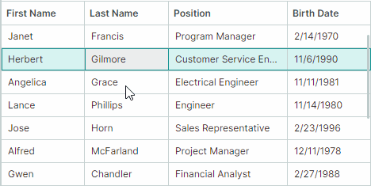
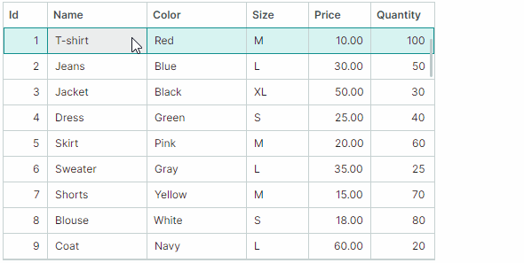
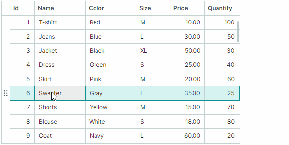
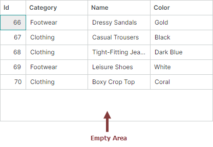
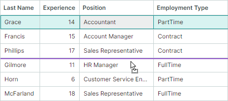

# Перетаскивание строк (Drag-and-Drop)

DataGrid поддерживает функцию перетаскивания строк как в пределах контрола, так и во внешние контролы.



При перетаскивании строк отображается их предварительный вид (preview). Однако, если вы включите платформенное перетаскивание строк (требуется для [перетаскивания строк между приложениями](#включение-перетаскивания-строк-между-приложениями)), предварительный вид строк недоступен.

## Включение перетаскивания строк

Установите свойство [`DataGridControl.AllowDragDrop`](../../API/Eremex.AvaloniaUI.Controls.DataGrid/DataGridControl/AllowDragDrop.md) в значение `true`, чтобы включить перетаскивание строк. В этом режиме пользователь может перетаскивать строку в пределах контрола DataGrid и за его пределы.
Операция перетаскивания перемещает строку на другую позицию, а также изменяет позицию соответствующего бизнес-объекта в источнике данных.

Если строка перетаскивается во внешний контрол, поведение DataGrid по умолчанию заключается в удалении строки из текущего контрола и удалении соответствующего бизнес-объекта из источника данных контрола. См. [Перетаскивание строк между контролами](#перетаскивание-строк-между-контролами) для информации о том, как предотвратить удаление строк и бизнес-объектов.

Перетаскивание нескольких строк поддерживается, если включить режим множественного выделения строк с помощью свойства [`DataControlBase.SelectionMode`](../../API/Eremex.AvaloniaUI.Controls.DataControl/DataControlBase/SelectionMode.md) (см. [Rows — Multiple Row Selection (Highlight)](rows.md#множественное-выделение-строк-подсветка)).

DataGrid не поддерживает автоматические операции копирования во время перетаскивания. Нажатие клавиши CTRL не действует.


### Включение перетаскивания строк между приложениями

Чтобы разрешить перетаскивание строк между приложениями, включите свойство [`UsePlatformRowDragDrop`](../../API/Eremex.AvaloniaUI.Controls.DataGrid/DataGridControl/UsePlatformRowDragDrop.md) для контрола, являющегося источником операций перетаскивания.

!!! Tip

    Свойство [`UsePlatformRowDragDrop`](../../API/Eremex.AvaloniaUI.Controls.DataGrid/DataGridControl/UsePlatformRowDragDrop.md) включает режим перетаскивания, в котором операции обрабатываются платформой Avalonia. Во время платформенных операций перетаскивания строк предварительный вид строк не отображается.

## Режим перетаскивания строк – начало перетаскивания в ячейках или с помощью специальных маркеров

DataGrid поддерживает два режима перетаскивания строк, различающихся способом инициации операций перетаскивания. Вы можете выбрать нужный режим с помощью свойства контрола [`RowDragMode`](../../API/Eremex.AvaloniaUI.Controls.DataControl/RowDragMode.md).

- Режим [`RowDragMode.Row`](../../API/Eremex.AvaloniaUI.Controls.DataControl/RowDragMode.md) (по умолчанию) — пользователи могут инициировать операцию перетаскивания в любой ячейке строки.

    


    В этом режиме поведение активации редактора ячейки по умолчанию следующее:
    
    1. Пользователю сначала нужно установить фокус на ячейке.
    
    2. Щелчок в сфокусированной ячейке затем активирует редактор ячейки.
    
    Чтобы активировать редактор ячейки одним щелчком, включите активацию редактора ячейки при отпускании кнопки мыши. Для этого установите свойство контрола [`DataControlBase.EditorShowMode`](../../API/Eremex.AvaloniaUI.Controls.DataControl/DataControlBase/EditorShowMode.md) в значение [`EditorShowMode.PointerReleased`](../../API/Eremex.AvaloniaUI.Controls.DataControl/EditorShowMode.md).

- Режим [`RowDragMode.DragHandle`](../../API/Eremex.AvaloniaUI.Controls.DataControl/RowDragMode.md) — пользователи могут инициировать операцию перетаскивания, перетаскивая специальный маркер перетаскивания. Маркеры перетаскивания отображаются в области индикатора строки, которая автоматически появляется слева от строк при активации режима [`RowDragMode.DragHandle`](../../API/Eremex.AvaloniaUI.Controls.DataControl/RowDragMode.md).

    

    В режиме `DragHandle` редакторы ячеек по умолчанию активируются одним нажатием в ячейке. Вы можете использовать свойство контрола [`DataControlBase.EditorShowMode`](../../API/Eremex.AvaloniaUI.Controls.DataControl/DataControlBase/EditorShowMode.md), чтобы изменить это поведение.

    Когда включено множественное выделение строк, маркеры перетаскивания отображаются для каждой выделенной строки.


**Связанный API:**

- [`RowIndicatorWidth`](../../API/Eremex.AvaloniaUI.Controls.DataGrid/DataGridControl/RowIndicatorWidth.md) — задаёт ширину области индикатора строки, в которой отображаются маркеры перетаскивания.


## Перетаскивание отсортированных и сгруппированных данных

Когда данные контрола [отсортированы](sorting.md) или [сгруппированы](grouping.md), перетаскивание строк по умолчанию отключено. Установите свойство [`DataGridControl.AllowDragDropSortedRows`](../../API/Eremex.AvaloniaUI.Controls.DataGrid/DataGridControl/AllowDragDropSortedRows.md) в значение `true`, чтобы включить перетаскивание в отсортированных/сгруппированных контролах.

Если данные отсортированы и строка перетаскивается на позицию до или после другой строки, контрол автоматически обновляет значение(-я) перетаскиваемой строки в отсортированном(-ых) колонке(-ах), чтобы сохранить текущий порядок сортировки. Значения перетаскиваемой строки в отсортированных колонках устанавливаются равными соответствующим значениям целевой строки.

## Обработка операций перетаскивания с помощью событий

Контрол DataGrid содержит события для управления операциями перетаскивания строк и реагирования на них.

### Начало перетаскивания

Событие [`DataGridControl.StartDrag`](../../API/Eremex.AvaloniaUI.Controls.DataGrid/DataGridControl/StartDrag.md) возникает, когда операция перетаскивания вот-вот начнётся. Используйте следующие параметры события, чтобы получить информацию о текущей операции перетаскивания.

- `e.Data` — задаёт объект [`DragDropData`](../../API/Eremex.AvaloniaUI.Controls.DataControl/DragDropData.md), содержащий данные текущей операции перетаскивания.
- `e.DragElement` — внутренний визуальный элемент контрола, который перетаскивается.
- `e.Effects` — задаёт эффект перетаскивания. Установите этот параметр в значение `DragDropEffects.None`, чтобы отменить текущую операцию перетаскивания. Эффект перетаскивания также определяет значок курсора мыши.
- `e.Items` — массив элементов источника данных (бизнес-объектов), соответствующих перетаскиваемым строкам. Если перетаскивается строка группы, массив `e.Items` содержит бизнес-объекты, соответствующие строкам данных, отображаемым внутри этой строки группы. Чтобы определить, перетаскивается ли строка группы, см. `e.DragRowIndexes`.
- `e.DragRowIndexes` — массив индексов перетаскиваемых строк. Строки данных имеют неотрицательные индексы, тогда как индексы строк группы отрицательны. Дополнительную информацию см. в следующем разделе: [Идентификация и получение строк](rows.md#идентификация-и-получение-строк)


#### Пример — предотвращение начала перетаскивания для определённых строк данных

Следующий обработчик события [`StartDrag`](../../API/Eremex.AvaloniaUI.Controls.DataGrid/DataGridControl/StartDrag.md) отключает перетаскивание для строк, содержащих строку «Manager» в колонке _Position_.

``` cs
private void DataGrid_StartDrag(object sender, DataGridStartDragEventArgs e)
{
    // It is assumed that items in the grid's data source are EmployeeInfo objects. 
    // The EmployeeInfo class contains the Position property of the string type.
    foreach(EmployeeInfo item in e.Items)
    {
        if(item.Position.Contains("Manager"))
        {
            e.Effects = Avalonia.Input.DragDropEffects.None;
            return;
        }
    }
}
```

#### Пример — предотвращение перетаскивания для строк группы

Этот пример обрабатывает событие [`StartDrag`](../../API/Eremex.AvaloniaUI.Controls.DataGrid/DataGridControl/StartDrag.md), чтобы отключить перетаскивание для строк группы. Строки группы имеют отрицательные индексы, поэтому обработчик события [`StartDrag`](../../API/Eremex.AvaloniaUI.Controls.DataGrid/DataGridControl/StartDrag.md) проверяет, содержит ли массив `e.DragRowIndexes` отрицательные индексы.

``` cs
private void DataGrid_StartDrag(object sender, DataGridStartDragEventArgs e)
{
    foreach(int rowIndex in e.DragRowIndexes)
        if(rowIndex < 0) e.Effects = Avalonia.Input.DragDropEffects.None;
}
```

### Обработка этапа перемещения над строками

Событие [`DataGridControl.DragOver`](../../API/Eremex.AvaloniaUI.Controls.DataGrid/DataGridControl/DragOver.md) возникает многократно, пока пользователь перетаскивает строку (или строки) над другой строкой. Аргументы события позволяют получить информацию о текущей операции перетаскивания:

- `e.Items` — массив элементов источника данных (бизнес-объектов), соответствующих перетаскиваемым строкам. Если перетаскивается строка группы, массив `e.Items` содержит бизнес-объекты всех строк данных этой группы.
- `e.TargetRowIndex` — [индекс](rows.md#идентификация-и-получение-строк) строки, над которой перетаскиваются строки.
- `e.DropPosition` — возвращает или задаёт потенциальную позицию сброса относительно целевой строки. Доступны следующие варианты:
    - [`DropPosition.Before`](../../API/Eremex.AvaloniaUI.Controls.DataControl/DropPosition.md) — перетаскиваемые строки при сбросе будут добавлены на тот же уровень иерархии перед целевой строкой.
    - [`DropPosition.After`](../../API/Eremex.AvaloniaUI.Controls.DataControl/DropPosition.md) — перетаскиваемые строки при сбросе будут добавлены на тот же уровень иерархии после целевой строки.
    - [`DropPosition.Inside`](../../API/Eremex.AvaloniaUI.Controls.DataControl/DropPosition.md) — перетаскиваемые строки при сбросе будут добавлены как дочерние элементы целевой строки группы. Этот вариант действует при перетаскивании над строками группы.
    - [`DropPosition.EmptyArea`](../../API/Eremex.AvaloniaUI.Controls.DataControl/DropPosition.md) (новое в v1.5) — строки перетаскиваются над пустой областью под всеми строками сетки.

        

        Когда строки перетаскиваются над пустой областью, параметр `e.Effects` изначально равен `DragDropEffects.None`, поэтому сбросить их здесь нельзя.

        Установите параметр `e.Effects` в значение `DragDropEffects.Move` или `DragDropEffects.Copy`, чтобы разрешить сброс строк в пустую область. Строки, сброшенные в эту область, вставляются в конец всех строк.

    Изменяя параметр `e.DropPosition`, можно управлять тем, куда вставляются перетаскиваемые строки. Например, чтобы всегда добавлять перетаскиваемые строки в конец, установите параметр `e.DropPosition` в значение [`DropPosition.EmptyArea`](../../API/Eremex.AvaloniaUI.Controls.DataControl/DropPosition.md) и убедитесь, что параметр `e.Effects` не равен `None`.

- `e.KeyModifiers` — указывает, нажата ли клавиша ALT, SHIFT и/или CTRL во время события [`DragOver`](../../API/Eremex.AvaloniaUI.Controls.DataGrid/DataGridControl/DragOver.md).
- `e.Data` — задаёт объект [`DragDropData`](../../API/Eremex.AvaloniaUI.Controls.DataControl/DragDropData.md), содержащий данные текущей операции перетаскивания.
- `e.Effects` — задаёт эффект перетаскивания. Установите этот параметр в значение `DragDropEffects.None`, чтобы отменить текущую операцию перетаскивания. Эффект перетаскивания также определяет значок курсора мыши.

#### Пример — разрешение сброса строк в пустую область

Следующий обработчик события [`DataGridControl.DragOver`](../../API/Eremex.AvaloniaUI.Controls.DataGrid/DataGridControl/DragOver.md) устанавливает параметр `e.Effects` в значение `Move`, чтобы разрешить сброс строк в пустую область контрола.

``` cs 
private void ProductsInStockGrid_DragOver(object sender, DataGridDragEventArgs e)
{
    if (e.DropPosition == DropPosition.EmptyArea)
        e.Effects = Avalonia.Input.DragDropEffects.Move;
}
```

#### Пример — вставка перетаскиваемых строк всегда в конец

Следующий обработчик события [`DataGridControl.DragOver`](../../API/Eremex.AvaloniaUI.Controls.DataGrid/DataGridControl/DragOver.md) гарантирует, что перетаскиваемые строки при сбросе всегда вставляются в конец всех строк. Для этого параметр события `e.DropPosition` принудительно устанавливается в значение [`DropPosition.EmptyArea`](../../API/Eremex.AvaloniaUI.Controls.DataControl/DropPosition.md), а параметр `e.Effects` — в значение `Move`.

``` cs
private void ProductsInStockGrid_DragOver(object sender, DataGridDragEventArgs e)
{
    e.DropPosition = DropPosition.EmptyArea;
    e.Effects = Avalonia.Input.DragDropEffects.Move;
}
```


#### Пример — предотвращение сброса строк над строками группы

Следующий обработчик события [`DragOver`](../../API/Eremex.AvaloniaUI.Controls.DataGrid/DataGridControl/DragOver.md) предотвращает сброс строк над строками группы.

``` cs
private void DataGrid_DragOver(object sender, DataGridDragEventArgs e)
{
    if(e.TargetRowIndex < 0) 
        e.Effects = Avalonia.Input.DragDropEffects.None;
}
```


### Завершение перетаскивания

Вы можете обработать два события для выполнения действий, когда строка сбрасывается в результате операции перетаскивания:

- [`DataGridControl.Drop`](../../API/Eremex.AvaloniaUI.Controls.DataGrid/DataGridControl/Drop.md) — возникает, когда строка вот-вот будет сброшена над другой строкой сетки. Аргументы этого события совпадают с аргументами события [`DataGridControl.DragOver`](../../API/Eremex.AvaloniaUI.Controls.DataGrid/DataGridControl/DragOver.md).

    Чтобы отменить операцию сброса в определённых случаях, обработайте событие [`Drop`](../../API/Eremex.AvaloniaUI.Controls.DataGrid/DataGridControl/Drop.md) и установите его параметр `e.Handled` в значение `true`.

    Если строка сбрасывается за пределами текущего контрола DataGrid, событие [`Drop`](../../API/Eremex.AvaloniaUI.Controls.DataGrid/DataGridControl/Drop.md) не возникает для этого контрола. Дополнительную информацию см. в описании события [`DataGridControl.CompleteDragDrop`](../../API/Eremex.AvaloniaUI.Controls.DataGrid/DataGridControl/CompleteDragDrop.md) ниже.

    #### Пример — изменение значений сброшенной строки

    Следующий обработчик события [`Drop`](../../API/Eremex.AvaloniaUI.Controls.DataGrid/DataGridControl/Drop.md) изменяет значение перетаскиваемой строки (строк) при её сбросе. Предполагается, что источник данных содержит поле _"EmploymentType"_. Приведённый ниже код устанавливает поле _"EmploymentType"_ сброшенной строки равным значению поля _"EmploymentType"_ целевой строки.

    ``` cs
    private void DataGrid_Drop(object sender, DataGridDragEventArgs e)
    {
        DataGridControl grid = sender as DataGridControl;
        GridColumn colEmploymentType = grid.Columns["EmploymentType"];
        EmploymentType newEmploymentType = (EmploymentType)grid.GetCellValue(e.TargetRowIndex, colEmploymentType);
        foreach (EmployeeInfo item in e.Items)
        {
            item.EmploymentType = newEmploymentType;
        }
    }
    ```

<!-- TODO
Почему передаются айтемы, а не row indexы?
В ивент надо добавить e.DragRowIndexes (по аналогии с StartDrag) ?
 -->


- [`DataGridControl.CompleteDragDrop`](../../API/Eremex.AvaloniaUI.Controls.DataGrid/DataGridControl/CompleteDragDrop.md) — возникает после завершения операции перетаскивания в пределах текущего контрола или за его пределами.

    Событие [`DataGridControl.CompleteDragDrop`](../../API/Eremex.AvaloniaUI.Controls.DataGrid/DataGridControl/CompleteDragDrop.md) возникает после события [`DataGridControl.Drop`](../../API/Eremex.AvaloniaUI.Controls.DataGrid/DataGridControl/Drop.md).

    Для события [`DataGridControl.CompleteDragDrop`](../../API/Eremex.AvaloniaUI.Controls.DataGrid/DataGridControl/CompleteDragDrop.md) доступны следующие аргументы:

    - `e.Items` — массив элементов (бизнес-объектов), соответствующих сброшенным строкам.
    - `e.Effects` — возвращает эффект перетаскивания, установленный в обработчике события [`Drop`](../../API/Eremex.AvaloniaUI.Controls.DataGrid/DataGridControl/Drop.md) контрола, на который была сброшена строка.

    Смотрите также: [Перетаскивание строк между контролами](#перетаскивание-строк-между-контролами)

    
## Параметры перетаскивания

DataGrid содержит следующие параметры для настройки операций перетаскивания строк:

- [`DataGridControl.AutoExpandOnDrag`](../../API/Eremex.AvaloniaUI.Controls.DataGrid/DataGridControl/AutoExpandOnDrag.md) — получает или задаёт, разворачиваются ли автоматически свёрнутые строки группы при наведении на них во время операции перетаскивания.
- [`DataGridControl.AutoExpandDelayOnDrag`](../../API/Eremex.AvaloniaUI.Controls.DataGrid/DataGridControl/AutoExpandDelayOnDrag.md) — получает или задаёт задержку перед автоматическим разворачиванием свёрнутых строк группы, когда курсор мыши находится над ними во время операции перетаскивания.
- [`DataGridControl.AllowScrollingOnDrag`](../../API/Eremex.AvaloniaUI.Controls.DataGrid/DataGridControl/AllowScrollingOnDrag.md) — получает или задаёт, прокручивает ли DataGrid автоматически строки при перетаскивании строки к верхнему или нижнему краю контрола.


## Перетаскивание строк между контролами

Перетаскивание строк автоматически поддерживается между контролами [`DataGridControl`](../../API/Eremex.AvaloniaUI.Controls.DataGrid/DataGridControl.md), [`TreeListControl`](../../API/Eremex.AvaloniaUI.Controls.TreeList/TreeListControl.md) и [`TreeViewControl`](../../API/Eremex.AvaloniaUI.Controls.TreeList/TreeViewControl.md). Используйте параметр `AllowDragDrop`, предоставляемый этими контролами, чтобы включить для них функцию перетаскивания.

### Визуальная индикация перетаскивания

При перетаскивании строки контролы [`DataGridControl`](../../API/Eremex.AvaloniaUI.Controls.DataGrid/DataGridControl.md), [`TreeListControl`](../../API/Eremex.AvaloniaUI.Controls.TreeList/TreeListControl.md) и [`TreeViewControl`](../../API/Eremex.AvaloniaUI.Controls.TreeList/TreeViewControl.md) визуально показывают потенциальную позицию сброса.



### Автоматическое перемещение строки и её элемента из исходного контрола в целевой

[`DataGridControl`](../../API/Eremex.AvaloniaUI.Controls.DataGrid/DataGridControl.md), [`TreeListControl`](../../API/Eremex.AvaloniaUI.Controls.TreeList/TreeListControl.md) и [`TreeViewControl`](../../API/Eremex.AvaloniaUI.Controls.TreeList/TreeViewControl.md) поддерживают автоматическое перемещение перетаскиваемой строки между этими контролами во время операции перетаскивания: новая строка, содержащая перетаскиваемые данные, добавляется в целевой контрол, а перетаскиваемая строка затем удаляется из исходного контрола. Соответствующий элемент (бизнес-объект) также переносится между источниками элементов исходного и целевого контролов.

Автоматическое перемещение строки и соответствующего элемента происходит, если тип данных элементов в исходном контроле совпадает или совместим с типом данных элементов в целевом контроле. См. метод `Type.IsAssignableFrom`, используемый для проверки совместимости типов данных.

Чтобы предотвратить удаление строки и элемента в исходном контроле во время операции перетаскивания во внешние контролы, вы можете выполнить одно из следующих действий:

- Обработать событие [`Drop`](../../API/Eremex.AvaloniaUI.Controls.DataGrid/DataGridControl/Drop.md) целевого контрола и установить его параметр события `e.Effects` в значение `Avalonia.Input.DragDropEffects.None`.

- Обработать событие [`DataGridControl.CompleteDragDrop`](../../API/Eremex.AvaloniaUI.Controls.DataGrid/DataGridControl/CompleteDragDrop.md) исходного контрола и установить параметр события `e.Handled` в значение `true`.

    ``` cs
    private void DataGrid_CompleteDragDrop(object sender, DataGridCompleteDragDropEventArgs e)
    {
        e.Handled = true;
    }
    ```

### Перетаскивание в другие контролы

Контролы [`DataGridControl`](../../API/Eremex.AvaloniaUI.Controls.DataGrid/DataGridControl.md), [`TreeListControl`](../../API/Eremex.AvaloniaUI.Controls.TreeList/TreeListControl.md) и [`TreeViewControl`](../../API/Eremex.AvaloniaUI.Controls.TreeList/TreeViewControl.md) не поддерживают автоматическое перетаскивание строк в другие контролы (например, в стандартный `DataGrid` Avalonia). Чтобы разрешить перетаскивание строк в такие контролы, включите для них функцию перетаскивания с помощью присоединённого свойства `Avalonia.Input.DragDrop.AllowDrop`. Обработайте присоединённое событие `Avalonia.Input.DragDrop.Drop` целевого контрола, чтобы принимать перетаскиваемые строки. При обработке события `DragDrop.Drop` вы можете получить доступ к перетаскиваемым строкам через параметр события `Data`.

<br>
<br>

<sup>*</sup> Эта страница переведена с использованием технологий машинного перевода.
</content>
