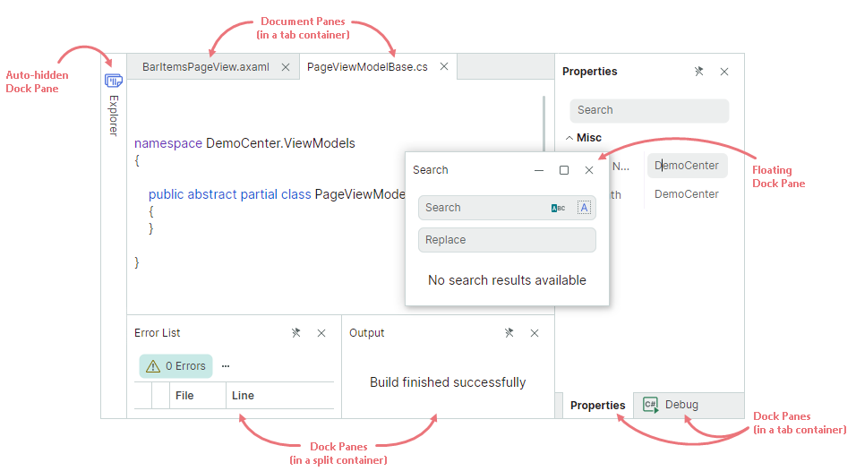
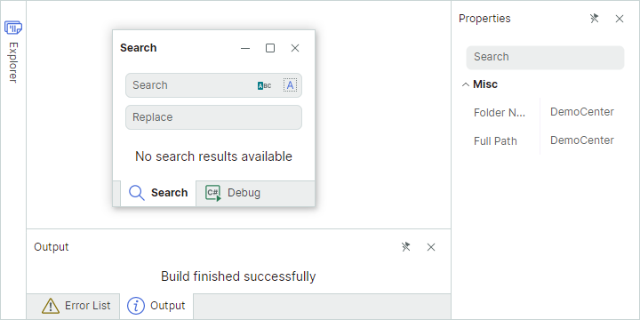
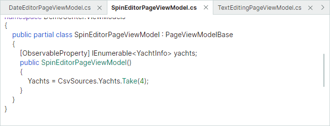
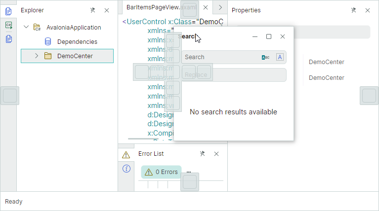
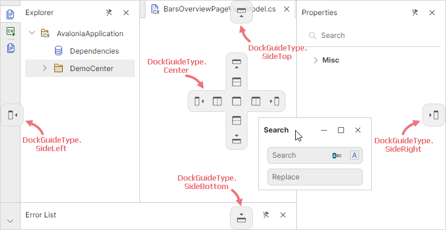
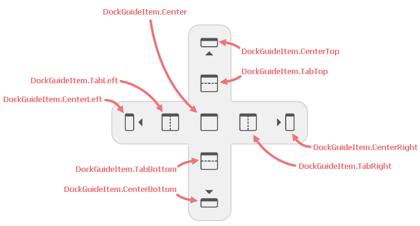
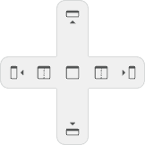
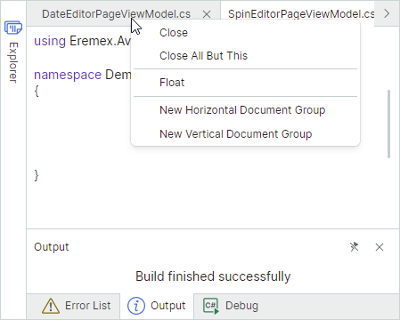
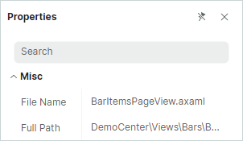

# Dock Manager и элементы докинга

Компонент [`DockManager`](../../API/Eremex.AvaloniaUI.Controls.Docking/DockManager.md) позволяет создавать интерфейс докинга, вдохновлённый Visual Studio. Dock-панели и Document-панели — это базовые элементы интерфейса докинга. Dock-панели используются для реализации инструментальных панелей. Document-панели предназначены для отображения основного содержимого окна. Вы можете объединять несколько Document-панелей в специальном контейнере, чтобы реализовать MDI с вкладками (Multiple Document Interface).




Библиотека докинга поддерживает операции над элементами докинга (панелями и документами) пользователями и в коде. Пользователи могут переупорядочивать размещение элементов докинга и делать их плавающими с помощью перетаскивания и контекстных меню. Разделители между соседними элементами позволяют выполнять операции изменения размера во время работы. Кнопки «Pin» в заголовках панелей поддерживают функцию автоскрытия, которая позволяет пользователю сворачивать и восстанавливать панели. 

С помощью библиотеки докинга вы можете использовать паттерн проектирования MVVM, чтобы заполнять интерфейс докинга Dock-панелями и Document-панелями, а также предоставлять содержимое для панелей.


## Начало работы с интерфейсом докинга

Следующие разделы демонстрируют, как создавать образцовые интерфейсы докинга с нуля:

- [Начало работы с интерфейсом докинга](get-started-with-docking.md) 
- [Как создать сложный макет для докинга в коде](examples/how-to-create-a-complex-docking-layout-in-code-behind.md)


## Dock-панели

Dock-панели (объекты [`DockPane`](../../API/Eremex.AvaloniaUI.Controls.Docking/DockPane.md)) позволяют создавать закрепляемые и плавающие инструментальные панели. Панели можно отображать рядом друг с другом или как вкладки. Они также поддерживают функцию автоскрытия.



Чтобы создать интерфейс докинга в XAML или code-behind, Dock-панели нужно объединить в контейнеры (группы). Например, вы можете объединить элементы в контейнер [`DockGroup`](../../API/Eremex.AvaloniaUI.Controls.Docking/DockGroup.md), чтобы отобразить их рядом друг с другом, горизонтально или вертикально. Если вы объедините панели в контейнер [`TabbedGroup`](../../API/Eremex.AvaloniaUI.Controls.Docking/TabbedGroup.md), они будут отображаться как вкладки. Контейнеры также могут включать другие контейнеры в качестве дочерних элементов.

Чтобы узнать больше, смотрите следующий раздел: [Dock-панели и контейнеры](dock-panes-and-containers.md)


## Document-панели

Используйте Document-панели (объекты [`DocumentPane`](../../API/Eremex.AvaloniaUI.Controls.Docking/DocumentPane.md)), чтобы отображать основное содержимое вашего окна. Если вы создаёте несколько Document-панелей, вы можете объединить их в контейнер [`DocumentGroup`](../../API/Eremex.AvaloniaUI.Controls.Docking/DocumentGroup.md). [`DocumentGroup`](../../API/Eremex.AvaloniaUI.Controls.Docking/DocumentGroup.md) — это специальный контейнер, представляющий Document-панели как вкладки (аналогично контейнеру [`TabbedGroup`](../../API/Eremex.AvaloniaUI.Controls.Docking/TabbedGroup.md), используемому для представления Dock-панелей как вкладок).



Document-панели можно делать плавающими. В отличие от Dock-панелей, Document-панели не поддерживают функцию автоскрытия.

Вы можете создать два или более контейнера [`DocumentGroup`](../../API/Eremex.AvaloniaUI.Controls.Docking/DocumentGroup.md), каждый из которых отображает свой набор Document-панелей.

<animated gif>

Чтобы узнать больше, смотрите следующий раздел: [Document-панели](document-panes.md)

## Направляющие докинга

Когда пользователь перетаскивает Dock-панель или Document-панель над другой панелью или контейнером, DockManager отображает направляющие докинга. Направляющие докинга — это визуальные наложения в виде стрелок, помогающие пользователю при операциях закрепления. Сброс панели или контейнера над определённой направляющей закрепляет элемент в соответствующей позиции.



Если пользователь сбрасывает элемент вне направляющей докинга, элемент становится плавающим.

### Настройка направляющих докинга

Событие [`CustomizeDockGuide`](../../API/Eremex.AvaloniaUI.Controls.Docking/DockManager/CustomizeDockGuide.md) позволяет скрыть отдельные направляющие докинга и отдельные элементы внутри направляющей `Center`. Когда элемент направляющей скрыт, пользователь не может выполнить соответствующую операцию закрепления.

Чтобы скрыть элементы направляющих, используйте следующие методы аргументов события:

- [`HideGuide(DockGuideType guide)`](../../API/Eremex.AvaloniaUI.Controls.Docking/CustomizeDockGuideEventArgs/HideGuide.md) — скрывает направляющую докинга, заданную перечислением `DockGuideType`.

    На следующем изображении показаны доступные типы направляющих докинга:

    

    - `SideLeft`, `SideRight`, `SideTop` и `SideBottom` — панель, сброшенная над этими направляющими, закрепляется у соответствующего края корневого контейнера.
    - `Center` — эта направляющая состоит из 9 внутренних элементов, каждый из которых можно скрыть методом [`HideItem`](../../API/Eremex.AvaloniaUI.Controls.Docking/CustomizeDockGuideEventArgs/HideItem.md).


- [`HideItem(DockGuideItem item)`](../../API/Eremex.AvaloniaUI.Controls.Docking/CustomizeDockGuideEventArgs/HideItem.md) — скрывает элемент внутри направляющей `Center`.

    На следующем изображении показаны доступные элементы направляющей `Center`:

    

    - `Center` — сброшенная панель и целевая панель объединяются в один контейнер с вкладками.
    - `CenterLeft`, `CenterRight`, `CenterTop` и `CenterBottom` — сброшенная панель размещается у соответствующего края целевой панели, образуя разделённый контейнер.
    - `TabLeft`, `TabRight`, `TabTop` и `TabBottom` — сброшенная панель помещается в новый контейнер с вкладками, который размещается у соответствующего края целевой панели.

#### Пример — скрытие направляющих докинга

Этот код обрабатывает событие [`CustomizeDockGuide`](../../API/Eremex.AvaloniaUI.Controls.Docking/DockManager/CustomizeDockGuide.md), чтобы скрыть элементы `TabTop` и `TabBottom` направляющей `Center`.



```csharp
private void DockManager1_CustomizeDockGuide(object sender, Eremex.AvaloniaUI.Controls.Docking.CustomizeDockGuideEventArgs e)
{
    DockGuideItem[] guideItems = new DockGuideItem[] { DockGuideItem.TabTop, DockGuideItem.TabBottom  };
    foreach (var item in guideItems)
    {
        e.HideItem(item);
    }
}
```

## Контекстные меню

Библиотека докинга предоставляет встроенные контекстные меню для Dock-панелей и Document-панелей. Эти меню содержат команды для выполнения распространённых операций докинга над панелями.



Обработайте событие [`DockManager.DockItemContextMenuOpening`](../../API/Eremex.AvaloniaUI.Controls.Docking/DockManager/DockItemContextMenuOpening.md), чтобы настроить контекстные меню или предотвратить их отображение.

<!-- TODO
example for the [`DockManager.DockItemContextMenuOpening`](../../API/Eremex.AvaloniaUI.Controls.Docking/DockManager/DockItemContextMenuOpening.md) event 
 -->

## Предотвращение определённых операций над элементами докинга

Dock-панели и Document-панели отображают в своих заголовках предопределённые кнопки, используемые для выполнения распространённых операций над панелями.



DockManager предоставляет опции и события для управления операциями докинга над панелями. Подробнее смотрите в следующем разделе: [Dock-панели и контейнеры - Опции для dock-панелей во время работы](dock-panes-and-containers.md#опции-для-dock-панелей-во-время-работы)

## Сохранение и восстановление размещения панелей

Вы можете сохранить текущее размещение докинга в поток, а затем восстановить его при необходимости. Эта функция позволяет сохранять размещение, когда пользователь закрывает приложение, и перезагружать сохранённое размещение при следующем запуске приложения. Дополнительную информацию смотрите в следующем разделе: [Сохранение и восстановление размещения панелей](save-and-restore-layout.md)

## Смотрите также

- [Как создать сложный макет для докинга в коде](examples/how-to-create-a-complex-docking-layout-in-code-behind.md)


<br>
<br>

<sup>*</sup> Эта страница переведена с использованием технологий машинного перевода.
