# Document-панели

Объекты Document-панелей ([`DocumentPane`](../../API/Eremex.AvaloniaUI.Controls.Docking/DocumentPane.md)) позволяют создавать MDI с вкладками (Multiple Document Interface) в вашем приложении. Document-панели предназначены для отображения основного содержимого вашего окна. 
Когда вы объединяете их в контейнер [`DocumentGroup`](../../API/Eremex.AvaloniaUI.Controls.Docking/DocumentGroup.md), они отображаются как вкладки.

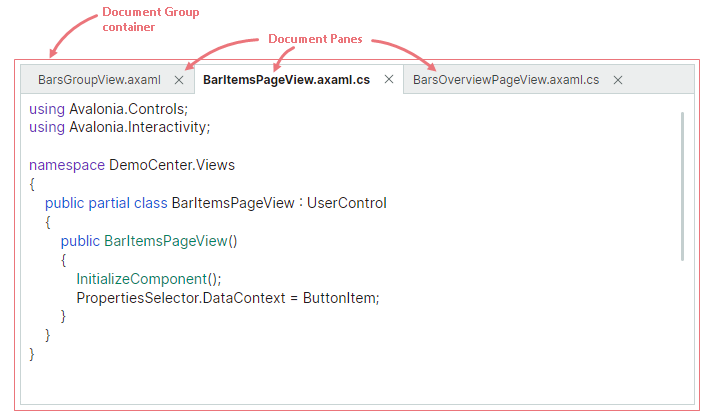

Перетаскивание и контекстные меню позволяют изменять порядок Document-панелей, перемещать Document-панели в другой контейнер или делать их плавающими.

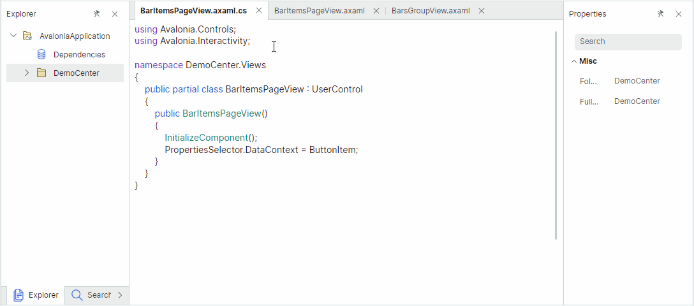

Вы также можете добавлять обычные [Dock-панели](dock-panes-and-containers.md) в контейнер [`DocumentGroup`](../../API/Eremex.AvaloniaUI.Controls.Docking/DocumentGroup.md). Все элементы, добавленные в контейнер [`DocumentGroup`](../../API/Eremex.AvaloniaUI.Controls.Docking/DocumentGroup.md), отображаются как вкладки.

[`DocumentPane`](../../API/Eremex.AvaloniaUI.Controls.Docking/DocumentPane.md) и [`DockPane`](../../API/Eremex.AvaloniaUI.Controls.Docking/DockPane.md) имеют много общих функций, поскольку [`DocumentPane`](../../API/Eremex.AvaloniaUI.Controls.Docking/DocumentPane.md) является потомком класса [`DockPane`](../../API/Eremex.AvaloniaUI.Controls.Docking/DockPane.md). [`DocumentGroup`](../../API/Eremex.AvaloniaUI.Controls.Docking/DocumentGroup.md) является потомком [TabbedGroup](dock-panes-and-containers.md#вкладки). Таким образом, эти объекты имеют много общих функций.

Как и dock-панели, объекты [`DocumentPane`](../../API/Eremex.AvaloniaUI.Controls.Docking/DocumentPane.md) и [`DocumentGroup`](../../API/Eremex.AvaloniaUI.Controls.Docking/DocumentGroup.md) можно объединять с другими элементами докинга в [сплит-контейнере](dock-panes-and-containers.md#разделённые-панели) (контейнере [`DockGroup`](../../API/Eremex.AvaloniaUI.Controls.Docking/DockGroup.md)), который располагает дочерние элементы рядом друг с другом, горизонтально или вертикально.

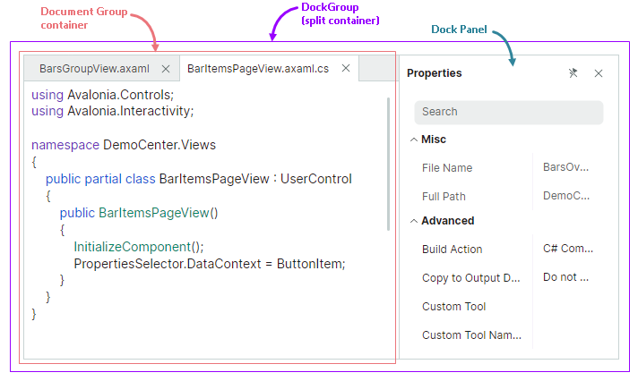

Следующий XAML-код создаёт размещение элементов докинга, показанное на изображении выше.

``` xml
xmlns:mxd="https://schemas.eremexcontrols.net/avalonia/docking"

<mxd:DockManager>
    <mxd:DockGroup Orientation="Horizontal">
        <mxd:DocumentGroup>
            <mxd:DocumentPane Header="BarsGroupView.axaml"/>
            <mxd:DocumentPane Header="BarItemsPageView.axaml"/>
        </mxd:DocumentGroup>
        <mxd:DockPane Header="Properties"/>
    </mxd:DockGroup>
</mxd:DockManager>
```

Функция автоскрытия не поддерживается для объектов [`DocumentPane`](../../API/Eremex.AvaloniaUI.Controls.Docking/DocumentPane.md) и [`DocumentGroup`](../../API/Eremex.AvaloniaUI.Controls.Docking/DocumentGroup.md).

## Использование MVVM для создания интерфейса докинга

Вы можете использовать паттерн проектирования MVVM, чтобы заполнять интерфейс докинга элементами (Dock-панелями и Document-панелями). Используйте для этого следующие члены API:

- [`DockManager.ItemsSource`](../../API/Eremex.AvaloniaUI.Controls.Docking/DockManager/ItemsSource.md) — задаёт список объектов, которые нужно отрисовать как элементы докинга.
- [`DockManager.ItemTemplate`](../../API/Eremex.AvaloniaUI.Controls.Docking/DockManager/ItemTemplate.md) — задаёт шаблон, используемый для отрисовки объектов из списка [`DockManager.ItemsSource`](../../API/Eremex.AvaloniaUI.Controls.Docking/DockManager/ItemsSource.md) как элементов докинга.

Дополнительную информацию смотрите в разделе [Использование паттерна MVVM для заполнения элементами закрепления](use-mvvm-pattern-to-populate-dock-items.md).


## Содержимое и размер Document-панели


### Задание содержимого

Вы можете использовать унаследованное свойство [`DockPane.Content`](../../API/Eremex.AvaloniaUI.Controls.Docking/DockPane/Content.md), чтобы определить содержимое Document-панели в коде. В XAML вы можете определить содержимое панели между открывающим и закрывающим тегами __&lt;DocumentPane&gt;__.

Унаследованное свойство [`DockPane.ContentTemplate`](../../API/Eremex.AvaloniaUI.Controls.Docking/DockPane/ContentTemplate.md) позволяет задать шаблон, используемый для отрисовки объекта [`Content`](../../API/Eremex.AvaloniaUI.Controls.Docking/DockPane/Content.md).


### Задание размера

Для элементов докинга (панелей и контейнеров), отображаемых внутри [сплит-контейнеров](dock-panes-and-containers.md#разделённые-панели) (объектов [`DockGroup`](../../API/Eremex.AvaloniaUI.Controls.Docking/DockGroup.md)), следующие свойства позволяют задать размер элемента:

- [`DockWidth`](../../API/Eremex.AvaloniaUI.Controls.Docking/DockItemBase/DockWidth.md) (для панелей, расположенных горизонтально в родительских контейнерах)
- [`DockHeight`](../../API/Eremex.AvaloniaUI.Controls.Docking/DockItemBase/DockHeight.md) (для панелей, расположенных вертикально в родительских контейнерах)

!!! note

    Document-панели отображаются как вкладки, когда находятся внутри контейнера Document Group. Вы можете изменить только размер контейнера Document Group, но не размер его дочерних Document-панелей. Вы можете задать размер отдельных Document-панелей, если они не отображаются как вкладки.

Этот пример располагает [`DocumentGroup`](../../API/Eremex.AvaloniaUI.Controls.Docking/DocumentGroup.md) и [`DockPane`](../../API/Eremex.AvaloniaUI.Controls.Docking/DockPane.md) горизонтально в сплит-контейнере и задаёт ширину [`DocumentGroup`](../../API/Eremex.AvaloniaUI.Controls.Docking/DocumentGroup.md) равной 4-кратной ширине [`DockPane`](../../API/Eremex.AvaloniaUI.Controls.Docking/DockPane.md).

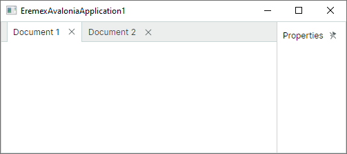

``` xml
xmlns:mxd="https://schemas.eremexcontrols.net/avalonia/docking"

<mxd:DockManager Grid.Row="1" Name="dockManager1">
    <mxd:DockGroup Orientation="Horizontal">
        <mxd:DocumentGroup DockWidth="4*">
            <mxd:DocumentPane Name="documentPane1" Header="Document 1"/>
            <mxd:DocumentPane Name="documentPane2" Header="Document 2"/>
        </mxd:DocumentGroup>
        <mxd:DockPane DockWidth="*" Header="Properties"/>
    </mxd:DockGroup>
</mxd:DockManager>
```

Свойства [`DockWidth`](../../API/Eremex.AvaloniaUI.Controls.Docking/DockItemBase/DockWidth.md) и [`DockHeight`](../../API/Eremex.AvaloniaUI.Controls.Docking/DockItemBase/DockHeight.md) не влияют на размер Document-панелей в плавающем состоянии. Чтобы узнать больше, смотрите следующую ссылку:

- [Задание плавающих границ](#задание-плавающих-границ)


### Задание параметров заголовка

Используйте унаследованные свойства [`DockPane.Header`](../../API/Eremex.AvaloniaUI.Controls.Docking/DockPane/Header.md) и [`DockPane.HeaderTemplate`](../../API/Eremex.AvaloniaUI.Controls.Docking/DockPane/HeaderTemplate.md), чтобы задать заголовки для Document-панелей. Чтобы отображать изображения, используйте унаследованные свойства [`DockPane.Glyph`](../../API/Eremex.AvaloniaUI.Controls.Docking/DockPane/Glyph.md) и [`DockPane.GlyphSize`](../../API/Eremex.AvaloniaUI.Controls.Docking/DockPane/GlyphSize.md).

Как правило, Document-панели размещаются внутри контейнера [`DocumentGroup`](../../API/Eremex.AvaloniaUI.Controls.Docking/DocumentGroup.md), в котором они отображаются как вкладки. В этом случае вы также можете использовать унаследованные свойства [`DockPane.TabHeader`](../../API/Eremex.AvaloniaUI.Controls.Docking/DockPane/TabHeader.md), [`DockPane.TabHeaderTemplate`](../../API/Eremex.AvaloniaUI.Controls.Docking/DockPane/TabHeaderTemplate.md), [`DockPane.TabGlyph`](../../API/Eremex.AvaloniaUI.Controls.Docking/DockPane/TabGlyph.md) и [`DockPane.TabGlyphSize`](../../API/Eremex.AvaloniaUI.Controls.Docking/DockPane/TabGlyphSize.md), чтобы задать текст заголовка и изображения. Если эти свойства не заданы, свойства [`DockPane.Header`](../../API/Eremex.AvaloniaUI.Controls.Docking/DockPane/Header.md), [`DockPane.HeaderTemplate`](../../API/Eremex.AvaloniaUI.Controls.Docking/DockPane/HeaderTemplate.md), [`DockPane.Glyph`](../../API/Eremex.AvaloniaUI.Controls.Docking/DockPane/Glyph.md) и [`DockPane.GlyphSize`](../../API/Eremex.AvaloniaUI.Controls.Docking/DockPane/GlyphSize.md) определяют текст и изображения, отображаемые во вкладках.


#### Связанный API

- [`DockPane.ShowGlyphMode`](../../API/Eremex.AvaloniaUI.Controls.Docking/DockPane/ShowGlyphMode.md) — задаёт видимость и положение глифа в заголовке панели.
- [`DockPane.ShowTabGlyphMode`](../../API/Eremex.AvaloniaUI.Controls.Docking/DockPane/ShowTabGlyphMode.md) — задаёт видимость и положение глифа во вкладке, когда панель размещена в контейнере вкладок (например, [`DocumentGroup`](../../API/Eremex.AvaloniaUI.Controls.Docking/DocumentGroup.md)).


## Создание интерфейса с вкладками

Вы можете объединять Document-панели в контейнер [`DocumentGroup`](../../API/Eremex.AvaloniaUI.Controls.Docking/DocumentGroup.md), чтобы создать MDI с вкладками (Multiple Document Interface). [`DocumentGroup`](../../API/Eremex.AvaloniaUI.Controls.Docking/DocumentGroup.md), как и его предок ([`TabbedGroup`](../../API/Eremex.AvaloniaUI.Controls.Docking/TabbedGroup.md)), — это контейнер, который представляет свои дочерние элементы как вкладки. 

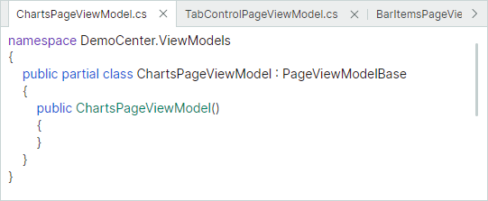

Этот пример создаёт контейнер [`DocumentGroup`](../../API/Eremex.AvaloniaUI.Controls.Docking/DocumentGroup.md) с тремя объектами [`DocumentPane`](../../API/Eremex.AvaloniaUI.Controls.Docking/DocumentPane.md).

``` xml
xmlns:mxd="https://schemas.eremexcontrols.net/avalonia/docking"

<mxd:DocumentGroup Name="documentGroup1" DockWidth="5*" >
    <mxd:DocumentPane Name="document1" Header="Document 1"></mxd:DocumentPane>
    <mxd:DocumentPane Name="document2" Header="Document 2"></mxd:DocumentPane>
    <mxd:DocumentPane Name="document3" Header="Document 3"></mxd:DocumentPane>
</mxd:DocumentGroup>
```

Чтобы объединить Document-панели в контейнер вкладок в code-behind, используйте метод [`DockManager.Dock`](../../API/Eremex.AvaloniaUI.Controls.Docking/DockManager/Dock.md) с параметром _dockType_, установленным в [`DockType.Fill`](../../API/Eremex.AvaloniaUI.Controls.ApplicationServices/DockType.md). Если вы закрепляете документ в другом документе, который уже размещён в контейнере вкладок, исходная панель отображается как дополнительная вкладка внутри контейнера вкладок.

``` csharp
// Закрепить документ в другом документе
dockManager1.Dock(document4, document1, DockType.Fill);
// или закрепить документ в группе:
dockManager1.Dock(document5, documentGroup1, DockType.Fill);
```

### Доступ к контейнеру вкладок

Для Document-панелей, находящихся в контейнере [`DocumentGroup`](../../API/Eremex.AvaloniaUI.Controls.Docking/DocumentGroup.md), используйте унаследованное свойство [`DockPane.DockParent`](../../API/Eremex.AvaloniaUI.Controls.Docking/DockItemBase/DockParent.md), чтобы вернуть родительский контейнер вкладок.


### Связанный API

Следующий список показывает часто используемые члены API, позволяющие настраивать объекты [`DocumentPane`](../../API/Eremex.AvaloniaUI.Controls.Docking/DocumentPane.md) и [`DocumentGroup`](../../API/Eremex.AvaloniaUI.Controls.Docking/DocumentGroup.md). Большинство этих настроек унаследованы от базовых классов объектов.

- [`DockManager.Dock`](../../API/Eremex.AvaloniaUI.Controls.Docking/DockManager/Dock.md) — позволяет закрепить элемент (например, объект [`DocumentPane`](../../API/Eremex.AvaloniaUI.Controls.Docking/DocumentPane.md)) в другом элементе. Установите параметр _dockType_ метода в [`DockType.Fill`](../../API/Eremex.AvaloniaUI.Controls.ApplicationServices/DockType.md), чтобы создать контейнер вкладок.
- [`DockItemBase.DockParent`](../../API/Eremex.AvaloniaUI.Controls.Docking/DockItemBase/DockParent.md) — позволяет получить непосредственного родителя объекта докинга. Для объектов [`DocumentPane`](../../API/Eremex.AvaloniaUI.Controls.Docking/DocumentPane.md), объединённых в контейнер [`DocumentGroup`](../../API/Eremex.AvaloniaUI.Controls.Docking/DocumentGroup.md), свойство [`DockParent`](../../API/Eremex.AvaloniaUI.Controls.Docking/DockItemBase/DockParent.md) возвращает этот контейнер.
- [`DockPane.CloseCommand`](../../API/Eremex.AvaloniaUI.Controls.Docking/DockPane/CloseCommand.md) — команда, вызываемая при закрытии панели. Панель можно закрыть щелчком по кнопке «Close» (см. [`DockPane.AllowClose`](../../API/Eremex.AvaloniaUI.Controls.Docking/DockPane/AllowClose.md) и [`TabbedGroup.CloseButtonShowMode`](../../API/Eremex.AvaloniaUI.Controls.Docking/TabbedGroup/CloseButtonShowMode.md)). 
Закрытые панели доступны из коллекции [`DockManager.ClosedPanes`](../../API/Eremex.AvaloniaUI.Controls.Docking/DockManager/ClosedPanes.md).
- [`DockPane.ShowTabGlyphMode`](../../API/Eremex.AvaloniaUI.Controls.Docking/DockPane/ShowTabGlyphMode.md) — задаёт видимость и положение глифа в заголовке панели (вкладке), когда панель размещена в контейнере вкладок.
- [`DockPane.TabGlyphSize`](../../API/Eremex.AvaloniaUI.Controls.Docking/DockPane/TabGlyphSize.md) — задаёт размер глифа вкладки ([`DockPane.TabGlyph`](../../API/Eremex.AvaloniaUI.Controls.Docking/DockPane/TabGlyph.md)). Это свойство действует, когда панель размещена в контейнере вкладок.
- [`DockPane.TabGlyph`](../../API/Eremex.AvaloniaUI.Controls.Docking/DockPane/TabGlyph.md) — задаёт глиф, отображаемый во вкладке. Это свойство действует, когда панель размещена в контейнере вкладок.
- [`DockPane.TabHeaderTemplate`](../../API/Eremex.AvaloniaUI.Controls.Docking/DockPane/TabHeaderTemplate.md) — задаёт шаблон для отрисовки вкладки. Это свойство действует, когда панель размещена в контейнере вкладок.
- [`DockPane.TabHeader`](../../API/Eremex.AvaloniaUI.Controls.Docking/DockPane/TabHeader.md) — задаёт текст для отображения во вкладке. Это свойство действует, когда панель размещена в контейнере вкладок.

- [`TabbedGroup.AllowFloat`](../../API/Eremex.AvaloniaUI.Controls.Docking/TabbedGroup/AllowFloat.md) — задаёт, может ли пользователь сделать контейнер вкладок плавающим.
- [`TabbedGroup.CloseButtonShowMode`](../../API/Eremex.AvaloniaUI.Controls.Docking/TabbedGroup/CloseButtonShowMode.md) — задаёт, отображать ли кнопки «Close» для дочерних панелей в области вкладок и где именно: нигде в области вкладок, в каждой панели, в активной панели или в области полосы вкладок. Свойство [`TabbedGroup.CloseButtonShowMode`](../../API/Eremex.AvaloniaUI.Controls.Docking/TabbedGroup/CloseButtonShowMode.md) не влияет на отображение кнопки «Close» в заголовке панели. См. [Закрытие панелей](#закрытие-document-панелей).
- [`TabbedGroup.SelectTabOnClose`](../../API/Eremex.AvaloniaUI.Controls.Docking/TabbedGroup/SelectTabOnClose.md) — задаёт, какая вкладка выбирается при закрытии вкладки: недавно открытая вкладка, следующая или предыдущая вкладка.
- [`TabbedGroup.SelectedIndex`](../../API/Eremex.AvaloniaUI.Controls.Docking/TabbedGroup/SelectedIndex.md) — задаёт индекс (начиная с нуля) выбранной вкладки в текущем контейнере вкладок. Вы можете использовать свойство [`SelectedIndex`](../../API/Eremex.AvaloniaUI.Controls.Docking/TabbedGroup/SelectedIndex.md), чтобы выбрать конкретную вкладку.
- [`TabbedGroup.ShowTabStripForSingleChild`](../../API/Eremex.AvaloniaUI.Controls.Docking/TabbedGroup/ShowTabStripForSingleChild.md) — задаёт, отображать ли полосу вкладок, когда контейнер вкладок содержит один дочерний элемент. Если это свойство установлено в `true`, полоса вкладок отображается только если контейнер владеет двумя или более дочерними элементами.
- [`TabbedGroup.TabHeaderOrientation`](../../API/Eremex.AvaloniaUI.Controls.Docking/TabbedGroup/TabHeaderOrientation.md) — задаёт, располагать ли вкладки горизонтально или вертикально. В режиме [`TabHeaderOrientation.Auto`](../../API/Eremex.AvaloniaUI.Controls/TabHeaderOrientation.md) вкладки располагаются горизонтально, если свойство [`TabbedGroup.TabStripPlacement`](../../API/Eremex.AvaloniaUI.Controls.Docking/TabbedGroup/TabStripPlacement.md) установлено в `Top` или `Bottom`. Вкладки располагаются вертикально, если свойство [`TabbedGroup.TabStripPlacement`](../../API/Eremex.AvaloniaUI.Controls.Docking/TabbedGroup/TabStripPlacement.md) установлено в `Left` или `Right`.
- [`TabbedGroup.TabStripLayoutType`](../../API/Eremex.AvaloniaUI.Controls.Docking/TabbedGroup/TabStripLayoutType.md) — задаёт, как отображаются вкладки. [`TabStripLayoutType.Scroll`](../../API/Eremex.AvaloniaUI.Controls/TabStripLayoutType.md) — заголовки вкладок достаточно широки, чтобы отобразить их содержимое. Кнопки прокрутки появляются в области заголовков вкладок, если недостаточно места для отображения всех заголовков вкладок целиком. [`TabStripLayoutType.Stretch`](../../API/Eremex.AvaloniaUI.Controls/TabStripLayoutType.md) — все заголовки вкладок располагаются в одну линию, растягиваясь, чтобы заполнить ширину контрола. Они имеют одинаковую ширину или высоту в зависимости от положения полосы вкладок (см. [`TabbedGroup.TabStripPlacement`](../../API/Eremex.AvaloniaUI.Controls.Docking/TabbedGroup/TabStripPlacement.md)). [`TabStripLayoutType.MultiLine`](../../API/Eremex.AvaloniaUI.Controls/TabStripLayoutType.md) — заголовки вкладок располагаются в несколько строк, если недостаточно места для их отображения в одну строку.
- [`TabbedGroup.TabStripPlacement`](../../API/Eremex.AvaloniaUI.Controls.Docking/TabbedGroup/TabStripPlacement.md) — задаёт край, вдоль которого отображаются вкладки.


## Активация Document-панелей

Унаследованное свойство [`DockPane.IsActive`](../../API/Eremex.AvaloniaUI.Controls.Docking/DockPane/IsActive.md) Document-панели позволяет переместить фокус на конкретную Document-панель. Используйте свойство [`DockManager.ActiveDockItem`](../../API/Eremex.AvaloniaUI.Controls.Docking/DockManager/ActiveDockItem.md), чтобы получить активный элемент докинга.

Когда Document-панели объединены в контейнер [`DocumentGroup`](../../API/Eremex.AvaloniaUI.Controls.Docking/DocumentGroup.md), вы можете использовать свойство [`DocumentGroup.SelectedIndex`](../../API/Eremex.AvaloniaUI.Controls.Docking/TabbedGroup/SelectedIndex.md), чтобы выбрать конкретную Document-панель.

## Закрытие Document-панелей

Когда Document-панели размещены внутри контейнера [`DocumentGroup`](../../API/Eremex.AvaloniaUI.Controls.Docking/DocumentGroup.md), они отображают кнопки «Close» во вкладках. Кнопки «Close» позволяют пользователю закрывать панели. В коде вы можете закрыть панель методом [`DockManager.Close`](../../API/Eremex.AvaloniaUI.Controls.Docking/DockManager/Close.md).

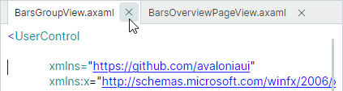

Используйте свойство [`DockPane.AllowClose`](../../API/Eremex.AvaloniaUI.Controls.Docking/DockPane/AllowClose.md), чтобы скрыть кнопку «Close» для панели и тем самым предотвратить закрытие панели этой кнопкой.

Когда панель закрывается, активируется унаследованная команда [`DockPane.CloseCommand`](../../API/Eremex.AvaloniaUI.Controls.Docking/DockPane/CloseCommand.md). 

Все закрытые панели доступны из коллекции [`DockManager.ClosedPanes`](../../API/Eremex.AvaloniaUI.Controls.Docking/DockManager/ClosedPanes.md). 

Паттерн проектирования MVVM позволяет предоставлять Document-панели из коллекции [`DockManager.ItemsSource`](../../API/Eremex.AvaloniaUI.Controls.Docking/DockManager/ItemsSource.md). При закрытии Document-панели вы можете удалить панель из коллекции [`DockManager.ItemsSource`](../../API/Eremex.AvaloniaUI.Controls.Docking/DockManager/ItemsSource.md). В этом случае панель также удаляется из коллекции [`DockManager.ClosedPanes`](../../API/Eremex.AvaloniaUI.Controls.Docking/DockManager/ClosedPanes.md).

Следующий код из демонстрационного примера «IDE Layout» показывает, как задать команду [`CloseCommand`](../../API/Eremex.AvaloniaUI.Controls.Docking/DockPane/CloseCommand.md) для вновь открытого документа. Эта команда удаляет панель из коллекции _Documents_ ([`DockManager.ItemsSource`](../../API/Eremex.AvaloniaUI.Controls.Docking/DockManager/ItemsSource.md)). Полный пример смотрите в демонстрационном примере «IDE Layout».

``` csharp
public void Open(SolutionFile solutionFile)
{
    var document = Documents.FirstOrDefault(x => x.Uri == solutionFile.Uri);
    if (document == null)
    {
        document = new IdeLayoutDocumentViewModel
        {
            Header = solutionFile.Filename,
            Uri = solutionFile.Uri
        };
        document.CloseCommand = new RelayCommand(() => Documents.Remove(document));
        Documents.Add(document);
    }
    document.IsActive = true;
}
```

Свойство [`CloseButtonShowMode`](../../API/Eremex.AvaloniaUI.Controls.Docking/TabbedGroup/CloseButtonShowMode.md) контейнера [`DocumentGroup`](../../API/Eremex.AvaloniaUI.Controls.Docking/DocumentGroup.md) позволяет отображать дополнительные кнопки «Close» в области полосы вкладок. Вы можете отображать кнопки «Close» во всех вкладках, в активной вкладке или в области полосы вкладок.  Изображение ниже показывает кнопку «Close» в области полосы вкладок (свойство [`CloseButtonShowMode`](../../API/Eremex.AvaloniaUI.Controls.Docking/TabbedGroup/CloseButtonShowMode.md) установлено в `TabControlCloseButtonShowMode.InHeaderPanel`).

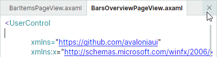

Событие [`DockManager.DockOperationStarting`](../../API/Eremex.AvaloniaUI.Controls.Docking/DockManager/DockOperationStarting.md) позволяет предотвратить закрытие определённых панелей или выполнить пользовательские действия при закрытии панелей. Это событие не возникает, если панель удаляется из коллекции [`DockManager.ItemsSource`](../../API/Eremex.AvaloniaUI.Controls.Docking/DockManager/ItemsSource.md) при закрытии панели.


## Опции для Document-панелей во время работы

Объекты [`DocumentPane`](../../API/Eremex.AvaloniaUI.Controls.Docking/DocumentPane.md) содержат настройки, позволяющие отключать определённые пользовательские операции во время работы. Эти настройки унаследованы от базового класса [`DockPane`](../../API/Eremex.AvaloniaUI.Controls.Docking/DockPane.md).

- [`DockPane.AllowClose`](../../API/Eremex.AvaloniaUI.Controls.Docking/DockPane/AllowClose.md) — возвращает или задаёт, может ли пользователь закрыть панель. Установите это свойство в `false`, чтобы скрыть кнопку `x` (закрытия) панели. См. [Закрытие Document-панелей](#закрытие-document-панелей).
- [`DockPane.AllowFloat`](../../API/Eremex.AvaloniaUI.Controls.Docking/DockPane/AllowFloat.md) — возвращает или задаёт, может ли пользователь сделать панель плавающей. См. [Плавающие Document-панели](#плавающие-document-панели).
- [`DockPane.AllowMaximize`](../../API/Eremex.AvaloniaUI.Controls.Docking/DockPane/AllowMaximize.md) — задаёт видимость кнопки «Maximize» для панели в плавающем состоянии.
- [`DockPane.AllowMinimize`](../../API/Eremex.AvaloniaUI.Controls.Docking/DockPane/AllowMinimize.md) — задаёт видимость кнопки «Minimize» для панели в плавающем состоянии.

Эти опции не мешают вам выполнять соответствующие операции над панелями в коде.

Вы также можете обработать событие [`DockManager.DockOperationStarting`](../../API/Eremex.AvaloniaUI.Controls.Docking/DockManager/DockOperationStarting.md), чтобы динамически предотвращать определённые операции докинга или выполнять пользовательскую логику при их возникновении.


### Пример - предотвращение перехода Document-панелей в плавающее состояние

Этот пример показывает, как отключить плавающее состояние для document-панелей. Код ниже обрабатывает событие [`DockManager.RegisterDockItem`](../../API/Eremex.AvaloniaUI.Controls.Docking/DockManager/RegisterDockItem.md), чтобы отключить опцию [`AllowFloat`](../../API/Eremex.AvaloniaUI.Controls.Docking/DockPane/AllowFloat.md) для вновь создаваемых документов.

``` cs
private void DockManager_RegisterDockItem(object sender, Eremex.AvaloniaUI.Controls.Docking.DockItemEventArgs e)
{
    if(e.Item is DocumentPane document)
    {
        document.AllowFloat = false;
    }
}
```


## Плавающие Document-панели


Как и Dock-панели, Document-панели можно делать плавающими. В плавающем состоянии пользователь может перемещать Document-панель в пределах доступного пространства экрана. Плавающие документы размещаются в плавающих окнах.

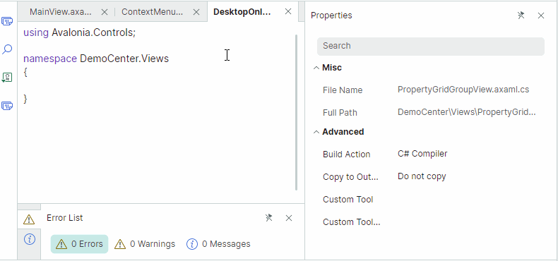

Этот пример показывает, как предотвратить переход документов в плавающее состояние:

- [Пример - предотвращение перехода Document-панелей в плавающее состояние](#пример---предотвращение-перехода-document-панелей-в-плавающее-состояние)

### Доступ к плавающему окну 

Когда панель делается плавающей, создаётся плавающее окно (контейнер), в котором размещается эта панель. Плавающие окна инкапсулируются объектами [`FloatGroup`](../../API/Eremex.AvaloniaUI.Controls.Docking/FloatGroup.md). Вы можете обратиться к родительскому плавающему окну панели с помощью свойства панели [`DockItemBase.FloatGroup`](../../API/Eremex.AvaloniaUI.Controls.Docking/DockItemBase/FloatGroup.md). Это свойство возвращает **null**, если панель не в плавающем состоянии.

Вы можете использовать следующие члены API, чтобы задать местоположение, размер, заголовок и глиф плавающего окна:

- [`FloatGroup.FloatHeight`](../../API/Eremex.AvaloniaUI.Controls.Docking/FloatGroup/FloatHeight.md)
- [`FloatGroup.FloatLocation`](../../API/Eremex.AvaloniaUI.Controls.Docking/FloatGroup/FloatLocation.md)
- [`FloatGroup.FloatWidth`](../../API/Eremex.AvaloniaUI.Controls.Docking/FloatGroup/FloatWidth.md)
- [`FloatGroup.Glyph`](../../API/Eremex.AvaloniaUI.Controls.Docking/FloatGroup/Glyph.md)
- [`FloatGroup.Header`](../../API/Eremex.AvaloniaUI.Controls.Docking/FloatGroup/Header.md)
- [`FloatGroup.HeaderTemplate`](../../API/Eremex.AvaloniaUI.Controls.Docking/FloatGroup/HeaderTemplate.md)
- `DockManager.DefaultFloatGroupHeader`
- `DockManager.DefaultFloatGroupGlyph`

### Как делать Document-панели плавающими

Чтобы определить плавающую Document-панель в XAML, добавьте объект [`FloatGroup`](../../API/Eremex.AvaloniaUI.Controls.Docking/FloatGroup.md) в коллекцию [`DockManager.FloatGroups`](../../API/Eremex.AvaloniaUI.Controls.Docking/DockManager/FloatGroups.md), а затем добавьте панель [`DocumentPane`](../../API/Eremex.AvaloniaUI.Controls.Docking/DocumentPane.md) в объект [`FloatGroup`](../../API/Eremex.AvaloniaUI.Controls.Docking/FloatGroup.md). Вы также можете обернуть объект [`DocumentPane`](../../API/Eremex.AvaloniaUI.Controls.Docking/DocumentPane.md) в контейнер [`DocumentGroup`](../../API/Eremex.AvaloniaUI.Controls.Docking/DocumentGroup.md), чтобы отобразить документ как вкладку.

Используйте метод [`DockManager.Float`](../../API/Eremex.AvaloniaUI.Controls.Docking/DockManager/Float.md), чтобы создать плавающий элемент докинга в коде.

#### Пример - определение плавающих документов в XAML

Этот пример создаёт два плавающих окна. Первое окно содержит объект [`DocumentPane`](../../API/Eremex.AvaloniaUI.Controls.Docking/DocumentPane.md). Второе окно отображает контейнер [`DocumentGroup`](../../API/Eremex.AvaloniaUI.Controls.Docking/DocumentGroup.md) с объектом [`DocumentPane`](../../API/Eremex.AvaloniaUI.Controls.Docking/DocumentPane.md).

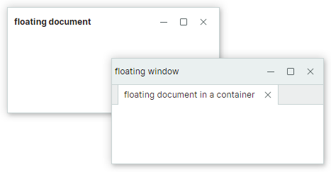

``` xml
<mxd:DockManager.FloatGroups>
    <mxd:FloatGroup FloatLocation="200,200" FloatWidth="300" FloatHeight="150" >
        <mxd:DocumentPane Header="floating document"></mxd:DocumentPane>
    </mxd:FloatGroup>
    <mxd:FloatGroup FloatLocation="400,400" FloatWidth="300" FloatHeight="150" Header="floating window">
        <mxd:DocumentGroup>
            <mxd:DocumentPane Header="floating document in a container"></mxd:DocumentPane>
        </mxd:DocumentGroup>
    </mxd:FloatGroup>
</mxd:DockManager.FloatGroups>
```

#### Пример - создание плавающих документов и настройка плавающего окна в code-behind

Код ниже делает активный документ плавающим и задаёт границы и заголовок для созданного плавающего окна. 

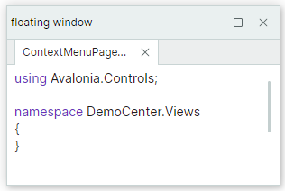

``` csharp
DocumentPane document = dockManager1.ActiveDockItem as DocumentPane;
if(document != null)
{
    dockManager1.Float(document);
    FloatGroup floatingWindow = document.FloatGroup;
    floatingWindow.FloatWidth = 300;
    floatingWindow.FloatHeight = 200;
    floatingWindow.Header = "floating window";
    document.FloatGroup.FloatLocation = dockManager1.PointToScreen(
        new Point(dockManager1.Bounds.Right - floatingWindow.FloatWidth,
        dockManager1.Bounds.Bottom - floatingWindow.FloatHeight));
}
```


### Задание заголовка и глифа плавающего окна

Когда Document-панель делается плавающей, создаётся плавающее окно ([`FloatGroup`](../../API/Eremex.AvaloniaUI.Controls.Docking/FloatGroup.md)) для размещения этого документа. Заголовок этого плавающего окна изначально пуст. 

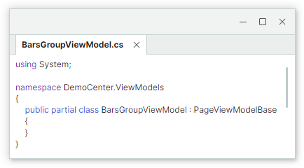


Вы можете использовать следующие свойства, чтобы задать содержимое заголовка плавающего окна:

- [`FloatGroup.Glyph`](../../API/Eremex.AvaloniaUI.Controls.Docking/FloatGroup/Glyph.md) — изображение для отображения в заголовке.
- [`FloatGroup.GlyphSize`](../../API/Eremex.AvaloniaUI.Controls.Docking/FloatGroup/GlyphSize.md) — размер изображения.
- [`FloatGroup.Header`](../../API/Eremex.AvaloniaUI.Controls.Docking/FloatGroup/Header.md) — объект для отрисовки в заголовке. Используйте [`FloatGroup.WindowTitle`](../../API/Eremex.AvaloniaUI.Controls.Docking/FloatGroup/WindowTitle.md), чтобы задать строку для отображения в заголовке вместо объекта.
- [`FloatGroup.HeaderTemplate`](../../API/Eremex.AvaloniaUI.Controls.Docking/FloatGroup/HeaderTemplate.md) — шаблон для отрисовки объекта [`FloatGroup.Header`](../../API/Eremex.AvaloniaUI.Controls.Docking/FloatGroup/Header.md).
- [`FloatGroup.ShowGlyphMode`](../../API/Eremex.AvaloniaUI.Controls.Docking/FloatGroup/ShowGlyphMode.md) — возвращает или задаёт положение и видимость изображения [`FloatGroup.Glyph`](../../API/Eremex.AvaloniaUI.Controls.Docking/FloatGroup/Glyph.md) в заголовке.
- [`FloatGroup.WindowIcon`](../../API/Eremex.AvaloniaUI.Controls.Docking/FloatGroup/WindowIcon.md) — объект [`WindowIcon`](../../API/Eremex.AvaloniaUI.Controls.Docking/FloatGroup/WindowIcon.md), представляющий значок для отрисовки в заголовке. Если [`WindowIcon`](../../API/Eremex.AvaloniaUI.Controls.Docking/FloatGroup/WindowIcon.md) не задан, заголовок отображает изображение, заданное свойством `Glyph`.
- [`FloatGroup.WindowTitle`](../../API/Eremex.AvaloniaUI.Controls.Docking/FloatGroup/WindowTitle.md) — текст для отрисовки в заголовке. Если [`WindowTitle`](../../API/Eremex.AvaloniaUI.Controls.Docking/FloatGroup/WindowTitle.md) не задан, заголовок отображает текстовое представление объекта `Header`.


Плавающие окна создаются динамически, когда панели делаются плавающими. Чтобы инициализировать свойства этих динамически создаваемых плавающих окон, обработайте событие [`DockManager.RegisterDockItem`](../../API/Eremex.AvaloniaUI.Controls.Docking/DockManager/RegisterDockItem.md).


``` cs
private void DockManager1_RegisterDockItem(object sender, Eremex.AvaloniaUI.Controls.Docking.DockItemEventArgs e)
{
    if (e.Item is FloatGroup floatGroup)
    {
        floatGroup.Header = "Demo App";
    }
}
```

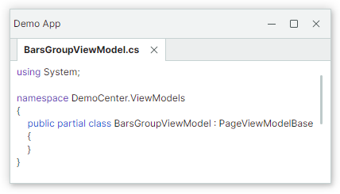


### Задание плавающих границ 

Когда Document-панель делается плавающей, её предыдущий размер определяет начальный размер плавающего окна. Вы можете установить присоединённые свойства [`FloatGroup.FloatWidth`](../../API/Eremex.AvaloniaUI.Controls.Docking/FloatGroup/FloatWidth.md), [`FloatGroup.FloatHeight`](../../API/Eremex.AvaloniaUI.Controls.Docking/FloatGroup/FloatHeight.md) и [`FloatGroup.FloatLocation`](../../API/Eremex.AvaloniaUI.Controls.Docking/FloatGroup/FloatLocation.md), чтобы задать пользовательские плавающие границы.

``` xml
<mxd:DocumentPane Name="documentPane1" Header="Document 1"
    mxd:FloatGroup.FloatWidth="500" mxd:FloatGroup.FloatHeight="400"/>
```

После того как элемент докинга становится плавающим, вы можете обратиться к его родительскому плавающему окну ([`FloatGroup`](../../API/Eremex.AvaloniaUI.Controls.Docking/FloatGroup.md)) и задать его границы.

Этот пример делает Document-панель плавающей, обращается к созданному плавающему окну и задаёт его размер.

``` csharp
using Eremex.AvaloniaUI.Controls.Docking;

dockManager1.Float(documentPane1);
FloatGroup floatingWindow = documentPane1.FloatGroup;
floatingWindow.FloatWidth = 400;
floatingWindow.FloatHeight = 300;
floatingWindow.FloatLocation = dockManager1.PointToScreen(new Point(100,100));
```


### Связанный API 

- [`DockPane.FloatGroup`](../../API/Eremex.AvaloniaUI.Controls.Docking/DockItemBase/FloatGroup.md) — возвращает плавающее окно (объект [`FloatGroup`](../../API/Eremex.AvaloniaUI.Controls.Docking/FloatGroup.md)), содержащее текущую панель, когда панель плавающая. Возвращает **null**, если панель не плавающая.
- [`FloatGroup.FloatLocation`](../../API/Eremex.AvaloniaUI.Controls.Docking/FloatGroup/FloatLocation.md) — задаёт положение float-группы относительно левого верхнего угла экрана.
- [`FloatGroup.FloatHeight`](../../API/Eremex.AvaloniaUI.Controls.Docking/FloatGroup/FloatHeight.md) — задаёт высоту [`FloatGroup`](../../API/Eremex.AvaloniaUI.Controls.Docking/FloatGroup.md).
- `FloatGroup.FloatWeight` — задаёт ширину [`FloatGroup`](../../API/Eremex.AvaloniaUI.Controls.Docking/FloatGroup.md).
- [`FloatGroup.Header`](../../API/Eremex.AvaloniaUI.Controls.Docking/FloatGroup/Header.md) — задаёт текст заголовка [`FloatGroup`](../../API/Eremex.AvaloniaUI.Controls.Docking/FloatGroup.md).
- [`FloatGroup.HeaderTemplate`](../../API/Eremex.AvaloniaUI.Controls.Docking/FloatGroup/HeaderTemplate.md) — задаёт шаблон заголовка [`FloatGroup`](../../API/Eremex.AvaloniaUI.Controls.Docking/FloatGroup.md).
- [`FloatGroup.Glyph`](../../API/Eremex.AvaloniaUI.Controls.Docking/FloatGroup/Glyph.md) — задаёт глиф [`FloatGroup`](../../API/Eremex.AvaloniaUI.Controls.Docking/FloatGroup.md).
- [`DockManager.Float`](../../API/Eremex.AvaloniaUI.Controls.Docking/DockManager/Float.md) — делает элемент докинга (например, объект [`DocumentPane`](../../API/Eremex.AvaloniaUI.Controls.Docking/DocumentPane.md)) плавающим.
- [`DockManager.FloatGroups`](../../API/Eremex.AvaloniaUI.Controls.Docking/DockManager/FloatGroups.md) — коллекция плавающих групп (плавающих окон).
- [`DockPane.AllowFloat`](../../API/Eremex.AvaloniaUI.Controls.Docking/DockPane/AllowFloat.md) — возвращает или задаёт, может ли пользователь сделать панель плавающей.

## Смотрите также

- [Как создать сложный макет для докинга в коде](examples/how-to-create-a-complex-docking-layout-in-code-behind.md)


<br>
<br>

<sup>*</sup> Эта страница переведена с использованием технологий машинного перевода.
