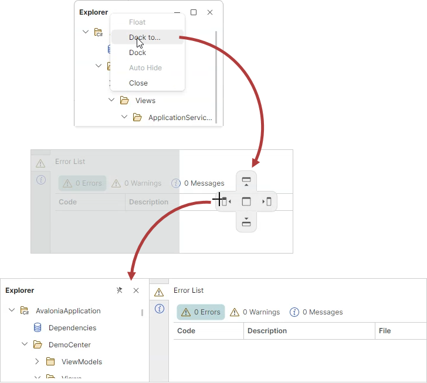

# Ограничения Wayland

В нативных сессиях Wayland в Linux отдельные окна приложения не могут узнавать или задавать собственное положение на экране. Из-за этого библиотека докинга имеет следующие ограничения:

- Плавающую панель можно перемещать перетаскиванием. Однако при перетаскивании направляющие докинга не отображаются. Перетаскиванием плавающую панель нельзя закрепить.

- Чтобы закрепить панель, выберите **Dock To** в её контекстном меню. Эта команда показывает направляющие докинга. Затем щёлкните направляющую, чтобы закрепить панель в нужном месте.

- Закреплённую панель нельзя сделать плавающей перетаскиванием. Вместо этого щёлкните правой кнопкой мыши по заголовку панели и выберите команду **Float** в контекстном меню.
