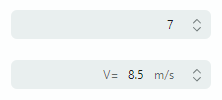

# SpinEditor

[`SpinEditor`](../../API/Eremex.AvaloniaUI.Controls.Editors/SpinEditor.md) — это редактор числовых значений со встроенными кнопками прокрутки, используемыми для увеличения и уменьшения числа на определённое значение (приращение). Пользователь может увеличивать и уменьшать число, щёлкая по этим кнопкам или нажимая клавиши со стрелками «Вверх» и «Вниз» на клавиатуре.



Основные возможности контрола включают:

- Встроенные кнопки прокрутки позволяют пользователю увеличивать и уменьшать значение.
- Ограничение доступного диапазона значений.
- Пользовательское значение приращения.
- Отображение пользовательского префикса и суффикса значения в поле ввода.

## Получение и установка значения редактора

Используйте свойство [`SpinEditor.Value`](../../API/Eremex.AvaloniaUI.Controls.Editors/SpinEditor/Value.md), чтобы вернуть и задать числовое значение редактора. Вы также можете использовать для той же цели свойство [`EditorValue`](../../API/Eremex.AvaloniaUI.Controls.Editors/BaseEditor/EditorValue.md). Эти свойства синхронизированы. Они различаются типом значения: свойство [`Value`](../../API/Eremex.AvaloniaUI.Controls.Editors/SpinEditor/Value.md) имеет тип decimal, тогда как свойство [`EditorValue`](../../API/Eremex.AvaloniaUI.Controls.Editors/BaseEditor/EditorValue.md) имеет тип `object`, как во всех редакторах Eremex.

Смотрите также: [Увеличение и уменьшение значения в коде](#увеличение-и-уменьшение-значения-в-коде).

## Настройка

Следующие основные свойства помогают настроить контрол [`SpinEditor`](../../API/Eremex.AvaloniaUI.Controls.Editors/SpinEditor.md):

- [`SpinEditor.Minimum`](../../API/Eremex.AvaloniaUI.Controls.Editors/SpinEditor/Minimum.md) — минимальное значение для редактора.
- [`SpinEditor.Maximum`](../../API/Eremex.AvaloniaUI.Controls.Editors/SpinEditor/Maximum.md) — максимальное значение для редактора.
- [`SpinEditor.Increment`](../../API/Eremex.AvaloniaUI.Controls.Editors/SpinEditor/Increment.md) — значение, на которое увеличивается или уменьшается значение редактора, когда пользователь щёлкает по кнопкам прокрутки или нажимает клавиши со стрелками «Вверх» и «Вниз».
- [`SpinEditor.ShowEditorButtons`](../../API/Eremex.AvaloniaUI.Controls.Editors/BaseEditor/ShowEditorButtons.md) — возвращает или задаёт, отображать ли встроенные кнопки прокрутки.
- [`SpinEditor.AllowRoundOutOfRangeValue`](../../API/Eremex.AvaloniaUI.Controls.Editors/SpinEditor/AllowRoundOutOfRangeValue.md) — возвращает или задаёт, округляются ли автоматически введённые пользователем значения вне диапазона до [`SpinEditor.Minimum`](../../API/Eremex.AvaloniaUI.Controls.Editors/SpinEditor/Minimum.md) или [`SpinEditor.Maximum`](../../API/Eremex.AvaloniaUI.Controls.Editors/SpinEditor/Maximum.md).

    !!! Note

        При использовании [`AllowRoundOutOfRangeValue`](../../API/Eremex.AvaloniaUI.Controls.Editors/SpinEditor/AllowRoundOutOfRangeValue.md) может также понадобиться установить свойство редактора [`ValidateOnInput`](../../API/Eremex.AvaloniaUI.Controls.Editors/TextEditor/ValidateOnInput.md) в `false`. Тогда данные не проверяются при каждом нажатии клавиши: введённое значение проверяется, когда пользователь нажимает ENTER или переводит фокус с контрола [`SpinEditor`](../../API/Eremex.AvaloniaUI.Controls.Editors/SpinEditor.md).

### Пример - как создать SpinEditor

Этот пример инициализирует контрол SpinEditor.

``` xml
xmlns:mxe="https://schemas.eremexcontrols.net/avalonia/editors"

<mxe:SpinEditor x:Name="SpinEditor" Width="200" 
    Value="7"
    Maximum="15"
    Minimum="1"
    Increment="1"
    />
```


## Префикс и суффикс отображаемого значения

Используйте свойства [`SpinEditor.Prefix`](../../API/Eremex.AvaloniaUI.Controls.Editors/SpinEditor/Prefix.md) и [`SpinEditor.Suffix`](../../API/Eremex.AvaloniaUI.Controls.Editors/SpinEditor/Suffix.md), чтобы задать текст, отображаемый до и после числового значения. Пользователи не могут редактировать этот текст.

### Пример - как задать префикс и суффикс для значения SpinEditor

Этот пример использует свойства [`SpinEditor.Prefix`](../../API/Eremex.AvaloniaUI.Controls.Editors/SpinEditor/Prefix.md) и [`SpinEditor.Suffix`](../../API/Eremex.AvaloniaUI.Controls.Editors/SpinEditor/Suffix.md), чтобы отобразить текст до и после значения редактора.

``` xml
xmlns:mxe="https://schemas.eremexcontrols.net/avalonia/editors"

<mxe:SpinEditor x:Name="SpinEditor1" Width="200" 
    Value="8.5"
    Maximum="35"
    Minimum="2"
    Increment="0.5"
    Prefix="V=" Suffix="m/s"
    />
```

## Увеличение и уменьшение значения в коде

Команды [`SpinEditor.IncreaseCommand`](../../API/Eremex.AvaloniaUI.Controls.Editors/SpinEditor/IncreaseCommand.md) и [`SpinEditor.DecreaseCommand`](../../API/Eremex.AvaloniaUI.Controls.Editors/SpinEditor/DecreaseCommand.md) увеличивают и уменьшают значение редактора на величину приращения ([`SpinEditor.Increment`](../../API/Eremex.AvaloniaUI.Controls.Editors/SpinEditor/Increment.md)).

<!--TODO
Check:
The [`SpinEditor.IncreaseCommand`](../../API/Eremex.AvaloniaUI.Controls.Editors/SpinEditor/IncreaseCommand.md) and [`SpinEditor.DecreaseCommand`](../../API/Eremex.AvaloniaUI.Controls.Editors/SpinEditor/DecreaseCommand.md) commands increase and decrease the editor's value by the increment value ([`SpinEditor.Increment`](../../API/Eremex.AvaloniaUI.Controls.Editors/SpinEditor/Increment.md)).
-->

Вы также можете изменить значение редактора напрямую с помощью свойства [`SpinEditor.Value`](../../API/Eremex.AvaloniaUI.Controls.Editors/SpinEditor/Value.md).


<br>
<br>

<sup>*</sup> Эта страница переведена с использованием технологий машинного перевода.
