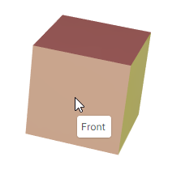
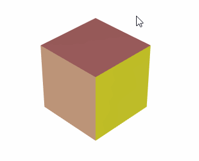
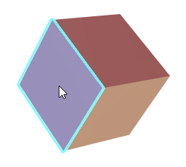
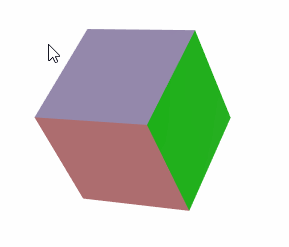
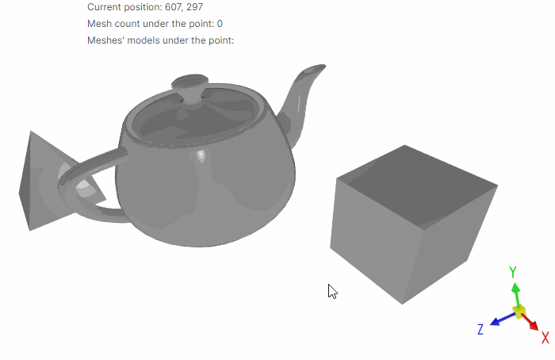

# Взаимодействие пользователя с 3D-моделями

[`Graphics3DControl`](../../API/Eremex.AvaloniaUI.Controls3D/Graphics3DControl.md) позволяет пользователям взаимодействовать с 3D-моделями. Пользователи могут вращать, масштабировать и панорамировать (перемещать) модели с помощью мыши и клавиатуры. Кроме того, вы можете разрешить пользователям выбирать элементы модели щелчком мыши или подсвечивать элементы при наведении на них мышью. 
[`Graphics3DControl`](../../API/Eremex.AvaloniaUI.Controls3D/Graphics3DControl.md) также поддерживает всплывающие подсказки для моделей и их элементов (сеток).

## Вращение модели

#### Сочетания клавиш

- Повернуть влево — Shift+Стрелка влево
- Повернуть вправо — Shift+Стрелка вправо
- Повернуть вверх — Shift+Стрелка вверх
- Повернуть вниз — Shift+Стрелка вниз


#### Операции мышью

- Вращение — перетаскивайте модель левой кнопкой мыши.

### Опции вращения

- [`Graphics3DControl.RotateStep`](../../API/Eremex.AvaloniaUI.Controls3D/Graphics3DControl/RotateStep.md) — позволяет управлять скоростью вращения. Свойство [`RotateStep`](../../API/Eremex.AvaloniaUI.Controls3D/Graphics3DControl/RotateStep.md) задаётся во внутренних единицах. Значение по умолчанию — 20. Более высокое значение приводит к большей скорости вращения. 

- [`Graphics3DControl.RotationMode`](../../API/Eremex.AvaloniaUI.Controls3D/Graphics3DControl/RotationMode.md) — возвращает или задаёт точку, вокруг которой камера вращается, когда пользователь вращает сцену перетаскиванием левой кнопкой мыши. Доступны следующие режимы вращения:

    - [`RotationMode.AroundCameraTarget`](../../API/Eremex.AvaloniaUI.Controls3D/RotationMode.md) (по умолчанию) — камера вращается вокруг своей цели ([`Camera.Target`](../../API/Eremex.AvaloniaUI.Controls3D/Camera/Target.md)).

        Цель камеры по умолчанию — начало системы координат _(0, 0, 0)_. Точка цели автоматически меняется, когда вы панорамируете (сдвигаете) модель методами [`Camera.MoveLeft`](../../API/Eremex.AvaloniaUI.Controls3D/Camera/MoveLeft.md)/[`Camera.MoveUp`](../../API/Eremex.AvaloniaUI.Controls3D/Camera/MoveUp.md), а также [сочетаниями клавиш и жестами мыши](#перемещение-модели).


    - [`RotationMode.AroundMouseHit`](../../API/Eremex.AvaloniaUI.Controls3D/RotationMode.md) — камера вращается вокруг точки сцены, над которой находился указатель мыши в момент начала вращения.

        Этот режим позволяет пользователю щёлкнуть по любому объекту или поверхности и вращать вид вокруг именно этой точки, а не вокруг текущей цели камеры.

    


<!-- TODO
Check the property in the demo. 
 -->

## Масштабирование модели

#### Сочетания клавиш

- Приблизить — CTRL+клавиша «плюс»
- Отдалить — CTRL+клавиша «минус»

#### Операции мышью

- Масштабирование — используйте колесо прокрутки мыши для приближения и отдаления.

### Опции масштабирования

- [`Graphics3DControl.ZoomRate`](../../API/Eremex.AvaloniaUI.Controls3D/Graphics3DControl/ZoomRate.md) — управляет скоростью операций масштабирования, выполняемых с помощью клавиатуры и колеса мыши. Значение по умолчанию — 0.1. Более высокое значение увеличивает скорость масштабирования.

## Перемещение модели

#### Сочетания клавиш

- Переместить влево — CTRL+Стрелка влево
- Переместить вправо — CTRL+Стрелка вправо
- Переместить вверх — CTRL+Стрелка вверх
- Переместить вниз — CTRL+Стрелка вниз

#### Операции мышью

- Перемещение — перетаскивайте модель правой кнопкой мыши.

### Опции перемещения

- Свойство [`Graphics3DControl.KeyboardMoveStep`](../../API/Eremex.AvaloniaUI.Controls3D/Graphics3DControl/KeyboardMoveStep.md) — позволяет задать расстояние, на которое сдвигается модель за одну операцию перемещения с клавиатуры.

<!-- TODO
which units ?
 -->

## Вращение, масштабирование и перемещение моделей в коде

Чтобы просмотреть модель из определённого положения и под определённым углом в коде, вам нужно настроить положение и ориентацию камеры. Дополнительную информацию смотрите в следующем разделе:

- [Camera](camera.md)


## Переопределение сочетаний клавиш

Свойство [`Graphics3DControl.NavigationBindings`](../../API/Eremex.AvaloniaUI.Controls3D/Graphics3DControl/NavigationBindings.md) класса [`Graphics3DKeyBindings`](../../API/Eremex.AvaloniaUI.Controls3D/Graphics3DKeyBindings.md) позволяет переопределять сочетания клавиш по умолчанию. Класс [`Graphics3DKeyBindings`](../../API/Eremex.AvaloniaUI.Controls3D/Graphics3DKeyBindings.md) содержит свойства, определяющие сочетания клавиш для операций масштабирования, вращения и панорамирования. Изначально эти свойства установлены в сочетания по умолчанию, перечисленные выше. Вы можете использовать эти свойства, чтобы назначить операциям пользовательские сочетания клавиш.

Следующий код назначает сочетания CTRL+1 и CTRL+2 операциям приближения и отдаления.

``` cs
g3DControl.NavigationBindings = new Graphics3DKeyBindings();
Graphics3DKeyBinding zoomInShortcut = new Graphics3DKeyBinding(Avalonia.Input.KeyModifiers.Control, Avalonia.Input.Key.D1);
Graphics3DKeyBinding zoomOutShortcut = new Graphics3DKeyBinding(Avalonia.Input.KeyModifiers.Control, Avalonia.Input.Key.D2);
g3DControl.NavigationBindings.ZoomIn = zoomInShortcut;
g3DControl.NavigationBindings.ZoomOut = zoomOutShortcut;
```

## Показ подсказок

[`Graphics3DControl`](../../API/Eremex.AvaloniaUI.Controls3D/Graphics3DControl.md) может отображать подсказки, когда пользователь наводит курсор на модели или отдельные сетки. 



Используйте следующие свойства, чтобы назначать подсказки моделям, сеткам или одновременно и моделям, и сеткам:

- [`GeometryModel3D.Hint`](../../API/Eremex.AvaloniaUI.Controls3D/SelectableElement/Hint.md) — подсказка для модели.
- [`MeshGeometry3D.Hint`](../../API/Eremex.AvaloniaUI.Controls3D/SelectableElement/Hint.md) — подсказка для сетки.

Этот пример задаёт подсказки для модели и её сеток. Подсказки для сеток указывают их имена.

``` xml
<mx3d:GeometryModel3D x:Name="Cube" MeshesSource="{Binding Meshes}" Hint="Cube">
    <mx3d:GeometryModel3D.MeshTemplate>
        <DataTemplate x:DataType="vm:MeshViewModel">
            <mx3d:MeshGeometry3D 
                Name="{Binding Name}" 
                Hint="{Binding Name}"
                ...
            />
        </DataTemplate>
    </mx3d:GeometryModel3D.MeshTemplate>
</mx3d:GeometryModel3D>
```
``` cs
public partial class MeshViewModel : ObservableObject
{
    [ObservableProperty] string name;
    [ObservableProperty] Vertex3D[] vertices;
    //...
}
```

Когда подсказки заданы и для модели, и для сетки, эти подсказки объединяются в одну подсказку, разделённую символом-разделителем «,».



Установите свойство [`Graphics3DControl.ShowHints`](../../API/Eremex.AvaloniaUI.Controls3D/Graphics3DControl/ShowHints.md) в `false`, чтобы отключить подсказки. Это свойство имеет значение по умолчанию `true`.

## Подсветка элементов

[`Graphics3DControl`](../../API/Eremex.AvaloniaUI.Controls3D/Graphics3DControl.md) поддерживает подсветку моделей и сеток. С помощью этой функции контрол рисует рамку подсветки вокруг модели/сетки, когда пользователь наводит на неё курсор.



Используйте свойство [`Graphics3DControl.HighlightMode`](../../API/Eremex.AvaloniaUI.Controls3D/Graphics3DControl/HighlightMode.md), чтобы включить функцию подсветки и задать режим подсветки. Доступны следующие опции:

- `Mesh` — включает подсветку отдельных сеток.
- `Model` — включает подсветку отдельных моделей.
- `None` (по умолчанию) — функция подсветки отключена.

**Связанный API**

- [`Graphics3DControl.HighlightedElement`](../../API/Eremex.AvaloniaUI.Controls3D/Graphics3DControl/HighlightedElement.md) — возвращает или задаёт текущий подсвеченный элемент.
- [`Graphics3DControl.HighlightColor`](../../API/Eremex.AvaloniaUI.Controls3D/Graphics3DControl/HighlightColor.md) — возвращает или задаёт цвет, используемый для рисования рамки подсветки вокруг подсвеченных элементов.


## Выбор элементов

Вы можете включить функцию выбора, чтобы позволить пользователю выбирать элементы (модели или сетки) щелчком мыши. Рамка выбора рисуется вокруг элемента, когда пользователь щёлкает по нему.



Используйте свойство [`Graphics3DControl.SelectionMode`](../../API/Eremex.AvaloniaUI.Controls3D/Graphics3DControl/SelectionMode.md), чтобы активировать функцию выбора и задать режим выбора. Доступные опции:

- `Mesh` — включает выбор отдельных сеток по щелчку мыши.
- `Model` — включает выбор отдельных моделей по щелчку мыши.
- `None` (по умолчанию) — функция выбора отключена.


**Связанный API**

- [`Graphics3DControl.SelectedElement`](../../API/Eremex.AvaloniaUI.Controls3D/Graphics3DControl/SelectedElement.md) — возвращает или задаёт текущий выбранный элемент.
- [`Graphics3DControl.SelectionColor`](../../API/Eremex.AvaloniaUI.Controls3D/Graphics3DControl/SelectionColor.md) — возвращает или задаёт цвет, используемый для рисования рамки вокруг выбранных элементов.


### Переопределение выбора и реакция на него

Когда элемент вот-вот будет выбран, контрол вызывает событие [`Graphics3DControl.SelectionChanging`](../../API/Eremex.AvaloniaUI.Controls3D/Graphics3DControl/SelectionChanging.md). Это событие позволяет переопределить выбор по умолчанию.

По умолчанию контрол выбирает ближайшую модель и сетку под точкой щелчка. Обработайте событие [`Graphics3DControl.SelectionChanging`](../../API/Eremex.AvaloniaUI.Controls3D/Graphics3DControl/SelectionChanging.md), чтобы изменить это поведение:

- Чтобы выбрать другой элемент, присвойте его параметру события `e.NewValue`.
- Чтобы снять выбор, установите параметр события `e.NewValue` в `null`.

Чтобы выбрать другой элемент, используйте параметр события `e.HitTestResults`, который содержит все результаты попадания, найденные лучом в точке щелчка, упорядоченные от ближнего к дальнему. Метод [`Graphics3DControl.CalcHitInfo`](../../API/Eremex.AvaloniaUI.Controls3D/Graphics3DControl/CalcHitInfo.md) возвращает те же результаты для этой точки. Подробнее см. в разделе [Проверка попадания](#проверка-попадания).

Используйте параметр события `e.OldValue`, чтобы получить элемент, выбранный в данный момент.

## Проверка попадания

Проверка попадания позволяет определить, какие модели и сетки сцены находятся под заданной точкой. Для этого [`Graphics3DControl`](../../API/Eremex.AvaloniaUI.Controls3D/Graphics3DControl.md) предоставляет два метода:

- [`HitTest(Point)`](../../API/Eremex.AvaloniaUI.Controls3D/Graphics3DControl/HitTest.md) — Возвращает ближайшую сетку под указанной точкой или `null`, если точка находится над пустым пространством.
- [`CalcHitInfo(Point)`](../../API/Eremex.AvaloniaUI.Controls3D/Graphics3DControl/CalcHitInfo.md) — Возвращает список сеток (по всем моделям) под указанной точкой, упорядоченный от ближней к дальней. Если точка находится над пустым пространством, метод возвращает пустой список.

Проверка попадания реализована как трассировка луча. Контрол проецирует луч из камеры через заданную 2D-точку (в координатах контрола), а затем проверяет пересечение этого луча с геометрией 3D-сцены, чтобы определить пересечённые объекты.

### Пример — проверка попадания

Код ниже обрабатывает событие `PointerMoved` контрола Graphics3DControl и отображает:

- Текущую позицию курсора
- Количество сеток под курсором
- Свойства [`GeometryModel3D.Hint`](../../API/Eremex.AvaloniaUI.Controls3D/SelectableElement/Hint.md) моделей, которым принадлежат эти сетки

Если под курсором находится несколько моделей, в вывод включаются сетки всех этих моделей.



``` cs
private void G3DControl_PointerMoved(object sender, Avalonia.Input.PointerEventArgs e)
{
    Point position = e.GetPosition(graphics3DControl1);
    label1.Content = "Current position: " + position;
    IList<RaycastHitTestResult> meshesHitInfo = graphics3DControl1.CalcHitInfo(position);
    label2.Content = "Mesh count under the point: " + meshesHitInfo.Count;
    label3.Content = "Meshes' models under the point: " + string.Join(", ", meshesHitInfo.Select(r => r.Model.Hint ?? "<null>"));
}
```


## Смотрите также

- [Camera](camera.md)


<br>
<br>

<sup>*</sup> Эта страница переведена с использованием технологий машинного перевода.
