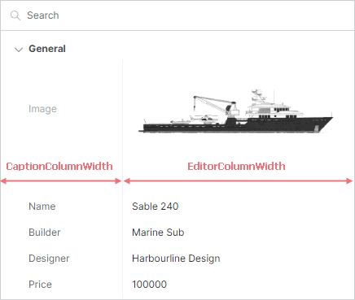
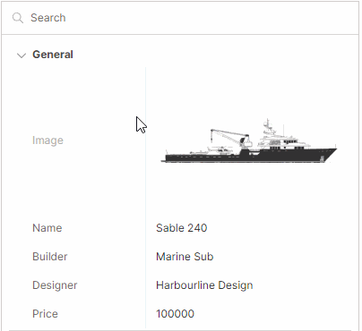

# Параметры заголовков строк и компоновки ячеек

[`PropertyGridControl`](../../API/Eremex.AvaloniaUI.Controls.PropertyGrid/PropertyGridControl.md) предоставляет несколько свойств для управления шириной колонки подписей (заголовков) и колонки редакторов (ячеек), а также для задания выравнивания заголовков строк. Можно зафиксировать ширину этих колонок и разрешить пользователям изменять её во время работы приложения.

## Задание ширины колонок

Используйте следующие свойства, чтобы задать ширину колонок PropertyGrid:

- [`CaptionColumnWidth`](../../API/Eremex.AvaloniaUI.Controls.PropertyGrid/PropertyGridControl/CaptionColumnWidth.md) — возвращает или задаёт ширину колонки заголовков (подписей). По умолчанию — значение `GridLength.Star`.
- [`EditorColumnWidth`](../../API/Eremex.AvaloniaUI.Controls.PropertyGrid/PropertyGridControl/EditorColumnWidth.md) — возвращает или задаёт ширину колонки редакторов (ячеек). По умолчанию — значение `GridLength.Star`.

    


Свойства [`CaptionColumnWidth`](../../API/Eremex.AvaloniaUI.Controls.PropertyGrid/PropertyGridControl/CaptionColumnWidth.md) и [`EditorColumnWidth`](../../API/Eremex.AvaloniaUI.Controls.PropertyGrid/PropertyGridControl/EditorColumnWidth.md) принимают значение `GridLength`, поэтому можно указать абсолютную ширину в пикселях, пропорциональную (звёздочку) или автоматическую ширину.

Значения этих свойств по умолчанию — `GridLength.Star`: доступное горизонтальное пространство делится между колонками подписей и редакторов пропорционально.


Если для обеих колонок заданы абсолютные значения (в пикселях), убедитесь, что их сумма не превышает ширину контрола. Иначе содержимое колонок будет обрезано.

```csharp
propertyGridControl.Width = 300;
propertyGridControl.CaptionColumnWidth = new GridLength(100);
propertyGridControl.EditorColumnWidth = new GridLength(200);
```


## Изменение ширины колонок пользователем

PropertyGrid позволяет пользователям изменять ширину колонок подписей и редакторов во время работы приложения с помощью встроенного разделителя.



Используйте свойство [`AllowResizing`](../../API/Eremex.AvaloniaUI.Controls.PropertyGrid/PropertyGridControl/AllowResizing.md), чтобы включить или отключить разделитель. Значение свойства по умолчанию — `true`.


## Выравнивание текста подписей

Используйте свойство [`CaptionHorizontalAlignment`](../../API/Eremex.AvaloniaUI.Controls.PropertyGrid/PropertyGridControl/CaptionHorizontalAlignment.md), чтобы задать горизонтальное выравнивание текста в колонке подписей. Поддерживаются следующие режимы выравнивания текста: `Left`, `Center` и `Right`.

```csharp
propertyGridControl.CaptionHorizontalAlignment = HorizontalAlignment.Center;
```


<br>
<br>

<sup>*</sup> Эта страница переведена с использованием технологий машинного перевода.
