# Элементы Ribbon

Вы можете добавлять различные элементы в контрол Ribbon и его меню: кнопки, кнопки-флажки, текстовые надписи, подменю, встроенные редакторы и другое.  

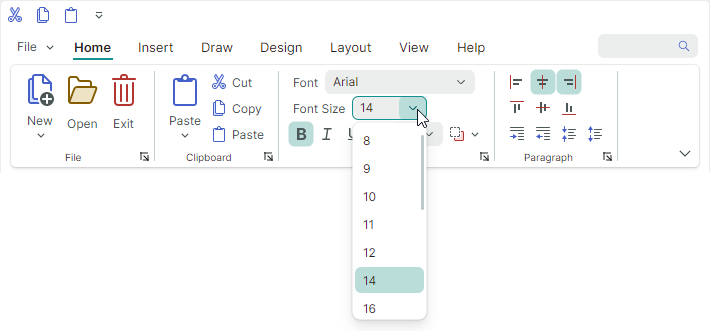

Помимо этих классических элементов, контрол Ribbon поддерживает галереи. Они предназначены для отображения графически насыщенных элементов, расположенных в столбцы и строки. Дополнительную информацию смотрите в разделе [Галереи](galleries.md).

Все элементы, включая галереи, можно добавлять на [традиционные панели инструментов и в контекстные меню](../toolbars-and-menus/index.md). 

## Добавление элементов Ribbon 

Вы можете отображать различные элементы в разных элементах Ribbon: [группах страниц Ribbon](page-groups.md), на [панели быстрого доступа](quick-access-toolbar.md), в [области заголовков страниц](page-header-items.md), в [главном меню (меню приложения)](application-button-and-main-menu.md) и в подменю.

Чтобы добавить элементы в группу страниц Ribbon в XAML, определите эти элементы между открывающим и закрывающим тегами **&lt;RibbonPageGroup&gt;**. В code-behind вы можете добавлять, получать доступ и изменять элементы с помощью коллекции [`RibbonPageGroup.Items`](../../API/Eremex.AvaloniaUI.Controls.Ribbon/RibbonPageGroup/Items.md). Другие элементы Ribbon заполняются элементами таким же образом.

Этот пример добавляет три кнопки (объекта [`ToolbarButtonItem`](../../API/Eremex.AvaloniaUI.Controls.Bars/ToolbarButtonItem.md)) в объект [`RibbonPageGroup`](../../API/Eremex.AvaloniaUI.Controls.Ribbon/RibbonPageGroup.md). 

``` xml
<mxb:ToolbarManager IsWindowManager="True">
    <mxr:RibbonControl ApplicationButtonContent="File" ApplicationButtonKeyTip="F">
        <mxr:RibbonPage Header="Home" KeyTip="H">
            <mxr:RibbonPageGroup Header="Editing" IsHeaderButtonVisible="False">
                <mxb:ToolbarButtonItem Header="Find" KeyTip="FN" 
                  Glyph="{x:Static icons:Basic.Search}" 
                  Command="FindButtonClick" />
                <mxb:ToolbarButtonItem Header="Replace" KeyTip="RP" 
                  Glyph="{x:Static icons:Basic.Update}" 
                  Command="ReplaceButtonClick"/>
                <mxb:ToolbarButtonItem Header="Clear" KeyTip="CL" 
                  Glyph="{x:Static icons:Basic.Table_Clear}" 
                  Command="ClearButtonClick"/>
            </mxr:RibbonPageGroup>
        </mxr:RibbonPage>
    </mxr:RibbonControl>
</mxb:ToolbarManager>
```

## Типы элементов Ribbon

Все элементы, которые вы можете добавлять в контрол Ribbon и на традиционные панели инструментов, являются потомками класса [`ToolbarItem`](../../API/Eremex.AvaloniaUI.Controls.Bars/ToolbarItem.md). В следующих разделах описаны доступные элементы Ribbon и их настройки. 


### Обычные кнопки (ToolbarButtonItem)

Объекты [`ToolbarButtonItem`](../../API/Eremex.AvaloniaUI.Controls.Bars/ToolbarButtonItem.md) позволяют реализовывать обычные кнопки и [кнопки с функцией выпадающего списка](#кнопки-с-функцией-выпадающего-списка-toolbarbuttonitem).

Обычная кнопка вызывает действие при щелчке.

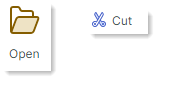


#### Щелчок по кнопке

Чтобы реализовать действие для кнопки, вы можете задать команду или обработать события кнопки:

- [`ToolbarItem.Command`](../../API/Eremex.AvaloniaUI.Controls.Bars/ToolbarItem/Command.md) — команда, выполняемая при щелчке по кнопке.

    ``` xml
    <mxb:ToolbarButtonItem Header="Open" KeyTip="O" 
    Command="{Binding OpenFileCommand}" 
    Glyph="{x:Static icons:Basic.Folder_Open}" />
    ```
    ``` cs
    [RelayCommand]
    public void OpenFile()
    {
        //...
    }
    ```
    
- [`CommandParameter`](../../API/Eremex.AvaloniaUI.Controls.Bars/ToolbarItem/CommandParameter.md) — параметр команды, передаваемый заданной команде.

- [`ToolbarItem.Click`](../../API/Eremex.AvaloniaUI.Controls.Bars/ToolbarItem/Click.md) — возникает при щелчке левой кнопкой мыши по элементу (после нажатия и отпускания левой кнопки мыши).
- [`ToolbarItem.Press`](../../API/Eremex.AvaloniaUI.Controls.Bars/ToolbarItem/Press.md) — возникает при нажатии любой кнопки мыши над элементом.

#### Подпись и глиф кнопки

- [`Header`](../../API/Eremex.AvaloniaUI.Controls.Bars/ToolbarItem/Header.md) — отображаемый текст элемента.
- [`Glyph`](../../API/Eremex.AvaloniaUI.Controls.Bars/ToolbarItem/Glyph.md) — изображение элемента. Смотрите также: [Размер глифа](#размер-глифа).
- [`GlyphTemplate`](../../API/Eremex.AvaloniaUI.Controls.Bars/ToolbarItem/GlyphTemplate.md) — пользовательский шаблон данных для отрисовки изображения элемента.

#### Размер глифа

Размер глифов команд в [группах страниц Ribbon](page-groups.md) различается в упрощённой и классической [компоновках команд](ribbon-command-layouts.md). Следующие разделы содержат подробности:

- [Размер глифа в упрощённой компоновке команд](#размер-глифа-в-упрощённой-компоновке-команд)
- [Размер глифа в классической компоновке команд](#размер-глифа-в-классической-компоновке-команд)
- [Адаптивный размер глифа в классической компоновке команд](#адаптивный-размер-глифа-в-классической-компоновке-команд)


!!! tip

    Чтобы настроить размер глифов элементов во всплывающих и контекстных меню, используйте свойство [`GlyphSize`](../../API/Eremex.AvaloniaUI.Controls.Bars/ToolbarItem/GlyphSize.md) элемента.
    
    ``` xml
    <mxb:PopupMenu MinWidth="250" ContentRightIndent="30">
        <mxb:ToolbarButtonItem Header="New" Glyph="{x:Static icons:Basic.Doc}" GlyphSize="32,32" HotKey="Ctrl+N"/>
    </mxb:PopupMenu>
    ```


#### Размер глифа в упрощённой компоновке команд

Все команды в группах страниц используют один размер значков в [упрощённой компоновке команд](ribbon-command-layouts.md). 

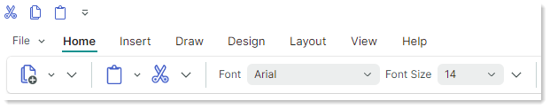

Размер значков по умолчанию — `22x22`. Вы можете использовать свойство [`RibbonControl.GlyphSizeInSimplifiedLayout`](../../API/Eremex.AvaloniaUI.Controls.Ribbon/RibbonControl/GlyphSizeInSimplifiedLayout.md), чтобы задать пользовательский размер значков.

#### Размер глифа в классической компоновке команд

Команды в группах страниц могут отображать большие и маленькие глифы в [классической компоновке команд](ribbon-command-layouts.md).

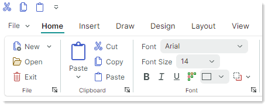

Размер маленьких значков по умолчанию — `16x16`. Вы можете использовать свойство [`RibbonControl.SmallGlyphSize`](../../API/Eremex.AvaloniaUI.Controls.Ribbon/RibbonControl/SmallGlyphSize.md), чтобы изменить размер маленьких значков. Большие значки вдвое больше маленьких.

Присоединённое свойство `RibbonControl.DisplayMode` можно использовать, чтобы задать размер отображения (большой, маленький и маленький с текстом) для команд в группах страниц Ribbon. Дополнительную информацию смотрите в разделе [Адаптивный размер глифа в классической компоновке команд](#адаптивный-размер-глифа-в-классической-компоновке-команд).

#### Адаптивный размер глифа в классической компоновке команд

[Функция адаптивной компоновки](page-groups.md#адаптивная-компоновка) контрола Ribbon подстраивает размещение элементов в [группах страниц Ribbon](page-groups.md) при изменении размера контрола Ribbon. Эта функция также подстраивает размер отображения элементов при изменении размера Ribbon, когда используется классическая компоновка команд.

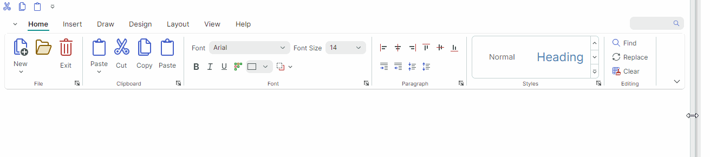

Присоединённое свойство `RibbonControl.DisplayMode` позволяет задавать поддерживаемые режимы отображения для элементов Ribbon в группах страниц Ribbon в [классической компоновке команд](ribbon-command-layouts.md).
Вы можете принудительно задать элементу использование только больших изображений, маленьких изображений, маленьких изображений с текстом или комбинации этих режимов отображения.

Предопределённые режимы отображения глифов определяются перечислением [`RibbonItemDisplayMode`](../../API/Eremex.AvaloniaUI.Controls.Ribbon/RibbonItemDisplayMode.md):

  - `Large` — элемент отображает большой глиф и текст.
  
    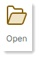 

  - `Small` — элемент отображает маленький глиф и текст.

    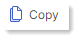

  - `SmallGlyph` — элемент отображает маленький глиф.

    

  - `Auto` — элемент поддерживает режимы отображения `Large`, `Small` и `SmallGlyph`. В зависимости от места, доступного в родительской [группе](page-groups.md) элемента, контрол Ribbon автоматически выбирает один из этих режимов отображения для элемента.

Следующий фрагмент кода устанавливает присоединённое свойство `RibbonControl.DisplayMode` для элемента Ribbon в `Large`. Это заставляет элемент использовать только большие изображения.

``` xml
<mxr:RibbonPage Header="Home" KeyTip="H">
    <mxr:RibbonPageGroup Header="File" IsHeaderButtonVisible="True">
        <mxb:ToolbarButtonItem Header="Open" KeyTip="O" mxr:RibbonControl.DisplayMode="Large"
                            Glyph="{x:Static icons:Basic.Folder_Open}" />
    </mxr:RibbonPageGroup>
</mxr:RibbonPage>
```

Перечисление [`RibbonItemDisplayMode`](../../API/Eremex.AvaloniaUI.Controls.Ribbon/RibbonItemDisplayMode.md) помечено атрибутом `[Flags]`. Поэтому вы можете использовать любую комбинацию флагов `Large`, `Small` и `SmallGlyph` при установке присоединённого свойства `RibbonControl.DisplayMode`.

Следующий код позволяет элементу Ribbon использовать только режимы отображения `Small` и `SmallGlyph`:

``` xml
<mxb:ToolbarButtonItem Header="Help" KeyTip="LP" Glyph="{x:Static icons:Basic.Info}"
                       mxr:RibbonControl.DisplayMode="Small, SmallGlyph" />
```

#### Общие настройки отображения элемента

- [`ShowSeparator`](../../API/Eremex.AvaloniaUI.Controls.Bars/ToolbarItem/ShowSeparator.md) — возвращает или задаёт, отображать ли разделитель перед элементом. Вы также можете использовать элемент [`ToolbarSeparatorItem`](../../API/Eremex.AvaloniaUI.Controls.Bars/ToolbarSeparatorItem.md), чтобы вставить разделитель.

<!-- TODO
 Check:
  - [`GlyphAlignment`](../../API/Eremex.AvaloniaUI.Controls.Bars/ToolbarItem/GlyphAlignment.md) — The glyph alignment relative to the item's header. 
-->

    
### Кнопки с функцией выпадающего списка (ToolbarButtonItem)

Элемент [`ToolbarButtonItem`](../../API/Eremex.AvaloniaUI.Controls.Bars/ToolbarButtonItem.md) позволяет создать кнопку со связанным выпадающим контролом или меню. 

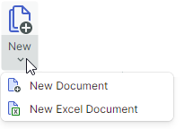

Используйте свойство [`ToolbarButtonItem.DropDownControl`](../../API/Eremex.AvaloniaUI.Controls.Bars/ToolbarButtonItem/DropDownControl.md), чтобы задать выпадающий контрол/меню. Этот выпадающий контрол вызывается, когда пользователь щёлкает по кнопке или по встроенной кнопке-стрелке вниз (в зависимости от настройки [`DropDownArrowVisibility`](../../API/Eremex.AvaloniaUI.Controls.Bars/DropDownArrowVisibility.md); см. ниже).
  

  
``` xml
<mxb:ToolbarButtonItem Name="btnNew" Header="New" KeyTip="N" 
    Glyph="{x:Static icons:Basic.Docs_Add}"
    mxr:RibbonControl.DisplayMode="Large"
    DropDownArrowVisibility="ShowSplitArrow">
    <mxb:ToolbarButtonItem.DropDownControl>
        <mxb:PopupMenu>
            <mxb:ToolbarButtonItem Header="New Document" KeyTip="ND" 
                Glyph="{x:Static icons:Basic.Doc_Add}" />
            <mxb:ToolbarButtonItem Header="New Excel Document" KeyTip="NX"
                                    Glyph="{x:Static icons:Basic.Doc_Excel}" />
        </mxb:PopupMenu>
    </mxb:ToolbarButtonItem.DropDownControl>
</mxb:ToolbarButtonItem>
```
  
#### Выпадающий контрол и кнопка-стрелка вниз

- [`DropDownControl`](../../API/Eremex.AvaloniaUI.Controls.Bars/ToolbarButtonItem/DropDownControl.md) — возвращает или задаёт выпадающий контрол (объект [`Eremex.AvaloniaUI.Controls.Bars.IPopup`](../../API/Eremex.AvaloniaUI.Controls.Bars/IPopup.md)), связанный с элементом. Контрол всплывает, когда пользователь щёлкает по элементу или по встроенной кнопке-стрелке вниз (см. [`DropDownArrowVisibility`](../../API/Eremex.AvaloniaUI.Controls.Bars/DropDownArrowVisibility.md)). Следующие объекты реализуют интерфейс [`Eremex.AvaloniaUI.Controls.Bars.IPopup`](../../API/Eremex.AvaloniaUI.Controls.Bars/IPopup.md) и потому могут отображаться как выпадающие контролы:

    - [`Eremex.AvaloniaUI.Controls.Bars.PopupMenu`](../../API/Eremex.AvaloniaUI.Controls.Bars/PopupMenu.md) — [всплывающее меню](../toolbars-and-menus/popup-and-context-menus.md). Вы можете добавлять в меню все типы элементов панели, чтобы заполнить его содержимым.
    - [`Eremex.AvaloniaUI.Controls.Bars.PopupContainer`](../../API/Eremex.AvaloniaUI.Controls.Bars/PopupContainer.md) — контейнер контролов. Используйте [`PopupContainer`](../../API/Eremex.AvaloniaUI.Controls.Bars/PopupContainer.md), чтобы отображать пользовательские контролы в выпадающем списке.
    
- [`DropDownArrowVisibility`](../../API/Eremex.AvaloniaUI.Controls.Bars/DropDownArrowVisibility.md) — возвращает или задаёт, отображает ли элемент стрелку выпадающего списка, используемую для вызова связанного выпадающего контрола. 

    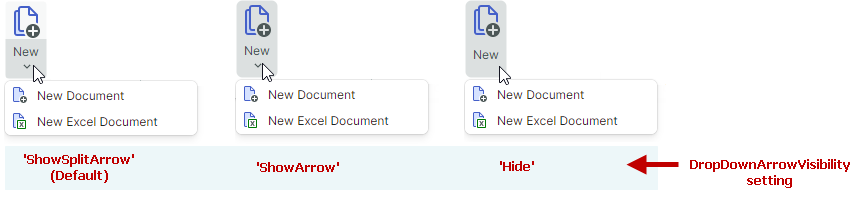

    - `ShowSplitArrow` или `Default` — стрелка выпадающего списка видима. Она действует как отдельная кнопка, встроенная в элемент. Щелчок по стрелке вызывает связанный выпадающий контрол и инициирует событие [`DropDownPress`](../../API/Eremex.AvaloniaUI.Controls.Bars/ToolbarButtonItem/DropDownPress.md). Щелчок по элементу вызывает его команду ([`Command`](../../API/Eremex.AvaloniaUI.Controls.Bars/ToolbarItem/Command.md)) и события ([`Click`](../../API/Eremex.AvaloniaUI.Controls.Bars/ToolbarItem/Click.md) и [`Press`](../../API/Eremex.AvaloniaUI.Controls.Bars/ToolbarItem/Press.md)). 

    - `ShowArrow` — стрелка выпадающего списка видима. Элемент и стрелка действуют как единая кнопка. Щелчок по ним отображает связанный выпадающий контрол.

    - `Hide` — стрелка выпадающего списка скрыта. Щелчок по элементу вызывает выпадающий контрол.

<!-- - [`DropDownArrowAlignment`](../../API/Eremex.AvaloniaUI.Controls.Bars/DropDownArrowAlignment.md) — Gets or sets the position of the dropdown arrow. -->

#### Вызов выпадающего контрола

- [`DropDownOpenMode`](../../API/Eremex.AvaloniaUI.Controls.Bars/DropDownOpenMode.md) — возвращает или задаёт, вызывается ли выпадающий контрол и когда, при взаимодействии пользователя с элементом/стрелкой выпадающего списка. Поддерживаемые опции:
    - [`Press`](../../API/Eremex.AvaloniaUI.Controls.Bars/ToolbarItem/Press.md) или `Default` — выпадающий список отображается по событию нажатия мыши.
    - [`Click`](../../API/Eremex.AvaloniaUI.Controls.Bars/ToolbarItem/Click.md) — выпадающий список отображается после нажатия и отпускания мыши над элементом.
    - `Never` — выпадающий список не отображается.
- [`DropDownPress`](../../API/Eremex.AvaloniaUI.Controls.Bars/ToolbarButtonItem/DropDownPress.md) — событие, возникающее при нажатии стрелки выпадающего списка.
  


### Кнопки-флажки (ToolbarCheckItem)


Элемент [`ToolbarCheckItem`](../../API/Eremex.AvaloniaUI.Controls.Bars/ToolbarCheckItem.md) позволяет создать кнопку-флажок. Кнопки-флажки поддерживают два состояния — обычное и нажатое. 


``` xml
xmlns:mxb="https://schemas.eremexcontrols.net/avalonia/bars"

<mxb:ToolbarCheckItem Header="Bold" 
 IsChecked="{Binding #textBox.FontWeight, 
  Converter={helpers:BoolToFontWeightConverter}, Mode=TwoWay}" 
 Glyph="{SvgImage 'avares://DemoCenter/Images/FontBold.svg'}" />
```

#### Нажатие кнопки

- [`IsChecked`](../../API/Eremex.AvaloniaUI.Controls.Bars/ToolbarCheckItem/IsChecked.md) — возвращает или задаёт состояние нажатия кнопки.
- [`CheckedChanged`](../../API/Eremex.AvaloniaUI.Controls.Bars/ToolbarCheckItem/CheckedChanged.md) — событие, возникающее при изменении состояния нажатия.


#### Подпись, глиф и настройки отображения

- [`Header`](../../API/Eremex.AvaloniaUI.Controls.Bars/ToolbarItem/Header.md) — отображаемый текст элемента.
- [`Glyph`](../../API/Eremex.AvaloniaUI.Controls.Bars/ToolbarItem/Glyph.md) — изображение элемента. Кнопка-флажок поддерживает как большие, так и маленькие изображения. Подробнее смотрите в следующих разделах:

  - [Размер глифа](#размер-глифа)
  - [Адаптивный размер глифа в классической компоновке команд](#адаптивный-размер-глифа-в-классической-компоновке-команд)

- [`GlyphTemplate`](../../API/Eremex.AvaloniaUI.Controls.Bars/ToolbarItem/GlyphTemplate.md) — пользовательский шаблон данных для отрисовки изображения элемента.

- [`CheckBoxStyle`](../../API/Eremex.AvaloniaUI.Controls.Bars/CheckBoxStyle.md) — возвращает или задаёт режим отображения объекта [`ToolbarCheckItem`](../../API/Eremex.AvaloniaUI.Controls.Bars/ToolbarCheckItem.md). Доступные опции:

  - [`CheckBoxStyle.CheckButton`](../../API/Eremex.AvaloniaUI.Controls.Bars/CheckBoxStyle.md) — элемент отрисовывается как кнопка-флажок. Когда [`IsChecked`](../../API/Eremex.AvaloniaUI.Controls.Bars/ToolbarCheckItem/IsChecked.md) равно `true`, кнопка отображается в нажатом состоянии.

    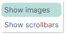

  - [`CheckBoxStyle.CheckBox`](../../API/Eremex.AvaloniaUI.Controls.Bars/CheckBoxStyle.md) — элемент отображает переключаемый флажок перед своим текстом и глифом. Когда [`IsChecked`](../../API/Eremex.AvaloniaUI.Controls.Bars/ToolbarCheckItem/IsChecked.md) равно `true`, флажок имеет отметку.

    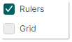
    
  - [`CheckBoxStyle.RadioButton`](../../API/Eremex.AvaloniaUI.Controls.Bars/CheckBoxStyle.md) — элемент отображает радиокнопку перед своим текстом и глифом. Когда [`IsChecked`](../../API/Eremex.AvaloniaUI.Controls.Bars/ToolbarCheckItem/IsChecked.md) равно `true`, радиокнопка отрисовывается как заполненный круг.

    Вы можете применить стиль RadioButton к объектам [`ToolbarCheckItem`](../../API/Eremex.AvaloniaUI.Controls.Bars/ToolbarCheckItem.md), объединённым в группу флажков ([`ToolbarCheckItemGroup`](#неразрывные-группы-флажков-toolbarcheckitemgroup)). В этом случае группа выглядит как обычная радиогруппа.

    ``` xml
    <mxb:ToolbarCheckItemGroup CheckType="Radio">
        <mxb:ToolbarCheckItem Header="E-mail" CheckBoxStyle="RadioButton" />
        <mxb:ToolbarCheckItem Header="Phone" CheckBoxStyle="RadioButton" />
    </mxb:ToolbarCheckItemGroup>
    ```
    
    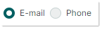
    
- [`CheckBoxAlignment`](../../API/Eremex.AvaloniaUI.Controls.Bars/CheckBoxAlignment.md) — возвращает или задаёт, отображаются ли флажок (или радиокнопка) до или после глифа и текста элемента. Эта опция действует, когда свойство [`CheckBoxStyle`](../../API/Eremex.AvaloniaUI.Controls.Bars/CheckBoxStyle.md) установлено в [`CheckBoxStyle.CheckBox`](../../API/Eremex.AvaloniaUI.Controls.Bars/CheckBoxStyle.md) или [`CheckBoxStyle.RadioButton`](../../API/Eremex.AvaloniaUI.Controls.Bars/CheckBoxStyle.md).

    ```xml
    <mxb:ToolbarCheckItem Header="Status bar" CheckBoxAlignment="After"
                        CheckBoxStyle="CheckBox"
                        Hint="Show and hide the status bar"/>
    <mxb:ToolbarSeparatorItem/>
    ```
    
    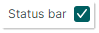
    


Вы можете настраивать общие параметры отображения кнопок-флажков так же, как и обычных кнопок.

- [Общие настройки отображения элемента](#общие-настройки-отображения-элемента)

### Подменю (ToolbarMenuItem)

Используйте [`ToolbarMenuItem`](../../API/Eremex.AvaloniaUI.Controls.Bars/ToolbarMenuItem.md), чтобы создать элемент, отображающий подменю при щелчке. 

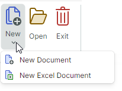

#### Содержимое подменю

Чтобы задать содержимое подменю, определите элементы между открывающим и закрывающим тегами **&lt;ToolbarMenuItem&gt;** в XAML или добавьте элементы в коллекцию [`ToolbarMenuItem.Items`](../../API/Eremex.AvaloniaUI.Controls.Bars/ToolbarMenuItem/Items.md) в code-behind.

``` xml
xmlns:mxb="https://schemas.eremexcontrols.net/avalonia/bars"

<mxb:ToolbarMenuItem Header="File" Category="File">
    <mxb:ToolbarButtonItem Header="New" 
     Glyph="{SvgImage 'avares://DemoCenter/Images/Group=Context Menu, Icon=NewDraftAction.svg'}" 
     Category="File" Command="{Binding NewFileCommand}"/>
    <mxb:ToolbarButtonItem Header="Open" 
     Glyph="{SvgImage 'avares://DemoCenter/Images/Group=Basic, Icon=Folder Open.svg'}" 
     Category="File" Command="{Binding OpenFileCommand}"/>
    <mxb:ToolbarButtonItem Header="Save" 
     Glyph="{SvgImage 'avares://DemoCenter/Images/Group=Basic, Icon=Save.svg'}" 
     Category="File" Command="{Binding SaveFileCommand}"/>
    <mxb:ToolbarButtonItem Header="Print" 
     Glyph="{SvgImage 'avares://DemoCenter/Images/Group=Basic, Icon=Print.svg'}" 
     ShowSeparator="True"  Category="File" Command="{Binding PrintFileCommand}"/>
</mxb:ToolbarMenuItem>
```

Вы также можете использовать свойство [`ToolbarMenuItem.ItemsSource`](../../API/Eremex.AvaloniaUI.Controls.Bars/ToolbarMenuItem/ItemsSource.md), чтобы заполнить подменю элементами из коллекции бизнес-объектов во View Model. Соответствующие шаблоны данных должны определять элементы Ribbon и инициализировать их настройки из базовых бизнес-объектов.


#### Вызов подменю

Когда вызывается подменю, возникают следующие события:

- `Opening` — возникает, когда меню собирается отобразиться. Это событие позволяет отменить отображение меню.
- `Opened` — возникает после отображения меню.
- `Closing` — возникает, когда меню собирается закрыться. Это событие позволяет отменить закрытие меню.
- `Closed` — возникает после закрытия меню.

Следующее свойство позволяет отменить отображение подменю и задать, отображать ли подменю по событию щелчка или нажатия мыши.

- [`DropDownOpenMode`](../../API/Eremex.AvaloniaUI.Controls.Bars/DropDownOpenMode.md) — возвращает или задаёт, вызывается ли подменю и как, при взаимодействии пользователя с элементом. Поддерживаемые опции:
    - [`Press`](../../API/Eremex.AvaloniaUI.Controls.Bars/ToolbarItem/Press.md) или `Default` — меню отображается по событию нажатия мыши.
    - [`Click`](../../API/Eremex.AvaloniaUI.Controls.Bars/ToolbarItem/Click.md) — меню отображается после нажатия и отпускания мыши над элементом.
    - `Never` — меню не отображается.


#### Подпись, глиф и настройки отображения

- [`Header`](../../API/Eremex.AvaloniaUI.Controls.Bars/ToolbarItem/Header.md) — текст заголовка подменю.
- [`Glyph`](../../API/Eremex.AvaloniaUI.Controls.Bars/ToolbarItem/Glyph.md) — изображение подменю. Подменю поддерживает как большие, так и маленькие изображения в заголовке. Смотрите следующие разделы, чтобы узнать, как задавать размер глифов элементов в контроле Ribbon:

  - [Размер глифа](#размер-глифа)
  - [Адаптивный размер глифа в классической компоновке команд](#адаптивный-размер-глифа-в-классической-компоновке-команд)

- [`GlyphTemplate`](../../API/Eremex.AvaloniaUI.Controls.Bars/ToolbarItem/GlyphTemplate.md) — пользовательский шаблон данных для отрисовки изображения элемента.

Вы можете настраивать общие параметры отображения подменю так же, как и обычных кнопок.

- [Общие настройки отображения элемента](#общие-настройки-отображения-элемента)


### Встроенные редакторы (ToolbarEditorItem)

Используйте объект [`ToolbarEditorItem`](../../API/Eremex.AvaloniaUI.Controls.Bars/ToolbarEditorItem.md), чтобы встроить встроенный редактор в контрол Ribbon. 

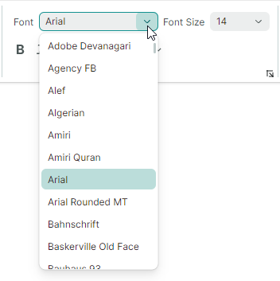

Объект [`ToolbarEditorItem`](../../API/Eremex.AvaloniaUI.Controls.Bars/ToolbarEditorItem.md) поддерживает следующие подходы к заданию встроенного редактора:

- [Задание типа редактора](#задание-типа-редактора). Это рекомендуемый способ задания встроенного редактора Eremex.

- [Задание редактора в шаблоне данных](#задание-редактора-в-шаблоне-данных)


#### Задание типа редактора

Этот подход позволяет встроить редактор Eremex. 

Чтобы задать тип редактора, установите свойство [`ToolbarEditorItem.EditorProperties`](../../API/Eremex.AvaloniaUI.Controls.Bars/ToolbarEditorItem/EditorProperties.md) в один из следующих объектов:

- [`ButtonEditorProperties`](../../API/Eremex.AvaloniaUI.Controls.Editors/ButtonEditorProperties.md) — соответствует встроенному редактору [`ButtonEditor`](../../API/Eremex.AvaloniaUI.Controls.Editors/ButtonEditor.md).
- [`CheckEditorProperties`](../../API/Eremex.AvaloniaUI.Controls.Editors/CheckEditorProperties.md) — соответствует встроенному редактору [`CheckEditor`](../../API/Eremex.AvaloniaUI.Controls.Editors/CheckEditor.md).
- `ColorEditorProperties` — соответствует встроенному редактору [`ColorEditor`](../../API/Eremex.AvaloniaUI.Controls.Editors/ColorEditor.md).
- [`ComboBoxEditorProperties`](../../API/Eremex.AvaloniaUI.Controls.Editors/ComboBoxEditorProperties.md) — соответствует встроенному редактору [`ComboBoxEditor`](../../API/Eremex.AvaloniaUI.Controls.Editors/ComboBoxEditor.md).
- [`HyperlinkEditorProperties`](../../API/Eremex.AvaloniaUI.Controls.Editors/HyperlinkEditorProperties.md) — соответствует встроенному редактору [`HyperlinkEditor`](../../API/Eremex.AvaloniaUI.Controls.Editors/HyperlinkEditor.md).
- [`PopupColorEditorProperties`](../../API/Eremex.AvaloniaUI.Controls.Editors/PopupColorEditorProperties.md) — соответствует встроенному редактору [`PopupColorEditor`](../../API/Eremex.AvaloniaUI.Controls.Editors/PopupColorEditor.md).
- [`PopupEditorProperties`](../../API/Eremex.AvaloniaUI.Controls.Editors/PopupEditorProperties.md) — соответствует встроенному редактору [`PopupEditor`](../../API/Eremex.AvaloniaUI.Controls.Editors/PopupEditor.md).
- [`SegmentedEditorProperties`](../../API/Eremex.AvaloniaUI.Controls.Editors/SegmentedEditorProperties.md) — соответствует встроенному редактору [`SegmentedEditor`](../../API/Eremex.AvaloniaUI.Controls.Editors/SegmentedEditor.md).
- [`SpinEditorProperties`](../../API/Eremex.AvaloniaUI.Controls.Editors/SpinEditorProperties.md) — соответствует встроенному редактору [`SpinEditor`](../../API/Eremex.AvaloniaUI.Controls.Editors/SpinEditor.md).
- [`TextEditorProperties`](../../API/Eremex.AvaloniaUI.Controls.Editors/TextEditorProperties.md) — соответствует встроенному редактору [`TextEditor`](../../API/Eremex.AvaloniaUI.Controls.Editors/TextEditor.md).
- [`MemoEditorProperties`](../../API/Eremex.AvaloniaUI.Controls.Editors/MemoEditorProperties.md) — соответствует встроенному редактору [`MemoEditor`](../../API/Eremex.AvaloniaUI.Controls.Editors/MemoEditor.md).

Эти объекты являются потомками [`BaseEditorProperties`](../../API/Eremex.AvaloniaUI.Controls.Editors/BaseEditorProperties.md). Они содержат настройки для настройки соответствующих встроенных редакторов.

Этот пример определяет элемент _Font_ (объект [`ToolbarEditorItem`](../../API/Eremex.AvaloniaUI.Controls.Bars/ToolbarEditorItem.md)), отображающий список шрифтов с помощью встроенного редактора combobox. Свойство [`ToolbarEditorItem.EditorProperties`](../../API/Eremex.AvaloniaUI.Controls.Bars/ToolbarEditorItem/EditorProperties.md) установлено в объект [`ComboBoxEditorProperties`](../../API/Eremex.AvaloniaUI.Controls.Editors/ComboBoxEditorProperties.md), что соответствует редактору [`ComboBoxEditor`](../../API/Eremex.AvaloniaUI.Controls.Editors/ComboBoxEditor.md). Полный код смотрите в демо _WordPad Example_.

``` xml
<mxb:ToolbarEditorItem Header="Font" EditorWidth="150" 
 EditorValue="{Binding #textBox.FontFamily, Converter={helpers:FontNameToFontFamilyConverter}}">
    <mxb:ToolbarEditorItem.EditorProperties>
        <mxe:ComboBoxEditorProperties 
         ItemsSource="{Binding $parent[view:ToolbarAndMenuPageView].Fonts}"
         IsTextEditable="False" PopupMaxHeight="300"/>
    </mxb:ToolbarEditorItem.EditorProperties>
</mxb:ToolbarEditorItem>      
```

#### Задание редактора в шаблоне данных

Используйте свойство [`ToolbarEditorItem.EditorTemplate`](../../API/Eremex.AvaloniaUI.Controls.Bars/ToolbarEditorItem/EditorTemplate.md), чтобы задать редактор в шаблоне данных. В этом случае вам нужно вручную задать значение для редактора (например, с помощью привязки данных).

``` xml
<mxb:ToolbarEditorItem Width="150">
    <mxb:ToolbarEditorItem.EditorTemplate>
        <DataTemplate>
            <mxe:TextEditor EditorValue="{Binding Count}" Width="80"/>
        </DataTemplate>
    </mxb:ToolbarEditorItem.EditorTemplate>
</mxb:ToolbarEditorItem>
```

#### Изменение и возврат значения редактора

- [`ToolbarEditorItem.EditorValue`](../../API/Eremex.AvaloniaUI.Controls.Bars/ToolbarEditorItem/EditorValue.md) — возвращает или задаёт значение встроенного редактора. Используйте это свойство для привязки данных.

- [`ToolbarEditorItem.EditorValueChanged`](../../API/Eremex.AvaloniaUI.Controls.Bars/ToolbarEditorItem/EditorValueChanged.md) — событие, возникающее после изменения значения редактора.

Эти члены действуют, когда вы используете свойство [`ToolbarEditorItem.EditorProperties`](../../API/Eremex.AvaloniaUI.Controls.Bars/ToolbarEditorItem/EditorProperties.md) для задания редактора.

#### Ширина редактора

<!-- TODO 
Not supported in Ribbon

 - [`ToolbarEditorItem.SizeMode`](../../API/Eremex.AvaloniaUI.Controls.Bars/ToolbarEditorItem/SizeMode.md) — Gets or sets the item's size mode. This property allows you to stretch the bar item, so it occupues all the available empty space within the bar. -->
- [`ToolbarEditorItem.EditorWidth`](../../API/Eremex.AvaloniaUI.Controls.Bars/ToolbarEditorItem/EditorWidth.md) — возвращает или задаёт ширину встроенного редактора. Это свойство действует, когда вы используете свойство [`ToolbarEditorItem.EditorProperties`](../../API/Eremex.AvaloniaUI.Controls.Bars/ToolbarEditorItem/EditorProperties.md) для задания редактора. Если вы задаёте редактор в шаблоне данных, вы можете задать ширину редактора с помощью свойства `ToolbarEditorItem.Width` или задать ширину для самого редактора.
<!-- TODO
Doesn't work:

- [`ToolbarEditorItem.EditorHeight`](../../API/Eremex.AvaloniaUI.Controls.Bars/ToolbarEditorItem/EditorHeight.md) — Gets or sets the in-place editor's height. 
- [`ToolbarEditorItem.EditorAlignment`](../../API/Eremex.AvaloniaUI.Controls.Bars/ToolbarEditorItem/EditorAlignment.md) — Gets or sets the editor's alignment relative to the item's header.
-->

<!--TODO - `ToolbarEditorItem.Editor` -  

-->

#### Подпись и глиф

- [`Header`](../../API/Eremex.AvaloniaUI.Controls.Bars/ToolbarItem/Header.md) — отображаемый текст элемента.

- [`Glyph`](../../API/Eremex.AvaloniaUI.Controls.Bars/ToolbarItem/Glyph.md) — изображение элемента. Объекты [`ToolbarEditorItem`](../../API/Eremex.AvaloniaUI.Controls.Bars/ToolbarEditorItem.md) поддерживают только маленькие изображения. Размер маленьких изображений задаётся свойством [`RibbonControl.SmallGlyphSize`](../../API/Eremex.AvaloniaUI.Controls.Ribbon/RibbonControl/SmallGlyphSize.md) в классической компоновке команд и свойством [`RibbonControl.GlyphSizeInSimplifiedLayout`](../../API/Eremex.AvaloniaUI.Controls.Ribbon/RibbonControl/GlyphSizeInSimplifiedLayout.md) в упрощённой компоновке команд.
- [`GlyphTemplate`](../../API/Eremex.AvaloniaUI.Controls.Bars/ToolbarItem/GlyphTemplate.md) — пользовательский шаблон данных для отрисовки изображения элемента.

Вы можете настраивать общие параметры отображения объектов [`ToolbarEditorItem`](../../API/Eremex.AvaloniaUI.Controls.Bars/ToolbarEditorItem.md) так же, как и обычных кнопок.

- [Общие настройки отображения элемента](#общие-настройки-отображения-элемента)


### Текстовые надписи (ToolbarTextItem)


Используйте объект [`ToolbarTextItem`](../../API/Eremex.AvaloniaUI.Controls.Bars/ToolbarTextItem.md), чтобы отобразить текстовую надпись, которую пользователи не могут редактировать.

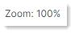

``` xml
<mxb:ToolbarTextItem 
 Header="{Binding #scaleDecorator.Scale, StringFormat={}Zoom: {0:P0}}" 
 ShowBorder="False" 
 />
```

#### Подпись и глиф

- [`Header`](../../API/Eremex.AvaloniaUI.Controls.Bars/ToolbarItem/Header.md) — отображаемый текст элемента.
- [`Glyph`](../../API/Eremex.AvaloniaUI.Controls.Bars/ToolbarItem/Glyph.md) — изображение элемента. Текстовая надпись поддерживает как большие, так и маленькие изображения. Смотрите следующие разделы, чтобы узнать, как задавать размер глифов элементов в контроле Ribbon:

  - [Размер глифа](#размер-глифа)
  - [Адаптивный размер глифа в классической компоновке команд](#адаптивный-размер-глифа-в-классической-компоновке-команд)


#### Настройки отображения текстовой надписи

- [`ToolbarTextItem.ShowBorder`](../../API/Eremex.AvaloniaUI.Controls.Bars/ToolbarTextItem/ShowBorder.md) — возвращает или задаёт, видима ли рамка элемента. 

  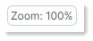

  Вы можете использовать свойство [`ToolbarTextItem.BorderTemplate`](../../API/Eremex.AvaloniaUI.Controls.Bars/ToolbarTextItem/BorderTemplate.md), чтобы задать пользовательский шаблон для отрисовки рамки.
- [`ToolbarTextItem.BorderTemplate`](../../API/Eremex.AvaloniaUI.Controls.Bars/ToolbarTextItem/BorderTemplate.md) — возвращает или задаёт пользовательский шаблон для отрисовки рамки элемента. Этот шаблон действует, если включена опция [`ToolbarTextItem.ShowBorder`](../../API/Eremex.AvaloniaUI.Controls.Bars/ToolbarTextItem/ShowBorder.md).


Смотрите также:

- [Общие настройки отображения элемента](#общие-настройки-отображения-элемента)


### Неразрывные группы элементов (ToolbarItemGroup)

Используйте [`ToolbarItemGroup`](../../API/Eremex.AvaloniaUI.Controls.Bars/ToolbarItemGroup.md), чтобы создать неразрывный контейнер (группу) элементов панели. Элементы в этом контейнере всегда отображаются вместе в линию и действуют как единое целое при изменении размера Ribbon. 

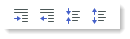

В [классической компоновке команд](ribbon-command-layouts.md) элементы [`ToolbarItemGroup`](../../API/Eremex.AvaloniaUI.Controls.Bars/ToolbarItemGroup.md) поддерживают только маленькие изображения.

#### Содержимое группы

Чтобы задать содержимое контейнера, определите элементы между открывающим и закрывающим тегами **&lt;ToolbarItemGroup&gt;** в XAML или добавьте элементы в коллекцию [`ToolbarItemGroup.Items`](../../API/Eremex.AvaloniaUI.Controls.Bars/ToolbarItemGroup/Items.md) в code-behind.

``` xml
<mxb:ToolbarItemGroup>
    <mxb:ToolbarButtonItem Header="Increase" KeyTip="CR" Glyph="{x:Static icons:Basic.Level_Increase}" />
    <mxb:ToolbarButtonItem Header="Decrease" KeyTip="DC" Glyph="{x:Static icons:Basic.Level_Reduce}" />
    <mxb:ToolbarButtonItem Header="Collapse" KeyTip="CL" Glyph="{x:Static icons:Basic.List_Collapse}" />
    <mxb:ToolbarButtonItem Header="Expand" KeyTip="EX" Glyph="{x:Static icons:Basic.List_Expand}" />
</mxb:ToolbarItemGroup>
```

Вы также можете использовать свойство [`ToolbarItemGroup.ItemsSource`](../../API/Eremex.AvaloniaUI.Controls.Bars/ToolbarItemGroup/ItemsSource.md), чтобы заполнить контейнер элементами из коллекции бизнес-объектов, хранящихся во View Model. Соответствующие шаблоны данных должны определять элементы Ribbon и инициализировать их настройки из базовых бизнес-объектов.

Смотрите также:

- [Настройка размещения элементов в группах страниц](page-groups.md#настройка-размещения-элементов-в-группах-страниц)
- [Размещение неразрывных контейнеров в две или три строки](page-groups.md#размещение-неразрывных-контейнеров-в-две-или-три-строки)

### Неразрывные группы флажков (ToolbarCheckItemGroup)

Используйте [`ToolbarCheckItemGroup`](../../API/Eremex.AvaloniaUI.Controls.Bars/ToolbarCheckItemGroup.md), чтобы создать неразрывный контейнер (группу) флажков ([объектов [`ToolbarCheckItem`](../../API/Eremex.AvaloniaUI.Controls.Bars/ToolbarCheckItem.md)](#кнопки-флажки-toolbarcheckitem)). Как и объект [`ToolbarItemGroup`](../../API/Eremex.AvaloniaUI.Controls.Bars/ToolbarItemGroup.md), объект [`ToolbarCheckItemGroup`](../../API/Eremex.AvaloniaUI.Controls.Bars/ToolbarCheckItemGroup.md) действует как единое целое при изменении размера родителя (содержимое контейнера не может быть частично скрыто; элементы всегда отображаются в одну линию и не поддерживают перенос).


Контейнер [`ToolbarCheckItemGroup`](../../API/Eremex.AvaloniaUI.Controls.Bars/ToolbarCheckItemGroup.md) может управлять состоянием нажатия своих дочерних элементов [`ToolbarCheckItem`](../../API/Eremex.AvaloniaUI.Controls.Bars/ToolbarCheckItem.md). Вы можете использовать контейнер [`ToolbarCheckItemGroup`](../../API/Eremex.AvaloniaUI.Controls.Bars/ToolbarCheckItemGroup.md) для создания следующих типов групп:

- Группа взаимоисключающих элементов (радиогруппа).
- Группа, позволяющая отмечать несколько элементов одновременно.

В [классической компоновке команд](ribbon-command-layouts.md) элементы [`ToolbarCheckItemGroup`](../../API/Eremex.AvaloniaUI.Controls.Bars/ToolbarCheckItemGroup.md) поддерживают только маленькие изображения.

#### Содержимое группы

Чтобы задать содержимое контейнера, определите элементы [`ToolbarCheckItem`](../../API/Eremex.AvaloniaUI.Controls.Bars/ToolbarCheckItem.md) между открывающим и закрывающим тегами **&lt;ToolbarCheckItemGroup&gt;** в XAML или добавьте элементы в коллекцию [`ToolbarCheckItemGroup.Items`](../../API/Eremex.AvaloniaUI.Controls.Bars/ToolbarItemGroup/Items.md) в code-behind.

``` xml
<mxb:ToolbarCheckItemGroup>
    <mxb:ToolbarCheckItem Header="Bold" KeyTip="B" Glyph="{x:Static icons:Basic.Font_Bold}" />
    <mxb:ToolbarCheckItem Header="Italic" KeyTip="I" Glyph="{x:Static icons:Basic.Font_Italic}" />
    <mxb:ToolbarCheckItem Header="Underline" KeyTip="U" Glyph="{x:Static icons:Basic.Font_Underline}" />
</mxb:ToolbarCheckItemGroup>
```

Вы также можете использовать свойство [`ToolbarCheckItemGroup.ItemsSource`](../../API/Eremex.AvaloniaUI.Controls.Bars/ToolbarItemGroup/ItemsSource.md), чтобы заполнить контейнер элементами из коллекции бизнес-объектов, хранящихся во View Model. Соответствующие шаблоны данных должны определять элементы Ribbon и инициализировать их настройки из базовых бизнес-объектов.


#### Нажатие элементов группы

- [`ToolbarCheckItemGroup.CheckType`](../../API/Eremex.AvaloniaUI.Controls.Bars/ToolbarCheckItemGroup/CheckType.md) — возвращает или задаёт, можно ли отмечать один или несколько элементов в группе одновременно. Поддерживаются следующие опции:

    - `Default` или `Multiple` — можно отмечать несколько элементов одновременно.
    - `Radio` — группа взаимоисключающих элементов. Пользователь не может снять отметку с элемента иначе как отметив другой.
    - `Single` — группа взаимоисключающих элементов. Пользователь может снять отметку со всех элементов в группе.

- [`ToolbarCheckItem.IsChecked`](../../API/Eremex.AvaloniaUI.Controls.Bars/ToolbarCheckItem/IsChecked.md) — возвращает или задаёт состояние нажатия кнопки.


Смотрите также:

- [Настройка размещения элементов в группах страниц](page-groups.md#настройка-размещения-элементов-в-группах-страниц)
- [Размещение неразрывных контейнеров в две или три строки](page-groups.md#размещение-неразрывных-контейнеров-в-две-или-три-строки)

### Разделители (ToolbarSeparatorItem)

Объект [`ToolbarSeparatorItem`](../../API/Eremex.AvaloniaUI.Controls.Bars/ToolbarSeparatorItem.md) позволяет вставить разделитель.


``` xml
<mxb:ToolbarMenuItem Header="File" Category="File">
    <mxb:ToolbarButtonItem Header="New" 
     Glyph="{SvgImage 'avares://DemoCenter/Images/Group=Context Menu, Icon=NewDraftAction.svg'}" 
     Category="File"/>
    <mxb:ToolbarButtonItem Header="Open" 
     Glyph="{SvgImage 'avares://DemoCenter/Images/Group=Basic, Icon=Folder Open.svg'}" 
     Category="File"/>
    <mxb:ToolbarButtonItem Header="Save" 
     Glyph="{SvgImage 'avares://DemoCenter/Images/Group=Basic, Icon=Save.svg'}" 
     Category="File"/>
    <mxb:ToolbarSeparatorItem/>
    <mxb:ToolbarButtonItem Header="Print" 
     Glyph="{SvgImage 'avares://DemoCenter/Images/Group=Basic, Icon=Print.svg'}" 
     Category="File"/>
</mxb:ToolbarMenuItem>
```

### Галереи

Чтобы создать галерею, используйте элемент [`RibbonGalleryItem`](../../API/Eremex.AvaloniaUI.Controls.Ribbon/RibbonGalleryItem.md). Следующее изображение отображает встроенную в Ribbon галерею.

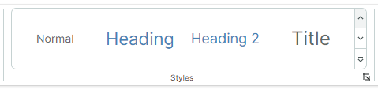

Когда вы добавляете объект [`RibbonGalleryItem`](../../API/Eremex.AvaloniaUI.Controls.Ribbon/RibbonGalleryItem.md) на традиционную панель инструментов или во всплывающее меню, галерея отображается как подменю.

Дополнительную информацию смотрите в следующем разделе: [Галереи](galleries.md)

## Горячие клавиши

Вы можете использовать свойство [`ToolbarItem.HotKey`](../../API/Eremex.AvaloniaUI.Controls.Bars/ToolbarItem/HotKey.md), чтобы назначать элементам горячие клавиши. 

``` xml
<mxb:ToolbarButtonItem 
    Header="Open" Command="{Binding OpenCommand}" HotKey="Ctrl+O"
    Glyph="{x:Static icons:Basic.Folder_Open}"/>
```

Нажатие горячей клавиши активирует команду элемента при условии, что фокус находится в пределах области действия горячих клавиш. Область действия горячих клавиш по умолчанию — область UI в границах компонента [`ToolbarManager`](../../API/Eremex.AvaloniaUI.Controls.Bars/ToolbarManager.md). Когда фокус ввода находится за пределами области действия горячих клавиш, [`ToolbarManager`](../../API/Eremex.AvaloniaUI.Controls.Bars/ToolbarManager.md) не может перехватывать горячие клавиши.

Свойство [`ToolbarManager.IsWindowManager`](../../API/Eremex.AvaloniaUI.Controls.Bars/ToolbarManager/IsWindowManager.md) позволяет расширить область действия горячих клавиш на всё окно. Когда вы устанавливаете это свойство в `true`, компонент [`ToolbarManager`](../../API/Eremex.AvaloniaUI.Controls.Bars/ToolbarManager.md) регистрирует горячие клавиши элементов в окне. Он сможет перехватывать и обрабатывать горячие клавиши, даже если фокус находится за пределами его клиентской области.

## Всплывающие подсказки

Используйте свойство [`ToolbarItem.Hint`](../../API/Eremex.AvaloniaUI.Controls.Bars/ToolbarItem/Hint.md), чтобы задавать всплывающие подсказки для элементов Ribbon:

``` xml
<mxb:ToolbarButtonItem Header="Increase" HotKey="CTRL+J" 
  Glyph="{x:Static icons:Basic.Level_Increase}" 
  Hint="Increase the indent"/>
```

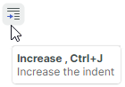

## Смотрите также

- [Key Tips](key-tips.md)
- [Настройка размещения элементов в группах страниц](page-groups.md#настройка-размещения-элементов-в-группах-страниц)


<br>
<br>

<sup>*</sup> Эта страница переведена с использованием технологий машинного перевода.
