# Визуальные темы

В Avalonia UI визуальные темы определяют настройки внешнего вида, ресурсы и шаблоны для контролов. Библиотека контролов Eremex включает следующие визуальные темы для отрисовки контролов, поставляемых с библиотекой:

<table >
  <thead>
    <tr>
      <th style="visibility: visible;">Тема&nbsp;оформления</th>
      <th style="visibility: visible;">Описание</th>
      <th style="visibility: visible;">Пакет</th>
    </tr>
  </thead>
  <tbody>
    <tr>
      <td><code>DeltaDesign</code></td>
      <td>Содержит визуальные настройки для контролов Eremex (кроме <a href="../../API/Eremex.AvaloniaUI.Controls3D/Graphics3DControl.md"><code>Graphics3DControl</code></a>) и набора стандартных контролов Avalonia UI.</td>
      <td>пакет <code>Eremex.Avalonia.Themes.DeltaDesign</code></td>
    </tr>
    <tr>
      <td><code>Controls3D</code></td>
      <td>Содержит визуальные настройки для <a href="../../API/Eremex.AvaloniaUI.Controls3D/Graphics3DControl.md"><code>Graphics3DControl</code></a>.</td>
      <td>пакет <code>Eremex.Avalonia.Controls3D</code></td>
    </tr>
  </tbody>
</table>


Вы должны [добавить и зарегистрировать](register-an-eremex-paint-theme.md) соответствующую тему (темы), чтобы контролы Eremex отрисовывались корректно. Без соответствующей темы контролы будут отображаться пустыми.

## Светлый и тёмный варианты темы

Визуальные темы Eremex поддерживают светлый и тёмный варианты:

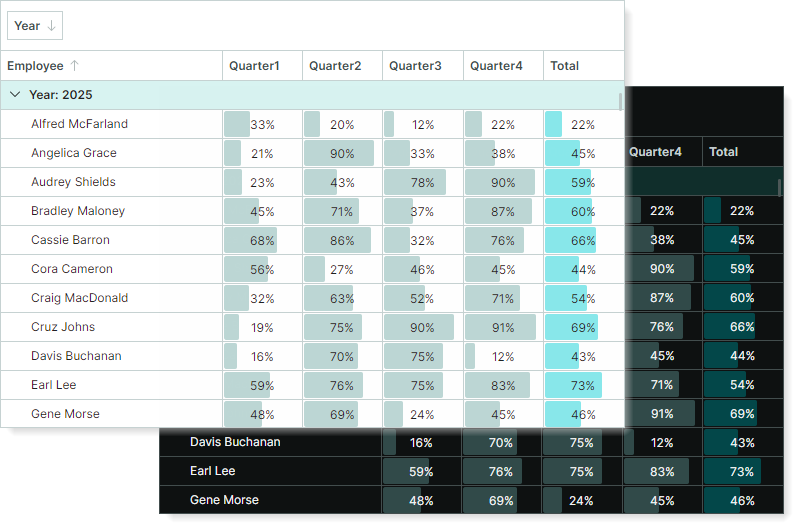

Чтобы задать нужный вариант темы, установите свойство `Application.RequestedThemeVariant` (например, в файле _App.axaml_).

``` xml
<Application
    RequestedThemeVariant="Default" ... >
    <!-- "Default" - The application's theme is defined by the system setting.
         "Light" - Enables the Light theme.
         "Dark" - Enables the Dark theme.
    -->
</Application>
```

## Цветовые палитры темы DeltaDesign

Тема `DeltaDesign` предоставляет несколько цветовых палитр, с помощью которых можно точно настроить внешний вид контролов Eremex в приложении. Цветовая палитра накладывает набор цветов поверх базовой темы и меняет оформление контролов и акцентные цвета.

Применение палитры динамически меняет цвета ключевых элементов интерфейса, в том числе:

- фон окон, панелей и контейнеров;
- фон редакторов в различных состояниях (обычном, при наведении и в фокусе);
- фон строк и ячеек в контролах, работающих с данными;
- выделение, подсветку элементов под курсором и акценты контрола в фокусе.

Доступные палитры представлены перечислением `Eremex.AvaloniaUI.Themes.DeltaDesign.Palette`:

<style>

th {
    visibility: collapse;
}
td, th, tr {
   border: none!important;
   vertical-align: top;
}
</style>


| <div style="width:400px"></div> | <div style="width:400px"></div> |
|---|---|
| **Nova** (по умолчанию)<br>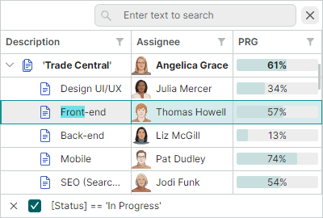 | **NovaDeep**<br>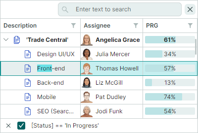 |
| **Helios**<br>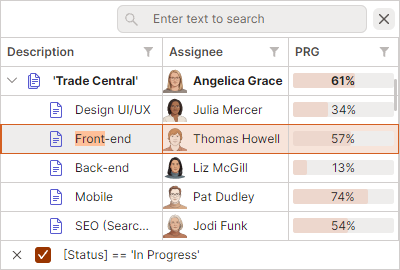 | **HeliosDeep**<br>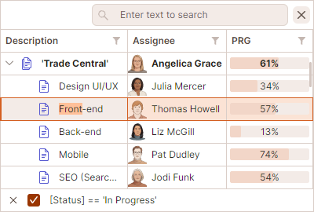 |
| **Terra**<br>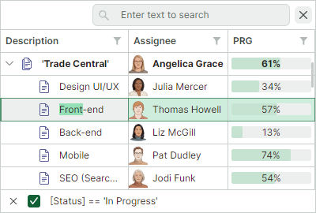 | **TerraDeep**<br>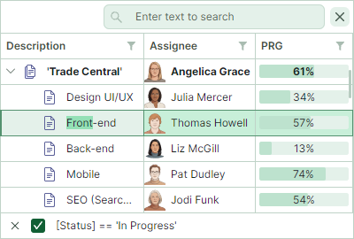 |
| **Vega**<br>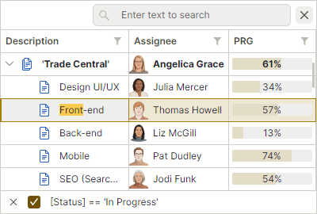 | **VegaDeep**<br>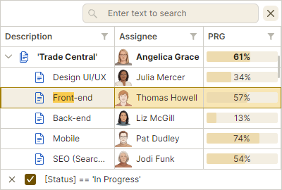 |
| **Atlas**<br>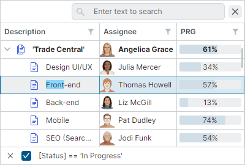 | **AtlasDeep**<br>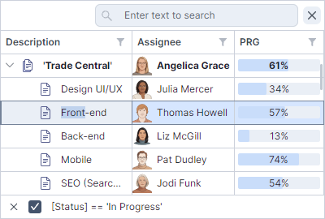 |


Цветовые палитры поддерживаются как для светлого, так и для тёмного варианта темы.

| <div style="width:400px"></div> | <div style="width:400px"></div> |
|---|---|
| **Helios** (светлый)<br>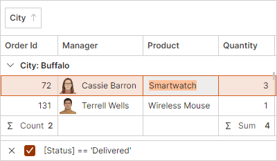 | **Helios** (тёмный)<br>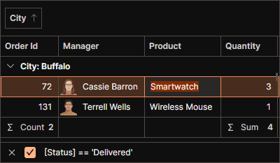 |


### Применение палитры

Чтобы изменить цветовую палитру, установите свойство `DeltaDesignTheme.Palette` в одно из значений перечисления `Eremex.AvaloniaUI.Themes.DeltaDesign.Palette`.

Этот пример задаёт палитру при [регистрации](register-an-eremex-paint-theme.md) темы `DeltaDesign` в файле _App.axaml_:

``` xml
<Application xmlns="https://github.com/avaloniaui"
             xmlns:x="http://schemas.microsoft.com/winfx/2006/xaml"
             xmlns:local="using:DemoCenter"
             x:Class="DemoCenter.App"
             xmlns:theme="clr-namespace:Eremex.AvaloniaUI.Themes.DeltaDesign;assembly=Eremex.Avalonia.Themes.DeltaDesign"
             RequestedThemeVariant="Light">
    <Application.Styles>
        <theme:DeltaDesignTheme Palette="AtlasDeep"/>
        ...
    </Application.Styles>
</Application>
```

Чтобы изменить палитру во время работы приложения, найдите зарегистрированную тему `DeltaDesign` в стилях приложения и измените её свойство `DeltaDesignTheme.Palette`:

```csharp
using Eremex.AvaloniaUI.Themes.DeltaDesign;

var deltaDesignTheme = Application.Current?.Styles.OfType<DeltaDesignTheme>().FirstOrDefault();
deltaDesignTheme.Palette = Palette.HeliosDeep;
```

#### Селектор палитры в интерфейсе приложения

Для управления параметрами темы `DeltaDesign`, включая цветовые палитры, плотность интерфейса и варианты темы, можно использовать объект [IAppearanceService](../app-services/appearanceservice.md). [`IAppearanceService`](../../API/Eremex.AvaloniaUI.Controls.ApplicationServices/IAppearanceService.md) позволяет менять параметры темы в коде. Он также упрощает создание в интерфейсе селекторов (галереи Ribbon, комбобокса или меню), с помощью которых пользователи переключают параметры темы во время работы приложения.

На следующем изображении комбобокс используется как селектор доступных цветовых палитр.


Подробнее см. в разделе [Пример - создание селектора палитры в View](../app-services/appearanceservice.md#пример---создание-селектора-палитры-в-view).

## Стилизация стандартных контролов Avalonia

Визуальная тема `DeltaDesign` также включает стили для распространённых стандартных контролов Avalonia. Если вы используете стандартные контролы Avalonia, не поддерживаемые темой `DeltaDesign`, вам также необходимо зарегистрировать тему `Fluent`. Инструкции смотрите в следующем разделе:

- [Регистрация темы 'FluentTheme' для стандартных контролов Avalonia](register-an-eremex-paint-theme.md#регистрация-темы-fluenttheme-для-стандартных-контролов-avalonia).

## Настройка темы

Чтобы изменить внешний вид контролов Eremex, вам следует настроить соответствующие параметры темы.
В следующем разделе объясняется, как изменять стили для отдельных контролов или для всех контролов Eremex в вашем проекте:

- [Изменение тем элементов управления](modify-control-themes.md)


## Смотрите также

- [Выбор светлого или тёмного варианта темы](register-an-eremex-paint-theme.md#выбор-светлого-или-тёмного-варианта-темы)


<br>
<br>

<sup>*</sup> Эта страница переведена с использованием технологий машинного перевода.
