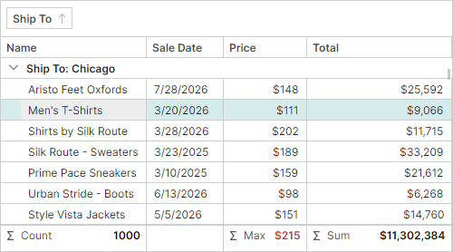
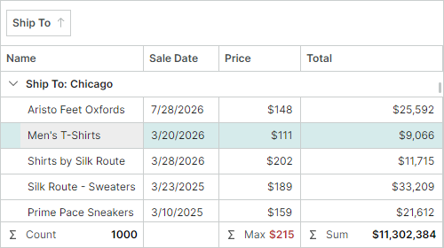
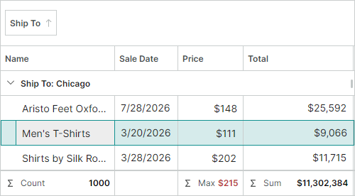

# Плотность интерфейса

Иногда приложению нужно максимально использовать площадь экрана или, наоборот, обеспечить более просторную компоновку. Для этого тема `DeltaDesign` позволяет изменить плотность интерфейса (UI density), которая влияет на отступы элементов и размеры шрифтов. Доступны три предопределённых режима:

- `Compact`

    

- `Standard` (по умолчанию)

    

- `Spacious`

    


## Изменение плотности интерфейса

Чтобы изменить плотность интерфейса, установите свойство `DeltaDesignTheme.Density` в одно из значений перечисления `Eremex.AvaloniaUI.Themes.DeltaDesign.Density`.

Этот пример задаёт плотность интерфейса при [регистрации](register-an-eremex-paint-theme.md) темы `DeltaDesign` в файле _App.axaml_:

```xml
<Application xmlns="https://github.com/avaloniaui"
             xmlns:x="http://schemas.microsoft.com/winfx/2006/xaml"
             xmlns:theme="clr-namespace:Eremex.AvaloniaUI.Themes.DeltaDesign;assembly=Eremex.Avalonia.Themes.DeltaDesign"
             x:Class="MyApp.App">
    <Application.Styles>
        <theme:DeltaDesignTheme Palette="AtlasDeep"
                        Density="Compact"/>
    </Application.Styles>
</Application>
```

Чтобы изменить плотность интерфейса во время работы приложения, найдите зарегистрированную тему `DeltaDesign` в стилях приложения и измените её свойство `DeltaDesignTheme.Density`:

```csharp
var deltaDesignTheme = Application.Current?.Styles.OfType<DeltaDesignTheme>().FirstOrDefault();
deltaDesignTheme.Density = Density.Compact;
```

## Селектор плотности в интерфейсе приложения

Для управления параметрами темы `DeltaDesign`, включая цветовые палитры, плотность интерфейса и варианты темы, можно использовать объект [IAppearanceService](../app-services/appearanceservice.md). [`IAppearanceService`](../../API/Eremex.AvaloniaUI.Controls.ApplicationServices/IAppearanceService.md) позволяет менять параметры темы в коде. Он также упрощает создание в интерфейсе селекторов (галереи Ribbon, комбобокса или меню), с помощью которых пользователи переключают параметры темы во время работы приложения.

На следующем изображении комбобокс используется как селектор плотности интерфейса.


Подробнее см. в разделе [Пример - создание селектора плотности](../app-services/appearanceservice.md#пример---создание-селектора-плотности).
