# Элементы панели инструментов

Элементы панели используются для отображения кнопок, кнопок-флажков, текстовых надписей, подменю и встроенных редакторов на панелях инструментов и в меню. Вы можете добавлять любое число элементов на каждую панель/в меню и создавать несколько уровней иерархии с помощью подменю.

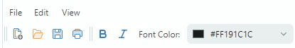

## Добавление элементов панели в панель и контекстное меню

Используйте коллекции [`Toolbar.Items`](../../API/Eremex.AvaloniaUI.Controls.Bars/Toolbar/Items.md) и [`PopupMenu.Items`](../../API/Eremex.AvaloniaUI.Controls.Bars/PopupMenu/Items.md), чтобы заполнять панели и меню элементами. В XAML вы можете определять элементы непосредственно между открывающим и закрывающим тегами `<Toolbar>`/`<PopupMenu>`.

Этот пример отображает три элемента в панели.

``` xml
xmlns:mxb="https://schemas.eremexcontrols.net/avalonia/bars"

<mxb:Toolbar x:Name="EditToolbar" ToolbarName="Edit" ShowCustomizationButton="False">
    <mxb:ToolbarButtonItem Header="Cut" Command="{Binding #textBox.Cut}" 
     IsEnabled="{Binding #textBox.CanCut}" 
     Glyph="{SvgImage 'avares://DemoCenter/Images/Group=Context Menu, Icon=Cut.svg'}" 
     Category="Edit"/>
    <mxb:ToolbarButtonItem Header="Copy" Command="{Binding #textBox.Copy}" 
     IsEnabled="{Binding #textBox.CanCopy}" 
     Glyph="{SvgImage 'avares://DemoCenter/Images/Group=Context Menu, Icon=Copy.svg'}" 
     Category="Edit"/>
    <mxb:ToolbarButtonItem Header="Paste" Command="{Binding #textBox.Paste}" 
     IsEnabled="{Binding #textBox.CanPaste}" 
     Glyph="{SvgImage 'avares://DemoCenter/Images/Group=Context Menu, Icon=Paste.svg'}" 
     Category="Edit"/>
</mxb:Toolbar>
```
## Типы элементов панели инструментов

Библиотека панелей поддерживает несколько типов элементов. Все они являются потомками класса [`ToolbarItem`](../../API/Eremex.AvaloniaUI.Controls.Bars/ToolbarItem.md), содержащего настройки, общие для всех элементов панели.

### Общие свойства элементов панели инструментов

- [`Alignment`](../../API/Eremex.AvaloniaUI.Controls.Bars/Alignment.md) — выравнивание элемента внутри панели.
- [`Category`](../../API/Eremex.AvaloniaUI.Controls.Bars/ToolbarItem/Category.md) — категория, к которой относится элемент. Категории используются для организации элементов в логические группы в окне настройки. Дополнительную информацию смотрите в следующем разделе: [Категории элементов панели инструментов](#категории-элементов-панели-инструментов).
- [`Command`](../../API/Eremex.AvaloniaUI.Controls.Bars/ToolbarItem/Command.md) — команда, выполняемая при щелчке по кнопке.
- [`CommandParameter`](../../API/Eremex.AvaloniaUI.Controls.Bars/ToolbarItem/CommandParameter.md) — параметр команды, передаваемый заданной команде.
- [`DisplayMode`](../../API/Eremex.AvaloniaUI.Controls.Bars/ToolbarItem/DisplayMode.md) — возвращает или задаёт, отображать ли только глиф, только заголовок или оба.
- [`Glyph`](../../API/Eremex.AvaloniaUI.Controls.Bars/ToolbarItem/Glyph.md) — изображение элемента.
- [`GlyphAlignment`](../../API/Eremex.AvaloniaUI.Controls.Bars/ToolbarItem/GlyphAlignment.md) — выравнивание глифа относительно заголовка элемента.
- [`GlyphSize`](../../API/Eremex.AvaloniaUI.Controls.Bars/ToolbarItem/GlyphSize.md) — размер отображения глифа.
- [`Header`](../../API/Eremex.AvaloniaUI.Controls.Bars/ToolbarItem/Header.md) — отображаемый текст элемента.
- [`ShowSeparator`](../../API/Eremex.AvaloniaUI.Controls.Bars/ToolbarItem/ShowSeparator.md) — возвращает или задаёт, отображать ли разделитель перед элементом. Вы также можете использовать элемент [`ToolbarSeparatorItem`](../../API/Eremex.AvaloniaUI.Controls.Bars/ToolbarSeparatorItem.md), чтобы вставить разделитель.

**События**

- [`Click`](../../API/Eremex.AvaloniaUI.Controls.Bars/ToolbarItem/Click.md) — возникает при щелчке левой кнопкой мыши по элементу (после нажатия и отпускания левой кнопки мыши).
- [`Press`](../../API/Eremex.AvaloniaUI.Controls.Bars/ToolbarItem/Press.md) — возникает при нажатии любой кнопки мыши над элементом.

### Обычные кнопки и кнопки с выпадающим списком (ToolbarButtonItem)

Используйте [`ToolbarButtonItem`](../../API/Eremex.AvaloniaUI.Controls.Bars/ToolbarButtonItem.md) для создания обычных кнопок. Щелчок по обычной кнопке вызывает связанную команду ([`Command`](../../API/Eremex.AvaloniaUI.Controls.Bars/ToolbarItem/Command.md)) и события ([`Click`](../../API/Eremex.AvaloniaUI.Controls.Bars/ToolbarItem/Click.md) и [`Press`](../../API/Eremex.AvaloniaUI.Controls.Bars/ToolbarItem/Press.md)). 

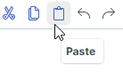

``` xml
xmlns:mxb="https://schemas.eremexcontrols.net/avalonia/bars"

<mxb:ToolbarButtonItem Header="Open" 
 Glyph="{SvgImage 'avares://bars_sample/Images/Toolbars/FileOpen.svg'}" 
 Category="File" Command="{Binding OpenFileCommand}"/>
```

Вы можете связать выпадающий контрол или меню с объектом [`ToolbarButtonItem`](../../API/Eremex.AvaloniaUI.Controls.Bars/ToolbarButtonItem.md). В этом случае [`ToolbarButtonItem`](../../API/Eremex.AvaloniaUI.Controls.Bars/ToolbarButtonItem.md) может действовать как кнопка с выпадающим списком, вызывая заданный выпадающий контрол/меню при щелчке по элементу или по встроенной стрелке вниз.

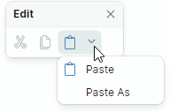

``` xml
xmlns:mxb="https://schemas.eremexcontrols.net/avalonia/bars"

<mxb:ToolbarButtonItem Header="Paste"
                       Command="{Binding #textBox.Paste}"
                       IsEnabled="{Binding #textBox.CanPaste}"
                       Glyph="{SvgImage 'avares://bars_sample/Images/Toolbars/EditPaste.svg'}"
                       Category="Edit"
                       DropDownArrowVisibility="ShowArrow" DropDownArrowAlignment="Default"
                       >
    <mxb:ToolbarButtonItem.DropDownControl>
        <mxb:PopupMenu>
            <mxb:ToolbarButtonItem Header="Paste" Command="{Binding #textBox.Paste}" 
             IsEnabled="{Binding #textBox.CanPaste}"/>
            <mxb:ToolbarButtonItem Header="Paste As" Command="{Binding PasteAsCommand}" 
             IsEnabled="{Binding #textBox.CanPaste}"/>
        </mxb:PopupMenu>
    </mxb:ToolbarButtonItem.DropDownControl>
</mxb:ToolbarButtonItem>
```

#### Основные свойства ToolbarButtonItem

- [`DropDownControl`](../../API/Eremex.AvaloniaUI.Controls.Bars/ToolbarButtonItem/DropDownControl.md) — возвращает или задаёт выпадающий контрол (объект [`Eremex.AvaloniaUI.Controls.Bars.IPopup`](../../API/Eremex.AvaloniaUI.Controls.Bars/IPopup.md)), связанный с элементом. Контрол всплывает, когда пользователь щёлкает по элементу или по встроенной кнопке-стрелке вниз (см. [`DropDownArrowVisibility`](../../API/Eremex.AvaloniaUI.Controls.Bars/DropDownArrowVisibility.md)). Следующие объекты реализуют интерфейс [`Eremex.AvaloniaUI.Controls.Bars.IPopup`](../../API/Eremex.AvaloniaUI.Controls.Bars/IPopup.md) и потому могут отображаться как выпадающие контролы:

    - [`Eremex.AvaloniaUI.Controls.Bars.PopupMenu`](../../API/Eremex.AvaloniaUI.Controls.Bars/PopupMenu.md) — [всплывающее меню](../toolbars-and-menus/popup-and-context-menus.md). Вы можете добавлять в меню все типы элементов панели, чтобы заполнить его содержимым.
    - [`Eremex.AvaloniaUI.Controls.Bars.PopupContainer`](../../API/Eremex.AvaloniaUI.Controls.Bars/PopupContainer.md) — контейнер контролов. Используйте [`PopupContainer`](../../API/Eremex.AvaloniaUI.Controls.Bars/PopupContainer.md), чтобы отображать пользовательские контролы в выпадающем списке.
    
- [`DropDownArrowVisibility`](../../API/Eremex.AvaloniaUI.Controls.Bars/DropDownArrowVisibility.md) — возвращает или задаёт, отображает ли элемент стрелку выпадающего списка, используемую для вызова связанного выпадающего контрола. 

    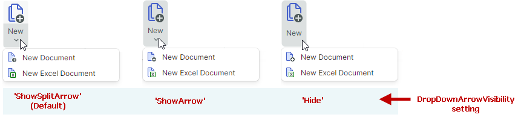

    - `ShowArrow` — стрелка выпадающего списка видима. Элемент и стрелка действуют как единая кнопка. Щелчок по ним отображает связанный выпадающий контрол.

    - `ShowSplitArrow` или `Default` — стрелка выпадающего списка видима. Она действует как отдельная кнопка, встроенная в элемент. Щелчок по элементу вызывает его команду ([`Command`](../../API/Eremex.AvaloniaUI.Controls.Bars/ToolbarItem/Command.md)) и события ([`Click`](../../API/Eremex.AvaloniaUI.Controls.Bars/ToolbarItem/Click.md) и [`Press`](../../API/Eremex.AvaloniaUI.Controls.Bars/ToolbarItem/Press.md)). 

    - `Hide` — стрелка выпадающего списка скрыта. Щелчок по элементу вызывает выпадающий контрол.

- [`DropDownArrowAlignment`](../../API/Eremex.AvaloniaUI.Controls.Bars/DropDownArrowAlignment.md) — возвращает или задаёт положение стрелки выпадающего списка.
- [`DropDownOpenMode`](../../API/Eremex.AvaloniaUI.Controls.Bars/DropDownOpenMode.md) — возвращает или задаёт, вызывается ли выпадающий контрол и когда, при взаимодействии пользователя с элементом/стрелкой выпадающего списка. Поддерживаемые опции:
    - [`Press`](../../API/Eremex.AvaloniaUI.Controls.Bars/ToolbarItem/Press.md) или `Default` — выпадающий список отображается по событию нажатия мыши.
    - [`Click`](../../API/Eremex.AvaloniaUI.Controls.Bars/ToolbarItem/Click.md) — выпадающий список отображается после нажатия и отпускания мыши над элементом.
    - `Never` — выпадающий список не отображается.
- [`DropDownPress`](../../API/Eremex.AvaloniaUI.Controls.Bars/ToolbarButtonItem/DropDownPress.md) — событие, возникающее при нажатии стрелки выпадающего списка.

Смотрите также: [Общие свойства элементов панели инструментов](#общие-свойства-элементов-панели-инструментов).

### Кнопки-флажки (ToolbarCheckItem)

[`ToolbarCheckItem`](../../API/Eremex.AvaloniaUI.Controls.Bars/ToolbarCheckItem.md) инкапсулирует кнопку-флажок, поддерживающую два состояния — обычное и нажатое. 

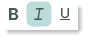

``` xml
xmlns:mxb="https://schemas.eremexcontrols.net/avalonia/bars"

<mxb:ToolbarCheckItem Header="Bold" 
 IsChecked="{Binding #textBox.FontWeight, 
  Converter={helpers:BoolToFontWeightConverter}, Mode=TwoWay}" 
 Glyph="{SvgImage 'avares://DemoCenter/Images/FontBold.svg'}" Category="Font"/>
```

#### Основные свойства и события кнопки-флажка

- [`IsChecked`](../../API/Eremex.AvaloniaUI.Controls.Bars/ToolbarCheckItem/IsChecked.md) — возвращает или задаёт состояние нажатия кнопки.
- [`CheckedChanged`](../../API/Eremex.AvaloniaUI.Controls.Bars/ToolbarCheckItem/CheckedChanged.md) — событие, возникающее при изменении состояния нажатия.

- [`CheckBoxStyle`](../../API/Eremex.AvaloniaUI.Controls.Bars/CheckBoxStyle.md) — возвращает или задаёт режим отображения объекта [`ToolbarCheckItem`](../../API/Eremex.AvaloniaUI.Controls.Bars/ToolbarCheckItem.md). Доступные опции:

  - [`CheckBoxStyle.CheckButton`](../../API/Eremex.AvaloniaUI.Controls.Bars/CheckBoxStyle.md) — элемент отрисовывается как кнопка-флажок. Когда [`IsChecked`](../../API/Eremex.AvaloniaUI.Controls.Bars/ToolbarCheckItem/IsChecked.md) равно `true`, кнопка отображается в нажатом состоянии.

    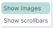

  - [`CheckBoxStyle.CheckBox`](../../API/Eremex.AvaloniaUI.Controls.Bars/CheckBoxStyle.md) — элемент отображает переключаемый флажок перед своим текстом и глифом. Когда [`IsChecked`](../../API/Eremex.AvaloniaUI.Controls.Bars/ToolbarCheckItem/IsChecked.md) равно `true`, флажок имеет отметку.

    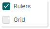
    
  - [`CheckBoxStyle.RadioButton`](../../API/Eremex.AvaloniaUI.Controls.Bars/CheckBoxStyle.md) — элемент отображает радиокнопку перед своим текстом и глифом. Когда [`IsChecked`](../../API/Eremex.AvaloniaUI.Controls.Bars/ToolbarCheckItem/IsChecked.md) равно `true`, радиокнопка отрисовывается как заполненный круг.

    Вы можете применить стиль RadioButton к объектам [`ToolbarCheckItem`](../../API/Eremex.AvaloniaUI.Controls.Bars/ToolbarCheckItem.md), объединённым в группу флажков ([`ToolbarCheckItemGroup`](../../API/Eremex.AvaloniaUI.Controls.Bars/ToolbarCheckItemGroup.md)). В этом случае группа выглядит как обычная радиогруппа.

    ``` xml
    <mxb:ToolbarCheckItemGroup CheckType="Radio">
        <mxb:ToolbarCheckItem Header="E-mail" CheckBoxStyle="RadioButton" />
        <mxb:ToolbarCheckItem Header="Phone" CheckBoxStyle="RadioButton" />
    </mxb:ToolbarCheckItemGroup>
    ```
    
    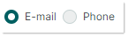

- [`CheckBoxAlignment`](../../API/Eremex.AvaloniaUI.Controls.Bars/CheckBoxAlignment.md) — возвращает или задаёт, отображаются ли флажок (или радиокнопка) до или после глифа и текста элемента. Эта опция действует, когда свойство [`CheckBoxStyle`](../../API/Eremex.AvaloniaUI.Controls.Bars/CheckBoxStyle.md) установлено в [`CheckBoxStyle.CheckBox`](../../API/Eremex.AvaloniaUI.Controls.Bars/CheckBoxStyle.md) или [`CheckBoxStyle.RadioButton`](../../API/Eremex.AvaloniaUI.Controls.Bars/CheckBoxStyle.md).

    ```xml
    <mxb:ToolbarCheckItem Header="Status bar" CheckBoxAlignment="After"
                        CheckBoxStyle="CheckBox"
                        Hint="Show and hide the status bar"/>
    <mxb:ToolbarSeparatorItem/>
    ```
    
    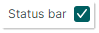

Смотрите также: [Общие свойства элементов панели инструментов](#общие-свойства-элементов-панели-инструментов).

### Подменю (ToolbarMenuItem)

[`ToolbarMenuItem`](../../API/Eremex.AvaloniaUI.Controls.Bars/ToolbarMenuItem.md) — это элемент, отображающий подменю при щелчке. 

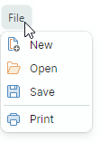

Чтобы задать содержимое подменю, определите элементы между открывающим и закрывающим тегами `<ToolbarMenuItem>` в XAML или добавьте элементы в коллекцию [`ToolbarMenuItem.Items`](../../API/Eremex.AvaloniaUI.Controls.Bars/ToolbarMenuItem/Items.md) в code-behind.

``` xml
xmlns:mxb="https://schemas.eremexcontrols.net/avalonia/bars"

<mxb:ToolbarMenuItem Header="File" Category="File">
    <mxb:ToolbarButtonItem Header="New" 
     Glyph="{SvgImage 'avares://DemoCenter/Images/Group=Context Menu, Icon=NewDraftAction.svg'}" 
     Category="File" Command="{Binding NewFileCommand}"/>
    <mxb:ToolbarButtonItem Header="Open" 
     Glyph="{SvgImage 'avares://DemoCenter/Images/Group=Basic, Icon=Folder Open.svg'}" 
     Category="File" Command="{Binding OpenFileCommand}"/>
    <mxb:ToolbarButtonItem Header="Save" 
     Glyph="{SvgImage 'avares://DemoCenter/Images/Group=Basic, Icon=Save.svg'}" 
     Category="File" Command="{Binding SaveFileCommand}"/>
    <mxb:ToolbarButtonItem Header="Print" 
     Glyph="{SvgImage 'avares://DemoCenter/Images/Group=Basic, Icon=Print.svg'}" 
     ShowSeparator="True"  Category="File" Command="{Binding PrintFileCommand}"/>
</mxb:ToolbarMenuItem>
```

#### Основные свойства и события подменю

- [`DropDownOpenMode`](../../API/Eremex.AvaloniaUI.Controls.Bars/DropDownOpenMode.md) — возвращает или задаёт, вызывается ли подменю и как, при взаимодействии пользователя с элементом. Поддерживаемые опции:
    - [`Press`](../../API/Eremex.AvaloniaUI.Controls.Bars/ToolbarItem/Press.md) или `Default` — меню отображается по событию нажатия мыши.
    - [`Click`](../../API/Eremex.AvaloniaUI.Controls.Bars/ToolbarItem/Click.md) — меню отображается после нажатия и отпускания мыши над элементом.
    - `Never` — меню не отображается.
- `Items` — коллекция элементов, отображаемых в подменю.
- `ItemsSource` — коллекция бизнес-объектов во View Model, из которых создаются элементы подменю. Соответствующие шаблоны данных должны определять элементы панели и инициализировать их настройки из базовых бизнес-объектов.

**События**

- `Opening` — возникает, когда меню собирается отобразиться. Это событие позволяет отменить отображение меню.
- `Opened` — возникает после отображения меню.
- `Closing` — возникает, когда меню собирается закрыться. Это событие позволяет отменить закрытие меню.
- `Closed` — возникает после закрытия меню.

Смотрите также: [Общие свойства элементов панели инструментов](#общие-свойства-элементов-панели-инструментов).

### Встроенные редакторы (ToolbarEditorItem)

[`ToolbarEditorItem`](../../API/Eremex.AvaloniaUI.Controls.Bars/ToolbarEditorItem.md) позволяет отображать встроенный редактор. 

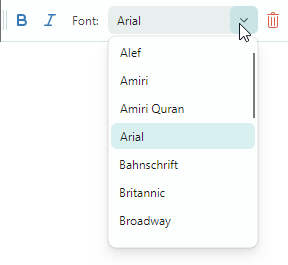

Чтобы задать тип и настройки встроенного редактора, используйте свойство [`ToolbarEditorItem.EditorProperties`](../../API/Eremex.AvaloniaUI.Controls.Bars/ToolbarEditorItem/EditorProperties.md). Вы можете установить [`ToolbarEditorItem.EditorProperties`](../../API/Eremex.AvaloniaUI.Controls.Bars/ToolbarEditorItem/EditorProperties.md) в один из следующих объектов:

- [`ButtonEditorProperties`](../../API/Eremex.AvaloniaUI.Controls.Editors/ButtonEditorProperties.md) — соответствует встроенному редактору [`ButtonEditor`](../../API/Eremex.AvaloniaUI.Controls.Editors/ButtonEditor.md).
- [`CheckEditorProperties`](../../API/Eremex.AvaloniaUI.Controls.Editors/CheckEditorProperties.md) — соответствует встроенному редактору [`CheckEditor`](../../API/Eremex.AvaloniaUI.Controls.Editors/CheckEditor.md).
- `ColorEditorProperties` — соответствует встроенному редактору [`ColorEditor`](../../API/Eremex.AvaloniaUI.Controls.Editors/ColorEditor.md).
- [`ComboBoxEditorProperties`](../../API/Eremex.AvaloniaUI.Controls.Editors/ComboBoxEditorProperties.md) — соответствует встроенному редактору [`ComboBoxEditor`](../../API/Eremex.AvaloniaUI.Controls.Editors/ComboBoxEditor.md).
- [`HyperlinkEditorProperties`](../../API/Eremex.AvaloniaUI.Controls.Editors/HyperlinkEditorProperties.md) — соответствует встроенному редактору [`HyperlinkEditor`](../../API/Eremex.AvaloniaUI.Controls.Editors/HyperlinkEditor.md).
- [`PopupColorEditorProperties`](../../API/Eremex.AvaloniaUI.Controls.Editors/PopupColorEditorProperties.md) — соответствует встроенному редактору [`PopupColorEditor`](../../API/Eremex.AvaloniaUI.Controls.Editors/PopupColorEditor.md).
- [`PopupEditorProperties`](../../API/Eremex.AvaloniaUI.Controls.Editors/PopupEditorProperties.md) — соответствует встроенному редактору [`PopupEditor`](../../API/Eremex.AvaloniaUI.Controls.Editors/PopupEditor.md).
- [`SegmentedEditorProperties`](../../API/Eremex.AvaloniaUI.Controls.Editors/SegmentedEditorProperties.md) — соответствует встроенному редактору [`SegmentedEditor`](../../API/Eremex.AvaloniaUI.Controls.Editors/SegmentedEditor.md).
- [`SpinEditorProperties`](../../API/Eremex.AvaloniaUI.Controls.Editors/SpinEditorProperties.md) — соответствует встроенному редактору [`SpinEditor`](../../API/Eremex.AvaloniaUI.Controls.Editors/SpinEditor.md).
- [`TextEditorProperties`](../../API/Eremex.AvaloniaUI.Controls.Editors/TextEditorProperties.md) — соответствует встроенному редактору [`TextEditor`](../../API/Eremex.AvaloniaUI.Controls.Editors/TextEditor.md).
- [`MemoEditorProperties`](../../API/Eremex.AvaloniaUI.Controls.Editors/MemoEditorProperties.md) — соответствует встроенному редактору [`MemoEditor`](../../API/Eremex.AvaloniaUI.Controls.Editors/MemoEditor.md).

В этом примере объект _Font_ [`ToolbarEditorItem`](../../API/Eremex.AvaloniaUI.Controls.Bars/ToolbarEditorItem.md) отображает список шрифтов с помощью встроенного редактора combobox. Свойство [`ToolbarEditorItem.EditorProperties`](../../API/Eremex.AvaloniaUI.Controls.Bars/ToolbarEditorItem/EditorProperties.md) установлено в [`ComboBoxEditorProperties`](../../API/Eremex.AvaloniaUI.Controls.Editors/ComboBoxEditorProperties.md), что соответствует контролу [`ComboBoxEditor`](../../API/Eremex.AvaloniaUI.Controls.Editors/ComboBoxEditor.md).

``` xml
<mxb:ToolbarEditorItem Header="Font:" EditorWidth="150" Category="Font" 
 EditorValue="{Binding #textBox.FontFamily, Converter={helpers:FontNameToFontFamilyConverter}}">
    <mxb:ToolbarEditorItem.EditorProperties>
        <mxe:ComboBoxEditorProperties 
         ItemsSource="{Binding $parent[view:ToolbarAndMenuPageView].Fonts}"
         IsTextEditable="False" PopupMaxHeight="300"/>
    </mxb:ToolbarEditorItem.EditorProperties>
</mxb:ToolbarEditorItem>      
```

#### Основные свойства и события встроенного редактора

- [`ToolbarEditorItem.EditorProperties`](../../API/Eremex.AvaloniaUI.Controls.Bars/ToolbarEditorItem/EditorProperties.md) — возвращает или задаёт объект, определяющий тип и настройки встроенного редактора.
- [`ToolbarEditorItem.EditorValue`](../../API/Eremex.AvaloniaUI.Controls.Bars/ToolbarEditorItem/EditorValue.md) — возвращает или задаёт значение встроенного редактора. Используйте это свойство для привязки данных.
- [`ToolbarEditorItem.SizeMode`](../../API/Eremex.AvaloniaUI.Controls.Bars/ToolbarEditorItem/SizeMode.md) — возвращает или задаёт режим размера элемента. Это свойство позволяет растянуть элемент панели, чтобы он занял всё доступное пустое пространство в панели.
- [`ToolbarEditorItem.EditorWidth`](../../API/Eremex.AvaloniaUI.Controls.Bars/ToolbarEditorItem/EditorWidth.md) — возвращает или задаёт ширину встроенного редактора.
- [`ToolbarEditorItem.EditorHeight`](../../API/Eremex.AvaloniaUI.Controls.Bars/ToolbarEditorItem/EditorHeight.md) — возвращает или задаёт высоту встроенного редактора.
- [`ToolbarEditorItem.EditorAlignment`](../../API/Eremex.AvaloniaUI.Controls.Bars/ToolbarEditorItem/EditorAlignment.md) — возвращает или задаёт выравнивание редактора относительно заголовка элемента.

- [`ToolbarEditorItem.EditorValueChanged`](../../API/Eremex.AvaloniaUI.Controls.Bars/ToolbarEditorItem/EditorValueChanged.md) — событие, возникающее после изменения значения редактора.

<!--TODO - `ToolbarEditorItem.Editor` -  

-->

Смотрите также: [Общие свойства элементов панели инструментов](#общие-свойства-элементов-панели-инструментов).


### Текстовые надписи (ToolbarTextItem)

[`ToolbarTextItem`](../../API/Eremex.AvaloniaUI.Controls.Bars/ToolbarTextItem.md) отображает текстовую надпись, заданную свойством [`ToolbarTextItem.Header`](../../API/Eremex.AvaloniaUI.Controls.Bars/ToolbarItem/Header.md). Используйте этот элемент для отрисовки текста, который не редактируется пользователями.

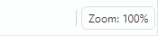

``` xml
<mxb:ToolbarTextItem 
 Header="{Binding #scaleDecorator.Scale, StringFormat={}Zoom: {0:P0}}" 
 ShowBorder="True" Alignment="Far" ShowSeparator="True" Category="Info" 
 CustomizationName="Zoom Info"/>
```

#### Основные свойства и события текстовой надписи

- [`ToolbarTextItem.SizeMode`](../../API/Eremex.AvaloniaUI.Controls.Bars/ToolbarTextItem/SizeMode.md) — возвращает или задаёт режим размера элемента. Это свойство позволяет растянуть элемент, чтобы он занял всё доступное пустое пространство в панели.
- [`ToolbarTextItem.ShowBorder`](../../API/Eremex.AvaloniaUI.Controls.Bars/ToolbarTextItem/ShowBorder.md) — возвращает или задаёт, видима ли рамка элемента. Вы можете использовать свойство [`ToolbarTextItem.BorderTemplate`](../../API/Eremex.AvaloniaUI.Controls.Bars/ToolbarTextItem/BorderTemplate.md), чтобы задать пользовательский шаблон для отрисовки рамки.
- [`ToolbarTextItem.BorderTemplate`](../../API/Eremex.AvaloniaUI.Controls.Bars/ToolbarTextItem/BorderTemplate.md) — возвращает или задаёт пользовательский шаблон для отрисовки рамки элемента. Этот шаблон действует, если включена опция [`ToolbarTextItem.ShowBorder`](../../API/Eremex.AvaloniaUI.Controls.Bars/ToolbarTextItem/ShowBorder.md).

Смотрите также: [Общие свойства элементов панели инструментов](#общие-свойства-элементов-панели-инструментов).

### Неразрывные группы элементов (ToolbarItemGroup)

Используйте [`ToolbarItemGroup`](../../API/Eremex.AvaloniaUI.Controls.Bars/ToolbarItemGroup.md) для создания неразрывной группы элементов панели. Неразрывная группа — это контейнер элементов, действующий как единое целое при изменении размера родителя (содержимое группы не может быть частично скрыто; элементы всегда отображаются в одну линию и не поддерживают перенос).

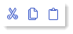

Чтобы задать содержимое группы, определите элементы между открывающим и закрывающим тегами `<ToolbarItemGroup>` или добавьте элементы в коллекцию [`ToolbarItemGroup.Items`](../../API/Eremex.AvaloniaUI.Controls.Bars/ToolbarItemGroup/Items.md) в code-behind.

``` xml
<mxb:ToolbarItemGroup CustomizationName="Clipboard" >
    <mxb:ToolbarButtonItem Header="Cut" Command="{Binding #textBox.Cut}" 
     IsEnabled="{Binding #textBox.CanCut}" 
     Glyph="{SvgImage 'avares://DemoCenter/Images/Group=Context Menu, Icon=Cut.svg'}" 
     Category="Edit"/>
    <mxb:ToolbarButtonItem Header="Copy" Command="{Binding #textBox.Copy}" 
     IsEnabled="{Binding #textBox.CanCopy}" 
     Glyph="{SvgImage 'avares://DemoCenter/Images/Group=Context Menu, Icon=Copy.svg'}" 
     Category="Edit"/>
    <mxb:ToolbarButtonItem Header="Paste" Command="{Binding #textBox.Paste}" 
     IsEnabled="{Binding #textBox.CanPaste}" 
     Glyph="{SvgImage 'avares://DemoCenter/Images/Group=Context Menu, Icon=Paste.svg'}" 
     Category="Edit"/>
</mxb:ToolbarItemGroup>
```

#### Основные свойства и события группы

- [`ToolbarItemGroup.Items`](../../API/Eremex.AvaloniaUI.Controls.Bars/ToolbarItemGroup/Items.md) — позволяет обращаться к дочерним элементам группы.

### Неразрывные группы флажков (ToolbarCheckItemGroup)

Используйте [`ToolbarCheckItemGroup`](../../API/Eremex.AvaloniaUI.Controls.Bars/ToolbarCheckItemGroup.md) для создания неразрывной группы флажков. Неразрывная группа — это контейнер элементов, действующий как единое целое при изменении размера родителя (содержимое группы не может быть частично скрыто; элементы всегда отображаются в одну линию и не поддерживают перенос).


Контейнер [`ToolbarCheckItemGroup`](../../API/Eremex.AvaloniaUI.Controls.Bars/ToolbarCheckItemGroup.md) может управлять состоянием нажатия своих дочерних элементов ([объектов [`ToolbarCheckItem`](../../API/Eremex.AvaloniaUI.Controls.Bars/ToolbarCheckItem.md)](#кнопки-флажки-toolbarcheckitem)). Вы можете использовать [`ToolbarCheckItemGroup`](../../API/Eremex.AvaloniaUI.Controls.Bars/ToolbarCheckItemGroup.md) для создания следующих типов групп:

- Группа взаимоисключающих элементов (радиогруппа).
- Группа, позволяющая отмечать несколько элементов одновременно.


Чтобы задать содержимое группы, добавьте элементы [`ToolbarCheckItem`](../../API/Eremex.AvaloniaUI.Controls.Bars/ToolbarCheckItem.md) между открывающим и закрывающим тегами `<ToolbarCheckItemGroup>` в XAML или добавьте элементы в коллекцию [`ToolbarCheckItemGroup.Items`](../../API/Eremex.AvaloniaUI.Controls.Bars/ToolbarItemGroup/Items.md) в code-behind.

``` xml
<mxb:ToolbarCheckItemGroup CustomizationName="Check group" CheckType="Radio" >
    <mxb:ToolbarCheckItem Header="1" IsChecked="{Binding Option1}"  
     Category="Settings"/>
    <mxb:ToolbarCheckItem Header="2" IsChecked="{Binding Option2}" 
     Category="Settings"/>
    <mxb:ToolbarCheckItem Header="3" IsChecked="{Binding Option3}" 
     Category="Settings"/>
</mxb:ToolbarCheckItemGroup>
```

Объект [`ToolbarCheckItemGroup`](../../API/Eremex.AvaloniaUI.Controls.Bars/ToolbarCheckItemGroup.md) принимает дочерние элементы всех поддерживаемых типов элементов панели. Однако группа управляет только состояниями нажатия вложенных объектов [`ToolbarCheckItem`](../../API/Eremex.AvaloniaUI.Controls.Bars/ToolbarCheckItem.md).

#### Основные свойства и события группы флажков

- [`ToolbarCheckItemGroup.CheckType`](../../API/Eremex.AvaloniaUI.Controls.Bars/ToolbarCheckItemGroup/CheckType.md) — возвращает или задаёт, можно ли отмечать один или несколько элементов в группе одновременно. Поддерживаются следующие опции:

    - `Default` или `Multiple` — можно отмечать несколько элементов одновременно.
    - `Radio` — группа взаимоисключающих элементов. Пользователь не может снять отметку с элемента иначе как отметив другой.
    - `Single` — группа взаимоисключающих элементов. Пользователь может снять отметку со всех элементов в группе.

- [`ToolbarCheckItemGroup.Items`](../../API/Eremex.AvaloniaUI.Controls.Bars/ToolbarItemGroup/Items.md) — позволяет обращаться к дочерним элементам группы.

Смотрите также: [Общие свойства элементов панели инструментов](#общие-свойства-элементов-панели-инструментов).

### Разделители (ToolbarSeparatorItem)

[`ToolbarSeparatorItem`](../../API/Eremex.AvaloniaUI.Controls.Bars/ToolbarSeparatorItem.md) рисует разделитель.


``` xml
<mxb:ToolbarMenuItem Header="File" Category="File">
    <mxb:ToolbarButtonItem Header="New" 
     Glyph="{SvgImage 'avares://DemoCenter/Images/Group=Context Menu, Icon=NewDraftAction.svg'}" 
     Category="File"/>
    <mxb:ToolbarButtonItem Header="Open" 
     Glyph="{SvgImage 'avares://DemoCenter/Images/Group=Basic, Icon=Folder Open.svg'}" 
     Category="File"/>
    <mxb:ToolbarButtonItem Header="Save" 
     Glyph="{SvgImage 'avares://DemoCenter/Images/Group=Basic, Icon=Save.svg'}" 
     Category="File"/>
    <mxb:ToolbarSeparatorItem/>
    <mxb:ToolbarButtonItem Header="Print" 
     Glyph="{SvgImage 'avares://DemoCenter/Images/Group=Basic, Icon=Print.svg'}" 
     Category="File"/>
</mxb:ToolbarMenuItem>
```


## Категории элементов панели инструментов

Вы можете классифицировать элементы панели по категориям, чтобы включить группировку элементов в окне настройки. Пользователь может выбрать категорию в окне настройки, чтобы получить доступ к связанным элементам.

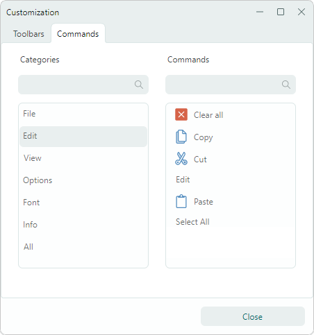

Используйте свойство [`ToolbarItem.Category`](../../API/Eremex.AvaloniaUI.Controls.Bars/ToolbarItem/Category.md), чтобы назначить элемент категории. Это свойство задаёт имя категории. Чтобы назначить группу элементов одной категории, установите их свойство [`ToolbarItem.Category`](../../API/Eremex.AvaloniaUI.Controls.Bars/ToolbarItem/Category.md) в одно и то же имя категории.

``` xml
<mxb:ToolbarMenuItem Header="Edit" Category="Edit">
    <mxb:ToolbarButtonItem Header="Cut" 
     Glyph="{SvgImage 'avares://DemoCenter/Images/Group=Context Menu, Icon=Cut.svg'}" 
     Category="Edit"/>
    <mxb:ToolbarButtonItem Header="Copy" 
     Glyph="{SvgImage 'avares://DemoCenter/Images/Group=Context Menu, Icon=Copy.svg'}" 
     Category="Edit"/>
    <mxb:ToolbarButtonItem Header="Paste" 
     Glyph="{SvgImage 'avares://DemoCenter/Images/Group=Context Menu, Icon=Paste.svg'}" 
     Category="Edit"/>
    <mxb:ToolbarButtonItem Header="Select All" 
     Command="{Binding #textBox.SelectAll}" Category="Edit" ShowSeparator="True"/>
    <mxb:ToolbarButtonItem Header="Clear all" 
     Command="{Binding #textBox.Clear}" 
     Glyph="{SvgImage 'avares://DemoCenter/Images/Group=Basic, Icon=Clear.svg'}" 
     Category="Edit"/>
</mxb:ToolbarMenuItem>       
```

## Горячие клавиши

Вы можете использовать свойство [`ToolbarItem.HotKey`](../../API/Eremex.AvaloniaUI.Controls.Bars/ToolbarItem/HotKey.md), чтобы назначать элементам горячие клавиши. 

``` xml
<mxb:ToolbarButtonItem 
    Header="Clear" Command="{Binding #textBox.Clear}" HotKey="Ctrl+Q"
    Glyph="{SvgImage 'avares://bars_sample/Images/Toolbars/EditDelete.svg'}"/>
```

Нажатие горячей клавиши активирует команду элемента при условии, что фокус находится в пределах области действия горячих клавиш. Область действия горячих клавиш по умолчанию — область UI в границах компонента [`ToolbarManager`](../../API/Eremex.AvaloniaUI.Controls.Bars/ToolbarManager.md). Когда фокус ввода находится за пределами области действия горячих клавиш, [`ToolbarManager`](../../API/Eremex.AvaloniaUI.Controls.Bars/ToolbarManager.md) не может перехватывать горячие клавиши.

Свойство [`ToolbarManager.IsWindowManager`](../../API/Eremex.AvaloniaUI.Controls.Bars/ToolbarManager/IsWindowManager.md) позволяет расширить область действия горячих клавиш на всё окно. Когда вы устанавливаете это свойство в `true`, компонент [`ToolbarManager`](../../API/Eremex.AvaloniaUI.Controls.Bars/ToolbarManager.md) регистрирует горячие клавиши элементов в окне. Он сможет перехватывать и обрабатывать горячие клавиши, даже если фокус находится за пределами его клиентской области.

### Отображение горячих клавиш

Горячие клавиши, назначенные элементам панели, отображаются в следующих случаях:

- В элементах, когда они находятся в подменю или всплывающих меню.
- Во всплывающих подсказках элементов.

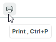

Вы можете использовать свойство [`ToolbarItem.HotKeyDisplayString`](../../API/Eremex.AvaloniaUI.Controls.Bars/ToolbarItem/HotKeyDisplayString.md), чтобы задать текст отображения горячей клавиши. Этот текст отображается, даже если элементу не назначена горячая клавиша. Это полезно, если целевая горячая клавиша уже зарегистрирована другим объектом для выполнения определённой операции, а вы хотите указать, что та же горячая клавиша связана с элементом панели.

Например, TextBox регистрирует сочетание _Ctrl+Z_ для выполнения операции отмены. Если элемент панели выполняет ту же операцию отмены над TextBox, не назначайте элементу горячую клавишу _Ctrl+Z_. Вместо этого установите [`ToolbarItem.HotKeyDisplayString`](../../API/Eremex.AvaloniaUI.Controls.Bars/ToolbarItem/HotKeyDisplayString.md) элемента в "_Ctrl+Z_", чтобы отображать это сочетание пользователям во всплывающих подсказках и подменю/всплывающих меню.

``` xml
<mxb:ToolbarButtonItem Header="Undo" HotKeyDisplayString="Ctrl+Z" 
    Command="{Binding $parent[TextBox].Undo}" 
    IsEnabled="{Binding $parent[TextBox].CanUndo}" 
    Glyph="{SvgImage 'avares://bars_sample/Images/Toolbars/EditUndo.svg'}"/>
```

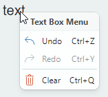


<br>
<br>

<sup>*</sup> Эта страница переведена с использованием технологий машинного перевода.
