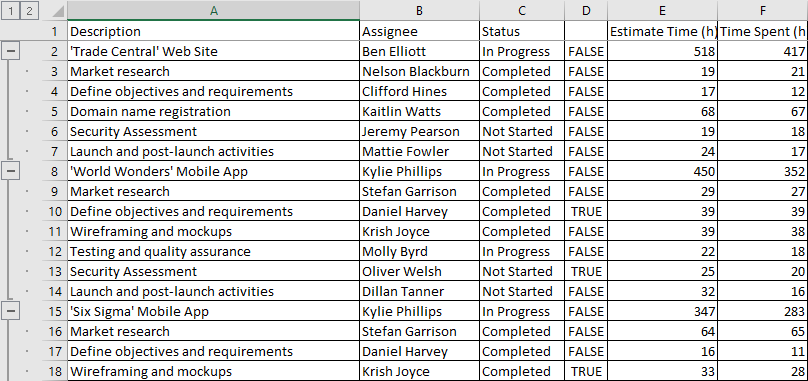
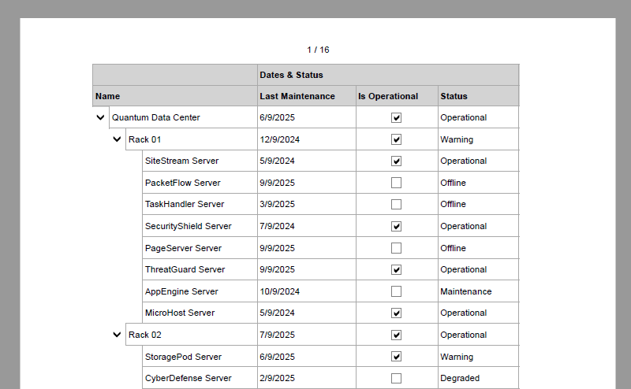
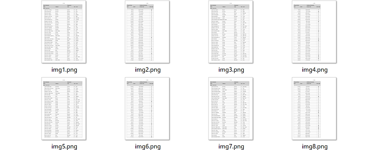

# Экспорт


Элемент управления TreeList может экспортировать данные в следующие форматы:

- XLSX (Microsoft Excel)
- PDF
- CSV
- Форматы изображений (PNG, JPEG, SVG и WebP)

Элемент управления TreeView поддерживает экспорт данных только в формат CSV.

!!! note 

    Экспорт данных в форматы XLSX, PDF и изображений реализован в библиотеке **Eremex.DocumentProcessing**. Убедитесь, что эта библиотека подключена к вашему проекту, чтобы использовать функцию экспорта.


## Экспорт в формат XLSX

Механизм экспорта в Excel учитывает структуру данных, то есть сохраняет параметры формирования данных контрола в выходном документе XLSX, включая:

- Иерархию узлов
- Форматирование значений
- Сортировку данных
- Итоги

<!-- TODO
 - Data filtering settings 
-->


После экспорта данные можно обрабатывать и анализировать в Microsoft Excel или другом приложении для работы с электронными таблицами.



!!! note

    Форматирование ячеек, реализованное с помощью шаблонов ячеек ([`TreeListColumn.CellTemplate`](../../API/Eremex.AvaloniaUI.Controls.DataControl/ColumnBase/CellTemplate.md)), не экспортируется.

Используйте следующие методы для экспорта данных контрола в формат XLSX:

- <code>TreeListControl.ExportToXlsx(string fileName, XlsxExportOptions? options = null)</code> — экспортирует данные в файл.

- <code>TreeListControl.ExportToXlsx(Stream stream, XlsxExportOptions? options = null)</code> — экспортирует данные в поток.

Необязательный параметр `options` (типа [`XlsxExportOptions`](../../API/Eremex.AvaloniaUI.Controls.DataControl/XlsxExportOptions.md)) позволяет настроить параметры экспорта. Класс [`XlsxExportOptions`](../../API/Eremex.AvaloniaUI.Controls.DataControl/XlsxExportOptions.md) предоставляет следующие члены:

**Ход экспорта**

- Событие [`ExportProgress`](../../API/Eremex.AvaloniaUI.Controls.DataControl/ExportOptions/ExportProgress.md) — возникает многократно во время экспорта данных. Параметр события [`ExportProgressEventArgs.ProgressPercentage`](../../API/Eremex.AvaloniaUI.Controls.DataControl/ExportProgressEventArgs/ProgressPercentage.md) указывает прогресс в процентах (от 0 до 100). Это событие можно использовать, чтобы отображать пользователям прогресс экспорта в удобном виде.


**Заголовки колонок и групп колонок**

- Свойство [`AllowFixedColumnHeaderPanel`](../../API/Eremex.AvaloniaUI.Controls.DataControl/XlsxExportOptions/AllowFixedColumnHeaderPanel.md) (по умолчанию `true`) — задаёт, остаётся ли панель заголовков колонок зафиксированной сверху в экспортированном документе.

- Свойство [`ShowBands`](../../API/Eremex.AvaloniaUI.Controls.DataControl/XlsxExportOptions/ShowBands.md) (по умолчанию `null`) — задаёт, включаются ли [группы колонок](bands.md) контрола в экспорт.

    Если [`ShowBands`](../../API/Eremex.AvaloniaUI.Controls.DataControl/XlsxExportOptions/ShowBands.md) равно `null`, значение параметра определяется свойством контрола [`TreeListControl.ShowBands`](../../API/Eremex.AvaloniaUI.Controls.TreeList/TreeListControl/ShowBands.md).

- Свойство [`ShowColumnHeaders`](../../API/Eremex.AvaloniaUI.Controls.DataControl/ExportOptions/ShowColumnHeaders.md) (по умолчанию `null`) — задаёт, включается ли панель заголовков колонок в экспорт.

    Если [`ShowColumnHeaders`](../../API/Eremex.AvaloniaUI.Controls.DataControl/ExportOptions/ShowColumnHeaders.md) равно `null`, значение параметра определяется свойством контрола [`TreeListControl.ShowColumnHeaders`](../../API/Eremex.AvaloniaUI.Controls.TreeList/TreeListControl/ShowColumnHeaders.md).


**Иерархия узлов**

- Свойство [`AllowGrouping`](../../API/Eremex.AvaloniaUI.Controls.DataControl/XlsxExportOptions/AllowGrouping.md) (по умолчанию `true`) — задаёт, экспортируется ли иерархия узлов. Если [`AllowGrouping`](../../API/Eremex.AvaloniaUI.Controls.DataControl/XlsxExportOptions/AllowGrouping.md) равно `false`, иерархия узлов не сохраняется в выходном документе.


**Итоги**


<!-- - [`ShowGroupSummaries`](../../API/Eremex.AvaloniaUI.Controls.DataControl/ExportOptions/ShowGroupSummaries.md) — Gets or sets whether group summaries are exported. -->

- [`ShowTotalSummaries`](../../API/Eremex.AvaloniaUI.Controls.DataControl/ExportOptions/ShowTotalSummaries.md) — возвращает или задаёт, экспортируются ли [итоги](summaries.md).

- [`SummaryCountBlankCells`](../../API/Eremex.AvaloniaUI.Controls.DataControl/XlsxExportOptions/SummaryCountBlankCells.md) — возвращает или задаёт, учитывают ли формулы итога Count пустые ячейки.

- [`ShowSummaryLabels`](../../API/Eremex.AvaloniaUI.Controls.DataControl/XlsxExportOptions/ShowSummaryLabels.md) — возвращает или задаёт, включаются ли метки итогов в экспортированные ячейки итогов.


**Линии ячеек**

- [`ShowHorizontalLines`](../../API/Eremex.AvaloniaUI.Controls.DataControl/XlsxExportOptions/ShowHorizontalLines.md) — задаёт, отображаются ли горизонтальные линии между ячейками в выходном документе.

- [`ShowVerticalLines`](../../API/Eremex.AvaloniaUI.Controls.DataControl/XlsxExportOptions/ShowVerticalLines.md) — задаёт, отображаются ли вертикальные линии между ячейками в выходном документе.


**Региональные параметры и форматирование ячеек**

- [`ApplyFormattingToEntireColumn`](../../API/Eremex.AvaloniaUI.Controls.DataControl/XlsxExportOptions/ApplyFormattingToEntireColumn.md) — задаёт, применяется ли форматирование ячеек ко всей колонке или к отдельным ячейкам в выходном документе.

- [`DocumentCulture`](../../API/Eremex.AvaloniaUI.Controls.DataControl/XlsxExportOptions/DocumentCulture.md) — пользовательский объект `CultureInfo`, определяющий правила форматирования числовых значений и значений даты/времени в выходном документе.

    Если свойство [`DocumentCulture`](../../API/Eremex.AvaloniaUI.Controls.DataControl/XlsxExportOptions/DocumentCulture.md) не указано, механизм экспорта использует текущую культуру приложения.

- Свойство [`TextExportMode`](../../API/Eremex.AvaloniaUI.Controls.DataControl/TextExportMode.md) — режим экспорта значений ячеек **по умолчанию**.

    Доступны следующие варианты:

    - [`TextExportMode.Value`](../../API/Eremex.AvaloniaUI.Controls.DataControl/TextExportMode.md) — экспортирует значения ячеек. Если значения ячеек отформатированы в элементе управления TreeList, механизм экспорта пытается применить соответствующее форматирование к экспортированным значениям в выходном документе.
    - [`TextExportMode.Text`](../../API/Eremex.AvaloniaUI.Controls.DataControl/TextExportMode.md) — экспортирует отображаемый текст ячеек. Если значения ячеек отформатированы в элементе управления TreeList, экспортируется отформатированное строковое представление.

    Вы можете использовать свойство [`TreeListColumn.TextExportMode`](../../API/Eremex.AvaloniaUI.Controls.DataControl/ColumnBase/TextExportMode.md), чтобы переопределить параметр [`XlsxExportOptions.TextExportMode`](../../API/Eremex.AvaloniaUI.Controls.DataControl/XlsxExportOptions/TextExportMode.md) для отдельных колонок.

    !!! note

        Механизм экспорта учитывает только форматирование ячеек, применённое с помощью свойства [`TreeListColumn.EditorProperties`](../../API/Eremex.AvaloniaUI.Controls.DataControl/ColumnBase/EditorProperties.md). Например:

        ```
        <mxtl:TreeListColumn Width="*" FieldName="Salary">
            <mxtl:TreeListColumn.EditorProperties>
                <mxe:TextEditorProperties DisplayFormatString="c"/>
            </mxtl:TreeListColumn.EditorProperties>
        </mxtl:TreeListColumn>
        ```

        Форматирование ячеек, применённое другими способами (например, с помощью [`TreeListColumn.CellTemplate`](../../API/Eremex.AvaloniaUI.Controls.DataControl/ColumnBase/CellTemplate.md)), игнорируется при экспорте данных.


## Экспорт в формат PDF

Механизм рендеринга PDF следует концепции WYSIWYG, которая сохраняет расположение элементов TreeList в выходном документе.





Используйте следующие методы для экспорта данных контрола в формат PDF:

- <code>TreeListControl.ExportToPdf(string fileName, PageExportOptions? options = null)</code> — экспортирует данные в файл.

- <code>TreeListControl.ExportToPdf(Stream stream, PageExportOptions? options = null)</code> — экспортирует данные в поток.

Необязательный параметр `options` (типа [`PageExportOptions`](../../API/Eremex.AvaloniaUI.Controls.DataControl/PageExportOptions.md)) позволяет настроить параметры экспорта. Класс [`PageExportOptions`](../../API/Eremex.AvaloniaUI.Controls.DataControl/PageExportOptions.md) предоставляет следующие члены:

**Ход экспорта**

- Событие [`PageExportOptions.ExportProgress`](../../API/Eremex.AvaloniaUI.Controls.DataControl/ExportOptions/ExportProgress.md) — возникает многократно во время экспорта данных. Параметр события [`ExportProgressEventArgs.ProgressPercentage`](../../API/Eremex.AvaloniaUI.Controls.DataControl/ExportProgressEventArgs/ProgressPercentage.md) указывает прогресс в процентах (от 0 до 100). Это событие можно использовать, чтобы отображать пользователям прогресс экспорта в удобном виде.

**Страница**

- [`PageExportOptions.FitToPageWidth`](../../API/Eremex.AvaloniaUI.Controls.DataControl/PageExportOptions/FitToPageWidth.md) (по умолчанию `false`) — задаёт, растягиваются ли колонки treelist по ширине бумаги.

- [`PageExportOptions.Landscape`](../../API/Eremex.AvaloniaUI.Controls.DataControl/PageExportOptions/Landscape.md) (по умолчанию `false`) — задаёт ориентацию страницы: горизонтальную ([`Landscape`](../../API/Eremex.AvaloniaUI.Controls.DataControl/PageExportOptions/Landscape.md)) или вертикальную (`Portrait`).

- [`PageExportOptions.Margins`](../../API/Eremex.AvaloniaUI.Controls.DataControl/PageExportOptions/Margins.md) (по умолчанию `72,72,72,72`) — поля страницы в пунктах. 1 пункт = 1/72 дюйма.

- [`PageExportOptions.PageRange`](../../API/Eremex.AvaloniaUI.Controls.DataControl/PageExportOptions/PageRange.md) — строка, задающая диапазон экспортируемых страниц. Можно использовать следующие обозначения для указания диапазона выходных страниц:

    - "1" — экспортирует страницу 1.
    - "1, 4, 8-10" — экспортирует страницы 1, 4 и с 8 по 10.
    <!-- - "7-" — Exports from page 7 to the end. -->

    Значение свойства [`PageRange`](../../API/Eremex.AvaloniaUI.Controls.DataControl/PageExportOptions/PageRange.md) по умолчанию — пустая строка, при которой экспортируются все страницы.

- [`PageExportOptions.PaperKind`](../../API/Eremex.AvaloniaUI.Controls.DataControl/PageExportOptions/PaperKind.md) (по умолчанию `A4`) — размер бумаги.


**Заголовки колонок и групп колонок**

- Свойство [`PageExportOptions.ShowBands`](../../API/Eremex.AvaloniaUI.Controls.DataControl/PageExportOptions/ShowBands.md) (по умолчанию `null`) — задаёт, включаются ли [группы колонок](bands.md) контрола в экспорт.

    Если [`ShowBands`](../../API/Eremex.AvaloniaUI.Controls.DataControl/PageExportOptions/ShowBands.md) равно `null`, значение параметра определяется свойством контрола [`TreeListControl.ShowBands`](../../API/Eremex.AvaloniaUI.Controls.TreeList/TreeListControl/ShowBands.md).

- Свойство [`PageExportOptions.ShowColumnHeaders`](../../API/Eremex.AvaloniaUI.Controls.DataControl/ExportOptions/ShowColumnHeaders.md) (по умолчанию `null`) — задаёт, включается ли панель заголовков колонок в экспорт.

    Если [`ShowColumnHeaders`](../../API/Eremex.AvaloniaUI.Controls.DataControl/ExportOptions/ShowColumnHeaders.md) равно `null`, значение параметра определяется свойством контрола [`TreeListControl.ShowColumnHeaders`](../../API/Eremex.AvaloniaUI.Controls.TreeList/TreeListControl/ShowColumnHeaders.md).

**Итоги**

- [`ShowTotalSummaries`](../../API/Eremex.AvaloniaUI.Controls.DataControl/ExportOptions/ShowTotalSummaries.md) — возвращает или задаёт, экспортируются ли [итоги](summaries.md).

**Собственный текст ячеек**

- Событие [`ColumnDisplayText`](../../API/Eremex.AvaloniaUI.Controls.DataControl/PageExportOptions/ColumnDisplayText.md) — возникает каждый раз, когда при экспорте формируется отображаемый текст ячейки. Обработайте это событие, чтобы задать собственный отображаемый текст ячеек.
    

## Экспорт в формат CSV

Элементы управления TreeList и TreeView предоставляют метод [`ExportToCsv`](../../API/Eremex.AvaloniaUI.Controls.DataControl/DataControlBase/ExportToCsv.md) для экспорта данных в формат CSV. CSV (значения, разделённые запятыми) — это текстовый формат данных для хранения табличных данных. Каждая запись экспортируется как текстовая строка, в которой значения разделены разделителем (как правило, запятой).

Доступны следующие перегрузки метода [`ExportToCsv`](../../API/Eremex.AvaloniaUI.Controls.DataControl/DataControlBase/ExportToCsv.md):

- <code>DataControlBase.ExportToCsv(string filePath, TextExportMode textExportNode = TextExportMode.Text, string separator = ",", bool quoteStringsWithSeparators = true)</code> — экспортирует данные в файл.

- <code>DataControlBase.ExportToCsv(Stream stream, TextExportMode textExportMode = TextExportMode.Text, string separator = ",", bool quoteStringsWithSeparators = true)</code> — экспортирует данные в поток.

Следующие параметры метода позволяют настроить параметры экспорта:

- `textExportMode` — режим экспорта значений ячеек **по умолчанию**.

    Доступны следующие варианты:

    - [`TextExportMode.Value`](../../API/Eremex.AvaloniaUI.Controls.DataControl/TextExportMode.md) — экспортирует значения ячеек. Форматы данных, применённые к значениям ячеек, не экспортируются.
    - [`TextExportMode.Text`](../../API/Eremex.AvaloniaUI.Controls.DataControl/TextExportMode.md) — экспортирует отображаемый текст ячеек. Если значения ячеек отформатированы в контроле, экспортируется отформатированное строковое представление.

        !!! note

            Механизм экспорта учитывает только форматирование ячеек, применённое с помощью свойств [`EditorProperties`](../../API/Eremex.AvaloniaUI.Controls.DataControl/ColumnBase/EditorProperties.md) ([`TreeListColumn.EditorProperties`](../../API/Eremex.AvaloniaUI.Controls.DataControl/ColumnBase/EditorProperties.md) и [`TreeViewControl.EditorProperties`](../../API/Eremex.AvaloniaUI.Controls.TreeList/TreeViewControl/EditorProperties.md)).

    Для элемента управления TreeList вы можете использовать свойство [`TreeListColumn.TextExportMode`](../../API/Eremex.AvaloniaUI.Controls.DataControl/ColumnBase/TextExportMode.md), чтобы переопределить параметр `textExportMode` метода для отдельных колонок.


- `separator` — строка, задающая разделитель, используемый для разграничения значений ячеек в выходном документе. Разделитель по умолчанию — запятая (",").

- `quoteStringsWithSeparators` — задаёт, следует ли заключать значения в кавычки ("), если они содержат указанный `separator`.


## Экспорт в форматы изображений

Метод [`ExportToImages`](../../API/Eremex.AvaloniaUI.Controls.TreeList/TreeListControl/ExportToImages.md) элемента управления TreeList выполняет постраничный экспорт в формат изображения (PNG, JPEG, SVG или WebP). Если содержимое контрола слишком велико, чтобы поместиться на одной странице, метод разбивает данные на страницы и экспортирует каждую страницу как отдельное изображение.



Формат и размер целевой страницы определяются параметром, передаваемым методу. Метод [`ExportToImages`](../../API/Eremex.AvaloniaUI.Controls.TreeList/TreeListControl/ExportToImages.md) использует тот же механизм разбиения на страницы, что и метод [`ExportToPdf`](../../API/Eremex.AvaloniaUI.Controls.TreeList/TreeListControl/ExportToPdf.md).

- <code>TreeListControl.ExportToImages(string directory, string fileNameFormat, ImageExportOptions? options = null)</code>

``` cs
using Eremex.AvaloniaUI.Controls.DataControl;
using Eremex.DocumentProcessing.Printing;

ImageExportOptions options = new ImageExportOptions();
options.Format = MxImageFormat.Svg;
options.FitToPageWidth = false;
options.PaperKind = PaperKind.A4;
options.Margins = new Margins(36, 36, 36, 36);
options.PageRange = "1-2";
treeList.ExportToImages(@"c:\images\", "img{0}.svg", options);
```


Используйте параметры метода [`ExportToImages`](../../API/Eremex.AvaloniaUI.Controls.TreeList/TreeListControl/ExportToImages.md), чтобы настроить параметры страницы, формат выходного изображения и шаблон имени файла.

- `directory` — задаёт каталог, в который сохраняются файлы изображений. Если указанный каталог не существует, возникает исключение.

- `fileNameFormat` — задаёт шаблон именования выходных файлов изображений.

    Значение `fileNameFormat` должно включать заполнитель `{0}` в позиции, куда нужно вставить номер страницы в генерируемых именах файлов. Вы можете форматировать номер страницы с помощью [стандартных](https://learn.microsoft.com/en-us/dotnet/standard/base-types/standard-numeric-format-strings) и [пользовательских числовых спецификаторов формата](https://learn.microsoft.com/en-us/dotnet/standard/base-types/custom-numeric-format-strings). Ниже приведены примеры значений `fileNameFormat`:

    - "image{0}.png" — создаёт файлы вида "image1.png", "image2.png" и так далее.
    - "image{0:D3}.svg"  — создаёт файлы вида "image001.svg", "image002.svg" и так далее.
    
Необязательный параметр `options` (типа [`ImageExportOptions`](../../API/Eremex.AvaloniaUI.Controls.DataControl/ImageExportOptions.md)) позволяет настроить параметры экспорта. Класс [`ImageExportOptions`](../../API/Eremex.AvaloniaUI.Controls.DataControl/ImageExportOptions.md) предоставляет следующие члены:

**Формат выходного изображения**

- [`ImageExportOptions.Format`](../../API/Eremex.AvaloniaUI.Controls.DataControl/ImageExportOptions/Format.md) — формат выходного изображения (PNG, JPEG, SVG или WebP).


**Ход экспорта**

- Событие [`PageExportOptions.ExportProgress`](../../API/Eremex.AvaloniaUI.Controls.DataControl/ExportOptions/ExportProgress.md) — возникает многократно во время экспорта данных. Параметр события [`ExportProgressEventArgs.ProgressPercentage`](../../API/Eremex.AvaloniaUI.Controls.DataControl/ExportProgressEventArgs/ProgressPercentage.md) указывает прогресс в процентах (от 0 до 100). Это событие можно использовать, чтобы отображать пользователям прогресс экспорта в удобном виде.

**Страница**

- [`PageExportOptions.FitToPageWidth`](../../API/Eremex.AvaloniaUI.Controls.DataControl/PageExportOptions/FitToPageWidth.md) (по умолчанию `false`) — задаёт, растягиваются ли колонки treelist по ширине бумаги.

- [`PageExportOptions.Landscape`](../../API/Eremex.AvaloniaUI.Controls.DataControl/PageExportOptions/Landscape.md) (по умолчанию `false`) — задаёт ориентацию страницы: горизонтальную ([`Landscape`](../../API/Eremex.AvaloniaUI.Controls.DataControl/PageExportOptions/Landscape.md)) или вертикальную (`Portrait`).

- [`PageExportOptions.Margins`](../../API/Eremex.AvaloniaUI.Controls.DataControl/PageExportOptions/Margins.md) (по умолчанию `72,72,72,72`) — поля страницы в пунктах. 1 пункт = 1/72 дюйма.

- [`ImageExportOptions.PageBorderColor`](../../API/Eremex.AvaloniaUI.Controls.DataControl/ImageExportOptions/PageBorderColor.md) — цвет рамки, отрисовываемой вокруг каждой страницы.

- [`ImageExportOptions.PageBorderWidth`](../../API/Eremex.AvaloniaUI.Controls.DataControl/ImageExportOptions/PageBorderWidth.md)  — ширина рамки, отрисовываемой вокруг каждой страницы.

- [`PageExportOptions.PageRange`](../../API/Eremex.AvaloniaUI.Controls.DataControl/PageExportOptions/PageRange.md) — строка, задающая диапазон экспортируемых страниц. Можно использовать следующие обозначения для указания диапазона выходных страниц:

    - "1" — экспортирует страницу 1.
    - "1, 4, 8-10" — экспортирует страницы 1, 4 и с 8 по 10.
    - "7-" — экспортирует страницы, начиная с 7 и до конца.

    Значение свойства [`PageRange`](../../API/Eremex.AvaloniaUI.Controls.DataControl/PageExportOptions/PageRange.md) по умолчанию — пустая строка, при которой экспортируются все страницы.

- [`PageExportOptions.PaperKind`](../../API/Eremex.AvaloniaUI.Controls.DataControl/PageExportOptions/PaperKind.md) (по умолчанию `A4`) — размер бумаги.

**Заголовки колонок и групп колонок**

- Свойство [`PageExportOptions.ShowBands`](../../API/Eremex.AvaloniaUI.Controls.DataControl/PageExportOptions/ShowBands.md) (по умолчанию `null`) — задаёт, включаются ли [группы колонок](bands.md) контрола в экспорт.

    Если [`ShowBands`](../../API/Eremex.AvaloniaUI.Controls.DataControl/PageExportOptions/ShowBands.md) равно `null`, значение параметра определяется свойством контрола [`TreeListControl.ShowBands`](../../API/Eremex.AvaloniaUI.Controls.TreeList/TreeListControl/ShowBands.md).

- Свойство [`PageExportOptions.ShowColumnHeaders`](../../API/Eremex.AvaloniaUI.Controls.DataControl/ExportOptions/ShowColumnHeaders.md) (по умолчанию `null`) — задаёт, включается ли панель заголовков колонок в экспорт.

    Если [`ShowColumnHeaders`](../../API/Eremex.AvaloniaUI.Controls.DataControl/ExportOptions/ShowColumnHeaders.md) равно `null`, значение параметра определяется свойством контрола [`TreeListControl.ShowColumnHeaders`](../../API/Eremex.AvaloniaUI.Controls.TreeList/TreeListControl/ShowColumnHeaders.md).


**Итоги**

- [`ShowTotalSummaries`](../../API/Eremex.AvaloniaUI.Controls.DataControl/ExportOptions/ShowTotalSummaries.md) — возвращает или задаёт, экспортируются ли [итоги](summaries.md).

**Собственный текст ячеек**

- Событие [`ColumnDisplayText`](../../API/Eremex.AvaloniaUI.Controls.DataControl/PageExportOptions/ColumnDisplayText.md) — возникает каждый раз, когда при экспорте формируется отображаемый текст ячейки. Обработайте это событие, чтобы задать собственный отображаемый текст ячеек.

<br>
<br>

<sup>*</sup> Эта страница переведена с использованием технологий машинного перевода.
