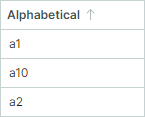
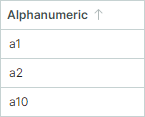
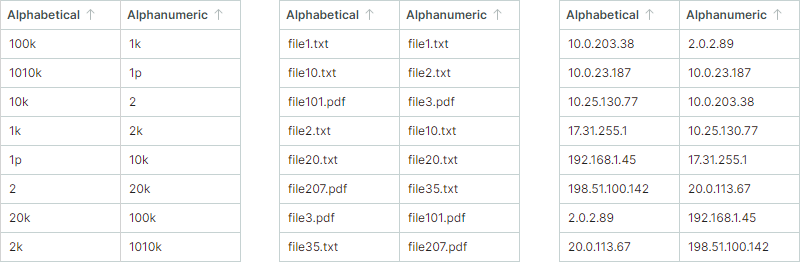

# Сортировка

Функция сортировки данных позволяет сортировать дочерние узлы одного уровня в контролах TreeList и TreeView по возрастанию или убыванию. 

TreeList поддерживает сортировку данных по одному или нескольким колонкам. Контрол также позволяет пользователям сортировать данные щелчком мыши по заголовку колонки и с помощью контекстного меню заголовка колонки.

## Действия пользователя (TreeList)

В контроле TreeList пользователь может щёлкнуть левой кнопкой мыши по заголовку колонки, чтобы отсортировать эту колонку. Последующий щелчок по тому же заголовку колонки меняет направление сортировки на противоположное. Чтобы очистить сортировку, удерживайте клавишу CTRL и щёлкните по заголовку колонки.

Чтобы отсортировать данные по нескольким колонкам, пользователю необходимо удерживать клавишу SHIFT, а затем щёлкать по заголовкам колонок в нужном порядке. Контрол отсортирует данные по первому выбранной колонке, затем по второй колонке, и так далее.

Пользователь также может изменить параметры сортировки колонки из контекстного меню заголовка колонки. Щёлкните правой кнопкой мыши по заголовку колонки, чтобы вызвать это меню.

Используйте следующие свойства, чтобы запретить пользователю сортировать данные:

- Установите [`TreeListControl.AllowSorting`](../../API/Eremex.AvaloniaUI.Controls.TreeList/TreeListControl/AllowSorting.md) в `false`, чтобы запретить пользователю сортировку по любой колонке.
- Установите [`ColumnBase.AllowSorting`](../../API/Eremex.AvaloniaUI.Controls.DataControl/ColumnBase/AllowSorting.md) в `false`, чтобы запретить пользователю сортировку по конкретной колонке.

Эти свойства не препятствуют сортировке данных в коде.

Контрол TreeView не имеет функций для сортировки данных из пользовательского интерфейса. Вы можете сортировать данные в коде для этого контрола.

## Алфавитно-цифровая сортировка

Для колонок, отображающих текст в TreeListControl и TreeViewControl, вы можете использовать унаследованное свойство [`DataControlBase.TextSortMode`](../../API/Eremex.AvaloniaUI.Controls.DataControl/DataControlBase/TextSortMode.md), чтобы выбрать между алфавитной и алфавитно-цифровой сортировкой.

- Сортировка `Alphabetical` (по умолчанию): Этот режим сравнивает строки посимвольно. Если текст содержит числа, алгоритм сортировки обрабатывает их как отдельные символы, а не как числа. Например:

    


- Сортировка `Alphanumeric` (естественный порядок): Этот режим подходит для строк, содержащих смесь текста и чисел. Алгоритм сортировки упорядочивает строки в понятном человеку, логическом порядке, обрабатывая числа как числовые значения, а не просто как символы. Например:

    

    Следующий код применяет алфавитно-цифровой порядок сортировки:

    ``` xml
    <mxtl:TreeListControl Name="treeList1" ItemsSource="{Binding MyData}" ChildrenSelector="{StaticResource childrenSelector}" 
                        TextSortMode="Alphanumeric"
                        />
    ```

Свойство [`DataControlBase.TextSortMode`](../../API/Eremex.AvaloniaUI.Controls.DataControl/DataControlBase/TextSortMode.md) влияет на сортировку всех колонок, отображающих текстовые значения.

На следующем изображении показаны дополнительные примеры, сравнивающие алфавитный и алфавитно-цифровой режимы сортировки:




## Сортировка в коде (TreeList)

Вы можете сортировать данные TreeList по одному или нескольким колонкам. Когда вы сортируете данные по нескольким колонкам, контрол TreeList переупорядочивает узлы согласно значениям первой колонки сортировки. Затем он переупорядочивает отсортированные узлы по второй колонке сортировки, сохраняя порядок значений в первой колонке, и так далее.

Используйте следующие свойства, чтобы отсортировать данные по колонке:

- Установите свойство [`ColumnBase.SortDirection`](../../API/Eremex.AvaloniaUI.Controls.DataControl/ColumnBase/SortDirection.md) в `Ascending` или `Descending`. Это свойство задаёт порядок сортировки данных колонки. 

- Установите свойство [`ColumnBase.SortIndex`](../../API/Eremex.AvaloniaUI.Controls.DataControl/ColumnBase/SortIndex.md) в неотрицательное значение, чтобы отсортировать данные по колонке в порядке возрастания. Свойство [`ColumnBase.SortIndex`](../../API/Eremex.AvaloniaUI.Controls.DataControl/ColumnBase/SortIndex.md) задаёт позицию колонки среди отсортированных колонок. 

Выполните одно из следующих действий, чтобы очистить сортировку:

- Установите свойство [`SortDirection`](../../API/Eremex.AvaloniaUI.Controls.TreeList/TreeViewControl/SortDirection.md) колонки в `null`, чтобы очистить сортировку для этой колонки. 
- Вызовите унаследованный метод [`DataControlBase.ClearSorting`](../../API/Eremex.AvaloniaUI.Controls.DataControl/DataControlBase/ClearSorting.md) контрола, чтобы удалить сортировку, применённую ко всем колонкам.

Следующий код очищает сортировку, а затем сортирует данные по двум колонкам:

``` csharp
using CommunityToolkit.Mvvm.ComponentModel;
using System.ComponentModel;

treeList.ClearSorting();
treeListColumn1.SortDirection = ListSortDirection.Ascending;
treeListColumn3.SortDirection = ListSortDirection.Descending;
```

Вы можете обернуть свой код методами [`BeginDataUpdate`](../../API/Eremex.AvaloniaUI.Controls.DataControl/DataControlBase/BeginDataUpdate.md) и [`EndDataUpdate`](../../API/Eremex.AvaloniaUI.Controls.DataControl/DataControlBase/EndDataUpdate.md), чтобы предотвратить избыточные обновления при изменении нескольких параметров контрола (включая параметры сортировки).

``` csharp
using CommunityToolkit.Mvvm.ComponentModel;
using System.ComponentModel;

treeList.BeginDataUpdate();
treeList.ClearSorting();
treeListColumn1.SortIndex = 0;
treeListColumn3.SortIndex = 1;
treeListColumn2.SortDirection = ListSortDirection.Descending;
treeList.EndDataUpdate();
```

## Сортировка в коде (TreeView)

Чтобы отсортировать данные в TreeView, используйте свойство `SortDirection` вашего объекта [`TreeViewControl`](../../API/Eremex.AvaloniaUI.Controls.TreeList/TreeViewControl.md). Установите это свойство в `Ascending` или `Descending`, чтобы отсортировать данные в нужном порядке. 

``` csharp
treeViewControl1.SortDirection = ListSortDirection.Ascending;
```

Выполните одно из следующих действий, чтобы очистить сортировку:

- Установите свойство `SortDirection` в `null`. 
- Вызовите унаследованный метод [`DataControlBase.ClearSorting`](../../API/Eremex.AvaloniaUI.Controls.DataControl/DataControlBase/ClearSorting.md) контрола.


## Сортируемые колонки и режим сортировки (TreeList и TreeView)

Контролы TreeList и TreeView могут сортировать колонки по значениям редактирования, отображаемым значениям, либо согласно пользовательскому алгоритму сортировки. Режим сортировки по умолчанию зависит от встроенного редактора колонки и типа данных привязанного свойства:

- Сортировка по значениям редактирования — Все колонки, кроме колонок со встроенным ComboBoxEditor.
- Сортировка по отображаемому тексту — Колонки со встроенным ComboBoxEditor.
- Без сортировки — Колонки, привязанные к объектам, не реализующим интерфейс `IComparable`. Например, типы данных изображений не реализуют этот интерфейс, поэтому для соответствующих колонок по умолчанию сортировка недоступна. См. раздел [Пользовательская сортировка](#пользовательская-сортировка) ниже, чтобы узнать, как принудительно отсортировать такие колонки.

Свойство [`ColumnBase.SortMode`](../../API/Eremex.AvaloniaUI.Controls.DataControl/ColumnBase/SortMode.md) (в TreeList) и свойство [`TreeViewControl.SortMode`](../../API/Eremex.AvaloniaUI.Controls.TreeList/TreeViewControl/SortMode.md) (в TreeView) позволяют изменить режим сортировки по умолчанию. Доступны следующие варианты:

- [`SortMode.Value`](../../API/Eremex.AvaloniaUI.Controls.DataControl/SortMode.md) — Сортировка по значениям редактирования ячеек.
- [`SortMode.DisplayText`](../../API/Eremex.AvaloniaUI.Controls.DataControl/SortMode.md) — Сортировка по отображаемому тексту ячеек.
- [`SortMode.Custom`](../../API/Eremex.AvaloniaUI.Controls.DataControl/SortMode.md) — Пользовательская сортировка. Установите свойство [`SortMode`](../../API/Eremex.AvaloniaUI.Controls.DataControl/SortMode.md) в `Custom`, а затем обработайте событие [`TreeListControl.CustomColumnSort`](../../API/Eremex.AvaloniaUI.Controls.TreeList/TreeListControl/CustomColumnSort.md)/[`TreeViewControl.CustomSort`](../../API/Eremex.AvaloniaUI.Controls.TreeList/TreeViewControl/CustomSort.md), чтобы реализовать пользовательскую логику сортировки. См. [Пользовательская сортировка](#пользовательская-сортировка).

### Пользовательская сортировка

Событие [`CustomColumnSort`](../../API/Eremex.AvaloniaUI.Controls.TreeList/TreeListControl/CustomColumnSort.md)/[`CustomSort`](../../API/Eremex.AvaloniaUI.Controls.TreeList/TreeViewControl/CustomSort.md) позволяет реализовать пользовательскую логику сортировки. Установите свойство [`ColumnBase.SortMode`](../../API/Eremex.AvaloniaUI.Controls.DataControl/ColumnBase/SortMode.md) (в TreeList) и свойство [`TreeViewControl.SortMode`](../../API/Eremex.AvaloniaUI.Controls.TreeList/TreeViewControl/SortMode.md) (в TreeView) в `Custom`, чтобы включить это событие.

Если тип данных, привязанный к колонке, не реализует интерфейс `IComparable` (например, тип данных изображения), контрол TreeList/TreeView по умолчанию запрещает сортировку для этой колонки. Однако вы можете включить сортировку для этой колонки следующим образом:

- TreeList: Установите свойство колонки [`AllowSorting`](../../API/Eremex.AvaloniaUI.Controls.DataControl/ColumnBase/AllowSorting.md) в `true` (значение по умолчанию для этого свойства — `null`).
- TreeList и TreeView: Установите свойство [`SortMode`](../../API/Eremex.AvaloniaUI.Controls.DataControl/SortMode.md) в `Custom`.
- TreeList и TreeView: Обработайте событие [`CustomColumnSort`](../../API/Eremex.AvaloniaUI.Controls.TreeList/TreeListControl/CustomColumnSort.md)/[`CustomSort`](../../API/Eremex.AvaloniaUI.Controls.TreeList/TreeViewControl/CustomSort.md), чтобы реализовать пользовательскую сортировку.

При обработке события [`CustomColumnSort`](../../API/Eremex.AvaloniaUI.Controls.TreeList/TreeListControl/CustomColumnSort.md)/[`CustomSort`](../../API/Eremex.AvaloniaUI.Controls.TreeList/TreeViewControl/CustomSort.md) вам следует сравнить два узла, указанных в параметрах события. Присвойте результат сравнения параметру события [`Result`](../../API/Eremex.AvaloniaUI.Controls.TreeList/TreeViewCustomSortEventArgs/Result.md) следующим образом:

- Установите [`Result`](../../API/Eremex.AvaloniaUI.Controls.TreeList/TreeViewCustomSortEventArgs/Result.md) в `-1`, если первый узел должен отображаться выше второго узла при сортировке данных по возрастанию. 

- Установите [`Result`](../../API/Eremex.AvaloniaUI.Controls.TreeList/TreeViewCustomSortEventArgs/Result.md) в `1`, если первый узел должен отображаться ниже второго узла при сортировке данных по возрастанию. 

 - Установите [`Result`](../../API/Eremex.AvaloniaUI.Controls.TreeList/TreeViewCustomSortEventArgs/Result.md) в `0`, если оба узла равны. 
 

Этот пример обрабатывает событие [`TreeListControl.CustomColumnSort`](../../API/Eremex.AvaloniaUI.Controls.TreeList/TreeListControl/CustomColumnSort.md), чтобы отсортировать данные в колонке "_FileName_" пользовательским способом. Колонка "_FileName_" хранит имена файлов в стандартном формате "_filename.ext_". Пользовательская процедура сортировки сортирует имена файлов по их расширениям.

``` csharp
<mxtl:TreeListControl Name="treeList" CustomColumnSort="TreeList_CustomColumnSort">
    <mxtl:TreeListControl.Columns>
        <mxtl:TreeListColumn  Width="*" FieldName="FileName"  SortMode="Custom" />
    </mxtl:TreeListControl.Columns>
</mxtl:TreeListControl>

private void TreeList_CustomColumnSort(object? sender, TreeListCustomColumnSortEventArgs e)
{
    if (e.Column.FieldName == "FileName")
    {
        string fileName1 = Convert.ToString(e.Value1);
        string fileName2 = Convert.ToString(e.Value2);

        string newfileName1 = extractFileExtension(fileName1) + "." + fileName1;
        string newfileName2 = extractFileExtension(fileName2) + "." + fileName2;
        e.Result = String.Compare(newfileName1, newfileName2);
    }
}

string extractFileExtension(string fileName)
{
    string res = "";
    int dotIndex = fileName.LastIndexOf('.');
    if (dotIndex > 0)
        res = fileName.Substring(dotIndex + 1);
    return res;
}
```

## Реакция на сортировку данных

Обработайте следующие события, чтобы выполнить пользовательские действия при сортировке данных:

- [`DataControlBase.StartSorting`](../../API/Eremex.AvaloniaUI.Controls.DataControl/DataControlBase/StartSorting.md) — Возникает, когда данные вот-вот будут отсортированы.
- [`DataControlBase.EndSorting`](../../API/Eremex.AvaloniaUI.Controls.DataControl/DataControlBase/EndSorting.md) — Возникает по завершении сортировки данных.

## Дополнительный API

- [`TreeListControlBase.AutoScrollOnSorting`](../../API/Eremex.AvaloniaUI.Controls.TreeList/TreeListControlBase/AutoScrollOnSorting.md) — Задаёт, прокручивает ли контрол автоматически видовое окно, чтобы сделать сфокусированный узел видимым, когда данные отсортированы.

<br>
<br>

<sup>*</sup> Эта страница переведена с использованием технологий машинного перевода.
