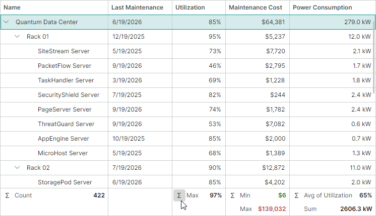
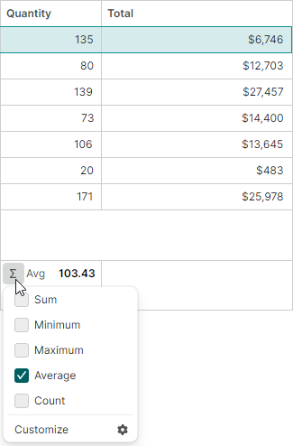
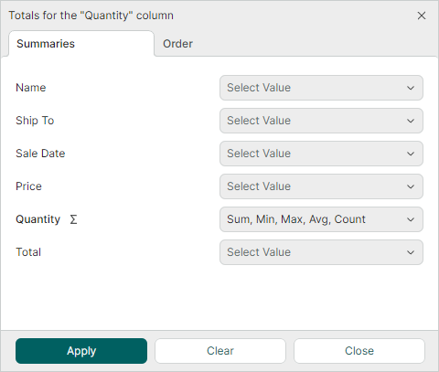
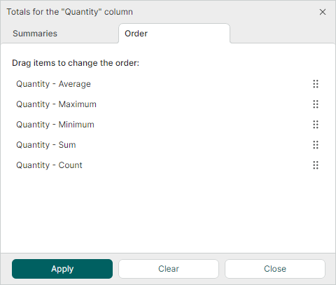
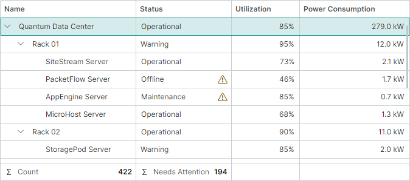
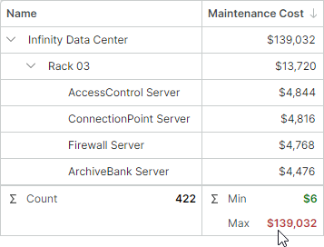

# Итоги

Контрол TreeList позволяет вычислять общие итоги по колонкам. Общие итоги — это агрегатные функции, вычисляемые по всем строкам. Чтобы правильно вычислять общие итоги, контролу необходим одновременный доступ ко всем строкам.

!!! note "Примечание"

    Установите свойство [`AllowDynamicDataLoading`](../../API/Eremex.AvaloniaUI.Controls.TreeList/TreeListControlBase/AllowDynamicDataLoading.md) в `false`, чтобы отключить [динамическую загрузку данных](data-binding/binding-to-hierarchical-data.md#динамическая-загрузка-данных) и обеспечить контролу TreeList одновременный доступ ко всем строкам.




Основные возможности вычисления итогов:

- Встроенные функции итогов: Sum, Min, Max, Count и Average.
- Управление во время работы приложения — пользователи могут щёлкнуть кнопку Σ в ячейке нижней панели, чтобы добавить итоги или открыть диалог Summary Editor для расширенных операций с итогами.
- Несколько итогов на колонку — каждая колонка может отображать несколько итогов, вычисленных по значениям этой колонки.
- Итоги между колонками — можно вычислить итог по одной колонке и отобразить его в другой.
- Пользовательские итоги — можно обработать событие [`CustomSummary`](../../API/Eremex.AvaloniaUI.Controls.TreeList/TreeListControl/CustomSummary.md), чтобы вычислить собственную агрегатную функцию по своей логике.
- Итоги включаются в экспорт в XLSX и PDF.


## Включение общих итогов

Общие итоги отображаются в нижней панели контрола.

Установите свойство [`ShowTotalSummaries`](../../API/Eremex.AvaloniaUI.Controls.TreeList/TreeListControl/ShowTotalSummaries.md) в `true`, чтобы отобразить панель итогов и тем самым включить вычисление общих итогов. Панель итогов отображается в нижней части [`TreeListControl`](../../API/Eremex.AvaloniaUI.Controls.TreeList/TreeListControl.md), под всеми строками. Изначально эта панель скрыта.

```xml
<mxtl:TreeListControl x:Name="treeList" ShowTotalSummaries="True" AllowDynamicDataLoading="False">...</mxtl:TreeListControl>
```

Панель итогов содержит ячейки итогов для всех колонок. Если включена [настройка итогов пользователем](#настройка-итогов-пользователем) (по умолчанию), эти ячейки содержат кнопку `Σ`, которая открывает меню итогов и редактор итогов.


**Связанный API**

- [`ShowTotalSummaries`](../../API/Eremex.AvaloniaUI.Controls.TreeList/TreeListControl/ShowTotalSummaries.md) — возвращает или задаёт, отображается ли панель общих итогов и включено ли вычисление общих итогов.
- [`TotalSummaryPanelMinHeight`](../../API/Eremex.AvaloniaUI.Controls.TreeList/TreeListControl/TotalSummaryPanelMinHeight.md) — возвращает или задаёт минимальную высоту панели общих итогов.

## Определение общих итогов

Используйте коллекцию [`TotalSummaries`](../../API/Eremex.AvaloniaUI.Controls.TreeList/TreeListControl/TotalSummaries.md) для определения общих итогов. Элементы этой коллекции — экземпляры класса [`SummaryItem`](../../API/Eremex.AvaloniaUI.Controls.DataControl/SummaryItem.md). Каждый объект [`SummaryItem`](../../API/Eremex.AvaloniaUI.Controls.DataControl/SummaryItem.md) задаёт поле для вычисления итога, тип итога, колонку, в которой отображается результат, и другие параметры.

```xml
xmlns:mxdc="clr-namespace:Eremex.AvaloniaUI.Controls.DataControl;assembly=Eremex.Avalonia.Controls"

<mxtl:TreeListControl x:Name="treeList" ShowTotalSummaries="True" AllowDynamicDataLoading="False">
    <mxtl:TreeListControl.TotalSummaries>
        <mxdc:SummaryItem FieldName="Name" SummaryType="Count" />
        <mxdc:SummaryItem FieldName="Utilization" SummaryType="Average" ShowInColumn="PowerConsumption" />
        <mxdc:SummaryItem FieldName="Utilization" SummaryType="Max" />
        <mxdc:SummaryItem FieldName="MaintenanceCost" SummaryType="Min" />
        <mxdc:SummaryItem FieldName="MaintenanceCost" SummaryType="Max" />
        <mxdc:SummaryItem FieldName="PowerConsumption" SummaryType="Sum" />
    </mxtl:TreeListControl.TotalSummaries>
</mxtl:TreeListControl>
```

**Связанный API**

- [`TotalSummaries`](../../API/Eremex.AvaloniaUI.Controls.TreeList/TreeListControl/TotalSummaries.md) — предоставляет доступ к коллекции элементов итогов (объектов [`SummaryItem`](../../API/Eremex.AvaloniaUI.Controls.DataControl/SummaryItem.md)), определяющих общие итоги.
- [`SummaryItem.FieldName`](../../API/Eremex.AvaloniaUI.Controls.DataControl/SummaryItem/FieldName.md) — возвращает или задаёт имя поля данных, значения которого используются для вычисления итога.
- [`SummaryItem.Name`](../../API/Eremex.AvaloniaUI.Controls.DataControl/SummaryItem/Name.md) — возвращает или задаёт имя элемента итога, по которому его можно идентифицировать. По имени можно получить элементы итогов из коллекции [`TotalSummaries`](../../API/Eremex.AvaloniaUI.Controls.TreeList/TreeListControl/TotalSummaries.md).
- [`SummaryItem.Tag`](../../API/Eremex.AvaloniaUI.Controls.DataControl/SummaryItem/Tag.md) — возвращает или задаёт пользовательские данные, связанные с этим элементом `SummaryItem`.
- [`SummaryItem.ShowInColumn`](../../API/Eremex.AvaloniaUI.Controls.DataControl/SummaryItem/ShowInColumn.md) — возвращает или задаёт имя поля колонки, которая отображает значение итога. Если свойство не задано, итог отображается в колонке, привязанной к `FieldName`.
- [`SummaryItem.SummaryType`](../../API/Eremex.AvaloniaUI.Controls.DataControl/SummaryItem/SummaryType.md) — возвращает или задаёт тип агрегатной функции (`Sum`, `Min`, `Max`, `Count` или `Average`).
- [`SummaryItem.Label`](../../API/Eremex.AvaloniaUI.Controls.DataControl/SummaryItem/Label.md) — возвращает или задаёт пользовательскую подпись, отображаемую вместо подписи итога по умолчанию. Подпись по умолчанию показывает название функции итога. Если итог отображается в другой колонке (см. [`ShowInColumn`](../../API/Eremex.AvaloniaUI.Controls.DataControl/SummaryItem/ShowInColumn.md)), подпись также показывает заголовок колонки, привязанной к [`SummaryItem.FieldName`](../../API/Eremex.AvaloniaUI.Controls.DataControl/SummaryItem/FieldName.md).

    


## Настройка итогов пользователем

По умолчанию итоги могут редактироваться пользователями. В этом режиме ячейки итогов отображают кнопку `Σ`, открывающую меню итогов:



С помощью этого меню пользователи могут:

- Добавлять и удалять итоги, устанавливая и снимая флажки рядом с функциями итогов.

    

- Выбрать `Customize`, чтобы открыть диалог `Summary Editor`.

    

    На вкладке `Summaries` этого диалога пользователи могут создавать итоги между колонками (итоги, вычисленные по одной колонке, но отображаемые в другой).

    На вкладке `Order` можно изменить порядок отображения существующих итогов.

    


**Связанный API**

- [`AllowEditingTotalSummaries`](../../API/Eremex.AvaloniaUI.Controls.TreeList/TreeListControl/AllowEditingTotalSummaries.md) — возвращает или задаёт, могут ли пользователи редактировать общие итоги.

    Это свойство влияет только на возможности пользователей изменять итоги и не влияет на вычисления итогов, выполняемые в коде.

## Пользовательские итоги

Пользовательские итоги позволяют вычислять агрегатные значения по вашей собственной логике.

Чтобы добавить пользовательский итог, выполните следующие действия:

- Создайте объект [`SummaryItem`](../../API/Eremex.AvaloniaUI.Controls.DataControl/SummaryItem.md) и задайте его свойству [`SummaryItem.SummaryType`](../../API/Eremex.AvaloniaUI.Controls.DataControl/SummaryItem/SummaryType.md) значение `Custom`.

- Добавьте этот [`SummaryItem`](../../API/Eremex.AvaloniaUI.Controls.DataControl/SummaryItem.md) в коллекцию [`TotalSummaries`](../../API/Eremex.AvaloniaUI.Controls.TreeList/TreeListControl/TotalSummaries.md).

- Обработайте событие [`CustomSummary`](../../API/Eremex.AvaloniaUI.Controls.TreeList/TreeListControl/CustomSummary.md), чтобы вручную вычислить значение для этого [`SummaryItem`](../../API/Eremex.AvaloniaUI.Controls.DataControl/SummaryItem.md).

    Присвойте параметру события `e.SummaryValue` свой результат.

    При обработке события [`CustomSummary`](../../API/Eremex.AvaloniaUI.Controls.TreeList/TreeListControl/CustomSummary.md) используйте коллекцию `e.Nodes` для перебора целевых узлов (строк).


### Пример — вычисление пользовательского общего итога

Этот пример создаёт пользовательский общий итог (с названием «Needs Attention»), который вычисляет число активов, требующих внимания. Это активы со статусом _Maintenance_, _Degraded_, _Offline_ или _Decommissioned_.




```xml
<!-- XAML -->
<mxtl:TreeListControl x:Name="treeList" CustomSummary="OnCustomSummary">
    <mxtl:TreeListControl.TotalSummaries>
        <mxdc:SummaryItem FieldName="Status" SummaryType="Custom" Label="Needs Attention"/>
        <mxdc:SummaryItem FieldName="Name" SummaryType="Count" />
    </mxtl:TreeListControl.TotalSummaries>
</mxtl:TreeListControl>
```

```csharp
// Code-behind
void OnCustomSummary(object sender, TreeListCustomSummaryEventArgs e)
{
    int assetsRequiringAttention = 0;
    foreach (var node in e.Nodes)
    {
        var status = (AssetStatus)treeList.GetCellValue(node, e.SummaryItem.FieldName);
        if (status is AssetStatus.Maintenance or AssetStatus.Degraded or AssetStatus.Offline or AssetStatus.Decommissioned)
            assetsRequiringAttention++;
    }
    e.SummaryValue = assetsRequiringAttention;
}
```

**Связанный API**

- [`CustomSummary`](../../API/Eremex.AvaloniaUI.Controls.TreeList/TreeListControl/CustomSummary.md) — возникает при вычислении значения итога. Используйте параметр события [`SummaryValue`](../../API/Eremex.AvaloniaUI.Controls.TreeList/TreeListCustomSummaryEventArgs/SummaryValue.md), чтобы передать пользовательское значение итога.


## Получение значений итогов

Вычисленные значения итогов можно получить в коде с помощью следующего API:

- [`TreeListControl.GetTotalSummaryValue`](../../API/Eremex.AvaloniaUI.Controls.TreeList/TreeListControl/GetTotalSummaryValue.md) — возвращает вычисленное значение общего итога.


```csharp
object? totalValue = treeList.GetTotalSummaryValue(summaryItem);
```


## Стилизация элементов итогов

Контрол TreeList позволяет настроить внешний вид элементов итогов. Для этого задайте стиль специального визуального контрола, который отрисовывает элементы итогов TreeList.

### Класс целевого визуального контрола

`Eremex.AvaloniaUI.Controls.DataControl.Visuals.FooterCellItemControl`

DataContext каждого `FooterCellItemControl` — объект `FooterCellItem`.

### DataContext

`Eremex.AvaloniaUI.Controls.DataControl.Visuals.FooterCellItem`

Ниже для справки приведено определение класса `FooterCellItem`. В собственных сеттерах стилей и конвертерах можно выполнять привязку к свойствам итога (`FooterCellItem.FieldName`, `FooterCellItem.SummaryType`, `FooterCellItem.Value`, `FooterCellItem.Label` и `FooterCellItem.DisplayValue`). См. [пример](#пример---стилизация-элементов-итогов).

```csharp
/// <summary>Represents a summary value displayed in a footer cell.</summary>
public partial class FooterCellItem : ViewModelBase
{
	/// <summary>Gets or sets the summary item's label.</summary>
	[ObservableProperty] string label = string.Empty;

	/// <summary>Gets or sets the formatted summary value displayed in the footer cell.</summary>
	[ObservableProperty] string displayValue = string.Empty;

	/// <summary>Gets or sets the type of the aggregate function the summary calculates.</summary>
	public SummaryItemType SummaryType { get; set; } = SummaryItemType.None;

	/// <summary>Gets or sets the summary value.</summary>
	public object Value { get; set; }

	/// <summary>Gets or sets the name of the data field whose values the summary calculates.</summary>
	public string FieldName { get; set; }
}
```

### Шаблон отрисовки элементов итогов по умолчанию

Этот код показывает шаблон, которым элементы итогов отрисовываются по умолчанию. Этот шаблон можно найти в [исходном коде визуальной темы `DeltaDesign`](../themes/modify-control-themes.md#тема-по-умолчанию). Используйте его, чтобы составить селектор стиля для нужных элементов итога. Например, `TextBlock` с именем _Label_ отображает метку элемента итогов, а `TextBlock` с именем _DisplayValue_ — значение итога:

``` xml
<!-- DeltaDesign paint theme -->
xmlns:mxdcv="clr-namespace:Eremex.AvaloniaUI.Controls.DataControl.Visuals;assembly=Eremex.Avalonia.Controls"

<ControlTheme x:Key="{x:Type mxdcv:FooterCellItemControl}" TargetType="mxdcv:FooterCellItemControl">
    <Setter Property="Background" Value="Transparent" />
    <Setter Property="Padding" Value="{DynamicResource DataControlFooterPadding}" />
    
    <Setter Property="Template">
        <ControlTemplate TargetType="mxdcv:FooterCellItemControl">
            <DockPanel Margin="{TemplateBinding Padding}" Background="{TemplateBinding Background}">
                <TextBlock x:Name="Label"
                           Text="{Binding Label}"
                           DockPanel.Dock="Left"
                           TextTrimming="CharacterEllipsis"
                           HorizontalAlignment="Left"
                           mxc:TextBlockHelper.ShowTooltipWhenTrimming="True" />
                <TextBlock Text=" "/>
                <TextBlock x:Name="DisplayValue"
                           Text="{Binding DisplayValue}"
                           DockPanel.Dock="Right"
                           FontWeight="SemiBold"
                           TextTrimming="CharacterEllipsis"
                           HorizontalAlignment="Right"
                           mxc:TextBlockHelper.ShowTooltipWhenTrimming="True" />
            </DockPanel>
        </ControlTemplate>
    </Setter>
</ControlTheme>
```

### Пример - стилизация элементов итогов

Этот код меняет цвет двух значений итогов для колонки _MaintenanceCost_ в контроле TreeList. Значение итога `Min` отображается зелёным, а значение `Max` — красным.



Созданный стиль применяется к текстовому блоку _DisplayValue_ в шаблоне `FooterCellItemControl` и с помощью собственного конвертера нескольких значений выбирает цвет текста по свойствам итога (`FooterCellItem.FieldName` и `FooterCellItem.SummaryType`).

```xml
xmlns:mxtl="https://schemas.eremexcontrols.net/avalonia/treelist"

xmlns:mxdcv="clr-namespace:Eremex.AvaloniaUI.Controls.DataControl.Visuals;assembly=Eremex.Avalonia.Controls"

<mxtl:TreeListControl.Styles>
    <Style Selector="mxdcv|FooterCellItemControl /template/ TextBlock#DisplayValue" x:DataType="mxdcv:FooterCellItem">
        <Setter Property="Foreground">
            <Setter.Value>
            <MultiBinding Converter="{views:TreeListSummaryTypeToForegroundConverter}">
                <Binding Path="FieldName" />
                <Binding Path="SummaryType" />
                <DynamicResourceExtension ResourceKey="Icons/Outline/Green"/>
                <DynamicResourceExtension ResourceKey="Icons/Outline/Red"/>
            </MultiBinding>
            </Setter.Value>
        </Setter>
        </Style>                
</mxtl:TreeListControl.Styles>
```

```csharp
public class TreeListSummaryTypeToForegroundConverter : MarkupExtension, IMultiValueConverter
{
    public object Convert(IList<object> values, Type targetType, object parameter, CultureInfo culture)
    {
        if (values.Count != 4)
            return null;

        if (values[0] is string fieldName && fieldName == "MaintenanceCost" && values[1] is SummaryItemType sumType)
        {
            if (sumType == SummaryItemType.Min)
                return values[2];
            else if (sumType == SummaryItemType.Max)
                return values[3];
        }

        return null;
    }

    public override object ProvideValue(IServiceProvider serviceProvider)
    {
        return this;
    }
}
```

Полный код см. в [демонстрационном приложении](../../index.md#демонстрационное-приложение).

<br>
<br>

<sup>*</sup> Эта страница переведена с использованием технологий машинного перевода.
