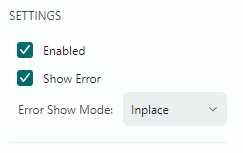
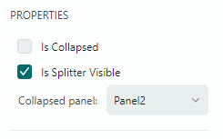

# GroupBox

[`GroupBox`](../../API/Eremex.AvaloniaUI.Controls.Editors/GroupBox.md) — это панель, у которой есть заголовок и линия внизу, визуально отделяющая [`GroupBox`](../../API/Eremex.AvaloniaUI.Controls.Editors/GroupBox.md) от других контролов.



[`GroupBox`](../../API/Eremex.AvaloniaUI.Controls.Editors/GroupBox.md) является потомком `Avalonia.Controls.Primitives.HeaderedContentControl`.

## Заголовок

Используйте свойство `Header`, чтобы задать заголовок [`GroupBox`](../../API/Eremex.AvaloniaUI.Controls.Editors/GroupBox.md). Свойство `HeaderTemplate` позволяет задать шаблон для отрисовки заголовка контрола произвольным образом.

### Связанный API

- [`ShowHeader`](../../API/Eremex.AvaloniaUI.Controls.Editors/GroupBox/ShowHeader.md) — возвращает или задаёт, виден ли заголовок.
- [`HeaderHorizontalAlignment`](../../API/Eremex.AvaloniaUI.Controls.Editors/GroupBox/HeaderHorizontalAlignment.md) — задаёт горизонтальное выравнивание заголовка.
- [`HeaderVerticalAlignment`](../../API/Eremex.AvaloniaUI.Controls.Editors/GroupBox/HeaderVerticalAlignment.md) — задаёт вертикальное выравнивание заголовка.

## Определение содержимого

Вы можете задать содержимое [`GroupBox`](../../API/Eremex.AvaloniaUI.Controls.Editors/GroupBox.md) в XAML между открывающим и закрывающим тегами `<GroupBox>`. В коде используйте для этого унаследованное свойство `Content`. Вы можете установить свойство `ContentTemplate`, чтобы задать шаблон, используемый для отрисовки содержимого контрола.

## Пример

Этот пример определяет [`GroupBox`](../../API/Eremex.AvaloniaUI.Controls.Editors/GroupBox.md), отображающий StackPanel с контролами.



``` xml
xmlns:mxe="https://schemas.eremexcontrols.net/avalonia/editors"

<mxe:GroupBox Header="PROPERTIES">
    <StackPanel>
        <mxe:CheckEditor x:Name="IsCollapsedSelector" 
         Content="Is Collapsed" Classes="LayoutItem"/>
        <mxe:CheckEditor x:Name="IsSplitterVisibleSelector" 
         Content="Is Splitter Visible" IsChecked="True" 
         Classes="LayoutItem"/>
        <DockPanel>
            <Label Content="Collapsed panel:" Classes="LayoutItem"/>
            <mxe:ComboBoxEditor EditorValue="{Binding CollapsedPanel, Mode=TwoWay}" 
            ItemsSource="{mxc:EnumItemsSource EnumType=mxe:SplitContainerControlCollapsePanel}"/>
        </DockPanel>
    </StackPanel>
</mxe:GroupBox>
```


<br>
<br>

<sup>*</sup> Эта страница переведена с использованием технологий машинного перевода.
