# TabControl

Контрол [`MxTabControl`](../../API/Eremex.AvaloniaUI.Controls/MxTabControl.md) позволяет организовать панели в интерфейс с вкладками. Пользователи могут активировать конкретную панель щелчком по соответствующей вкладке.

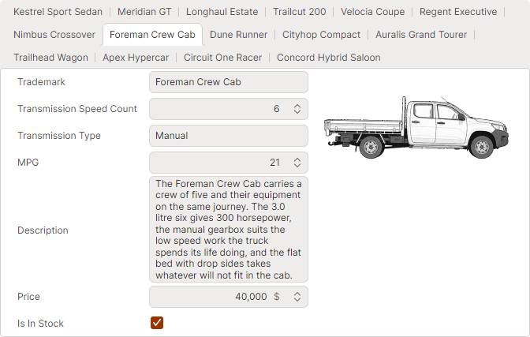

[`MxTabControl`](../../API/Eremex.AvaloniaUI.Controls/MxTabControl.md) является потомком стандартного контрола `Avalonia.Controls.TabControl`. Он наследует базовую функциональность `TabControl` и расширяет её дополнительными возможностями:

- Неограниченное число вкладок.
- Заполнение вкладок и их содержимого из источника объектов.
- Изменение порядка вкладок с помощью перетаскивания.
- Режимы размещения вкладок: Stretch, Scroll и Multi-line.
- Гибкая настройка ширины вкладок: по содержимому, по самому широкому содержимому или фиксированная ширина.
- Растягивание вкладок на всю ширину контрола.
- Настраиваемая видимость значков и автоматическое скрытие текста при нехватке места.
- Кнопки «Закрыть вкладку».
- Кнопка «Новая вкладка».
- Пользовательские контролы в области заголовков вкладок.

## Создание вкладок

[`MxTabControl`](../../API/Eremex.AvaloniaUI.Controls/MxTabControl.md) наследует функциональность создания вкладок от базового класса `Avalonia.Controls.TabControl`. Контролы поддерживают два подхода к добавлению вкладок:

- Добавление элементов вкладок вручную
- Заполнение вкладок и их содержимого из источника объектов.

### Добавление элементов вкладок вручную

Элементы вкладок в контроле [`MxTabControl`](../../API/Eremex.AvaloniaUI.Controls/MxTabControl.md) инкапсулируются объектами [`MxTabItem`](../../API/Eremex.AvaloniaUI.Controls/MxTabItem.md). Они предоставляют настройки для задания содержимого заголовка вкладки, значка заголовка, состояния выбора и т. д. Список ниже описывает основные открытые члены [`MxTabItem`](../../API/Eremex.AvaloniaUI.Controls/MxTabItem.md), включая унаследованные:

- `Header` — Возвращает или задаёт содержимое заголовка вкладки.
- `HeaderTemplate` — Возвращает или задаёт шаблон данных, используемый для отрисовки `Header`.
- [`Glyph`](../../API/Eremex.AvaloniaUI.Controls/MxTabItem/Glyph.md) — Возвращает или задаёт значок, отображаемый в заголовке вкладки.
- [`GlyphSize`](../../API/Eremex.AvaloniaUI.Controls/MxTabItem/GlyphSize.md) — Возвращает или задаёт размер отображения значка заголовка вкладки.
- `IsSelected` — Возвращает или задаёт состояние выбора вкладки.
- [`CloseCommand`](../../API/Eremex.AvaloniaUI.Controls/MxTabItem/CloseCommand.md) — Возвращает или задаёт команду, выполняемую при щелчке по кнопке «Закрыть» этой вкладки.
- [`CloseCommandParameter`](../../API/Eremex.AvaloniaUI.Controls/MxTabItem/CloseCommandParameter.md) — Возвращает или задаёт параметр, передаваемый в [`CloseCommand`](../../API/Eremex.AvaloniaUI.Controls/MxTabItem/CloseCommand.md).

#### Пример

Этот пример создаёт две вкладки с предопределённым содержимым (редакторы и надписи).

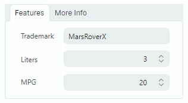

``` xml
xmlns:mx="https://schemas.eremexcontrols.net/avalonia"
xmlns:mxe="https://schemas.eremexcontrols.net/avalonia/editors"

<mx:MxTabControl Margin="5" Height="160" Name="tabControl1" Width="300">
    <mx:MxTabItem Header="Features">
        <Grid RowDefinitions="Auto Auto Auto" ColumnDefinitions="Auto *" Margin="5">
            <Label Classes="LayoutItem" Grid.Column="0" Grid.Row="0" Content="Trademark"/>
            <mxe:TextEditor EditorValue="{Binding SelectedCar.Trademark}" Margin="5" 
             Height="20" Grid.Row="0" Grid.Column="1"/>
            <Label Classes="LayoutItem" Grid.Column="0" Grid.Row="1" Content="Liters"/>
            <mxe:SpinEditor EditorValue="{Binding SelectedCar.Liter}" Margin="5" 
             Height="20" Grid.Row="1" Grid.Column="1"/>
            <Label Classes="LayoutItem" Grid.Column="0" Grid.Row="2" Content="MPG"/>
            <mxe:SpinEditor EditorValue="{Binding SelectedCar.MPG}" Margin="5" 
             Height="20" Grid.Row="2" Grid.Column="1"/>
        </Grid>
    </mx:MxTabItem>
    <mx:MxTabItem Header="More Info" >
        <mxe:TextEditor Margin="5" EditorValue="{Binding SelectedCar.Description}" 
         TextWrapping="Wrap" VerticalAlignment="Stretch"/>
    </mx:MxTabItem>
</mx:MxTabControl>
```

### Заполнение вкладок из источника объектов

Одним из предков [`MxTabControl`](../../API/Eremex.AvaloniaUI.Controls/MxTabControl.md) является класс `Avalonia.Controls.ItemsControl`. Это позволяет заполнять TabControl элементами из источника объектов. Используйте для этого следующие основные свойства:

- `ItemsSource` — задаёт источник, содержащий элементы для отображения в виде вкладок.
- `ItemTemplate` — задаёт DataTemplate, используемый для отрисовки заголовков вкладок.
- `ContentTemplate` — задаёт DataTemplate, используемый для отрисовки содержимого вкладок.

#### Пример

Этот пример привязывает контрол [`MxTabControl`](../../API/Eremex.AvaloniaUI.Controls/MxTabControl.md) к источнику объектов и задаёт DataTemplate, которые отрисовывают заголовки и содержимое вкладок.

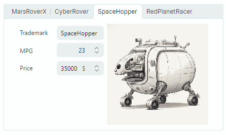

``` xml
xmlns:mx="https://schemas.eremexcontrols.net/avalonia"
xmlns:mxe="https://schemas.eremexcontrols.net/avalonia/editors"

<mx:MxTabControl ItemsSource="{Binding Cars}" SelectedItem="{Binding SelectedCar}">
    <mx:MxTabControl.ItemTemplate>
        <DataTemplate DataType="demoData:CarInfo">
            <TextBlock Text="{Binding Trademark}"></TextBlock>
        </DataTemplate>
    </mx:MxTabControl.ItemTemplate>

    <mx:MxTabControl.ContentTemplate>
        <DataTemplate DataType="demoData:CarInfo">
            <StackPanel Orientation="Horizontal" Margin="10">
                <Grid RowDefinitions="Auto Auto Auto" ColumnDefinitions="Auto *">
                    <Label Classes="LayoutItem" Grid.Column="0" Grid.Row="0" Content="Trademark"/>
                    <mxe:TextEditor Classes="LayoutItem"  Grid.Column="1" Grid.Row="0" 
                     EditorValue="{Binding Trademark}"/>

                    <Label Classes="LayoutItem" Grid.Column="0" Grid.Row="1" Content="MPG"/>
                    <mxe:SpinEditor Classes="LayoutItem" Grid.Column="1" Grid.Row="1" 
                     EditorValue="{Binding  MPG}" Minimum="0"/>

                    <Label Classes="LayoutItem" Grid.Column="0" Grid.Row="2" Content="Price"/>
                    <mxe:SpinEditor Classes="LayoutItem" Grid.Column="1" Grid.Row="2" 
                     EditorValue="{Binding  Price}" Suffix="{Binding Currency}" Minimum="0"/>
                </Grid>
                <Image Grid.Column="1" Width="200" Source="{Binding Image}" VerticalAlignment="Top"/>
            </StackPanel>
        </DataTemplate>
    </mx:MxTabControl.ContentTemplate>
</mx:MxTabControl>
```

#### Указание значков заголовков вкладок при использовании источника объектов

Чтобы отобразить значок в заголовке вкладки, задайте свойство [`MxTabItem.Glyph`](../../API/Eremex.AvaloniaUI.Controls/MxTabItem/Glyph.md) для вкладок.
При заполнении вкладок из источника объектов свойство [`MxTabItem.Glyph`](../../API/Eremex.AvaloniaUI.Controls/MxTabItem/Glyph.md) нельзя инициализировать напрямую. Вместо этого задайте [`MxTabItem.Glyph`](../../API/Eremex.AvaloniaUI.Controls/MxTabItem/Glyph.md), создав `Style` в коллекции `MxTabControl.Styles`. Этот стиль должен быть нацелен на класс [`MxTabItem`](../../API/Eremex.AvaloniaUI.Controls/MxTabItem.md). При необходимости ограничьте размер отображения значков заголовков вкладок свойством [`MxTabItem.GlyphSize`](../../API/Eremex.AvaloniaUI.Controls/MxTabItem/GlyphSize.md) (оно тоже задаётся в `Style`).

##### Пример — назначение значков заголовков вкладок

Этот пример назначает значки вкладкам при заполнении вкладок из источника объектов.

Здесь контрол вкладок привязан к источнику _Cars_, который хранит коллекцию объектов _CarInfo_. Таким образом, контекст данных каждой вкладки — объект _CarInfo_.

Чтобы задать значок заголовка вкладки, создаётся `Style`, нацеленный на [`MxTabItem`](../../API/Eremex.AvaloniaUI.Controls/MxTabItem.md). Стиль привязывает [`MxTabItem.Glyph`](../../API/Eremex.AvaloniaUI.Controls/MxTabItem/Glyph.md) к свойству _CarInfo.SmallImage_.

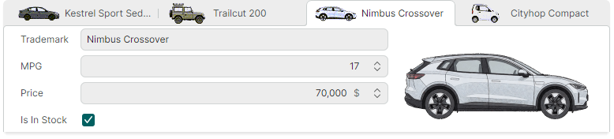

``` xml
<mx:MxTabControl ItemsSource="{Binding Cars}" >
    <mx:MxTabControl.Styles>
        <Style Selector="mx|MxTabItem" x:DataType="demoData:CarInfo">
            <Setter Property="Glyph" Value="{Binding SmallImage}"/>
            <Setter Property="GlyphSize" Value="57 32"/>
        </Style>
    </mx:MxTabControl.Styles>
</mx:MxTabControl>
```


## Выбор вкладки

Используйте следующие свойства для выбора вкладок и получения выбранных вкладок:

- `SelectedIndex` — задаёт индекс выбранной вкладки среди всех вкладок (начиная с нуля). Вы можете использовать свойство `MxTabControl.Items` для доступа к коллекции вкладок.
- `SelectedItem` — задаёт элемент выбранной вкладки. Если вкладки добавлены в TabControl вручную с помощью объектов [`MxTabItem`](../../API/Eremex.AvaloniaUI.Controls/MxTabItem.md), свойство `SelectedItem` задаёт выбранный объект [`MxTabItem`](../../API/Eremex.AvaloniaUI.Controls/MxTabItem.md). Если TabControl заполнен из источника объектов, свойство `SelectedItem` задаёт объект данных выбранной вкладки из привязанного источника объектов.

Свойство `SelectedValue` задаёт значение выбранной вкладки. Это свойство возвращает следующие значения:

- `null`, если вкладки добавлены в TabControl вручную с помощью объектов [`MxTabItem`](../../API/Eremex.AvaloniaUI.Controls/MxTabItem.md).
- Базовый объект данных вкладки, если TabControl заполнен из источника объектов.

Следующие свойства позволяют вернуть содержимое выбранной вкладки:

- `SelectedContent` — задаёт содержимое выбранной вкладки.
- `SelectedContentTemplate` — задаёт шаблон содержимого выбранной вкладки.

## Расположение и размер вкладок

Заголовки вкладок по умолчанию отображаются вдоль верхнего края TabControl. Вы можете использовать свойство `TabStripPlacement`, чтобы задать положение заголовков вкладок.

TabControl поддерживает три режима размещения заголовков вкладок. Используйте свойство [`MxTabControl.TabStripLayoutType`](../../API/Eremex.AvaloniaUI.Controls/MxTabControl/TabStripLayoutType.md), чтобы задать тип расположения заголовков вкладок:

- `Scroll` — заголовки вкладок достаточно широки, чтобы отобразить их содержимое. Кнопки прокрутки появляются в области заголовков вкладок, если недостаточно места для отображения всех заголовков вкладок целиком.

    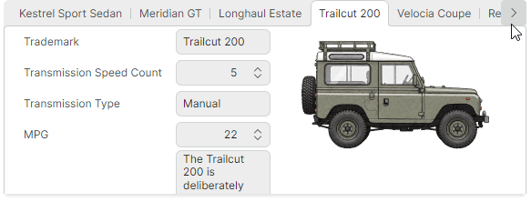

- `MultiLine` — заголовки вкладок располагаются в несколько строк, если недостаточно места для их отображения в одну строку.

    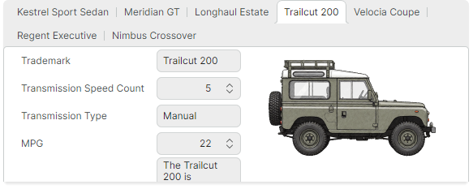

- `Stretch` — все заголовки вкладок располагаются в одну линию без прокрутки. Если суммарная ширина заголовков больше ширины контрола, вкладки сжимаются, чтобы уместиться в доступной ширине.

    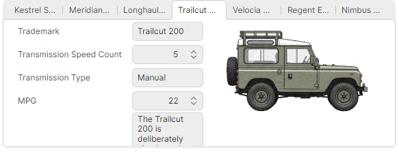


### Растягивание вкладок

Если суммарная ширина вкладок меньше ширины контрола, вкладки не растягиваются на свободное место. Чтобы растянуть вкладки на всю ширину контрола, установите свойство [`StretchTabsToFill`](../../API/Eremex.AvaloniaUI.Controls/MxTabControl/StretchTabsToFill.md) в `true`.

**[`StretchTabsToFill`](../../API/Eremex.AvaloniaUI.Controls/MxTabControl/StretchTabsToFill.md) равно false:**

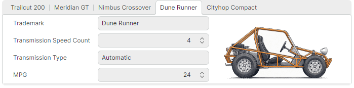

**[`StretchTabsToFill`](../../API/Eremex.AvaloniaUI.Controls/MxTabControl/StretchTabsToFill.md) равно true:**

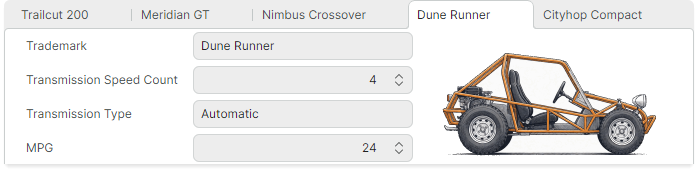


### Размер вкладок

Свойство [`TabSizeMode`](../../API/Eremex.AvaloniaUI.Controls/TabSizeMode.md) задаёт способ расчёта ширины вкладок. Доступны следующие режимы:

- `Default` — ширина вкладок по умолчанию зависит от значения [`TabStripLayoutType`](../../API/Eremex.AvaloniaUI.Controls/TabStripLayoutType.md):
    - Если [`TabStripLayoutType`](../../API/Eremex.AvaloniaUI.Controls/TabStripLayoutType.md) равно `Stretch`, ширину вкладки задаёт свойство [`TabSize`](../../API/Eremex.AvaloniaUI.Controls/MxTabControl/TabSize.md).
    - При других типах размещения ширина вкладок подгоняется под их содержимое, как в режиме [`TabSizeMode.Content`](../../API/Eremex.AvaloniaUI.Controls/TabSizeMode.md).
- `Explicit` — ширину вкладок задаёт свойство [`TabSize`](../../API/Eremex.AvaloniaUI.Controls/MxTabControl/TabSize.md).
- `Content` — ширина каждого заголовка вкладки подгоняется под его текст и значок.

    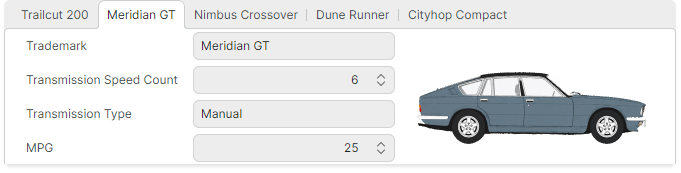

- `LargestContent` — все вкладки получают ширину самого широкого видимого заголовка.

    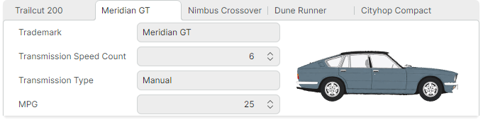

Свойство [`TabSize`](../../API/Eremex.AvaloniaUI.Controls/MxTabControl/TabSize.md) задаёт одинаковую фиксированную ширину всех вкладок. Оно действует в следующих случаях:

- Свойство [`TabSizeMode`](../../API/Eremex.AvaloniaUI.Controls/TabSizeMode.md) равно `Explicit`.
- Свойство [`TabSizeMode`](../../API/Eremex.AvaloniaUI.Controls/TabSizeMode.md) равно `Default`, а [`TabStripLayoutType`](../../API/Eremex.AvaloniaUI.Controls/TabStripLayoutType.md) — `Stretch`.


### Значки вкладок и скрытие текста

Если ширина контрола вкладок (высота при вертикальной ориентации) ограничена, заголовки вкладок могут скрывать текст и показывать только значки. Это поведение настраивается свойствами [`TabIconDisplayMode`](../../API/Eremex.AvaloniaUI.Controls/TabIconDisplayMode.md) и [`TabHeaderCollapseThreshold`](../../API/Eremex.AvaloniaUI.Controls/MxTabControl/TabHeaderCollapseThreshold.md).

Свойство [`TabIconDisplayMode`](../../API/Eremex.AvaloniaUI.Controls/TabIconDisplayMode.md) определяет, когда отображается значок вкладки:

- `Always` (по умолчанию) — значок отображается рядом с текстом заголовка и остаётся видимым, если текст скрыт.
- `WhenTextCollapsed` — значок отображается, только когда текст заголовка скрыт. Пока текст виден, значок скрыт.
- `Never` — значок никогда не отображается.


Свойство [`TabHeaderCollapseThreshold`](../../API/Eremex.AvaloniaUI.Controls/MxTabControl/TabHeaderCollapseThreshold.md) задаёт длину заголовка (в аппаратно-независимых пикселях), при которой или ниже которой текст заголовка скрывается (заменяется значком). Значение `0` отключает замену текста значком.


## Перемещение вкладок

Пользователь может переупорядочивать вкладки с помощью перетаскивания, если свойство [`MxTabControl.TabDragMode`](../../API/Eremex.AvaloniaUI.Controls/MxTabControl/TabDragMode.md) установлено в `Reorder`.

Обработайте события [`TabItemStartDragging`](../../API/Eremex.AvaloniaUI.Controls/MxTabControl/TabItemStartDragging.md) и [`TabItemCompleteDragging`](../../API/Eremex.AvaloniaUI.Controls/MxTabControl/TabItemCompleteDragging.md), чтобы отменить операции перетаскивания или выполнить дополнительные действия при перетаскивании вкладок.

## Кнопки «Закрыть»

TabControl поддерживает встроенные кнопки «Закрыть вкладку» («x»). Они могут отображаться на вкладках и/или в области заголовков вкладок, как задаёт свойство [`MxTabControl.CloseButtonShowMode`](../../API/Eremex.AvaloniaUI.Controls/MxTabControl/CloseButtonShowMode.md).

Кнопки «Закрыть вкладку» по умолчанию не выполняют никаких действий. Вам нужно реализовать действия кнопки «Закрыть» одним из следующих подходов:

- Обработайте событие [`MxTabControl.CloseButtonClick`](../../API/Eremex.AvaloniaUI.Controls/MxTabControl/CloseButtonClick.md).
- Задайте команды с помощью члена [`MxTabItem.CloseCommand`](../../API/Eremex.AvaloniaUI.Controls/MxTabItem/CloseCommand.md).

## Кнопка «Новая вкладка»

Установите свойство [`MxTabControl.NewButtonShowMode`](../../API/Eremex.AvaloniaUI.Controls/MxTabControl/NewButtonShowMode.md) в `InHeaderPanel`, чтобы отобразить кнопку «Новая вкладка» («+»). Щелчок по этой кнопке по умолчанию не выполняет действий. Вы можете задать действие с помощью следующих членов:

- Событие [`MxTabControl.NewButtonClick`](../../API/Eremex.AvaloniaUI.Controls/MxTabControl/NewButtonClick.md).
- Команда [`MxTabControl.NewCommand`](../../API/Eremex.AvaloniaUI.Controls/MxTabControl/NewCommand.md).

## Пользовательские контролы в области заголовков вкладок

Вы можете использовать свойства [`ControlBoxContent`](../../API/Eremex.AvaloniaUI.Controls/MxTabControl/ControlBoxContent.md) и [`ControlBoxContentTemplate`](../../API/Eremex.AvaloniaUI.Controls/MxTabControl/ControlBoxContentTemplate.md), чтобы добавить пользовательские контролы в область заголовков вкладок. 

### Пример

Этот пример добавляет кнопку «?» в область заголовков вкладок. Щелчок по кнопке вызывает команду _HelpCommand_. Элемент текущей выбранной вкладки передаётся как параметр команды.

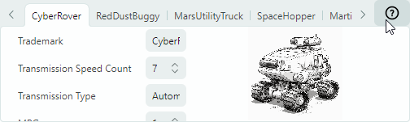

``` xml
xmlns:mx="https://schemas.eremexcontrols.net/avalonia"
x:Class="SampleTabControl.TabControlPageView"
xmlns:vm="using:SampleTabControl"
x:DataType="vm:TabControlPageViewModel"

<mx:MxTabControl ItemsSource="{Binding Cars}"
                SelectedItem="{Binding SelectedCar}"
                x:Name="TabControl"
    >
    <mx:MxTabControl.ControlBoxContent>
        <Button Command="{Binding HelpCommand}" 
         CommandParameter="{Binding $parent.SelectedItem}">
            <Image Width="20" Height="20"  
             Source="{SvgImage 'avares://SampleTabControl/Images/help-icon.svg'}"/>
        </Button>
    </mx:MxTabControl.ControlBoxContent>
    ...
</mx:MxTabControl>
```
``` csharp
public partial class TabControlPageViewModel : PageViewModelBase
{
    //...
    [RelayCommand]
    private void Help(object parameter)
    {
        //...
    }
}
```


<br>
<br>

<sup>*</sup> Эта страница переведена с использованием технологий машинного перевода.
