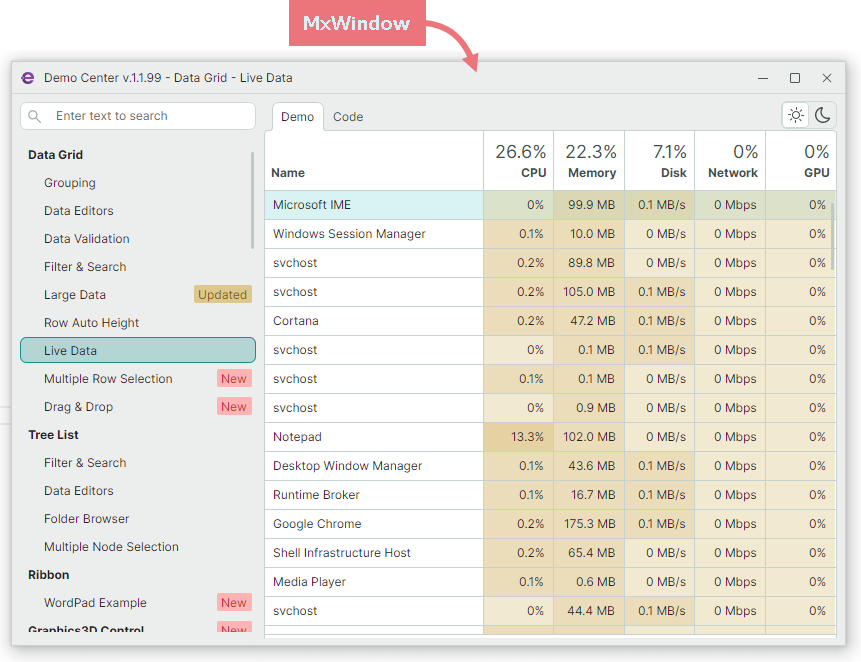
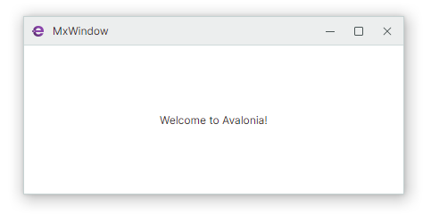
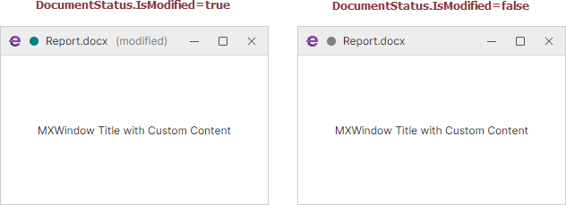
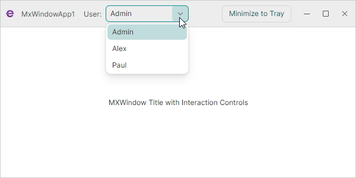

# MxWindow

Если вы используете контролы Eremex Avalonia, рассмотрите возможность применения компонента [`MxWindow`](../../API/Eremex.AvaloniaUI.Controls.Common/MxWindow.md) как для главного, так и для дополнительных окон в вашем приложении. Это позволяет поддерживать единообразный интерфейс во всём вашем проекте Avalonia.

[`MxWindow`](../../API/Eremex.AvaloniaUI.Controls.Common/MxWindow.md) — это окно, которое отрисовывает свои элементы (фон, рамку и заголовок) в соответствии с [визуальной темой Eremex](../themes/index.md). 



## Добавление пакета темы и регистрация визуальные темы

Чтобы использовать [`MxWindow`](../../API/Eremex.AvaloniaUI.Controls.Common/MxWindow.md) и другие контролы Eremex Avalonia, подключите [пакет](../../whats-included/assemblies.md), содержащий визуальную тему Eremex. В следующем разделе показано, как зарегистрировать визуальную тему в вашем приложении: 

- [Регистрация визуальной темы Eremex](../themes/register-an-eremex-paint-theme.md).


## Создание MxWindow

[`MxWindow`](../../API/Eremex.AvaloniaUI.Controls.Common/MxWindow.md) является потомком стандартного компонента Avalonia `Window`. Вы можете беспрепятственно заменить компоненты `Window` в ваших существующих приложениях на [`MxWindow`](../../API/Eremex.AvaloniaUI.Controls.Common/MxWindow.md), чтобы использовать визуальные темы Eremex. Следующий XAML-код демонстрирует пример объявления объекта [`MxWindow`](../../API/Eremex.AvaloniaUI.Controls.Common/MxWindow.md):

``` xml
<mx:MxWindow 
    xmlns:mx="https://schemas.eremexcontrols.net/avalonia"
    Title="MxWindow"
    ...
>

</mx:MxWindow>
```

[Шаблоны проектов Eremex](../../whats-included/project-templates.md) позволяют создавать новые приложения Avalonia с контролами Eremex. Эти шаблоны создают новые проекты, в которых главное окно инкапсулировано компонентом [`MxWindow`](../../API/Eremex.AvaloniaUI.Controls.Common/MxWindow.md).



## Настройки MxWindow

[`MxWindow`](../../API/Eremex.AvaloniaUI.Controls.Common/MxWindow.md) расширяет настройки, предоставляемые стандартным компонентом `Window`, следующими параметрами, которые задают видимость и глифы стандартных кнопок в заголовке:

- [`ShowCloseButton`](../../API/Eremex.AvaloniaUI.Controls.Common/MxWindow/ShowCloseButton.md) — задаёт видимость кнопки «Закрыть».
- [`ShowMaximizeButton`](../../API/Eremex.AvaloniaUI.Controls.Common/MxWindow/ShowMaximizeButton.md) — задаёт видимость кнопки «Развернуть».
- [`ShowMinimizeButton`](../../API/Eremex.AvaloniaUI.Controls.Common/MxWindow/ShowMinimizeButton.md) — задаёт видимость кнопки «Свернуть».

- [`CloseButtonGlyph`](../../API/Eremex.AvaloniaUI.Controls.Common/MxWindow/CloseButtonGlyph.md) — глиф кнопки «Закрыть».
- [`MaximizeButtonGlyph`](../../API/Eremex.AvaloniaUI.Controls.Common/MxWindow/MaximizeButtonGlyph.md) — глиф кнопки «Развернуть».
- [`MinimizeButtonGlyph`](../../API/Eremex.AvaloniaUI.Controls.Common/MxWindow/MinimizeButtonGlyph.md) — глиф кнопки «Свернуть».
- [`RestoreButtonGlyph`](../../API/Eremex.AvaloniaUI.Controls.Common/MxWindow/RestoreButtonGlyph.md) — глиф кнопки «Восстановить».


## Добавление пользовательского содержимого в заголовок MxWindow

[`MxWindow`](../../API/Eremex.AvaloniaUI.Controls.Common/MxWindow.md) позволяет размещать пользовательские контролы (надписи, раскрывающиеся списки, кнопки, индикаторы состояния) в заголовке окна — слева от системных кнопок окна (control box). Этим участком управляют два свойства:

- [`MxWindow.Header`](../../API/Eremex.AvaloniaUI.Controls.Common/MxWindow/Header.md) — возвращает или задаёт пользовательское содержимое, отображаемое в заголовке. Если оно задано, [`Header`](../../API/Eremex.AvaloniaUI.Controls.Common/MxWindow/Header.md) переопределяет свойство окна `Title`.
- [`MxWindow.HeaderTemplate`](../../API/Eremex.AvaloniaUI.Controls.Common/MxWindow/HeaderTemplate.md) — возвращает или задаёт шаблон, определяющий, как отрисовывается объект [`Header`](../../API/Eremex.AvaloniaUI.Controls.Common/MxWindow/Header.md).

Свойство [`ActualHeader`](../../API/Eremex.AvaloniaUI.Controls.Common/MxWindow/ActualHeader.md) возвращает итоговое отображаемое содержимое: объект [`Header`](../../API/Eremex.AvaloniaUI.Controls.Common/MxWindow/Header.md), если [`Header`](../../API/Eremex.AvaloniaUI.Controls.Common/MxWindow/Header.md) задан, иначе `Title`.


### Пример - отображение статуса документа в заголовке окна

Этот пример отрисовывает заголовок окна из объекта _DocumentStatus_, назначенного свойству [`Header`](../../API/Eremex.AvaloniaUI.Controls.Common/MxWindow/Header.md), с помощью пользовательского шаблона, заданного через [`HeaderTemplate`](../../API/Eremex.AvaloniaUI.Controls.Common/MxWindow/HeaderTemplate.md).

Объект _DocumentStatus_ содержит имя файла и признак изменения. [`HeaderTemplate`](../../API/Eremex.AvaloniaUI.Controls.Common/MxWindow/HeaderTemplate.md) отрисовывает этот объект как цветной индикатор, за которым следует имя файла.



XAML окна

```xml
<mx:MxWindow ...
        xmlns:mx="https://schemas.eremexcontrols.net/avalonia"
        xmlns:mxcommon="clr-namespace:Eremex.AvaloniaUI.Controls.Common;assembly=Eremex.Avalonia.Controls"
        xmlns:vm="using:MxWindowApp10.ViewModels"
        x:DataType="vm:MainWindowViewModel"
        Title="MxWindowApp1"
        Header="{Binding DocumentStatus}">

    <mxcommon:MxWindow.HeaderTemplate>
        <DataTemplate x:DataType="vm:DocumentStatus">
            <StackPanel Orientation="Horizontal" VerticalAlignment="Center" Spacing="8">
                <!-- Teal dot when modified -->
                <Ellipse Width="10" Height="10" VerticalAlignment="Center"
                         Fill="Teal"
                         IsVisible="{Binding IsModified}" />

                <!-- Gray dot when not modified -->
                <Ellipse Width="10" Height="10" VerticalAlignment="Center"
                         Fill="Gray"
                         IsVisible="{Binding !IsModified}" />

                <TextBlock Text="{Binding FileName}" VerticalAlignment="Center" />

                <TextBlock Text="(modified)"
                           VerticalAlignment="Center"
                           IsVisible="{Binding IsModified}"
                           Foreground="Gray" />

            </StackPanel>
        </DataTemplate>
    </mxcommon:MxWindow.HeaderTemplate>

    <TextBlock Text="MXWindow Title with Custom Content" HorizontalAlignment="Center" VerticalAlignment="Center"/>
</mx:MxWindow>
```

ViewModel

```csharp
using CommunityToolkit.Mvvm.ComponentModel;

namespace MxWindowApp10.ViewModels;

public partial class MainWindowViewModel : ViewModelBase
{
    [ObservableProperty]
    private DocumentStatus documentStatus;

    public MainWindowViewModel()
    {
        DocumentStatus = new DocumentStatus
        {
            FileName = "Report.docx",
            IsModified = true
        };
    }
}

public partial class DocumentStatus : ObservableObject
{
    [ObservableProperty]
    private string fileName;

    [ObservableProperty]
    private bool isModified;
}
```


### Пример - отображение интерактивных контролов в заголовке окна

В этом примере свойство [`HeaderTemplate`](../../API/Eremex.AvaloniaUI.Controls.Common/MxWindow/HeaderTemplate.md) используется для отображения исходного заголовка окна и добавления интерактивных контролов в заголовок. Свойство [`Header`](../../API/Eremex.AvaloniaUI.Controls.Common/MxWindow/Header.md) остаётся незаданным.

В этом примере заголовок окна отображает следующие элементы:

- Исходный заголовок окна, прочитанный из свойства `MxWindow.Title`
- Надпись «User: » и селектор учётной записи ([`ComboBoxEditor`](../../API/Eremex.AvaloniaUI.Controls.Editors/ComboBoxEditor.md)), привязанный к свойствам `Accounts` и `SelectedAccount` в ViewModel
- Кнопку «Minimize to Tray» справа



Выбор учётной записи автоматически обновляет свойство `SelectedAccount` в ViewModel. Чтобы отреагировать на выбор, используйте частичный метод `OnSelectedAccountChanged`, сгенерированный для наблюдаемого свойства `SelectedAccount`.


XAML окна

```xml
<mx:MxWindow ...
             xmlns:vm="using:MxWindowApp1.ViewModels"
             xmlns:mx="https://schemas.eremexcontrols.net/avalonia"
             xmlns:mxcommon="clr-namespace:Eremex.AvaloniaUI.Controls.Common;assembly=Eremex.Avalonia.Controls"
             xmlns:mxe="https://schemas.eremexcontrols.net/avalonia/editors"
             x:DataType="vm:MainWindowViewModel"
             Title="MxWindowApp1"
             >

    <Design.DataContext>
        <vm:MainWindowViewModel/>
    </Design.DataContext>

    <mxcommon:MxWindow.HeaderTemplate>
        <DataTemplate>
            <DockPanel LastChildFill="False" VerticalAlignment="Center">
                <Label DockPanel.Dock="Left"
                       VerticalAlignment="Center"
                       Content="{Binding $parent[mxcommon:MxWindow].Title}" />

                <Label DockPanel.Dock="Left"
                       VerticalAlignment="Center"
                       Content="User: " Margin="8,0,0,0"/>

                <mxe:ComboBoxEditor DockPanel.Dock="Left"
                                    x:Name="accountComboBox"
                                    Margin="0,0,8,0"
                                    VerticalAlignment="Center"
                                    ItemsSource="{Binding $parent[mxcommon:MxWindow].DataContext.Accounts}"
                                    DisplayMember="Name"
                                    EditorValue="{Binding $parent[mxcommon:MxWindow].DataContext.SelectedAccount, Mode=TwoWay}"
                                    SelectionMode="Single"
                                    MinWidth="140" />

                <Button DockPanel.Dock="Right"
                        x:Name="btnMinimize"
                        VerticalAlignment="Center"
                        Content="Minimize to Tray"
                        Click="btnMinimizeB_Click" />
            </DockPanel>
        </DataTemplate>
    </mxcommon:MxWindow.HeaderTemplate>

    <TextBlock Text="MXWindow Title with Interaction Controls" HorizontalAlignment="Center" VerticalAlignment="Center"/>
</mx:MxWindow>
```

Код окна

``` cs
using Eremex.AvaloniaUI.Controls.Common;
using MxWindowApp1.ViewModels;

namespace MxWindowApp1.Views;

public partial class MainWindow : MxWindow
{
    public MainWindow()
    {
        this.DataContext = new MainWindowViewModel();
        InitializeComponent();
    }

    private void btnMinimizeB_Click(object sender, Avalonia.Interactivity.RoutedEventArgs e)
    {
        //...
    }
}
```

ViewModel

```cs
using CommunityToolkit.Mvvm.ComponentModel;
using System.Collections.ObjectModel;

namespace MxWindowApp1.ViewModels;

public partial class MainWindowViewModel : ViewModelBase
{

    [ObservableProperty]
    private ObservableCollection<Account> accounts;

    [ObservableProperty]
    private Account selectedAccount;
    
    public MainWindowViewModel()
    {
        Accounts = new ObservableCollection<Account>
        {
            new Account(1, "Admin"),
            new Account(2, "Alex"),
            new Account(3, "Paul"),
        };

        SelectedAccount = Accounts[0];
    }

    partial void OnSelectedAccountChanged(Account value)
    {
        // Runs whenever the user picks a different account
        if (value.Name == "Admin")
        {
            //...
        }
    }
}

public partial class Account : ObservableObject
{
    public Account(int accountId, string name)
    {
        AccountId = accountId;
        Name = name;
    }

    [ObservableProperty]
    private int accountId;

    [ObservableProperty]
    private string name;
}
```


<br>
<br>

<sup>*</sup> Эта страница переведена с использованием технологий машинного перевода.
