# Активация и управление локальными лицензиями

Локальная лицензия — тип программной лицензии, которая привязана к одному компьютеру. В данном документе описывается установка и управление локальными лицензиями на машинах разработчиков.


<a id="license-management-utilities"></a>

## Утилиты управления лицензиями

Управление всеми типами лицензий (локальными и [сетевыми](activate-and-manage-network-licenses.md)) для библиотеки EMX Controls осуществляется с помощью двух утилит от компании [Guardant](https://guardant.com) — _Guardant Control Center_ и _Guardant License Wizard_. Эти инструменты можно скачать по ссылкам ниже:

- [Guardant License Management Redistributables (Windows)](../resources/Guardant_Redistributable_Windows.zip)
- [Guardant License Management Redistributables (Linux)](../resources/Guardant_Redistributable_Linux.zip)


**_Guardant Control Center_**

Служба управления лицензиями.

_Установочные файлы_: 

- Windows: `grdcontrol-x.x.msi`
- Linux: `grdcontrol-x.x_amd64.deb`, `grdcontrol-x.x.x86_64.rpm`

!!! Note

    Служба _Guardant Control Center_ должна быть установлена и запущена на машине разработчика для управления лицензиями и мониторинга их использования. Не удаляйте, не останавливайте и не отключайте эту службу; без неё библиотека EMX Controls не сможет проверить лицензию и будет отображать сообщения о триальном режиме.

**_Guardant License Wizard_** 

Инструмент с графическим интерфейсом и командной строкой, позволяющий добавлять, обновлять и переносить лицензии. 

_Исполняемые файлы_: 

- Windows: `license_wizard.exe`
- Linux: `license_wizard`

Чтобы получить информацию обо всех доступных параметрах командной строки, выполните команду:

<code>license_wizard --help</code>


## Онлайн-активация лицензии с помощью программного ключа (Guardant DL)

### Из командной строки

```
license_wizard --console --activate &lt;LICENSE-KEY&gt; --host https://getlicense.guardant.ru
```

### Через пользовательский интерфейс

1. Убедитесь, что служба _Guardant Control Center_ установлена и запущена.

2. Запустите _Guardant License Wizard_.

    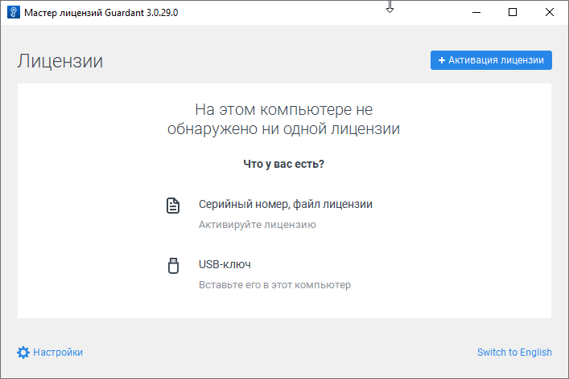

3. Нажмите **Настройки** и убедитесь, что в поле **Адрес сервера** установлено значение _https://getlicense.guardant.ru_. 
   
     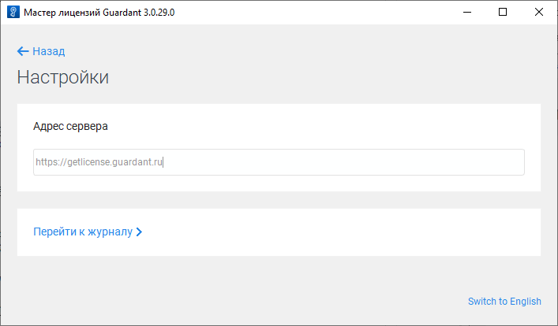

	 Затем нажмите **Назад**, чтобы вернуться на предыдущую страницу.

4. Нажмите кнопку **Активация лицензии**, чтобы добавить новый лицензионный ключ.

5. Укажите компьютер, на котором необходимо зарегистрировать лицензию.

    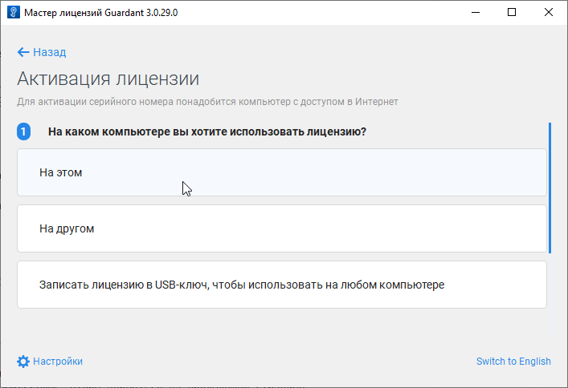

6. Введите лицензионный ключ в поле **Серийный номер**.

    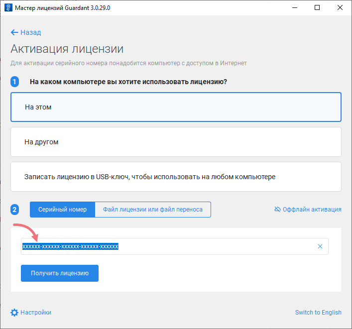
	
7. Нажмите **Получить лицензию**.

    Если активация лицензии прошла успешно, отобразится информация о лицензированных продуктах.

    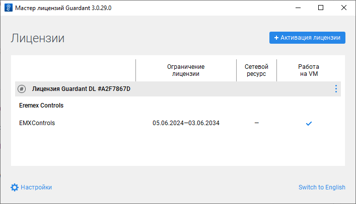


<a id="offline-license-activation-using-a-software-key-guardant-dl"></a>

## Офлайн-активация лицензии с помощью программного ключа (Guardant DL)

Если на компьютере нет доступа в интернет, вы можете активировать программный ключ с помощью офлайн-процедуры. Этот тип активации включает следующие этапы:

- Шаг 1. Создайте файл запроса на целевой машине (не имеющей доступа в интернет).
- Шаг 2. Получите файл лицензии из файла запроса на другой машине, имеющей доступ в интернет.
- Шаг 3. Импортируйте файл лицензии обратно на целевую машину.

Ниже приведено подробное описание этих шагов.

1. Убедитесь, что служба _Guardant Control Center_ установлена и запущена на целевом компьютере (работающем без доступа в интернет) и на втором компьютере (имеющем доступ в интернет).

2. Запустите _Guardant License Wizard_ на целевом компьютере.

    

3. Нажмите **Активация лицензии**.
    
4. Выберите **На этом**, чтобы указать компьютер, на котором нужно зарегистрировать лицензию.

    

5. Нажмите кнопку **Offline активация**.

    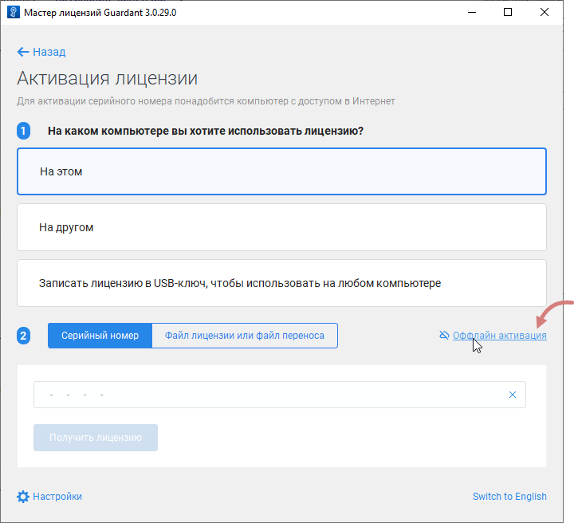

6. Нажмите **Сохранить**, чтобы сохранить запрос на новую лицензию в файл.

    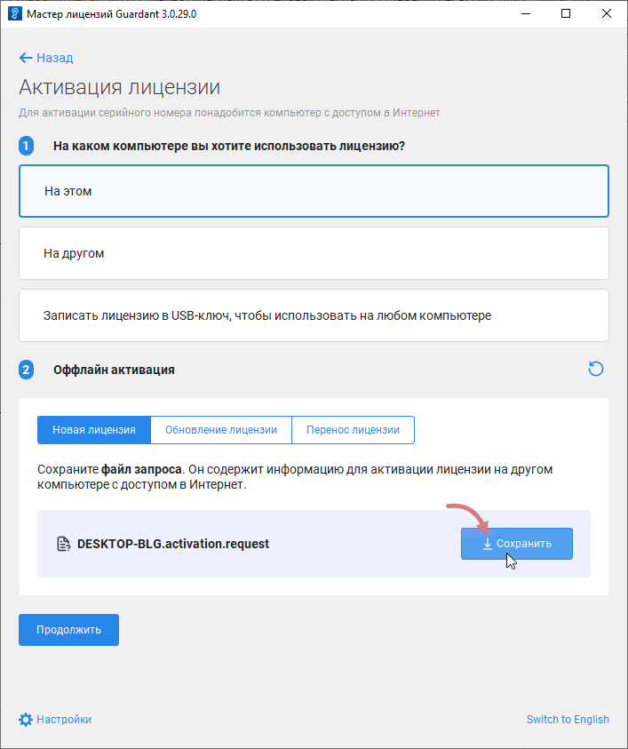

7. На другом компьютере с доступом в интернет запустите _Guardant License Wizard_.

8. Нажмите **Настройки** и убедитесь, что в поле **Адрес сервера** установлено значение _https://getlicense.guardant.ru_. Затем нажмите **Назад**, чтобы вернуться на предыдущую страницу.

9. На странице **Лицензии** нажмите кнопку **Активация лицензии**.

    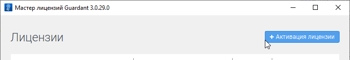

10. Выберите **На другом**, чтобы указать компьютер, для которого нужно активировать лицензию. Затем нажмите **Продолжить**.

    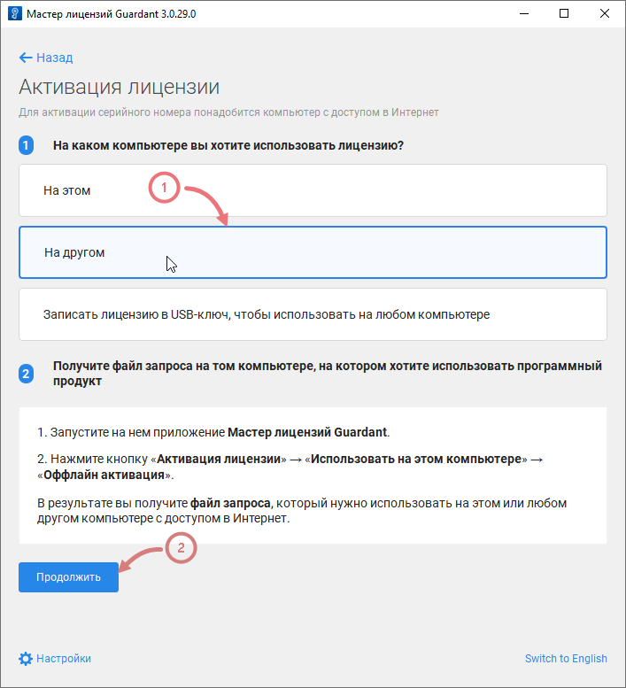

11. Загрузите запрос на лицензию, созданный на целевом компьютере.

    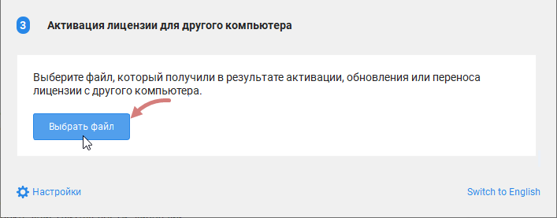

12. Введите номер лицензии и нажмите **Активировать новую лицензию**.

    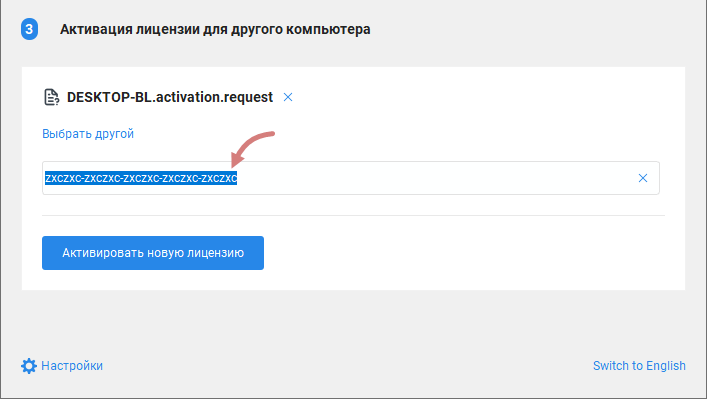

13. Сохраните файл лицензии ('_*.license_').

    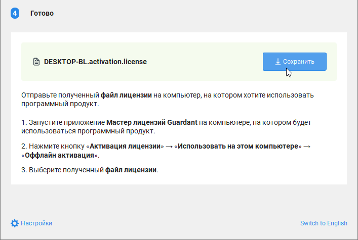

14. Вернитесь на целевой компьютер.

15. Запустите _Guardant License Wizard_ и перейдите на страницу **Активация лицензии**.

16. Выберите **На этом**, чтобы указать компьютер для активации лицензии. Затем нажмите **Файл лицензии или файл переноса** и загрузите созданный файл лицензии ('_*.license_').

    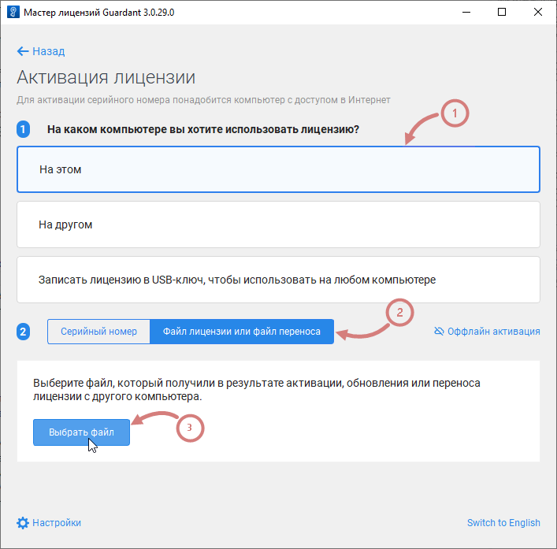

17. Активируйте лицензию.


## Онлайн-обновление лицензии

### Из командной строки

```
license_wizard --console --update &lt;LICENSE-KEY&gt; --host https://getlicense.guardant.ru
```

### Через пользовательский интерфейс

1. Запустите _Guardant License Wizard_.

    

2. Нажмите **Настройки** и убедитесь, что в поле **Адрес сервера** установлено значение _https://getlicense.guardant.ru_. Затем нажмите **Назад**, чтобы вернуться на предыдущую страницу.

3. На странице **Лицензии** нажмите кнопку с многоточием ('...') и выберите **Проверить наличие обновлений**.

    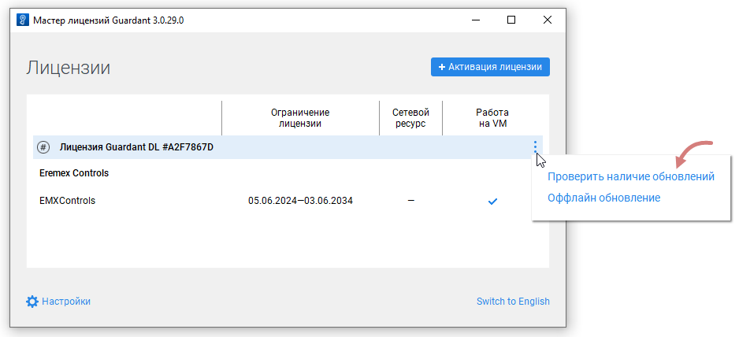

	
4. Нажмите ссылку **Установить обновления**, которая появится, если на сервере найдено обновление лицензии.

5. После успешного завершения операции мастер обновит зарегистрированные лицензии.


## Переключение между лицензиями

Если на вашем компьютере зарегистрированы две или более лицензии, вы можете выбрать нужную лицензию для проекта следующим образом.

1. Соберите проект, если файл `emxLicense.cs` отсутствует. После создания этот файл будет ссылаться на первую найденную лицензию.

    Третий параметр метода `SetRuntimeLicenseOwner` в файле `emxLicense.cs` задаёт идентификатор лицензии.

    <!-- TODO
    screenshots
    <image> -->

2. Запустите _Guardant License Wizard_, чтобы просмотреть установленные лицензии.

    <!--TODO <image> -->

3. Найдите идентификатор нужной лицензии (шестнадцатеричное число, отображаемое после названия лицензии).

4. Замените идентификатор лицензии в методе `SetRuntimeLicenseOwner` на новый.

    <!-- TODO
    code
    -->

5. Пересоберите проект.
