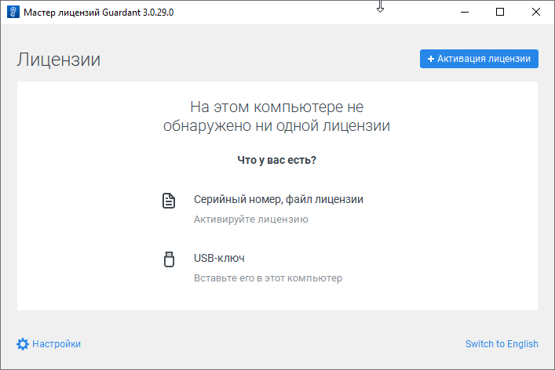
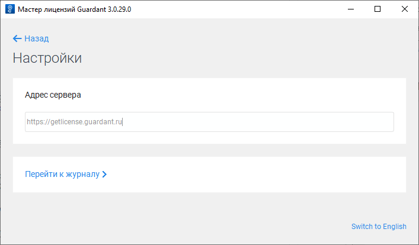
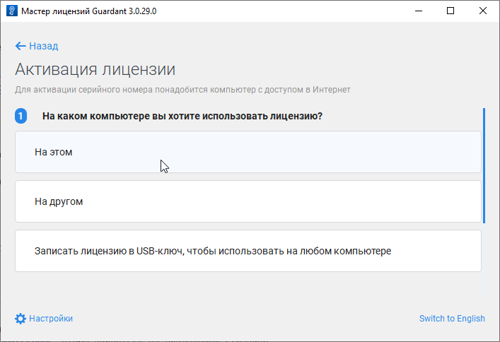
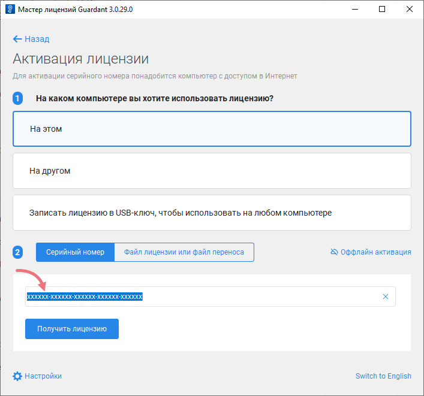
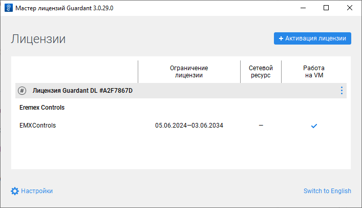
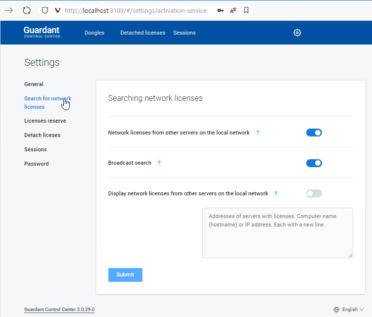
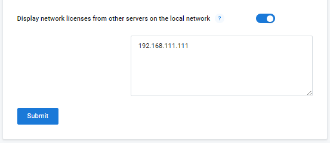

# Активация и управление сетевыми лицензиями

Сетевые лицензии позволяют нескольким пользователям в локальной сети совместно использовать пул лицензионных мест. Сетевую лицензию следует устанавливать на сервере, который должен оставаться включенным и подключенным к сети. На этом сервере размещается пул лицензий, из которого клиентские машины получают лицензии.

## Утилиты управления лицензиями

Управление всеми типами лицензий ([локальными](activate-and-manage-local-licenses.md) и сетевыми) для библиотеки EMX Controls осуществляется с помощью двух утилит от компании [Guardant](https://guardant.com) — _Guardant Control Center_ и _Guardant License Wizard_. Эти инструменты можно скачать по ссылкам ниже:

- [Guardant License Management Redistributables (Windows)](../resources/Guardant_Redistributable_Windows.zip)
- [Guardant License Management Redistributables (Linux)](../resources/Guardant_Redistributable_Linux.zip)


**_Guardant Control Center_**

Служба управления лицензиями.

_Установочные файлы_: 

- Windows: `grdcontrol-x.x.msi`
- Linux: `grdcontrol-x.x_amd64.deb`, `grdcontrol-x.x.x86_64.rpm`

!!! Note

    Служба _Guardant Control Center_ должна быть установлена и запущена как на сервере, так и на клиентских машинах для управления лицензиями и мониторинга их использования. Не удаляйте, не останавливайте и не отключайте эту службу; без неё библиотека EMX Controls не сможет проверить лицензию и будет отображать сообщения о триальном режиме.

**_Guardant License Wizard_** 

Инструмент с графическим интерфейсом и командной строкой, позволяющий добавлять, обновлять и переносить лицензии. 

_Исполняемые файлы_: 

- Windows: `license_wizard.exe`
- Linux: `license_wizard`

Чтобы получить информацию обо всех доступных параметрах командной строки, выполните команду:

<code>license_wizard --help</code>


## Настройка сетевых лицензий

Чтобы настроить сетевую лицензию, выполните следующие шаги:

1. [Установите Guardant Control Center (GCC)](#install-guardant-control-center-gcc) на сервере и клиентских машинах.
2. [Активируйте сетевую лицензию на сервере](#activate-a-network-license-on-the-server).
3. [Предоставьте клиентским машинам доступ к сетевой лицензии](#provide-client-access-to-the-network-license).

В разделах ниже приведены более подробные сведения о настройке и использовании сетевых лицензий.


<a id="install-guardant-control-center-gcc"></a>

## Установка Guardant Control Center (GCC)

Чтобы использовать сетевые лицензии, установите _Guardant Control Center_ на сервере и всех клиентских машинах. После установки GCC работает как фоновая служба. Доступ к веб-интерфейсу службы осуществляется через порт `3189`. Например, чтобы открыть локальную службу GCC в Windows, перейдите по адресу [http://localhost:3189/](http://localhost:3189/). В веб-интерфейсе используйте `admin` в качестве пароля по умолчанию.


<a id="activate-a-network-license-on-the-server"></a>

## Активация сетевой лицензии на сервере

После установки GCC необходимо активировать сетевую лицензию на серверной машине.

### Онлайн-активация лицензии с помощью программного ключа (Guardant DL)

#### Из командной строки

```
license_wizard --console --activate &lt;LICENSE-KEY&gt; --host https://getlicense.guardant.ru
```

#### Через пользовательский интерфейс

1. Запустите _Guardant License Wizard_.

    
2. Нажмите **Настройки** и убедитесь, что в поле **Адрес сервера** установлено значение _https://getlicense.guardant.ru_. 
   
     

	 Затем нажмите **Назад**, чтобы вернуться на предыдущую страницу.
3. Нажмите кнопку **Активация лицензии**, чтобы добавить новый лицензионный ключ.

4. Укажите компьютер, на котором необходимо зарегистрировать лицензию.

    
5. Введите лицензионный ключ в поле **Серийный номер**.

    
	
6. Нажмите **Получить лицензию**.

    Если активация лицензии прошла успешно, отобразится информация о лицензированных продуктах.

    


### Офлайн-активация лицензии с помощью программного ключа (Guardant DL)

Если сервер, который должен выдавать лицензии, не имеет доступа в интернет, вы можете активировать программный ключ с помощью офлайн-процедуры. Этот тип активации включает следующие шаги:

- Шаг 1. Создайте файл запроса на сервере, не имеющем доступа в интернет.
- Шаг 2. Получите файл лицензии из файла запроса на другой машине, имеющей доступ в интернет.
- Шаг 3. Импортируйте файл лицензии обратно на офлайн-сервер.

Подробное описание процедуры офлайн-активации можно найти в следующем документе:

- [Офлайн-активация лицензии Eremex Controls](activate-and-manage-local-licenses.md#offline-license-activation-using-a-software-key-guardant-dl)


<a id="provide-client-access-to-the-network-license"></a>

## Предоставление клиентам доступа к сетевой лицензии

После установки сетевой лицензии на сервере настройте клиентские машины, чтобы они могли найти сервер лицензий.

Убедитесь, что служба _Guardant Control Center_ установлена и запущена на клиентской машине. Она необходима для взаимодействия клиента и сервера.

По умолчанию GCC использует широковещательный поиск для автоматического обнаружения серверов лицензий в той же подсети. Если клиент и сервер находятся в одной локальной сети, сетевая лицензия должна подхватиться автоматически.

Если автоматическое обнаружение не работает (например, из-за правил брандмауэра, VPN или разных подсетей), укажите адрес сервера вручную, как показано ниже:

1. Откройте веб-интерфейс GCC на клиентской машине ([http://localhost:3189/](http://localhost:3189/)).

    Пароль по умолчанию: `admin`.

2. Нажмите кнопку **Настройки** (), а затем выберите **Поиск сетевых лицензий** (**Search for network licenses**).

    


3. Включите параметр **Поиск лицензий по списку адресов** (**Display network licenses from other servers on the local network**) и добавьте IP-адрес сервера GCC, на котором размещена лицензия.

    

4. Нажмите **Применить** (**Submit**).

    Теперь клиент будет напрямую запрашивать сетевую лицензию у указанного сервера


## Проверка сетевой лицензии

Откройте веб-интерфейс GCC по адресу [http://localhost:3189/#/dongles/list](http://localhost:3189/#/dongles/list). Вы должны увидеть список доступных сетевых лицензий.