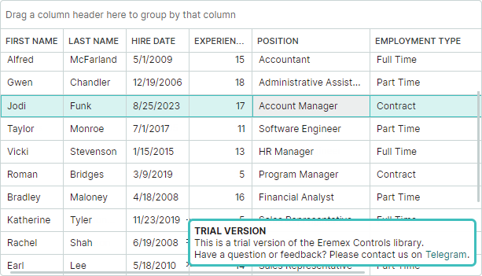
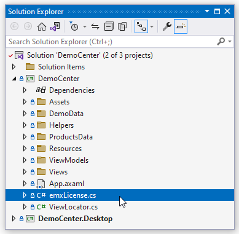

# Лицензирование и ознакомление с продуктом

Этот документ содержит подробную информацию о модели лицензирования, а также ответы на часто задаваемые вопросы относительно лицензирования библиотеки Eremex Controls.

Если вы разрабатываете проект с открытым исходным кодом и хотите использовать в нем библиотеку Eremex Controls, вы можете подать заявку на получение бесплатной некоммерческой лицензии. См. раздел [Бесплатные некоммерческие лицензии для проектов с открытым исходным кодом](#free-non-commercial-licenses-for-open-source-projects).

## Ознакомление с продуктом

Бесплатная 60-дневная ознакомительная (триальная) версия библиотеки Eremex Controls позволяет оценить возможности продукта в ваших проектах и вашей рабочей среде. Ознакомительная версия не имеет функциональных ограничений по сравнению с активированной лицензией, за исключением вывода сообщений о работе в триальном режиме.




## Модель лицензирования

Условия лицензирования библиотеки Eremex Controls описаны в [Лицензионном соглашении с конечным пользователем (EULA)](eula.md).

Лицензия предоставляет право на один год обновлений продукта и технической поддержки. Приобретается для каждого разработчика, использующего продукт.

В течение периода действия активной лицензии вы можете создавать новые проекты с использованием библиотеки Eremex Controls, а также обновлять существующие проекты до новых версий библиотеки.


### Типы лицензий


#### Годовая лицензия

- Доступ к обновлениям и технической поддержке в течение 1 года с момента приобретения лицензии.

- После окончания срока действия лицензии **разрешается сборка и распространение ранее созданных проектов на основе этой лицензии**.

    При этом запрещается менять имя сборки (assembly name) или мажорную версию библиотеки Eremex Controls в этих проектах. В противном случае компоненты снова начнут выводить сообщения о работе в триальном режиме. Тем не менее вы можете свободно обновлять минорную версию (XX.Y.**z**) библиотеки в своих проектах даже после истечения срока действия лицензии.


#### Бессрочная лицензия

- Доступ к обновлениям и технической поддержке в течение 1 года с момента приобретения лицензии.

- По окончании 1 года с момента приобретения лицензии **разрешается сборка и распространение старых и новых проектов на основе этой лицензии**.

- Для получения обновлений библиотеки EMX Controls по окончании 1 года вы можете приобрести продукт `Продление подписки на обновления EMX Controls на 1 год`.

#### Продление подписки на обновления на 1 год

Данный продукт предоставляет владельцам `Бессрочной лицензии` право получать обновления библиотеки Eremex Controls и техническую поддержку в течение 1 года.


### Сообщения о триальном режиме при запуске и во время отладки

Сообщение о работе в триальном режиме выводится при запуске приложения и во время отладки проекта, если информация о лицензии отсутствует или лицензия недействительна.

Поскольку отладка является неотъемлемой частью процесса разработки, для нее требуется действующая лицензия разработчика. Если в своей работе вы используете два или три компьютера, вы можете дополнительно зарегистрировать вашу лицензию на этих устройствах. Одну лицензию разработчика можно активировать до трех раз. Так как лицензия привязывается к оборудованию рабочего места, вы можете активировать ее на дополнительных компьютерах или сохранить оставшиеся активации для будущих изменений конфигурации оборудования (например, при замене жесткого диска).


## Файл лицензии

На этапе предварительной сборки менеджер лицензий, встроенный в библиотеку Eremex Controls, создает файл `emxLicense.cs`, который содержит уникальный рантайм-ключ. Этот ключ используется для проверки лицензии во время работы приложения. Если информация о лицензии отсутствует или недействительна, будет показано сообщение о работе в триальном режиме.

Рантайм-ключ лицензии кодирует информацию о следующих параметрах:

- Имя сборки проекта.
- Мажорная версия (**XX.Y**.z) библиотеки Eremex Controls, используемой в вашем проекте. 

Файл `emxLicense.cs` создается в директории проекта и включается в проект как элемент компиляции (compile item).



Пример файла `emxLicense.cs`, определяющий лицензионный рантайм-ключ:

``` csharp
// This file is auto-generated. Please do not change it.
using System.Runtime.CompilerServices;
using Eremex.AvaloniaUI.Controls.License;

namespace DemoCenter;
public class LicenseProvider
{
#pragma warning disable CA2255 // The 'ModuleInitializer' attribute should not be used in libraries
	[ModuleInitializer]
#pragma warning restore CA2255 // The 'ModuleInitializer' attribute should not be used in libraries
    public static void RegisterLicense()
	{
        ControlsLicenseManager.SetRuntimeLicenseOwner(new LicenseProvider(),"", 
        "61 5C D0 DA 5E 85 40 27 D0 33 A1 27 5E A7 49 C0 55 B8 3F 84 29 15 30 E0 
        08 57 73 0B 33 D6 BF 34 51 3D AC 02 BD 11 BF C3");
	}
}
```

Если сгенерированный файл `emxLicense.cs` не добавляется в проект автоматически (например, из-за настроек среды разработки), добавьте этот файл в проект вручную.


<a id="free-non-commercial-licenses-for-open-source-projects"></a>

## Бесплатные некоммерческие лицензии для проектов с открытым исходным кодом

Мы поддерживаем разработчиков программного обеспечения с открытым исходным кодом, предоставляя возможность бесплатного использования библиотеки Eremex Controls в некоммерческих проектах. Если вы разрабатываете проект с открытым исходным кодом и хотите использовать в нем нашу библиотеку, вы можете запросить бесплатную лицензию с помощью указанного ниже сервиса.

- [Подать заявку на бесплатную лицензию EMX Controls для проектов с открытым кодом](https://eremexcontrols.net/open-source-licensing/)

!!! note 

    Этот тип лицензии предназначен исключительно для некоммерческих проектов с открытым исходным кодом.

Чтобы получить бесплатную некоммерческую лицензию, выполните следующие условия:

- Проект публично размещен на GitHub и содержит файл `README.md`.
- Файл README включает ссылку на наш веб-сайт: [https://eremexcontrols.net/](https://eremexcontrols.net/).
- Проект использует библиотеку EMX Controls.
- Проект распространяется под одной из следующих открытых лицензий: MIT, Apache 2.0, BSD 2-Clause, BSD 3-Clause, ISC или MSPL.

Бесплатная лицензия EMX Controls жестко привязывается к имени вашего проекта и мажорной версии библиотеки. Если вы переименуете проект или обновите до новой мажорной версии библиотеки, вам потребуется получить новую лицензию через наш сервис.

Пожалуйста, обратите внимание, что техническая поддержка для бесплатных лицензий может предоставляться в ограниченном объеме.


## Часто задаваемые вопросы


#### Что если я работаю на нескольких компьютерах?

Одну лицензию разработчика можно активировать до трех раз. Так как лицензия привязывается к оборудованию рабочего места, вы можете активировать ее на дополнительных компьютерах или сохранить оставшиеся активации для будущих изменений конфигурации оборудования (например, при замене жесткого диска).

#### Нужна ли мне дополнительная лицензия для сборки проектов в среде CI (Continuous Integration)?

Нет. Лицензия необходима только на компьютере, где непосредственно ведется разработка. В CI осуществляется только сборка существующего проекта, для которой лицензия не нужна. Убедитесь, что ваши конвейеры автоматической сборки (build pipelines) не изменяют имя сборки (assembly name) или мажорную версию библиотеки Eremex Controls.

#### Можно ли разрабатывать приложения через удаленное подключение по RDP?

При разработке через подключение к удаленному рабочему столу (RDP) менеджер лицензий не может генерировать файл лицензии в вашем проекте, что приведет к появлению сообщений о триальном режиме. Если ваш рабочий процесс сильно зависит от сред удаленной разработки, пожалуйста, свяжитесь с нашей службой поддержки, чтобы обсудить альтернативные типы лицензий, поддерживающие такую конфигурацию.


#### Будет ли мой проект продолжать собираться и запускаться без триальных сообщений по истечении лицензии?

Да. Лицензия дает вам право создавать новые проекты и обновлять существующие в течение всего периода ее действия. 

После истечения срока действия лицензии:

- Ваши существующие проекты будут продолжать компилироваться и запускаться без вывода триальных сообщений. 

    Если вы используете `Годовую лицензию`, вы не должны изменять имя сборки или обновлять мажорную версию (**XX.Y**.z) библиотеки Eremex Controls в своих проектах.

- В случае истекшей `Бессрочной лицензии` вы можете создавать новые проекты на основе лицензированной версии библиотеки Eremex Controls.

- Разрешается обновлять номер минорного релиза (XX.Y.**z**) в своих существующих проектах после окончания лицензии, так как этот номер не используется при проверке лицензии.

#### Почему в моем проекте отображается сообщение об использовании триальной версии?

Сообщения о работе в триальном режиме могут отображаться при запуске приложения и во время сессий отладки в следующих случаях:

- Проект не содержит файл `emxLicense.cs` с действительным рантайм-ключом лицензии.
- Мажорная версия библиотеки Eremex Controls, используемая приложением, не совпадает с мажорной версией библиотеки, закодированной в лицензионном рантайм-ключе.
- Имя текущей сборки не совпадает с именем сборки, закодированным в рантайм-ключе.
- Во время отладки:

    - Если на компьютере не активирована действующая лицензия разработчика. Поскольку отладка является неотъемлемой частью процесса разработки, для нее требуется активная лицензия разработчика на этом компьютере.
    - Если служба [Guardant Control Center](activate-and-manage-local-licenses.md) не запущена.

